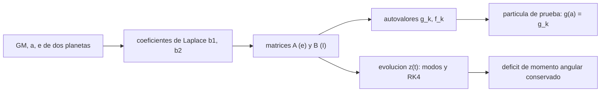

# B73-C11 — Resonancias seculares

<!-- nav:top -->
[🏠 Programa](../../../../README.md) · [📚 Bloque B73](../../../tronco-comun/B73-mecanica-celeste-resonancias-y-caos.md) · [← Anterior: B73-C10 — Resonancias de movimiento medio](../B73-C10-resonancias-de-movimiento-medio/CLASE.md) · [Siguiente: B73-C12 — Captura y escape resonante →](../B73-C12-captura-y-escape-resonante/CLASE.md)
<!-- /nav -->

## 1. Ubicación, nivel y alcance

Clase 11 del bloque B73. Nivel N3. Sigue a [B73-C10](../B73-C10-resonancias-de-movimiento-medio/CLASE.md): las resonancias de movimiento medio dependen de los periodos; las seculares dependen de las frecuencias de precesión del perihelio y del nodo. Aquí calculas la teoría secular lineal de Laplace–Lagrange para Júpiter y Saturno con coeficientes de Laplace obtenidos por integración numérica, verificas la matriz por simetría, por conservación del déficit de momento angular y por integración numérica, y hallas dónde una partícula de prueba entra en resonancia secular con el modo lento. Las masas y distancias son publicadas; las longitudes del perihelio iniciales son **sintéticas**.

## 2. Por qué esta clase existe

La excentricidad de una órbita varía durante millones de años por la atracción promediada de los demás planetas, y esa variación se vuelve violenta cuando una frecuencia propia coincide con la de precesión de un asteroide. La decisión central: **¿qué frecuencias propias tiene un sistema planetario y a qué distancia caen las resonancias seculares?**

## 3. Lo que podrás hacer al terminar

1. Escribir la forma matricial de la teoría secular lineal de dos planetas.
2. Calcular los coeficientes de Laplace `b_{3/2}^{(1)}` y `b_{3/2}^{(2)}` por integración numérica.
3. Obtener las frecuencias propias de excentricidad y de inclinación.
4. Verificar la matriz por simetría ponderada y por conservación del déficit de momento angular.
5. Evolucionar `e` con un integrador y con la solución por modos y compararlos.
6. Localizar la distancia donde la precesión de una partícula de prueba iguala una frecuencia propia.

La evidencia es la **ficha secular de un par Júpiter–Saturno** del ejercicio 12 (sección 20).

## 4. Con qué llegas y cómo comprobarlo

1. ¿Qué es la precesión del perihelio?
2. ¿Qué es un promedio secular?
3. ¿Qué es una matriz simétrica ponderada?
4. ¿Qué es una frecuencia propia?
5. ¿Qué es un déficit de momento angular?

<details>
<summary>Ver respuestas</summary>

1. El giro lento de la línea de ápsides de una órbita. 2. Promediar la perturbación sobre las órbitas para dejar solo los efectos lentos. 3. Una matriz `A` tal que `W A` es simétrica para una matriz diagonal `W`. 4. Un autovalor de la matriz que gobierna una evolución lineal. 5. La diferencia entre el momento angular de órbitas circulares coplanares y el real; se conserva en el modelo secular.
</details>

Con cuatro o cinco aciertos, sigue; si no, repasa los prerrequisitos.

## 5. Un caso de contexto y casos de referencia

Con `α = a_J/a_S = 0,54365`, `b₍₃/₂₎⁽¹⁾ = 3,16014` y `b₍₃/₂₎⁽²⁾ = 2,05982`, las frecuencias propias de excentricidad de Júpiter y Saturno son `g₁ = 21,765 "/año` (periodo `59 545` años) y `g₂ = 3,450 "/año` (`375 674` años); la de inclinación, `f₂ = -25,215 "/año`. Una partícula interior de prueba precesa a `26,1 "/año` en 2 UA y entra en resonancia con `g₁` en `a = 1,8314` UA. Es el **ejemplo conductor**. Las masas y distancias son publicadas; las longitudes de perihelio son **sintéticas**.

## 6. Vocabulario

La **teoría de Laplace–Lagrange** promedia la perturbación y la linealiza en `e` e `I`; para el vector `z_j = e_j exp(iϖ_j)`, `dz/dt = i A z`. Los **coeficientes de Laplace** son `b_s^{(j)}(α) = (1/π)∫₀^{2π} cos(jψ)(1 − 2α cos ψ + α²)^{−s} dψ`. Las **frecuencias propias** `g_k` son los autovalores de `A` y `f_k` los de `B` (inclinaciones; un modo es nulo). Una **resonancia secular** ocurre cuando la precesión de un cuerpo iguala una de estas frecuencias.

## 7. Modelo mental: dos péndulos acoplados muy despacio



*Descripción textual:* los datos dan los coeficientes de Laplace, éstos las matrices, y de ellas salen las frecuencias propias, la evolución de `e` y la posición de las resonancias seculares.

Analogía: dos péndulos unidos por un muelle muy blando intercambian energía lentamente: las frecuencias propias son los modos en que oscilan en conjunto. Límite: la teoría lineal de dos planetas no incluye a los demás planetas ni los términos de orden superior en `e` e `I`.

## 8. La explicación, paso a paso

### 8.1 Los coeficientes y la matriz

Con `α = 0,54365`, `b₍₃/₂₎⁽¹⁾ = 3,16014` y `b₍₃/₂₎⁽²⁾ = 2,05982` (integración trapezoidal periódica de 20 000 puntos), las matrices se arman con `m_J/M = 9,5460e-04`, `m_S/M = 2,8582e-04` y los movimientos medios `30,325 °/año` (Júpiter) y `12,155 °/año` (Saturno). `GM_S ≈ 3,7931e+07 km³/s²` se deduce de la masa de la ficha con `G` de CODATA 2018.

### 8.2 Frecuencias propias

| Modo | frecuencia ("/año) | periodo (años) |
|---|---|---|
| `g₁` (excentricidad) | 21,765 | 59 545 |
| `g₂` (excentricidad) | 3,450 | 375 674 |
| `f₂` (inclinación) | -25,215 (retrógrada) | — |
| `f₁` | 0 (plano invariable) | — |

### 8.3 Segunda vía: simetría, déficit y modos

(a) La matriz es simétrica con los pesos `m(1+m)√a`: `1,7e-16` en `A` y `2,2e-16` en `B`. (b) El déficit de momento angular `Σ m(1+m)√a e²` varía `2,2e-14` (relativo) en 200 000 años de integración RK4 (`dt = 10` años). (c) La solución por modos y la integración numérica coinciden a `1,5e-13`. Las tres comprobaciones son independientes de los datos.

### 8.4 Evolución de las excentricidades

Con las excentricidades de las fichas (`0,049` y `0,052`) y longitudes de perihelio **sintéticas** (0° y 90°), el modelo lineal da rangos de `e` de `0,0241` a `0,0580` (Júpiter) y de `0,0186` a `0,0848` (Saturno). Son resultados de un modelo lineal con condiciones sintéticas, no la historia de los planetas.

### 8.5 La resonancia secular de una partícula de prueba

La precesión de una partícula interior es `g(a) = (n/4) Σ_k (m_k/M) α_k² b₍₃/₂₎⁽¹⁾(α_k)` con `α_k = a/a_k`. Vale `14,8`, `26,1`, `44,1`, `75,4` y `137,8` "/año a 1,5, 2, 2,5, 3 y 3,5 UA. Se cruza con `g₁` en `a = 1,8314` UA (bisección) y `1,8314` UA (secante). Esta posición es la del modelo de dos planetas; la comparación con los valores de la literatura no se hizo (no consultados).

## 9. Magnitudes, símbolos y unidades

| Símbolo | Qué es | Unidad | Valor / nota |
|---|---|---|---|
| `α` | cociente de semiejes | — | 0,54365 |
| `b₍₃/₂₎⁽ʲ⁾` | coeficientes de Laplace | — | 3,160; 2,060 |
| `g_k` | frecuencia propia de `e` | "/año | 21,765; 3,450 |
| `f_k` | frecuencia propia de `I` | "/año | 0; -25,215 |
| `a` | semieje de la partícula de prueba | UA (149,6×10⁶ km) | 1,8314 en resonancia con `g₁` |

## 10. Convenciones y referencias

Teoría lineal de Laplace–Lagrange para dos planetas coplanares y la partícula de prueba interior. Distancias al Sol de la ficha de planetas (no son semiejes exactos). `1 UA = 149,6×10⁶ km` (redondeo de la misma ficha). Frecuencias en segundos de arco por año; `ϖ` y `Ω` medidos desde una dirección fija.

## 11. De dónde sale lo que afirmamos

| ID | Fuente | Localizador | Respalda | Estado |
|---|---|---|---|---|
| S1 | NASA/NSSDC, Sun Fact Sheet — https://nssdc.gsfc.nasa.gov/planetary/factsheet/sunfact.html (consultada 2026-11-10) | ficha leída; actualizada el 2024-05-09 | GM del Sol = 132 712 × 10⁶ km³/s² | Consultada |
| S2 | NASA/NSSDC, Jupiter Fact Sheet — https://nssdc.gsfc.nasa.gov/planetary/factsheet/jupiterfact.html (consultada 2026-11-10) | ficha leída; actualizada el 2024-10-02 | GM de Júpiter = 126,687×10⁶ km³/s² | Consultada |
| S3 | NASA/NSSDC, Saturn Fact Sheet — https://nssdc.gsfc.nasa.gov/planetary/factsheet/saturnfact.html (consultada 2026-11-10) | ficha leída; actualizada el 2025-03-18 | masa de Saturno 568,32×10²⁴ kg | Consultada |
| S4 | NASA/NSSDC, Planetary Fact Sheet (métrico) — https://nssdc.gsfc.nasa.gov/planetary/factsheet/ (consultada 2026-11-10) | tabla comparativa leída; actualizada el 2025-03-18 | distancias al Sol de Júpiter y Saturno (778,5 y 1432,0 ×10⁶ km); excentricidades 0,049 y 0,052 | Consultada |
| S5 | NASA JPL SSD, Planetary Physical Parameters — https://ssd.jpl.nasa.gov/planets/phys_par.html (consultada 2026-11-10) | tabla de masas y radios medios; registro de cambios 2019-12-12 (CODATA 2018) | G de CODATA 2018 citada en el registro de cambios (2019-12-12) | Consultada |
| — | Teoría secular de Laplace–Lagrange y coeficientes de Laplace (resultados clásicos) | — | las verifica el laboratorio con una segunda vía | No consultada en una fuente concreta |

Límites: las longitudes del perihelio son sintéticas; las distancias de las fichas están redondeadas; no se consultó la fuente de la teoría ni los valores publicados de las frecuencias seculares del sistema solar, por lo que no se compara con ellos.

## 12. Cómo ver las frecuencias seculares

| Magnitud | Valor |
|---|---|
| `g₁`, `g₂` | 21,765; 3,450 "/año |
| `f₂` | -25,215 "/año |
| simetría de `A` | 1,7e-16 |
| déficit de momento angular | 2,2e-14 |
| resonancia `g(a) = g₁` | 1,8314 UA |

Descripción larga: las dos frecuencias de excentricidad dan periodos de decenas y cientos de miles de años; la matriz pasa tres pruebas independientes; la resonancia de la partícula de prueba cae a algo menos de 2 UA.

## 13. Ejemplo trabajado: el periodo del modo rápido

**Paso 1 · Frecuencia.** `g₁ = 21,765 "/año`.

**Paso 2 · Vuelta completa.** `360° = 1 296 000"`.

**Paso 3 · Periodo.** `1 296 000/21,765 = 59 545` años.

**Paso 4 · Lectura.** El perihelio de los planetas gira una vez en unos 60 000 años según este modelo.

## 14. Distintas formas de describir la dinámica secular

**Por matrices:** `A` y `B`. **Por modos:** `g_k`, `f_k`. **Por conservación:** déficit de momento angular. **Por resonancia:** `g(a) = g_k`.

## 15. Práctica guiada

**Ejercicio 1 · con los pasos indicados.** Calcula `α`. *Pasos:* `778,5/1432,0`.

<details><summary>Solución comentada</summary>

`0,54365`.
</details>

**Ejercicio 2 · con una pista.** Pasa `g₁` a periodo. *Pista:* `1 296 000/g`.

<details><summary>Solución comentada</summary>

`59 545` años.
</details>

**Ejercicio 3 · casi autónomo.** ¿Por qué un modo de inclinación tiene frecuencia nula?

<details><summary>Solución comentada</summary>

Porque el plano invariable del sistema es fijo: no precesa.
</details>

## 16. Práctica autónoma, transferencia e integrador

**Ejercicio 4 · autónomo.** Periodo del modo lento `g₂` en años.

<details><summary>Solución comentada</summary>

`375 674`.
</details>

**Ejercicio 5 · autónomo.** ¿Qué signo tiene `f₂` y qué significa?

<details><summary>Solución comentada</summary>

Negativo: el nodo regresa (gira en sentido contrario al movimiento orbital).
</details>

**Ejercicio 6 · autónomo.** ¿A cuántas UA se cruza `g(a)` con `g₁`?

<details><summary>Solución comentada</summary>

`1,8314` UA.
</details>

**Ejercicio 7 · autónomo.** ¿Qué pasa con `g(a)` al alejar la partícula hacia Júpiter?

<details><summary>Solución comentada</summary>

Crece rápidamente (`137,8 "/año` a 3,5 UA).
</details>

**Ejercicio 8 · autónomo.** ¿Qué mide la conservación del déficit?

<details><summary>Solución comentada</summary>

Que la integración y la matriz son consistentes: `2,2e-14`.
</details>

**Ejercicio 9 · transferencia.** **Transferencia.** Un colega compara tu `g₁` con un valor publicado del sistema solar completo y ve diferencias. ¿Es un error de tu cálculo?

<details><summary>Solución comentada</summary>

No necesariamente: el modelo tiene dos planetas y teoría lineal; los demás planetas y los términos no lineales cambian las frecuencias; y los valores publicados no se consultaron aquí.
</details>

**Ejercicio 10 · transferencia.** **Transferencia.** Un asteroide de 1,83 UA, según este modelo, ¿qué vivirá?

<details><summary>Solución comentada</summary>

Una resonancia secular con `g₁`: la excentricidad puede crecer; es una ilustración del modelo, no una predicción de ningún objeto real.
</details>

**Ejercicio 11 · transferencia.** **Transferencia.** ¿Por qué la teoría secular no sirve en una resonancia de movimiento medio?

<details><summary>Solución comentada</summary>

Porque promedia sobre las órbitas y esa resonancia depende de la fase orbital, que se pierde al promediar.
</details>

**Ejercicio 12 · integrador.** **Integrador.** Elabora tu *ficha secular de un par Júpiter–Saturno*: coeficientes de Laplace, matrices, frecuencias, tres verificaciones, evolución de `e` con condiciones sintéticas rotuladas y la resonancia de la partícula de prueba.

<details><summary>Solución comentada</summary>

Secciones 8.1–8.5 y la salida del laboratorio.
</details>

## 17. Laboratorio: teoría secular de dos planetas

El script [seculares.py](seculares.py) calcula los coeficientes de Laplace, las matrices, las frecuencias propias, las verifica por simetría, conservación y RK4, y resuelve `g(a) = g₁` por dos métodos (**comprueba** simetría `< 10⁻¹²`, déficit `< 10⁻⁹`, modos–RK4 `< 10⁻⁶` y bisección–secante `< 10⁻⁶` UA).

**Datos:** `GM`, masa, distancias y excentricidades de las fichas NASA (consultadas); longitudes de perihelio **sintéticas**. **Predice antes de ejecutar:** ¿cuánto valdrá el periodo del modo rápido? (`≈ 6×10⁴` años.) **Ejecución del 2026-11-10 (Python 3.12.9):**

```text
Python 3.12.9 (biblioteca estandar)
alpha = a_J/a_S = 0.54365 ; b_(3/2)^(1) = 3.16014 ; b_(3/2)^(2) = 2.05982
GM_Saturno (deducido) = 3.7931e+07 km3/s2 ; m_J/M = 9.54601e-04 ; m_S/M = 2.85817e-04 ; n_J = 30.325 grados/ano ; n_S = 12.155 grados/ano
Simetria con pesos m(1+m) sqrt(a): A 1.7e-16 ; B 2.2e-16
Frecuencias propias de excentricidad: g1 = 21.765 "/ano (periodo 59,545 anos) ; g2 = 3.450 "/ano (periodo 375,674 anos)
Frecuencias propias de inclinacion: f1 = 0.000 "/ano ; f2 = -25.215 "/ano (el modo nulo es el plano invariable)
Deficit de momento angular (m(1+m) sqrt(a) e^2): variacion relativa maxima en 200 000 anos = 2.2e-14
Modos frente a RK4 en t = 200 000 anos: diferencia relativa = 1.5e-13
Rango de e (condiciones sinteticas, modelo lineal): Jupiter 0.0241-0.0580 ; Saturno 0.0186-0.0848
Precesion de una particula de prueba interior (Jupiter y Saturno, modelo lineal): a [UA] -> g ["/ano]
  1.5 -> 14.846
  2.0 -> 26.128
  2.5 -> 44.107
  3.0 -> 75.410
  3.5 -> 137.793
Resonancia g(a) = g1 = 21.765 "/ano: a = 1.8314 UA (biseccion) ; 1.8314 UA (secante) ; diferencia = 4.4e-16 UA
Pruebas superadas.
```

```bash
python programa/clases/B73/B73-C11-resonancias-seculares/seculares.py
```

**Límites:** teoría lineal de dos planetas; sin los otros planetas; coplanar; distancias redondeadas; no se compara con valores publicados.

## 18. Errores frecuentes y cómo corregirlos

**Confundir resonancia secular con resonancia de movimiento medio.** Se corrige con la última pregunta de transferencia.

**Olvidar los pesos en la simetría.** Se corrige con 8.3.

**Tomar el rango de `e` como la historia de los planetas.** Se corrige con 8.4.

**Usar un solo planeta en `g(a)`.** Se corrige con 8.5.

## 19. Cómo sabrás que vas bien

Tras la sección 8: ¿cuánto valía el periodo del modo rápido y qué esperabas? Si dudas, repasa el ejemplo 13. Tras el laboratorio: ¿qué comprueba? (ver la sección 17).

## 20. Qué entregas y cómo se evalúa

El producto es tu **ficha secular de un par Júpiter–Saturno** (ejercicio 12).

| Criterio | Inicial | En desarrollo | Logrado | Destacado |
|---|---|---|---|---|
| Conceptos | Los confunde | Parciales | Calcula frecuencias propias y las verifica | Explica los límites |
| Cálculo | Sin unidades | Con errores | Tablas completas con unidades | Calcula casos nuevos |
| Comprobación | Sin comprobar | Un caso | Contraste con una segunda vía | Interpreta las diferencias |
| Fuentes | Sin fuente | Sin fecha | Fuentes con fecha y estado | Declara lo sintético y lo no consultado |
| Límites | No los nombra | Uno | Tres | Discute qué falta del modelo |

**Condiciones críticas (no se compensan con promedio):** rotular las longitudes del perihelio como sintéticas; no comparar con valores no consultados; no presentar el rango de `e` como historia real.

## 21. Ética, seguridad y límites

Clase educativa: los modelos son simplificados y sus datos son publicados con fuente o sintéticos rotulados; ningún resultado describe una trayectoria real ni sirve para planificar una misión.  Accesibilidad: tablas equivalentes a las gráficas, fórmulas en texto, ejercicios sin conexión.

## 22. Para cerrar y seguir

Dos planetas dan frecuencias propias de `21,8` y `3,4 "/año`, una matriz que pasa tres pruebas independientes y una resonancia secular de prueba a `1,83` UA. Queda una pregunta: ¿cómo se queda un cuerpo en una resonancia?

**Glosario español–inglés.** teoría secular · *secular theory*; coeficiente de Laplace · *Laplace coefficient*; frecuencia propia · *eigenfrequency*; déficit de momento angular · *angular momentum deficit*; resonancia secular · *secular resonance*.

**Continuidad.** [B73-CC12](../B73-C12-captura-y-escape-resonante/CLASE.md) estudia la captura y el escape resonante.

**Referencias:** ver sección 11.

<!-- nav:bottom -->
---

[← Anterior: B73-C10 — Resonancias de movimiento medio](../B73-C10-resonancias-de-movimiento-medio/CLASE.md) · [📚 Bloque B73](../../../tronco-comun/B73-mecanica-celeste-resonancias-y-caos.md) · [Siguiente: B73-C12 — Captura y escape resonante →](../B73-C12-captura-y-escape-resonante/CLASE.md)
<!-- /nav -->
