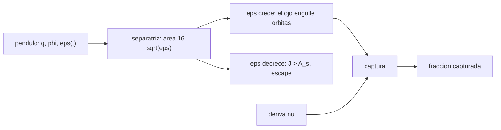

# B73-C12 — Captura y escape resonante

<!-- nav:top -->
[🏠 Programa](../../../../README.md) · [📚 Bloque B73](../../../tronco-comun/B73-mecanica-celeste-resonancias-y-caos.md) · [← Anterior: B73-C11 — Resonancias seculares](../B73-C11-resonancias-seculares/CLASE.md) · [Siguiente: B73-C13 — Caos determinista →](../B73-C13-caos-determinista/CLASE.md)
<!-- /nav -->

## 1. Ubicación, nivel y alcance

Clase 12 del bloque B73, que cierra el tramo de resonancias. Nivel N3. Sigue a [B73-C11](../B73-C11-resonancias-seculares/CLASE.md). Aquí estudias cómo una partícula entra y sale de una resonancia con el modelo del péndulo de intensidad variable: calculas el área de la separatriz, compruebas que el área encerrada por una órbita atrapada (el invariante adiabático) se conserva cuando la intensidad crece lentamente, predices en qué momento escapa una partícula cuando la intensidad decrece y mides la fracción capturada cuando además hay una deriva constante. **Todos los datos son sintéticos**: el modelo es adimensional y no representa ningún cuerpo concreto.

## 2. Por qué esta clase existe

Muchas resonancias observadas (satélites, planetas migrantes, asteroides) no son primordiales: los cuerpos entraron en ellas. Saber cuándo una captura es segura y cuándo es improbable, y cuándo un cuerpo atrapado debe escapar, evita explicaciones erróneas. La decisión central: **¿bajo qué condiciones una resonancia captura o suelta a un cuerpo?**

## 3. Lo que podrás hacer al terminar

1. Escribir el hamiltoniano del péndulo `H = q²/2 − ε cos φ` y su separatriz.
2. Verificar numéricamente que el área de la separatriz es `16 √ε`.
3. Comprobar la conservación del invariante adiabático al variar `ε` lentamente.
4. Predecir la intensidad de escape con `ε* = (J/16)²` y contrastarla con la simulación.
5. Medir la fracción de captura con una deriva constante `ν`.
6. Distinguir el papel de la tasa de cambio y de la deriva en la captura.

La evidencia es la **curva de captura frente a tasa (semilla fija)** del ejercicio 12 (sección 20).

## 4. Con qué llegas y cómo comprobarlo

1. ¿Qué es un péndulo en variables acción-ángulo?
2. ¿Qué es una separatriz?
3. ¿Qué es un invariante adiabático?
4. ¿Qué es la libración?
5. ¿Qué es una semilla fija?

<details>
<summary>Ver respuestas</summary>

1. Un sistema con libración (atrapado) y circulación, separados por una órbita especial. 2. La curva que separa las órbitas de libración de las de circulación. 3. Una cantidad (el área encerrada) que se conserva si los parámetros cambian muy despacio. 4. Una oscilación del ángulo resonante alrededor de un valor. 5. El valor inicial del generador aleatorio que hace repetible una simulación.
</details>

Con cuatro o cinco aciertos, sigue; si no, repasa los prerrequisitos.

## 5. Un caso de contexto y casos de referencia

En el péndulo con `ε = 0,04`, el área de la separatriz es `3,200000` (frente a `16√ε = 3,200000`). Una órbita atrapada con `J = 2,0079` debe escapar cuando `ε` baja a `0,01575`, y en la simulación lo hace a `0,01570` (`0,29%` de diferencia). Con una deriva `ν` creciente (`0`, `3×10⁻⁴`, `10⁻³`, `3×10⁻³`) la fracción capturada baja de `1,00` a `0,66`, `0,32` y `0,00`. Es el **ejemplo conductor**. **Todo es sintético.**

## 6. Vocabulario

El **modelo del péndulo** `φ' = q`, `q' = −ε sin φ` tiene energía `E = q²/2 − ε cos φ`; la **separatriz** es `E = ε`. El **área de la separatriz** es `A_s = 16 √ε`. El **invariante adiabático** de una órbita atrapada es el área `J` que encierra en el plano `(φ, q)`. Una **captura** es el paso de la circulación a la libración; un **escape**, el contrario. Una **deriva** `ν` es un par constante: `q' = −ε sin φ − ν`.

## 7. Modelo mental: un columpio cuya cuerda crece o se acorta



*Descripción textual:* la intensidad `ε(t)` hace crecer o decrecer el área de la separatriz; si crece, engulle órbitas (captura); si decrece por debajo de `J`, la partícula escapa; la deriva `ν` reduce la fracción capturada.

Analogía: un columpio con una cuerda que se alarga o acorta: mientras el cambio sea lento, el área que recorre se conserva; si la cuerda se acorta demasiado, el columpio sale del círculo. Límite: el modelo es de un solo grado de libertad y sin disipación.

## 8. La explicación, paso a paso

### 8.1 El péndulo y su separatriz

Con `ε` constante, la energía se conserva; las órbitas atrapadas cumplen `E < ε` y la separatriz `E = ε` tiene `q_s = 2√ε cos(φ/2)`. El área que encierra es `A_s = 16 √ε`. La cuadratura numérica da `3,20000000` para `ε = 0,04`, frente a `3,20000000` teórico: diferencia `3,3e-09`.

### 8.2 Invariante adiabático

Se hace crecer `ε` de `0,01` a `0,04` durante `T = 1000`, `4000` y `16000`; `J` se calcula con la integral `∮ q dφ` a la energía instantánea (promediada sobre un ciclo). Los cambios relativos de `J` son `4,7e-04`, `6,5e-05` y `2,5e-04`: pequeños (< 0,2 %) mientras que la energía cambia de `−0,0054` a `−0,0307`, es decir, `J` se conserva y la energía no. El error no es monótono en `T` porque depende de la fase del ciclo en que se mide.

### 8.3 Escape cuando `ε` baja

Una órbita atrapada con `φ₀ = 2,0` y `ε₀ = 0,04` tiene `J = 2,00789`. La separatriz encoge hasta igualar ese área cuando `16√ε = J`, es decir `ε* = (J/16)² = 0,01575`. La simulación (`ε` baja de `0,04` a `0,0005` en `T = 20 000`) cruza la separatriz con `ε = 0,01570`, diferencia relativa `0,29%`.

### 8.4 Captura con deriva

Con `ε` creciente de `0,001` a `0,04` en `T_c = 3000`, `100` partículas circulantes con `q₀ = +0,20` y fases iniciales aleatorias (semilla 73), la fracción capturada es:

| `ν` | fracción capturada |
|---|---|
| 0 | 1,00 |
| 3×10⁻⁴ | 0,66 |
| 10⁻³ | 0,32 |
| 3×10⁻³ | 0,00 |

Sin deriva, el ojo en expansión engulle todas las partículas; con deriva, la captura se vuelve probabilística y decrece al aumentar `ν`. Con `ν = 3×10⁻³` ninguna se captura.

### 8.5 Qué no es este modelo

No hay disipación, ni masas, ni otros cuerpos; `ν` es un par constante, no una migración física. El objetivo es la lógica de captura y escape; no se calculan probabilidades para un sistema real ni se compara con teoría analítica de la probabilidad de captura (no consultada).

## 9. Magnitudes, símbolos y unidades

| Símbolo | Qué es | Unidad | Valor / nota |
|---|---|---|---|
| `ε` | intensidad de la resonancia | adimensional | 0,001 a 0,04 |
| `φ, q` | ángulo resonante y su tasa | rad; rad/t | — |
| `J` | área encerrada (invariante) | rad²/t | 2,0079 (caso c) |
| `A_s` | área de la separatriz | rad²/t | `16√ε` |
| `ν` | deriva constante | rad/t² | 0 a 3×10⁻³ |

## 10. Convenciones y referencias

Modelo adimensional con `φ' = q`, `q' = −ε(t) sin φ − ν`. Leapfrog kick–drift–kick con `dt = 0,5`. Captura = rango de `φ` sin envolver menor que `2π` en los últimos 400 tiempos. Semilla 73 para las fases iniciales. Sin datos físicos.

## 11. De dónde sale lo que afirmamos

| ID | Fuente | Localizador | Respalda | Estado |
|---|---|---|---|---|
| — | Modelo del péndulo para resonancias, invariante adiabático y captura (teoría clásica de resonancias) | — | las verifica el laboratorio con cuadratura, conservación del área y simulación | No consultada en una fuente concreta |
| — | Fórmulas analíticas de probabilidad de captura (no usadas) | — | no se compara con ellas | No consultada en una fuente concreta |

Límites: no se consultó ninguna fuente externa; todos los números provienen del propio modelo; no hay datos publicados ni comparación con teoría analítica de la captura.

## 12. Cómo ver la captura y el escape

| Magnitud | Valor |
|---|---|
| área de la separatriz | 3,200000 = 3,200000 |
| cambio máximo de `J` | 4,7e-04 |
| `ε*` predicho y simulado | 0,01575 y 0,01570 |
| captura sin deriva | 1,00 |
| captura con `ν = 10⁻³` | 0,32 |

Descripción larga: el área de la separatriz coincide con la fórmula, `J` se conserva, el escape ocurre donde se predice y la captura baja al crecer la deriva.

## 13. Ejemplo trabajado: predecir el escape

**Paso 1 · Área.** Una órbita atrapada con `φ₀ = 2,0` y `ε = 0,04` encierra `J = 2,0079`.

**Paso 2 · Condición.** Escapará cuando `16√ε = J`.

**Paso 3 · Cálculo.** `ε* = (2,0079/16)² = 0,01575`.

**Paso 4 · Contraste.** La simulación da `0,01570`.

## 14. Distintas formas de describir una resonancia

**Por energía:** `E < ε` es libración. **Por área:** `J` frente a `A_s`. **Por fase:** el rango de `φ`. **Por probabilidad:** fracción capturada.

## 15. Práctica guiada

**Ejercicio 1 · con los pasos indicados.** Calcula `A_s` para `ε = 0,04`. *Pasos:* `16√0,04`.

<details><summary>Solución comentada</summary>

`16 × 0,2 = 3,2`.
</details>

**Ejercicio 2 · con una pista.** Calcula `ε*` para una órbita con `J = 1,6`. *Pista:* `(J/16)²`.

<details><summary>Solución comentada</summary>

`(0,1)² = 0,01`.
</details>

**Ejercicio 3 · casi autónomo.** ¿Por qué `J` se conserva pero `E` no?

<details><summary>Solución comentada</summary>

Porque `J` es el invariante adiabático: solo cambia si `ε` varía rápido; `E` cambia con `ε(t)`.
</details>

## 16. Práctica autónoma, transferencia e integrador

**Ejercicio 4 · autónomo.** `A_s` para `ε = 0,01`.

<details><summary>Solución comentada</summary>

`16 × 0,1 = 1,6`.
</details>

**Ejercicio 5 · autónomo.** Cambio de `J` con `T = 16000`.

<details><summary>Solución comentada</summary>

`2,5e-04`.
</details>

**Ejercicio 6 · autónomo.** Diferencia relativa entre `ε*` simulado y teórico.

<details><summary>Solución comentada</summary>

`0,29%`.
</details>

**Ejercicio 7 · autónomo.** Fracción capturada con `ν = 3×10⁻⁴`.

<details><summary>Solución comentada</summary>

`0,66`.
</details>

**Ejercicio 8 · autónomo.** ¿Por qué la captura baja al aumentar `ν`?

<details><summary>Solución comentada</summary>

Porque un par mayor arrastra las partículas fuera del pozo antes de que el ojo las engulla.
</details>

**Ejercicio 9 · transferencia.** **Transferencia.** Un colega afirma que un satélite en resonancia «siempre estuvo allí». ¿Qué le dices desde este modelo?

<details><summary>Solución comentada</summary>

Que una resonancia puede adquirirse por captura cuando una intensidad crece o hay una deriva lenta, y perderse si el área de la separatriz decrece; no se sigue que fuera primordial.
</details>

**Ejercicio 10 · transferencia.** **Transferencia.** En un caso real la deriva es mayor que la intensidad. ¿Qué predice el modelo?

<details><summary>Solución comentada</summary>

Que la captura es improbable (`ν = 3×10⁻³` da `0,0`).
</details>

**Ejercicio 11 · transferencia.** **Transferencia.** ¿Por qué este laboratorio no permite estimar la probabilidad de captura de un planeta real?

<details><summary>Solución comentada</summary>

Porque todos los datos son sintéticos, no hay disipación ni masas físicas y no se comparó con teoría de captura.
</details>

**Ejercicio 12 · integrador.** **Integrador.** Elabora tu *curva de captura frente a tasa (semilla fija)*: tabla de `ν` frente a fracción capturada, área de la separatriz, invariancia de `J`, escape predicho y simulado, y límites del modelo.

<details><summary>Solución comentada</summary>

Secciones 8.1–8.5 y la salida del laboratorio.
</details>

## 17. Laboratorio: péndulo con intensidad variable

El script [captura_resonante.py](captura_resonante.py) calcula el área de la separatriz, la invariancia de `J`, el escape y la fracción capturada con deriva (**comprueba** área `< 10⁻⁶`, `J` `< 0,2 %`, `ε*` dentro del 5 % y captura decreciente con `ν`).

**Datos:** **todos sintéticos**, adimensionales, semilla 73. **Predice antes de ejecutar:** ¿cuánto valdrá la captura sin deriva? (`1,00`.) **Ejecución del 2026-11-10 (Python 3.12.9):**

```text
Python 3.12.9 (biblioteca estandar)
(a) Area de la separatriz para eps = 0.04: cuadratura = 3.20000000 ; 16 sqrt(eps) = 3.20000000 ; diferencia = 3.3e-09
(b) Invariante adiabatico: eps crece de 0.01 a 0.04 durante T; J(t=0) frente a J(t=T):
    T =   1000: J0 = 0.29795 ; J(T) = 0.29781 ; |dJ/J| = 4.65e-04 ; E0 = -0.00540 -> E = -0.03066
    T =   4000: J0 = 0.29795 ; J(T) = 0.29793 ; |dJ/J| = 6.53e-05 ; E0 = -0.00540 -> E = -0.03066
    T =  16000: J0 = 0.29795 ; J(T) = 0.29788 ; |dJ/J| = 2.46e-04 ; E0 = -0.00540 -> E = -0.03066
(c) Escape: J0 = 2.00789 -> eps* = (J/16)^2 = 0.01575 ; eps simulado al cruzar la separatriz = 0.01570 ; diferencia relativa = 0.29%
(d) Captura con deriva: 100 particulas circulantes (q0 = +0.20, phi0 uniforme, semilla 73); eps crece de 0.001 a 0.04 en T_c = 3000; q' = -eps sin(phi) - nu:
    nu          capturadas (rango de phi en los ultimos 400 < 2 pi)
     0.0e+00     1.00
     3.0e-04     0.66
     1.0e-03     0.32
     3.0e-03     0.00
Pruebas superadas.
```

```bash
python programa/clases/B73/B73-C12-captura-y-escape-resonante/captura_resonante.py
```

**Límites:** un grado de libertad, sin disipación, deriva constante, 100 partículas por caso, sin comparación analítica de la probabilidad.

## 18. Errores frecuentes y cómo corregirlos

**Presentar el modelo como un sistema real.** Se corrige con la sección 21.

**Esperar captura con deriva grande.** Se corrige con 8.4.

**Usar la energía como invariante.** Se corrige con 8.2.

**Dar el 66 % como probabilidad física.** Se corrige con 8.5: es una fracción de un conjunto sintético.

## 19. Cómo sabrás que vas bien

Tras la sección 8: ¿qué fracción se capturó sin deriva y qué esperabas? Si dudas, repasa el ejemplo 13. Tras el laboratorio: ¿qué comprueba? (ver la sección 17).

## 20. Qué entregas y cómo se evalúa

El producto es tu **curva de captura frente a tasa (semilla fija)** (ejercicio 12).

| Criterio | Inicial | En desarrollo | Logrado | Destacado |
|---|---|---|---|---|
| Conceptos | Los confunde | Parciales | Explica captura y escape con el área | Explica los límites |
| Cálculo | Sin unidades | Con errores | Tablas completas con unidades | Calcula casos nuevos |
| Comprobación | Sin comprobar | Un caso | Contraste con una segunda vía | Interpreta las diferencias |
| Fuentes | Sin fuente | Sin fecha | Fuentes con fecha y estado | Declara lo sintético y lo no consultado |
| Límites | No los nombra | Uno | Tres | Discute qué falta del modelo |

**Condiciones críticas (no se compensan con promedio):** rotular todo como sintético; no presentar fracciones del modelo como probabilidades físicas; declarar que no hay fuentes consultadas.

## 21. Ética, seguridad y límites

Clase educativa: los modelos son simplificados y sus datos son publicados con fuente o sintéticos rotulados; ningún resultado describe una trayectoria real ni sirve para planificar una misión.  Accesibilidad: tablas equivalentes a las gráficas, fórmulas en texto, ejercicios sin conexión.

## 22. Para cerrar y seguir

El área de la separatriz `16√ε`, el invariante `J` y la predicción de escape (`0,3%`) explican la captura y el escape; la deriva baja la fracción capturada de `1,00` a `0,00`. Queda una pregunta: ¿cuándo la dinámica deja de ser predecible?

**Glosario español–inglés.** captura resonante · *resonance capture*; escape resonante · *resonance escape*; separatriz · *separatrix*; invariante adiabático · *adiabatic invariant*; libración · *libration*.

**Continuidad.** [B73-CC13](../B73-C13-caos-determinista/CLASE.md) introduce el caos determinista.

**Referencias:** ver sección 11.

<!-- nav:bottom -->
---

[← Anterior: B73-C11 — Resonancias seculares](../B73-C11-resonancias-seculares/CLASE.md) · [📚 Bloque B73](../../../tronco-comun/B73-mecanica-celeste-resonancias-y-caos.md) · [Siguiente: B73-C13 — Caos determinista →](../B73-C13-caos-determinista/CLASE.md)
<!-- /nav -->
