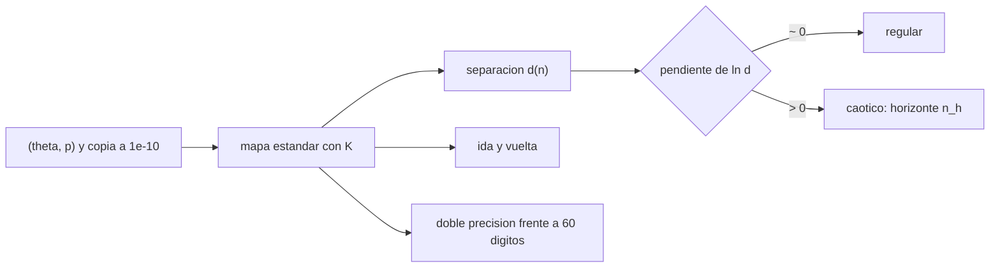

# B73-C13 — Caos determinista

<!-- nav:top -->
[🏠 Programa](../../../../README.md) · [📚 Bloque B73](../../../tronco-comun/B73-mecanica-celeste-resonancias-y-caos.md) · [← Anterior: B73-C12 — Captura y escape resonante](../B73-C12-captura-y-escape-resonante/CLASE.md) · [Siguiente: B73-C14 — Exponentes de Lyapunov →](../B73-C14-exponentes-de-lyapunov/CLASE.md)
<!-- /nav -->

## 1. Ubicación, nivel y alcance

Clase 13 del bloque B73, que abre el tramo del caos. Nivel N3. Sigue a [B73-C12](../B73-C12-captura-y-escape-resonante/CLASE.md). Aquí usas el mapa estándar de Chirikov, el modelo más simple de una dinámica que mezcla órbitas regulares y caóticas, para ver qué significa «sensibilidad a las condiciones iniciales»: dos trayectorias que parten a `10⁻¹⁰`, un horizonte de predicción, la pérdida de reversibilidad numérica y la diferencia entre doble precisión y aritmética de 60 dígitos. **Todos los datos son sintéticos**.

## 2. Por qué esta clase existe

Un sistema determinista puede ser impredecible a largo plazo: el error de medida se amplifica exponencialmente y fija un horizonte más allá del cual la predicción no vale, por más cómputo que se use. La decisión central: **¿hasta cuándo puedo confiar en una integración y cómo reconozco el régimen caótico?**

## 3. Lo que podrás hacer al terminar

1. Iterar el mapa estándar en un régimen regular y en uno caótico.
2. Medir la separación de dos trayectorias vecinas frente al número de iteraciones.
3. Estimar la pendiente de `ln d` frente a `n` y el horizonte de predicción.
4. Comprobar que la reversibilidad exacta se pierde numéricamente en el caos.
5. Contrastar doble precisión con aritmética de 60 dígitos.
6. Explicar por qué el determinismo no implica predecibilidad.

La evidencia es la **ficha de dos regímenes (regular y caótico)** del ejercicio 12 (sección 20).

## 4. Con qué llegas y cómo comprobarlo

1. ¿Qué es un mapa discreto?
2. ¿Qué es la sensibilidad a condiciones iniciales?
3. ¿Qué es una función módulo `2π`?
4. ¿Qué es la precisión de máquina?
5. ¿Qué es un dato sintético?

<details>
<summary>Ver respuestas</summary>

1. Una regla que lleva el estado en la iteración `n` al de la `n+1`. 2. Que trayectorias vecinas se separan rápidamente. 3. La que reduce un ángulo al intervalo `[0, 2π)`. 4. El menor cambio relativo (`≈ 10⁻¹⁶`) que distingue la aritmética de doble precisión. 5. Uno propuesto para el ejemplo, no medido.
</details>

Con cuatro o cinco aciertos, sigue; si no, repasa los prerrequisitos.

## 5. Un caso de contexto y casos de referencia

Con el mapa estándar, dos trayectorias que parten a `10⁻¹⁰` terminan separadas `5,20e-02` a las 20 iteraciones si `K = 5` y solo `2,9e-08` a las 40 si `K = 0,5`. La pendiente de `ln d` es `1,022` frente a `-0,030`; el horizonte para ir de `10⁻¹⁰` a `10⁻²` es de `18,0` iteraciones estimadas y `18` medidas. Es el **ejemplo conductor**. **Todos los datos son sintéticos.**

## 6. Vocabulario

El **mapa estándar** es `p' = p + K sen θ`, `θ' = θ + p'` (módulo `2π`). `K` mide la intensidad del «golpe». Un **régimen regular** (`K` pequeño) tiene curvas invariantes que acotan las trayectorias; en el **caótico** (`K` grande) las trayectorias llenan una región. El **horizonte de predicción** es el tiempo en que un error inicial `δ₀` alcanza una tolerancia `δ_f`: `n_h = ln(δ_f/δ₀)/λ`. La **reversibilidad** es poder volver al inicio con el mapa inverso.

## 7. Modelo mental: un pinball de golpes periódicos



*Descripción textual:* se itera el mapa con dos condiciones vecinas; la pendiente de `ln d` distingue lo regular de lo caótico y fija un horizonte; además se pone a prueba la reversibilidad y la precisión aritmética.

Analogía: un pinball: con golpes suaves la bola recorre una trayectoria previsible; con golpes fuertes, una diferencia mínima en el lanzamiento cambia por completo adónde llega la bola tras pocos rebotes. Límite: el pinball real tiene fricción; el mapa es conservativo.

## 8. La explicación, paso a paso

### 8.1 Los dos regímenes

Las trayectorias que parten a `10⁻¹⁰` en `θ` se separan así:

| `n` | `d` (`K = 0,5`) | `d` (`K = 5`) |
|---|---|---|
| 0 | 1,000×10⁻¹⁰ | 1,000×10⁻¹⁰ |
| 10 | 2,593×10⁻⁹ | 8,772×10⁻⁶ |
| 20 | 1,551×10⁻⁹ | 5,196e-02 |
| 30 | 3,577×10⁻⁹ | 1,842e+00 |
| 60 | 1,083×10⁻⁸ | 3,300 |

En el caso regular la separación oscila en torno a `10⁻⁹–10⁻⁸` sin crecer exponencialmente; en el caótico crece un factor `e^{1,02}` por iteración hasta saturar en el tamaño del espacio de fases.

### 8.2 Pendiente y horizonte

La pendiente de `ln d` entre `n = 0` y `20` en el caso caótico es `1,022`; en el regular, entre `n = 10` y `60`, `-0,030`. Con la pendiente caótica, pasar de `10⁻¹⁰` a `10⁻²` requiere `n_h = ln(10⁸)/1,022 = 18,0` iteraciones; la integración da `18`. Es solo un ajuste; el exponente de Lyapunov se calcula con rigor en [B73-C14](../B73-C14-exponentes-de-lyapunov/CLASE.md).

### 8.3 Reversibilidad numérica

El mapa tiene inverso exacto. Tras 60 iteraciones adelante y 60 atrás, el error de ida y vuelta es `2,6e-13` con `K = 0,5` y `3,69` con `K = 5`: en el caos el redondeo de `10⁻¹⁶` se amplifica hasta el tamaño del espacio y la trayectoria no vuelve.

### 8.4 Segunda vía: doble precisión frente a 60 dígitos

La misma condición inicial iterada con aritmética decimal de 60 dígitos (con el seno por serie de Taylor): con `K = 0,5` la separación a `n = 200` es `3,3e-10` y nunca supera `10⁻³`; con `K = 5` supera `10⁻³` en la iteración `27` y vale `1,65` a `n = 200`. La trayectoria de doble precisión en el caso caótico es válida solo unas decenas de iteraciones; la «verdad» de largo plazo solo se alcanza con más dígitos.

### 8.5 Qué significa determinista pero impredecible

Cada trayectoria está completamente determinada por su condición inicial, pero el error inicial y el de redondeo crecen exponencialmente. Un mayor poder de cómputo solo suma unos pasos al horizonte: cada dígito adicional añade `ln 10/λ ≈ 2,3` iteraciones (con `λ ≈ 1`).

## 9. Magnitudes, símbolos y unidades

| Símbolo | Qué es | Unidad | Valor / nota |
|---|---|---|---|
| `K` | intensidad del golpe | — | 0,5 y 5 |
| `θ, p` | ángulo y momento (módulo `2π`) | rad | (1,0; 0,5) inicial |
| `d` | distancia en el toro | rad | ver 8.1 |
| `pendiente` | d(ln d)/dn | 1/iteración | 1,022 (caótico) |
| `n_h` | horizonte de predicción | iteraciones | 18,0 |

## 10. Convenciones y referencias

Mapa estándar sobre el toro `[0, 2π)²`; la distancia usa el camino más corto en cada eje. Aritmética de doble precisión (IEEE 754) y `decimal` de 60 dígitos con `π` a 60 decimales y seno por serie de Taylor. Condición inicial `(θ, p) = (1,0; 0,5)`; la copia, desplazada `10⁻¹⁰` en `θ`.

## 11. De dónde sale lo que afirmamos

| ID | Fuente | Localizador | Respalda | Estado |
|---|---|---|---|---|
| — | Mapa estándar de Chirikov, sensibilidad a condiciones iniciales y horizonte de predicción (resultados clásicos) | — | las verifica el laboratorio con separación, inverso exacto y aritmética de 60 dígitos | No consultada en una fuente concreta |
| — | Teoría KAM (curvas invariantes en el régimen regular) (no usada) | — | no se compara con ella | No consultada en una fuente concreta |

Límites: no se consultó ninguna fuente externa; no hay datos publicados; los valores de `K` y las condiciones iniciales son sintéticos.

## 12. Cómo ver el caos

| Magnitud | Valor |
|---|---|
| pendiente regular y caótica | -0,030 y 1,022 |
| horizonte estimado y medido | 18,0 y 18 |
| ida y vuelta (regular y caótico) | 2,6e-13 y 3,69 |
| doble precisión se separa en | iteración 27 (`K = 5`) |
| separación a 200 con `K = 0,5` | 3,3e-10 |

Descripción larga: el régimen regular mantiene la separación pequeña y la reversibilidad; el caótico la amplifica `e^{1,02 n}` y pierde la reversibilidad numérica.

## 13. Ejemplo trabajado: cuántos dígitos hacen falta

**Paso 1 · Tolerancia.** Se quiere conocer la trayectoria con `10⁻²` tras `100` iteraciones.

**Paso 2 · Error inicial.** Con pendiente `1,02`, el error crece `e^{1,02 × 100} ≈ 10^{44}`.

**Paso 3 · Dígitos.** Se necesita un error inicial `10⁻²/10^{44} = 10^{-46}`.

**Paso 4 · Lectura.** La doble precisión (`10⁻¹⁶`) no alcanza; hacen falta unos 46 dígitos.

## 14. Distintas formas de describir un régimen dinámico

**Por separación:** `d(n)`. **Por pendiente:** regular o caótico. **Por reversibilidad:** ida y vuelta. **Por horizonte:** `n_h`. **Por precisión:** doble o 60 dígitos.

## 15. Práctica guiada

**Ejercicio 1 · con los pasos indicados.** Calcula el horizonte para pasar de `10⁻¹⁰` a `10⁻²` con pendiente 1. *Pasos:* `ln(10⁸)`.

<details><summary>Solución comentada</summary>

`18,4` iteraciones.
</details>

**Ejercicio 2 · con una pista.** ¿Y si el error inicial fuera `10⁻¹⁶`? *Pista:* `ln(10¹⁴)`.

<details><summary>Solución comentada</summary>

`32,2` iteraciones.
</details>

**Ejercicio 3 · casi autónomo.** ¿Qué indica una pendiente de `ln d` cercana a cero?

<details><summary>Solución comentada</summary>

Un régimen regular: la separación no crece exponencialmente.
</details>

## 16. Práctica autónoma, transferencia e integrador

**Ejercicio 4 · autónomo.** Separación a las 20 iteraciones con `K = 5`.

<details><summary>Solución comentada</summary>

`5,20e-02`.
</details>

**Ejercicio 5 · autónomo.** Horizonte medido.

<details><summary>Solución comentada</summary>

`18` iteraciones.
</details>

**Ejercicio 6 · autónomo.** Error de ida y vuelta con `K = 0,5`.

<details><summary>Solución comentada</summary>

`2,6e-13`.
</details>

**Ejercicio 7 · autónomo.** Iteración en que doble precisión y 60 dígitos se separan más de `10⁻³` con `K = 5`.

<details><summary>Solución comentada</summary>

La `27`.
</details>

**Ejercicio 8 · autónomo.** ¿Cuántos dígitos añade cada iteración de horizonte?

<details><summary>Solución comentada</summary>

Cada dígito adicional suma `ln 10/λ ≈ 2,3` iteraciones con `λ ≈ 1`.
</details>

**Ejercicio 9 · transferencia.** **Transferencia.** Un colega dice que, con un ordenador más potente, se puede predecir el sistema caótico a cualquier plazo. ¿Es cierto?

<details><summary>Solución comentada</summary>

No: el horizonte crece solo logarítmicamente con los dígitos (≈ 2,3 iteraciones por dígito).
</details>

**Ejercicio 10 · transferencia.** **Transferencia.** Alguien interpreta la reversibilidad como prueba de que el integrador es correcto. ¿Qué le dices?

<details><summary>Solución comentada</summary>

Que en el régimen caótico la reversibilidad falla incluso con un mapa exacto, por el redondeo; en el regular se cumple a `10⁻¹³`.
</details>

**Ejercicio 11 · transferencia.** **Transferencia.** ¿Por qué la separación de `K = 0,5` oscila en lugar de crecer?

<details><summary>Solución comentada</summary>

Porque las curvas invariantes acotan las trayectorias y la separación crece a lo sumo linealmente.
</details>

**Ejercicio 12 · integrador.** **Integrador.** Elabora tu *ficha de dos regímenes (regular y caótico)*: tabla de separaciones, pendientes, horizonte estimado y medido, reversibilidad, doble precisión frente a 60 dígitos y qué implica para predecir.

<details><summary>Solución comentada</summary>

Secciones 8.1–8.5 y la salida del laboratorio.
</details>

## 17. Laboratorio: mapa estándar: regular y caótico

El script [caos_determinista.py](caos_determinista.py) itera dos trayectorias vecinas, mide separaciones, pendientes, reversibilidad y compara doble precisión con 60 dígitos (**comprueba** pendiente regular `< 0,1`, caótica `> 0,5`, horizonte medido dentro del 30 % del estimado).

**Datos:** **todos sintéticos**: `K = 0,5` y `5`, condición inicial `(1,0; 0,5)`, desplazamiento `10⁻¹⁰`. **Predice antes de ejecutar:** ¿cuántas iteraciones tardan en separarse `10⁻²` con `K = 5`? (`≈ 18`.) **Ejecución del 2026-11-10 (Python 3.12.9):**

```text
Python 3.12.9 (biblioteca estandar) ; decimal de 60 digitos
(a)-(b) Separacion de dos trayectorias que parten a 1e-10 en theta (datos sinteticos):
   n      d(K=0.5)      d(K=5)
   0   1.000e-10   1.000e-10
   5   7.941e-11   3.435e-08
  10   2.593e-09   8.772e-06
  15   2.081e-08   6.702e-04
  20   1.551e-09   5.196e-02
  25   2.113e-08   1.554e+00
  30   3.577e-09   1.842e+00
  40   2.916e-08   2.449e+00
  60   1.083e-08   3.300e+00
Pendiente de ln(d) frente a n: regular (n 10-60) = -0.030 ; caotico (n 0-20) = 1.022
Horizonte para pasar de 1e-10 a 1e-2 (caotico): estimado = 18.0 iteraciones ; medido = 18
(c) Reversibilidad: n iteraciones adelante y n atras (mapa inverso exacto):
   K = 0.5: error de ida y vuelta tras 60 pasos = 2.62e-13
   K = 5.0: error de ida y vuelta tras 60 pasos = 3.69e+00
(d) Doble precision frente a aritmetica de 60 digitos (misma condicion inicial):
   K = 0.5: separacion mayor que 1e-3 en la iteracion > 200 ; separacion a n = 200: 3.26e-10
   K = 5.0: separacion mayor que 1e-3 en la iteracion 27 ; separacion a n = 200: 1.65e+00
Pruebas superadas.
```

```bash
python programa/clases/B73/B73-C13-caos-determinista/caos_determinista.py
```

**Límites:** un solo punto inicial por régimen; ajuste de pendiente sobre pocas iteraciones; sin datos reales.

## 18. Errores frecuentes y cómo corregirlos

**Creer que determinista significa predecible.** Se corrige con 8.5.

**Medir la separación sin el camino más corto en el toro.** Se corrige con la sección 10.

**Creer que más cómputo elimina el horizonte.** Se corrige con el ejemplo 13.

**Tomar el ajuste de pendiente por un exponente de Lyapunov.** Se corrige en la clase siguiente.

## 19. Cómo sabrás que vas bien

Tras la sección 8: ¿qué horizonte esperabas y cuál mediste? Si dudas, repasa el ejemplo 13. Tras el laboratorio: ¿qué comprueba? (ver la sección 17).

## 20. Qué entregas y cómo se evalúa

El producto es tu **ficha de dos regímenes (regular y caótico)** (ejercicio 12).

| Criterio | Inicial | En desarrollo | Logrado | Destacado |
|---|---|---|---|---|
| Conceptos | Los confunde | Parciales | Distingue régimen regular y caótico con datos | Explica los límites |
| Cálculo | Sin unidades | Con errores | Tablas completas con unidades | Calcula casos nuevos |
| Comprobación | Sin comprobar | Un caso | Contraste con una segunda vía | Interpreta las diferencias |
| Fuentes | Sin fuente | Sin fecha | Fuentes con fecha y estado | Declara lo sintético y lo no consultado |
| Límites | No los nombra | Uno | Tres | Discute qué falta del modelo |

**Condiciones críticas (no se compensan con promedio):** rotular todo como sintético; no presentar el mapa como un sistema astronómico; declarar que no hay fuentes externas.

## 21. Ética, seguridad y límites

Clase educativa: los modelos son simplificados y sus datos son publicados con fuente o sintéticos rotulados; ningún resultado describe una trayectoria real ni sirve para planificar una misión.  Accesibilidad: tablas equivalentes a las gráficas, fórmulas en texto, ejercicios sin conexión.

## 22. Para cerrar y seguir

Con `K = 5` el error de `10⁻¹⁰` llega a `10⁻²` en `18` iteraciones y la ida y vuelta falla (`3,7`), mientras que con `K = 0,5` la separación queda en `10⁻⁸` y la ida y vuelta cierra a `3e-13`. Queda una pregunta: ¿cómo se mide con rigor la tasa de separación?

**Glosario español–inglés.** caos determinista · *deterministic chaos*; mapa estándar · *standard map*; sensibilidad a condiciones iniciales · *sensitive dependence on initial conditions*; horizonte de predicción · *prediction horizon*; reversibilidad · *reversibility*.

**Continuidad.** [B73-CC14](../B73-C14-exponentes-de-lyapunov/CLASE.md) mide la tasa de separación con exponentes de Lyapunov.

**Referencias:** ver sección 11.

<!-- nav:bottom -->
---

[← Anterior: B73-C12 — Captura y escape resonante](../B73-C12-captura-y-escape-resonante/CLASE.md) · [📚 Bloque B73](../../../tronco-comun/B73-mecanica-celeste-resonancias-y-caos.md) · [Siguiente: B73-C14 — Exponentes de Lyapunov →](../B73-C14-exponentes-de-lyapunov/CLASE.md)
<!-- /nav -->
