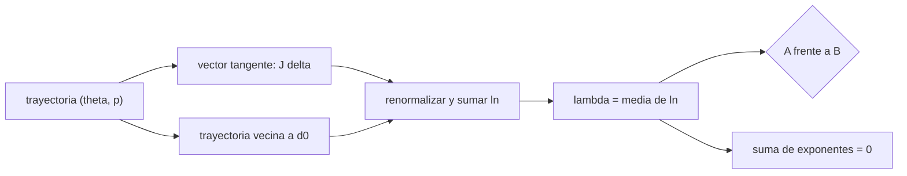

# B73-C14 — Exponentes de Lyapunov

<!-- nav:top -->
[🏠 Programa](../../../../README.md) · [📚 Bloque B73](../../../tronco-comun/B73-mecanica-celeste-resonancias-y-caos.md) · [← Anterior: B73-C13 — Caos determinista](../B73-C13-caos-determinista/CLASE.md) · [Siguiente: B73-C15 — Difusión orbital →](../B73-C15-difusion-orbital/CLASE.md)
<!-- /nav -->

## 1. Ubicación, nivel y alcance

Clase 14 del bloque B73. Nivel N3. Sigue a [B73-C13](../B73-C13-caos-determinista/CLASE.md), donde el ajuste de pendiente era una estimación gruesa. Aquí calculas el exponente de Lyapunov máximo del mapa estándar con rigor, por dos métodos independientes (vector tangente y trayectorias vecinas con renormalización), para cinco valores de `K`, con 8 condiciones iniciales por valor; compruebas que la suma de los dos exponentes es cero (mapa que conserva el área), lo comparas con la estimación `ln(K/2)` y conviertes el tiempo de Lyapunov a días con una escala ilustrativa. **Los datos son sintéticos**; el periodo de Io solo sirve de escala.

## 2. Por qué esta clase existe

El exponente de Lyapunov es el número que cuantifica el caos: fija el horizonte de predicción y distingue una trayectoria regular de una caótica. En un espacio de fases mixto, un solo exponente no basta. La decisión central: **¿cómo calculo un exponente fiable y cómo lo interpreto cuando depende de la condición inicial?**

## 3. Lo que podrás hacer al terminar

1. Calcular el exponente máximo con el vector tangente y renormalización.
2. Calcularlo con dos trayectorias vecinas y compararlos.
3. Comprobar que la suma de los exponentes es cero en un mapa simpléctico.
4. Distinguir condiciones iniciales regulares y caóticas por su exponente.
5. Comparar el resultado con la estimación `ln(K/2)`.
6. Convertir un tiempo de Lyapunov a una escala de tiempo física ilustrativa.

La evidencia es la **tabla de exponentes frente a `K`** del ejercicio 12 (sección 20).

## 4. Con qué llegas y cómo comprobarlo

1. ¿Qué es la jacobiana de un mapa?
2. ¿Qué es la renormalización?
3. ¿Qué es un mapa que conserva el área?
4. ¿Qué es un promedio sobre condiciones iniciales?
5. ¿Qué es un tiempo característico?

<details>
<summary>Ver respuestas</summary>

1. La matriz de derivadas parciales que gobierna el crecimiento de perturbaciones infinitesimales. 2. Reducir de nuevo la separación a un tamaño fijo para no salir del régimen lineal. 3. Uno cuya jacobiana tiene determinante 1. 4. El promedio del exponente de varias trayectorias distintas. 5. El inverso de una tasa: `1/λ`.
</details>

Con cuatro o cinco aciertos, sigue; si no, repasa los prerrequisitos.

## 5. Un caso de contexto y casos de referencia

Para `K = 5` el exponente medio es `0,9741` por iteración con el vector tangente y `0,9741` con trayectorias vecinas (`0,00%` de diferencia); la estimación `ln(K/2)` da `0,9163`. Con `K = 1` el exponente medio es solo `0,0246`, con valores entre `0,0001` y `0,0792`, porque hay islas regulares. El tiempo de Lyapunov con `K = 5` es de `1,03` iteraciones, `1,82` d en la escala ilustrativa de un periodo de Io. Es el **ejemplo conductor**. **Los datos son sintéticos.**

## 6. Vocabulario

El **exponente de Lyapunov máximo** es `λ = lim (1/n) ln(|δ_n|/|δ_0|)`. Con el **vector tangente**, `δ_{n+1} = J(x_n) δ_n`. Con **trayectorias vecinas**, se mide `d_n/d_0` y se renormaliza la separación. El **tiempo de Lyapunov** es `T_L = 1/λ`. En un mapa que conserva el área, `λ₁ + λ₂ = 0`. Un **espacio de fases mixto** tiene islas regulares y un mar caótico: `λ` depende de la condición inicial.

## 7. Modelo mental: la tasa a la que se abre un compás



*Descripción textual:* dos métodos acumulan el logaritmo del factor de estiramiento y lo promedian; sus resultados se comparan entre sí y con el requisito de que la suma de exponentes sea cero.

Analogía: medir con qué rapidez se abre un compás cuyas patas viajan por la misma trayectoria: si la apertura se duplica en cada paso, el exponente es `ln 2`. Límite: el compás infinitesimal solo describe el crecimiento mientras sea pequeño; por eso se renormaliza.

## 8. La explicación, paso a paso

### 8.1 Dos métodos

**A (tangente).** Se propaga un vector con `J = [[1 + K cos θ, 1], [K cos θ, 1]]` y se acumula `ln|v|` renormalizando en cada paso. **B (vecinas).** Se itera una copia a `10⁻⁹` y se renormaliza la separación a `10⁻⁹` tras cada paso. Ambos usan `N = 40 000` iteraciones tras 100 de transitorio y las mismas 8 condiciones iniciales (semilla 73).

### 8.2 Resultados

| `K` | `<λ>` (A) | mín…máx (A) | `<λ>` (B) | diferencia | `ln(K/2)` |
|---|---|---|---|---|---|
| 0,5 | 0,0002 | 0,0002…0,0003 | 0,0002 | — | — |
| 1 | 0,0246 | 0,0001…0,0792 | 0,0246 | 0,02% | — |
| 2 | 0,3873 | 0,0002…0,4598 | 0,3873 | 0,00% | — |
| 5 | 0,9741 | 0,9584…0,9817 | 0,9741 | 0,00% | 0,9163 |
| 10 | 1,6223 | 1,6177…1,6256 | 1,6223 | 0,00% | 1,6094 |

Con `K = 0,5` el exponente es casi cero (órbitas regulares). Con `K = 1` y `K = 2` los valores por condición inicial van de casi cero a `0,08` y `0,46`: el espacio de fases es mixto y el promedio engaña. Para `K = 5` y `10` todas las condiciones iniciales dan valores muy próximos y la estimación `ln(K/2)` queda a `0,06` y `0,01` por debajo.

### 8.3 Verificaciones

Los dos métodos coinciden: las diferencias de la tabla no superan el 0,02 % para `K ≥ 1`. La suma de los dos exponentes, calculada por Gram–Schmidt de dos vectores tangentes, tiene un valor máximo de `8,9e-16`: es cero a precisión de máquina, como corresponde a un mapa que conserva el área.

### 8.4 Tiempo de Lyapunov

`T_L = 1/λ`: `1,03` iteraciones para `K = 5` y `0,62` para `K = 10`. Si una iteración equivaliera a un periodo de Io (`1,769138 d`, ficha NASA/NSSDC), serían `1,82` y `1,09` d. Es solo una escala para dar un orden de magnitud; el mapa estándar no es la dinámica de Io.

### 8.5 Cómo leer un exponente

Un exponente positivo en una trayectoria prueba sensibilidad exponencial en ella; un promedio sobre condiciones iniciales mezcla regiones distintas. Un exponente calculado con `N` finito tiene un error del orden de `1/N`: por eso `K = 0,5` da `0,0002` y no exactamente cero.

## 9. Magnitudes, símbolos y unidades

| Símbolo | Qué es | Unidad | Valor / nota |
|---|---|---|---|
| `λ` | exponente máximo | 1/iteración | 0,9741 (`K = 5`) |
| `T_L` | tiempo de Lyapunov | iteraciones | 1,03 (`K = 5`) |
| `K` | intensidad | — | 0,5; 1; 2; 5; 10 |
| `N` | iteraciones por trayectoria | — | 40 000 |
| `λ₁ + λ₂` | suma de exponentes | 1/iteración | 8,9e-16 (máx. abs.) |

## 10. Convenciones y referencias

Mapa estándar sobre el toro `[0, 2π)²`; transitorio de 100 iteraciones; renormalización en cada paso; promedios sobre 8 condiciones iniciales (semilla 73). La escala `T_L` en días usa `P_Io = 1,769138 d` solo como ejemplo.

## 11. De dónde sale lo que afirmamos

| ID | Fuente | Localizador | Respalda | Estado |
|---|---|---|---|---|
| S1 | NASA/NSSDC, Jovian Satellite Fact Sheet — https://nssdc.gsfc.nasa.gov/planetary/factsheet/joviansatfact.html (consultada 2026-11-10) | ficha leída; actualizada el 2023-12-06 | periodo de Io 1,769138 d usado solo como escala ilustrativa | Consultada |
| — | Definición de exponente de Lyapunov, método de Benettin y estimación `ln(K/2)` para `K` grande (resultados clásicos) | — | las verifica el laboratorio con dos métodos y con la suma de exponentes | No consultada en una fuente concreta |

Límites: el mapa y las condiciones iniciales son sintéticos; la escala de días es ilustrativa; no se consultó la fuente de la estimación `ln(K/2)`; un exponente de tiempo finito tiene incertidumbre `~1/N`.

## 12. Cómo ver el exponente frente a K

| Magnitud | Valor |
|---|---|
| `λ` con `K = 0,5` | 0,0002 |
| `λ` con `K = 5` (A y B) | 0,9741 y 0,9741 |
| dispersión con `K = 1` | 0,0001…0,0792 |
| suma de exponentes | 8,9e-16 |
| `T_L` con `K = 5` | 1,03 iteraciones |

Descripción larga: el exponente crece con `K` y se vuelve uniforme cuando el caos es global; en `K` intermedio cambia con la condición inicial; la suma de exponentes es nula.

## 13. Ejemplo trabajado: del exponente al horizonte

**Paso 1 · Exponente.** `λ = 0,9741` (`K = 5`).

**Paso 2 · Error inicial.** `10⁻¹²`; tolerancia `10⁻²`.

**Paso 3 · Horizonte.** `n_h = ln(10¹⁰)/0,9741 = 23,7` iteraciones.

**Paso 4 · Tiempo.** `23,6 × 1,769 d ≈ 42 d` en la escala ilustrativa.

## 14. Distintas formas de describir el caos de un mapa

**Por exponente máximo:** `λ`. **Por espectro:** `{λ₁, λ₂}`. **Por tiempo:** `T_L`. **Por dispersión:** mín…máx entre condiciones iniciales.

## 15. Práctica guiada

**Ejercicio 1 · con los pasos indicados.** Calcula `T_L` con `λ = 0,9741`. *Pasos:* `1/λ`.

<details><summary>Solución comentada</summary>

`1,03` iteraciones.
</details>

**Ejercicio 2 · con una pista.** Calcula `ln(5/2)`. *Pista:* `ln 2,5`.

<details><summary>Solución comentada</summary>

`0,9163`.
</details>

**Ejercicio 3 · casi autónomo.** ¿Qué valor debe tener `λ₁ + λ₂` y por qué?

<details><summary>Solución comentada</summary>

Cero: el mapa conserva el área (determinante 1); el laboratorio da `8,9e-16`.
</details>

## 16. Práctica autónoma, transferencia e integrador

**Ejercicio 4 · autónomo.** `λ` medio con `K = 10`.

<details><summary>Solución comentada</summary>

`1,6223`.
</details>

**Ejercicio 5 · autónomo.** Tiempo de Lyapunov con `K = 10`.

<details><summary>Solución comentada</summary>

`0,62` iteraciones.
</details>

**Ejercicio 6 · autónomo.** ¿Por qué `K = 0,5` da `0,0002` y no cero?

<details><summary>Solución comentada</summary>

Por el tiempo finito: el error de un exponente calculado con `N` iteraciones es del orden de `1/N`.
</details>

**Ejercicio 7 · autónomo.** Dispersión de `λ` con `K = 2`.

<details><summary>Solución comentada</summary>

De `0,0002` a `0,4598`.
</details>

**Ejercicio 8 · autónomo.** Diferencia entre A y B con `K = 5`.

<details><summary>Solución comentada</summary>

`0,00%`.
</details>

**Ejercicio 9 · transferencia.** **Transferencia.** Un informe da un único `λ` promedio para `K = 1`. ¿Qué le falta?

<details><summary>Solución comentada</summary>

La dispersión por condición inicial: va de `0,000` a `0,079`; un promedio mezcla islas regulares y mar caótico.
</details>

**Ejercicio 10 · transferencia.** **Transferencia.** Un colega calcula `λ` con una sola trayectoria de 100 iteraciones. ¿Es fiable?

<details><summary>Solución comentada</summary>

No: el error es del orden de `1/N = 1 %` o más y depende del transitorio y de la condición inicial.
</details>

**Ejercicio 11 · transferencia.** **Transferencia.** ¿Qué le dirías a quien presenta `T_L` en días para un satélite real a partir de este mapa?

<details><summary>Solución comentada</summary>

Que la escala es ilustrativa: el mapa estándar no modela ese satélite; el valor no es una medida.
</details>

**Ejercicio 12 · integrador.** **Integrador.** Elabora tu *tabla de exponentes frente a `K`*: promedio, mínimo, máximo por método, suma de exponentes, comparación con `ln(K/2)` y tiempo de Lyapunov con su escala ilustrativa.

<details><summary>Solución comentada</summary>

Secciones 8.1–8.5 y la salida del laboratorio.
</details>

## 17. Laboratorio: exponentes de Lyapunov del mapa estándar

El script [lyapunov.py](lyapunov.py) calcula el exponente máximo por vector tangente y por trayectorias vecinas para cinco valores de `K` y 8 condiciones iniciales (**comprueba** A frente a B `< 5 %` para `K ≥ 2`, suma de exponentes `< 10⁻¹⁰` y `λ < 0,02` para `K = 0,5`).

**Datos:** **sintéticos**: `K`, condiciones iniciales (semilla 73); el periodo de Io de la ficha NASA/NSSDC solo como escala. **Predice antes de ejecutar:** ¿cuánto valdrá `λ` con `K = 5`? (`≈ 1`.) **Ejecución del 2026-11-10 (Python 3.12.9):**

```text
Python 3.12.9 (biblioteca estandar)
8 condiciones iniciales sinteticas (semilla 73), N = 40000 iteraciones por trayectoria
    K    <lambda_A>  min..max (A)     <lambda_B>   dif A-B   lambda1+lambda2   ln(K/2)   t_Lyap [iter]   t_Lyap [d, escala Io]
   0.5      0.0002    0.0002.. 0.0003      0.0002     6.90%        2.2e-18        nan            inf              inf
   1.0      0.0246    0.0001.. 0.0792      0.0246     0.02%        4.2e-17        nan          40.72            72.04
   2.0      0.3873    0.0002.. 0.4598      0.3873     0.00%        1.1e-16        nan           2.58             4.57
   5.0      0.9741    0.9584.. 0.9817      0.9741     0.00%        3.3e-16     0.9163           1.03             1.82
  10.0      1.6223    1.6177.. 1.6256      1.6223     0.00%        8.9e-16     1.6094           0.62             1.09
Pruebas superadas.
```

```bash
python programa/clases/B73/B73-C14-exponentes-de-lyapunov/lyapunov.py
```

**Límites:** `N = 40 000` finito; solo 8 condiciones iniciales; mapa conservativo; el promedio mezcla regiones.

## 18. Errores frecuentes y cómo corregirlos

**Dar un promedio sin dispersión en un espacio mixto.** Se corrige con la tabla 8.2.

**Olvidar renormalizar.** Se corrige con 8.1.

**Tomar `ln(K/2)` por exacto.** Se corrige con 8.2: queda por debajo.

**Interpretar los días como dinámica de Io.** Se corrige con 8.4.

## 19. Cómo sabrás que vas bien

Tras la sección 8: ¿qué `λ` esperabas con `K = 5` y cuál obtuviste? Si dudas, repasa el ejemplo 13. Tras el laboratorio: ¿qué comprueba? (ver la sección 17).

## 20. Qué entregas y cómo se evalúa

El producto es tu **tabla de exponentes frente a `K`** (ejercicio 12).

| Criterio | Inicial | En desarrollo | Logrado | Destacado |
|---|---|---|---|---|
| Conceptos | Los confunde | Parciales | Calcula `λ` por dos métodos | Explica los límites |
| Cálculo | Sin unidades | Con errores | Tablas completas con unidades | Calcula casos nuevos |
| Comprobación | Sin comprobar | Un caso | Contraste con una segunda vía | Interpreta las diferencias |
| Fuentes | Sin fuente | Sin fecha | Fuentes con fecha y estado | Declara lo sintético y lo no consultado |
| Límites | No los nombra | Uno | Tres | Discute qué falta del modelo |

**Condiciones críticas (no se compensan con promedio):** rotular los datos como sintéticos; informar la dispersión por condición inicial; presentar la escala de días como ilustrativa; citar solo lo consultado.

## 21. Ética, seguridad y límites

Clase educativa: los modelos son simplificados y sus datos son publicados con fuente o sintéticos rotulados; ningún resultado describe una trayectoria real ni sirve para planificar una misión.  Accesibilidad: tablas equivalentes a las gráficas, fórmulas en texto, ejercicios sin conexión.

## 22. Para cerrar y seguir

El exponente sube de `0,000` con `K = 0,5` a `0,97` con `K = 5`, los dos métodos coinciden y la suma de exponentes es `9e-16`; con `K` intermedio el valor depende de la condición inicial. Queda una pregunta: ¿cómo se esparce una población de condiciones iniciales en el tiempo?

**Glosario español–inglés.** exponente de Lyapunov · *Lyapunov exponent*; tiempo de Lyapunov · *Lyapunov time*; vector tangente · *tangent vector*; renormalización · *renormalization*; espacio de fases mixto · *mixed phase space*.

**Continuidad.** [B73-CC15](../B73-C15-difusion-orbital/CLASE.md) estudia la difusión orbital.

**Referencias:** ver sección 11.

<!-- nav:bottom -->
---

[← Anterior: B73-C13 — Caos determinista](../B73-C13-caos-determinista/CLASE.md) · [📚 Bloque B73](../../../tronco-comun/B73-mecanica-celeste-resonancias-y-caos.md) · [Siguiente: B73-C15 — Difusión orbital →](../B73-C15-difusion-orbital/CLASE.md)
<!-- /nav -->
