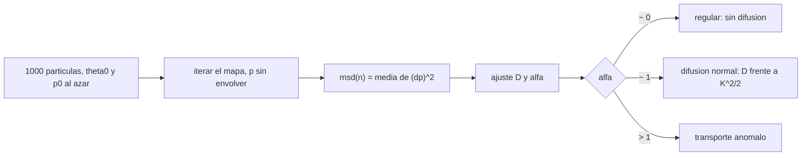

# B73-C15 — Difusión orbital

<!-- nav:top -->
[🏠 Programa](../../../../README.md) · [📚 Bloque B73](../../../tronco-comun/B73-mecanica-celeste-resonancias-y-caos.md) · [← Anterior: B73-C14 — Exponentes de Lyapunov](../B73-C14-exponentes-de-lyapunov/CLASE.md) · [Siguiente: B73-C16 — Dinámica de anillos →](../../../tronco-comun/B73-mecanica-celeste-resonancias-y-caos.md#b73-c16)
<!-- /nav -->

## 1. Ubicación, nivel y alcance

Clase 15 del bloque B73, que cierra el tramo del caos. Nivel N3. Sigue a [B73-C14](../B73-C14-exponentes-de-lyapunov/CLASE.md): el exponente mide cómo se separan dos trayectorias; la difusión mide cómo se esparce una población. Aquí mides el coeficiente de difusión del momento en el mapa estándar para cinco valores de `K` con 1000 partículas, lo comparas con la teoría cuasi-lineal `D = K²/2`, validas el Monte Carlo con un mapa de fases aleatorias, y descubres tres comportamientos: sin difusión (regular), difusión normal y transporte anómalo (modos aceleradores). **Los datos son sintéticos**.

## 2. Por qué esta clase existe

Un conjunto de cuerpos en una región caótica no escapa de golpe: su excentricidad o su semieje se esparce como una caminata aleatoria, y el tiempo que tarda en recorrer una región fija la escala de supervivencia de la población. La decisión central: **¿cómo medir un coeficiente de difusión y cuándo no tiene sentido hablar de él?**

## 3. Lo que podrás hacer al terminar

1. Medir `⟨(Δp)²⟩` frente a `n` en un conjunto de partículas.
2. Ajustar el coeficiente `D` por regresión por el origen con error estándar.
3. Compararlo con la teoría cuasi-lineal `K²/2`.
4. Validar la maquinaria de Monte Carlo con el mapa de fases aleatorias.
5. Calcular el exponente de transporte `α` y reconocer difusión normal, ausente y anómala.
6. Estimar el tiempo de difusión para recorrer un intervalo dado.

La evidencia es la **tabla de difusión frente a `K`** del ejercicio 12 (sección 20).

## 4. Con qué llegas y cómo comprobarlo

1. ¿Qué es un camino aleatorio?
2. ¿Qué es el coeficiente de difusión?
3. ¿Qué es un error estándar?
4. ¿Qué es el transporte anómalo?
5. ¿Qué es un modo acelerador?

<details>
<summary>Ver respuestas</summary>

1. Una sucesión de pasos independientes cuya dispersión crece con el tiempo. 2. La constante `D` en `⟨(Δx)²⟩ = D t`. 3. La desviación típica de la media de submuestras independientes. 4. Un crecimiento de `⟨(Δx)²⟩` distinto de lineal en `t`. 5. Una trayectoria del mapa estándar cuyo momento crece linealmente con las iteraciones.
</details>

Con cuatro o cinco aciertos, sigue; si no, repasa los prerrequisitos.

## 5. Un caso de contexto y casos de referencia

Con 1000 partículas y `K = 5`, el coeficiente medido es `D = 12,156 ± 0,423` frente a `K²/2 = 12,5` (cociente `0,973`, `α = 1,01`); con `K = 10`, `31,23` frente a 50 (cociente `0,625`); con `K = 1`, solo `0,0019`; con `K = 6,5` el transporte es anómalo (`α = 1,79`). Es el **ejemplo conductor**. **Los datos son sintéticos.**

## 6. Vocabulario

La **difusión del momento** mide `⟨(p_n − p_0)²⟩ = D n` en el mapa con `p` sin envolver. La **teoría cuasi-lineal** supone fases aleatorias y da `D_ql = K²/2`. El **exponente de transporte** `α` cumple `⟨(Δp)²⟩ ∝ n^α`: `α = 1` es difusión normal, `α = 2` es balístico. Los **modos aceleradores** aparecen cerca de `K = 2πm` y producen `α > 1`. El **tiempo de difusión** para recorrer `Δ` es `τ = Δ²/D`.

## 7. Modelo mental: una multitud que se dispersa



*Descripción textual:* un conjunto de partículas se itera con el momento sin envolver; la dispersión cuadrática frente a las iteraciones da `D` y `α`, que clasifican el régimen.

Analogía: una multitud que sale de un estadio: si las calles son rectas y ordenadas (régimen regular) casi nadie se aleja; si hay cruces confusos (caos) la gente se dispersa como una caminata aleatoria; si hay un tren expreso (modo acelerador) algunos se alejan mucho más rápido. Límite: el mapa es un modelo de juguete, no una población real.

## 8. La explicación, paso a paso

### 8.1 Medición

Se sortean `θ₀` y `p₀` uniformes en `[0, 2π)` (semilla 73), se itera el mapa con `p` sin envolver y se registra `⟨(p_n − p_0)²⟩` en `n = 100, 200, 400, 700, 1000`. `D` es la pendiente de la regresión por el origen; el error estándar sale de 5 submuestras de 200.

### 8.2 Resultados

| `K` | `D` medido | error est. | `K²/2` | `D/D_ql` | `α` |
|---|---|---|---|---|---|
| 1 | 0,0019 | 0,0001 | 0,5 | 0,004 | 0,01 |
| 3 | 3,930 | 0,247 | 4,5 | 0,873 | 1,02 |
| 5 | 12,156 | 0,423 | 12,5 | 0,973 | 1,01 |
| 6,5 | 447,5 | 58,3 | 21,1 | 21,2 | 1,79 |
| 10 | 31,23 | 1,19 | 50 | 0,625 | 0,99 |

Con `K = 1` las curvas invariantes impiden la difusión (`α ≈ 0`). Con `K = 3`, `5` y `10` la difusión es normal (`α ≈ 1`) y `D` es del orden de `K²/2`, con ajustes de `13 %`, `3 %` y `38 %`. Con `K = 6,5`, cerca de `2π`, el coeficiente de ajuste (`448`) no es un coeficiente de difusión: `α = 1,79` indica transporte anómalo por modos aceleradores.

### 8.3 Segunda vía: fases aleatorias

Si en cada paso se sortea `θ` en lugar de iterar el mapa, el mismo código debe dar exactamente `K²/2`. Con `K = 5` da `12,757 ± 0,738` frente a 12,5: `0,35` errores estándar de diferencia. El Monte Carlo reproduce la teoría donde ésta es exacta, así que las diferencias de 8.2 son del mapa y no del método.

### 8.4 Corrección por correlaciones

La corrección de primer orden `1 − 2J₂(K)` vale `0,028` (`K = 3`), `0,907` (`K = 5`) y `0,491` (`K = 10`); frente a las medidas `0,873`, `0,973` y `0,625`, solo es razonable alrededor de `K = 5`. Haría falta una teoría con más términos (no consultada). Las desviaciones del modelo cuasi-lineal son reales y de signo cambiante.

### 8.5 Tiempos de difusión

`τ = (2π)²/D`: `3,2` iteraciones con `K = 5` y `1,3` con `K = 10` para esparcirse `2π` en momento. Con `K = 1` serían `21 178` iteraciones: la población no se esparce en la práctica.

## 9. Magnitudes, símbolos y unidades

| Símbolo | Qué es | Unidad | Valor / nota |
|---|---|---|---|
| `D` | coeficiente de difusión | rad²/iteración | 12,16 (`K = 5`) |
| `α` | exponente de transporte | — | 1,01 (`K = 5`) |
| `K²/2` | difusión cuasi-lineal | rad²/iteración | 12,5 (`K = 5`) |
| `τ` | tiempo de difusión | iteraciones | 3,2 (`K = 5`) |
| `M` | partículas | — | 1000 |

## 10. Convenciones y referencias

Mapa estándar con `p` sin envolver; `θ` módulo `2π`. 1000 partículas con semilla 73; `⟨(Δp)²⟩` en `n = 100…1000`. Errores estándar con 5 submuestras de 200. `J₂` por serie de potencias. Sin datos físicos.

## 11. De dónde sale lo que afirmamos

| ID | Fuente | Localizador | Respalda | Estado |
|---|---|---|---|---|
| — | Teoría cuasi-lineal `D = K²/2` y corrección `1 − 2J₂(K)` (resultados clásicos) | — | las compara el laboratorio con el Monte Carlo | No consultada en una fuente concreta |
| — | Modos aceleradores del mapa estándar | — | su efecto sobre `α` se observa pero su teoría no se consultó | No consultada en una fuente concreta |

Límites: no se consultó ninguna fuente externa; el mapa y los parámetros son sintéticos; el ajuste de `D` en `K = 6,5` no es válido; los errores estándar usan solo 5 submuestras.

## 12. Cómo ver la difusión

| Magnitud | Valor |
|---|---|
| `D` con `K = 5` (medido y teórico) | 12,16 y 12,5 |
| `D/D_ql` con `K = 10` | 0,625 |
| `α` con `K = 1` y `K = 6,5` | 0,01 y 1,79 |
| fases aleatorias frente a teoría | 0,35 errores estándar |
| `τ` con `K = 5` | 3,2 iteraciones |

Descripción larga: la difusión es nula, normal o anómala según `K`; donde la teoría cuasi-lineal es exacta (fases aleatorias) el Monte Carlo la reproduce.

## 13. Ejemplo trabajado: ¿cuánto tarda en esparcirse una población?

**Paso 1 · Coeficiente.** Con `K = 5`, `D = 12,16` rad²/iteración.

**Paso 2 · Intervalo.** Se quiere recorrer `2π` en momento: `(2π)² = 39,5`.

**Paso 3 · Tiempo.** `τ = 39,5/12,16 = 3,2` iteraciones.

**Paso 4 · Lectura.** Con `K = 5` la población se esparce en unas 3 iteraciones; con `K = 1`, nunca.

## 14. Distintas formas de describir el transporte en el espacio de fases

**Por varianza:** `⟨(Δp)²⟩(n)`. **Por coeficiente:** `D`. **Por exponente:** `α`. **Por teoría:** `K²/2` y correcciones. **Por tiempo:** `τ`.

## 15. Práctica guiada

**Ejercicio 1 · con los pasos indicados.** Calcula `D_ql` para `K = 5`. *Pasos:* `K²/2`.

<details><summary>Solución comentada</summary>

`12,5`.
</details>

**Ejercicio 2 · con una pista.** Calcula el cociente `D/D_ql` con `K = 10`. *Pista:* `31,23/50`.

<details><summary>Solución comentada</summary>

`0,625`.
</details>

**Ejercicio 3 · casi autónomo.** ¿Qué indica `α ≈ 0` con `K = 1`?

<details><summary>Solución comentada</summary>

Que no hay difusión: las curvas invariantes acotan el momento.
</details>

## 16. Práctica autónoma, transferencia e integrador

**Ejercicio 4 · autónomo.** `D_ql` con `K = 3`.

<details><summary>Solución comentada</summary>

`4,5`.
</details>

**Ejercicio 5 · autónomo.** `τ` con `K = 10`.

<details><summary>Solución comentada</summary>

`1,3` iteraciones.
</details>

**Ejercicio 6 · autónomo.** ¿Por qué el ajuste de `D` no vale con `K = 6,5`?

<details><summary>Solución comentada</summary>

Porque `α = 1,79 ≠ 1`: el transporte es anómalo y `D` no está definido.
</details>

**Ejercicio 7 · autónomo.** Error estándar de `D` con `K = 5`.

<details><summary>Solución comentada</summary>

`0,423`.
</details>

**Ejercicio 8 · autónomo.** ¿Qué comprueba el mapa de fases aleatorias?

<details><summary>Solución comentada</summary>

Que el código de Monte Carlo reproduce `K²/2` donde la teoría es exacta.
</details>

**Ejercicio 9 · transferencia.** **Transferencia.** Un estudio estima la vida de una población caótica con `τ = Δ²/K²·2` para todo `K`. ¿Qué le falta?

<details><summary>Solución comentada</summary>

Comprobar que `α = 1` y que `D/D_ql` está cerca de 1; hay desviaciones de `13 %` a `38 %` y regiones sin difusión.
</details>

**Ejercicio 10 · transferencia.** **Transferencia.** Un colega aplica la teoría cuasi-lineal a `K = 1`. ¿Qué pasa?

<details><summary>Solución comentada</summary>

Predice `D = 0,5` pero el valor medido es `0,0019`: hay curvas invariantes y la teoría no aplica.
</details>

**Ejercicio 11 · transferencia.** **Transferencia.** ¿Qué le dirías a quien usa estos números para la vida de un asteroide real?

<details><summary>Solución comentada</summary>

Que son sintéticos: el mapa estándar no es el problema de ningún asteroide.
</details>

**Ejercicio 12 · integrador.** **Integrador.** Elabora tu *tabla de difusión frente a `K`*: `D`, error, cociente con la teoría, exponente de transporte, validación por fases aleatorias y tiempos de difusión.

<details><summary>Solución comentada</summary>

Secciones 8.1–8.5 y la salida del laboratorio.
</details>

## 17. Laboratorio: difusión en el mapa estándar

El script [difusion_orbital.py](difusion_orbital.py) mide la difusión de 1000 partículas para cinco valores de `K`, la compara con `K²/2` y valida el método con fases aleatorias (**comprueba** fases aleatorias dentro de 3 errores estándar, `K = 5` y `10` con `α` entre 0,9 y 1,1 y `K = 6,5` con `α > 1,3`).

**Datos:** **todos sintéticos**: `K`, condiciones iniciales (semilla 73). **Predice antes de ejecutar:** ¿cuánto valdrá `D/D_ql` con `K = 5`? (cercano a 1.) **Ejecución del 2026-11-10 (Python 3.12.9):**

```text
Python 3.12.9 (biblioteca estandar)
1000 particulas sinteticas (semilla 73), hasta 1000 iteraciones; D = <(Dp)^2>/n por regresion por el origen
    K       D medido   error est.   D_ql=K^2/2   D/D_ql    1-2 J2(K)   alfa   tau [iter] = (2 pi)^2/D
   1.0       0.0019      0.0001       0.5000     0.004       0.770     0.01          21177.9
   3.0       3.9298      0.2472       4.5000     0.873       0.028     1.02             10.0
   5.0      12.1563      0.4226      12.5000     0.973       0.907     1.01              3.2
   6.5     447.5171     58.2705      21.1250    21.184       1.615     1.79              0.1
  10.0      31.2329      1.1930      50.0000     0.625       0.491     0.99              1.3
Mapa de fases aleatorias (K = 5): D = 12.7568 +- 0.7378 ; K^2/2 = 12.5000 ; diferencia = 0.35 errores estandar
Pruebas superadas.
```

```bash
python programa/clases/B73/B73-C15-difusion-orbital/difusion_orbital.py
```

**Límites:** 1000 partículas, errores estándar con 5 submuestras, `n ≤ 1000`, un solo mapa; el régimen anómalo se observa sin teoría.

## 18. Errores frecuentes y cómo corregirlos

**Usar `K²/2` sin comprobar `α`.** Se corrige con 8.2.

**Envolver `p` y perder el crecimiento.** Se corrige con la sección 10.

**Fiarse de un solo conjunto sin error estándar.** Se corrige con 8.1.

**Extrapolar a sistemas reales.** Se corrige con la sección 21.

## 19. Cómo sabrás que vas bien

Tras la sección 8: ¿qué cociente `D/D_ql` esperabas con `K = 5` y cuál obtuviste? Si dudas, repasa el ejemplo 13. Tras el laboratorio: ¿qué comprueba? (ver la sección 17).

## 20. Qué entregas y cómo se evalúa

El producto es tu **tabla de difusión frente a `K`** (ejercicio 12).

| Criterio | Inicial | En desarrollo | Logrado | Destacado |
|---|---|---|---|---|
| Conceptos | Los confunde | Parciales | Mide `D` y `α` y los interpreta | Explica los límites |
| Cálculo | Sin unidades | Con errores | Tablas completas con unidades | Calcula casos nuevos |
| Comprobación | Sin comprobar | Un caso | Contraste con una segunda vía | Interpreta las diferencias |
| Fuentes | Sin fuente | Sin fecha | Fuentes con fecha y estado | Declara lo sintético y lo no consultado |
| Límites | No los nombra | Uno | Tres | Discute qué falta del modelo |

**Condiciones críticas (no se compensan con promedio):** rotular los datos como sintéticos; no aplicar `D` donde `α ≠ 1`; no extrapolar a poblaciones reales.

## 21. Ética, seguridad y límites

Clase educativa: los modelos son simplificados y sus datos son publicados con fuente o sintéticos rotulados; ningún resultado describe una trayectoria real ni sirve para planificar una misión.  Accesibilidad: tablas equivalentes a las gráficas, fórmulas en texto, ejercicios sin conexión.

## 22. Para cerrar y seguir

La difusión del momento es nula con `K = 1`, normal con `K = 5` (`D = 12,2`, cociente `0,97`) y anómala con `K = 6,5`; el Monte Carlo reproduce la teoría con fases aleatorias. Queda una pregunta: ¿qué dinámica gobierna a las partículas de un anillo?

**Glosario español–inglés.** difusión orbital · *orbital diffusion*; coeficiente de difusión · *diffusion coefficient*; teoría cuasi-lineal · *quasilinear theory*; transporte anómalo · *anomalous transport*; modo acelerador · *accelerator mode*.

**Continuidad.** [B73-CC16](../B73-C16-dinamica-de-anillos/CLASE.md) estudia la dinámica de anillos.

**Referencias:** ver sección 11.

<!-- nav:bottom -->
---

[← Anterior: B73-C14 — Exponentes de Lyapunov](../B73-C14-exponentes-de-lyapunov/CLASE.md) · [📚 Bloque B73](../../../tronco-comun/B73-mecanica-celeste-resonancias-y-caos.md) · [Siguiente: B73-C16 — Dinámica de anillos →](../../../tronco-comun/B73-mecanica-celeste-resonancias-y-caos.md#b73-c16)
<!-- /nav -->
