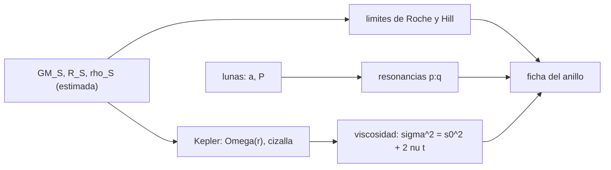

# B73-C16 — Dinámica de anillos

<!-- nav:top -->
[🏠 Programa](../../../../README.md) · [📚 Bloque B73](../../../tronco-comun/B73-mecanica-celeste-resonancias-y-caos.md) · [← Anterior: B73-C15 — Difusión orbital](../B73-C15-difusion-orbital/CLASE.md) · [Siguiente: B73-C17 — Estabilidad de sistemas exoplanetarios →](../B73-C17-estabilidad-de-sistemas-exoplanetarios/CLASE.md)
<!-- /nav -->

## 1. Ubicación, nivel y alcance

Clase 16 del bloque B73, que abre el tramo de aplicaciones. Nivel N3. Sigue a [B73-C15](../B73-C15-difusion-orbital/CLASE.md). Aquí aplicas lo aprendido a los anillos de Saturno: calculas el límite de Roche rígido y fluido y el criterio de la esfera de Hill con una densidad de partícula ilustrativa, la cizalla kepleriana a varias distancias, las posiciones de las resonancias 2:1 y 3:2 de Mimas, Encélado y Tetis, y el tiempo de ensanchamiento viscoso con una verificación numérica de la ley `σ² = σ₀² + 2νt`. Los `GM`, radios y periodos son publicados; la densidad de las partículas, la viscosidad y la anchura del anillo son **ilustrativas**.

## 2. Por qué esta clase existe

Un anillo existe donde las mareas impiden que las partículas se junten, se ensancha por viscosidad y se estructura por resonancias con las lunas. La decisión central: **¿qué escalas fijan dónde hay un anillo, cuánto dura y dónde lo moldean las lunas?**

## 3. Lo que podrás hacer al terminar

1. Calcular los límites de Roche rígido y fluido y el criterio de Hill.
2. Calcular la velocidad orbital y la cizalla kepleriana de un anillo.
3. Localizar las resonancias `p:q` con una luna exterior.
4. Verificar la tercera ley de Kepler con el `GM` deducido y los periodos publicados.
5. Verificar con difusión 1D el ensanchamiento `σ² = σ₀² + 2νt`.
6. Rotular qué es publicado y qué es ilustrativo en una estimación de anillo.

La evidencia es la **ficha de un anillo de Saturno con sus escalas** del ejercicio 12 (sección 20).

## 4. Con qué llegas y cómo comprobarlo

1. ¿Qué es el límite de Roche?
2. ¿Qué es la cizalla kepleriana?
3. ¿Qué es una resonancia orbital?
4. ¿Qué es la viscosidad cinemática?
5. ¿Qué es una cota inferior?

<details>
<summary>Ver respuestas</summary>

1. La distancia dentro de la cual la marea de un planeta supera la autogravedad de un cuerpo que lo orbita. 2. La diferencia de velocidad angular entre radios vecinos: `Ω ∝ r^(−3/2)`. 3. Una razón racional entre dos periodos orbitales. 4. Un coeficiente `ν` de difusión del momento, en m²/s. 5. Un valor que sabemos que no es mayor que el real.
</details>

Con cuatro o cinco aciertos, sigue; si no, repasa los prerrequisitos.

## 5. Un caso de contexto y casos de referencia

Con `GM_Saturno ≈ 3,7931e+07 km³/s²` (deducido) y densidad de partícula ilustrativa de `920 kg/m³`, el límite de Roche es `66 570 km` (rígido) y `129 758 km` (fluido); la resonancia 2:1 de Mimas cae en `r = 116 870 km` (`1,939 R_S`), donde el periodo de una partícula es la mitad del de Mimas. A `100 000 km` la velocidad orbital es `19,48 km/s` y la cizalla `2,92e-04 s⁻¹`. Es el **ejemplo conductor**. Densidad, viscosidad y anchura son **ilustrativas**.

## 6. Vocabulario

El **límite de Roche** rígido es `1,26 R (ρ_M/ρ_m)^{1/3}` y el fluido `2,456 R (ρ_M/ρ_m)^{1/3}`. El **criterio de Hill** pide que el radio de la partícula iguale su esfera de Hill: `1,442 R (ρ_M/ρ_m)^{1/3}`. La **cizalla kepleriana** es `dΩ/d ln r = −(3/2)Ω`. Una **resonancia** `p:q` con una luna de periodo `P` ubica una partícula de periodo `P q/p` en `r = a_luna (q/p)^{2/3}`. El **ensanchamiento viscoso** hace crecer la varianza como `2νt`.

## 7. Modelo mental: un tiovivo con muchos aros que giran a distinta velocidad



*Descripción textual:* el planeta fija los límites de marea y la velocidad kepleriana; las lunas, las resonancias; la viscosidad, la escala de tiempo de ensanchamiento; todo se reúne en una ficha del anillo.

Analogía: un tiovivo con aros concéntricos que giran más lento cuanto más afuera están: los vecinos se rozan y esparcen (viscosidad), y un empujón periódico desde fuera (la luna) deja huecos donde coincide con su ritmo. Límite: un anillo real tiene partículas de muchos tamaños, colisiones inelásticas y ondas de densidad que este modelo no incluye.

## 8. La explicación, paso a paso

### 8.1 Datos y densidad

`GM_Saturno` se deduce de la masa de la ficha (`568,32×10²⁴ kg`) con `G` de CODATA 2018: `3,7931e+07 km³/s²`. La densidad media estimada con el radio ecuatorial (`60 268 km`) es `620 kg/m³`: es una **cota inferior**, no una densidad publicada. La densidad de las partículas (`920 kg/m³`) es ilustrativa.

### 8.2 Límites de marea

| Criterio | distancia (km) | en `R_S` |
|---|---|---|
| Roche rígido | 66 570 | 1,10 |
| Hill de la partícula | 76 185 | 1,26 |
| Roche fluido | 129 758 | 2,15 |

El criterio de Hill cae entre los dos límites, como debe. Con otra densidad de partícula todos escalan con `ρ_m^{−1/3}`.

### 8.3 Segunda vía: Kepler y los periodos publicados

La tercera ley con el `GM` deducido da periodos que difieren de los publicados en `0,12 %` (Mimas), `0,07 %` (Encélado) y `0,04 %` (Tetis); la máxima es `0,117%`, dentro del 0,5 % de tolerancia. Eso valida el `GM` deducido a ese nivel (y la aproximación de órbita circular sin achatamiento).

### 8.4 Cizalla y resonancias

A `100 000 km` el periodo es `8,96 h`, la velocidad `19,48 km/s` y la cizalla `2,92e-04 s⁻¹`; a `117 000 km`, el periodo es `11,34 h`. La resonancia 2:1 de Mimas está en `116 870 km` y la 3:2 en `141 578 km`; Encélado 2:1 en `149 943 km` y Tetis 2:1 en `185 624 km`. Lo que ocurre en esas posiciones en los anillos reales no se consultó.

### 8.5 Ensanchamiento viscoso

Con `ν = 0,01 m²/s` y una anchura de `100 km`, `W²/ν = 31 688` años; con `ν = 0,1 m²/s`, `3 169` años. Ambos valores son ilustrativos (viscosidad y anchura no consultadas). La ley `σ² = σ₀² + 2νt` se verificó con una difusión 1D explícita: con `σ₀ = 1`, `ν = 1` y `t = 4,5` adimensionales, `σ = 3,15596` frente a `3,16228`, diferencia `2,0e-03`.

## 9. Magnitudes, símbolos y unidades

| Símbolo | Qué es | Unidad | Valor / nota |
|---|---|---|---|
| `GM_S` | parámetro gravitacional de Saturno | km³/s² | 3,7931×10⁷ (deducido) |
| `R_S` | radio ecuatorial | km | 60 268 |
| `r` | radio del anillo | km | 74 000 a 136 000 |
| `Ω` | velocidad angular kepleriana | rad/s | `√(GM/r³)` |
| `ν` | viscosidad cinemática (ilustrativa) | m²/s | 0,01 y 0,1 |

## 10. Convenciones y referencias

Órbitas circulares y coplanares alrededor de Saturno esférico (sin `J₂`). `1 año = 365,25 d`. `G = 6,67430×10⁻¹¹ m³ kg⁻¹ s⁻² (CODATA 2018)`. Los límites de Roche y los coeficientes `1,26`, `2,456` y `1,442` son fórmulas estándar no consultadas.

## 11. De dónde sale lo que afirmamos

| ID | Fuente | Localizador | Respalda | Estado |
|---|---|---|---|---|
| S1 | NASA/NSSDC, Saturn Fact Sheet — https://nssdc.gsfc.nasa.gov/planetary/factsheet/saturnfact.html (consultada 2026-11-10) | ficha leída; actualizada el 2025-03-18 | masa 568,32×10²⁴ kg y radio ecuatorial 60 268 km de Saturno | Consultada |
| S2 | NASA/NSSDC, Saturnian Satellite Fact Sheet — https://nssdc.gsfc.nasa.gov/planetary/factsheet/saturniansatfact.html (consultada 2026-11-10) | ficha leída; actualizada el 2025-07-22 | semiejes y periodos de Mimas, Encélado y Tetis | Consultada |
| S3 | NASA JPL SSD, Planetary Physical Parameters — https://ssd.jpl.nasa.gov/planets/phys_par.html (consultada 2026-11-10) | tabla de masas y radios medios; registro de cambios 2019-12-12 (CODATA 2018) | G de CODATA 2018 citada en el registro de cambios (2019-12-12) | Consultada |
| — | Fórmulas de Roche y del criterio de Hill, ensanchamiento viscoso de anillos (resultados clásicos) | — | las verifica el laboratorio con Kepler y una difusión numérica | No consultada en una fuente concreta |

Límites: la densidad de partícula, la viscosidad y la anchura son ilustrativas; la densidad media de Saturno es una cota inferior estimada; no se consultó información observacional de los anillos ni de las lunas pastoras; no se modelan ondas de densidad ni colisiones.

## 12. Cómo ver las escalas de un anillo

| Magnitud | Valor |
|---|---|
| Roche rígido y fluido | 66 570 y 129 758 km |
| resonancia 2:1 de Mimas | 116 870 km (1,939 R_S) |
| velocidad orbital a 100 000 km | 19,48 km/s |
| Kepler frente a publicado | como máximo 0,117% |
| difusión numérica frente a teoría | 2,0e-03 |

Descripción larga: las tres escalas del anillo (marea, cizalla y resonancia) son del orden de decenas de miles de kilómetros y horas; el ensanchamiento viscoso, de miles de años con parámetros ilustrativos.

## 13. Ejemplo trabajado: la posición de la resonancia 2:1 de Mimas

**Paso 1 · Datos.** `a_Mimas = 185 520 km`.

**Paso 2 · Cociente.** Una partícula con la mitad del periodo: `(1/2)^{2/3} = 0,630`.

**Paso 3 · Radio.** `0,630 × 185 520 = 116 870 km`.

**Paso 4 · Contraste.** Con Kepler, el periodo de una órbita a ese radio es la mitad del de Mimas dentro del 0,12 %.

## 14. Distintas formas de describir un anillo

**Por marea:** Roche y Hill. **Por velocidad:** `Ω(r)` y cizalla. **Por resonancia:** `r = a (q/p)^{2/3}`. **Por tiempo:** `W²/ν`.

## 15. Práctica guiada

**Ejercicio 1 · con los pasos indicados.** Calcula `(1/2)^{2/3}`. *Pasos:* `0,5^{0,6667}`.

<details><summary>Solución comentada</summary>

`0,630`.
</details>

**Ejercicio 2 · con una pista.** Da la posición de la resonancia 2:1 de Encélado. *Pista:* `0,630 × 238 020 km`.

<details><summary>Solución comentada</summary>

`149 943 km`.
</details>

**Ejercicio 3 · casi autónomo.** ¿Qué distancia es mayor, el Roche rígido o el fluido, y por qué?

<details><summary>Solución comentada</summary>

El fluido (`129 758` km frente a `66 570`), porque un cuerpo deformable se rompe antes: su coeficiente es mayor (2,456 frente a 1,26).
</details>

## 16. Práctica autónoma, transferencia e integrador

**Ejercicio 4 · autónomo.** Resonancia 3:2 de Mimas.

<details><summary>Solución comentada</summary>

`141 578 km`.
</details>

**Ejercicio 5 · autónomo.** Periodo orbital a 117 000 km.

<details><summary>Solución comentada</summary>

`11,34 h`.
</details>

**Ejercicio 6 · autónomo.** Tiempo de ensanchamiento con `ν = 0,1 m²/s`.

<details><summary>Solución comentada</summary>

`3 169` años.
</details>

**Ejercicio 7 · autónomo.** ¿Cómo escala el límite de Roche con la densidad de la partícula?

<details><summary>Solución comentada</summary>

Como `ρ_m^{−1/3}`: partículas más densas se pueden acercar más.
</details>

**Ejercicio 8 · autónomo.** Diferencia entre el periodo kepleriano y el publicado de Mimas.

<details><summary>Solución comentada</summary>

`0,12 %`.
</details>

**Ejercicio 9 · transferencia.** **Transferencia.** Un estudiante dice que el límite de Roche de Saturno es `66 570` km porque «es una constante del planeta». ¿Qué le falta?

<details><summary>Solución comentada</summary>

Depende de la densidad de las partículas y de si son rígidas o fluidas; con `920 kg/m³` ilustrativos el rango va de `66 570` a `129 758` km.
</details>

**Ejercicio 10 · transferencia.** **Transferencia.** ¿Qué no puede concluirse de la tabla de resonancias sobre los anillos reales?

<details><summary>Solución comentada</summary>

Nada sobre su estructura observada: el laboratorio solo calcula posiciones geométricas; la observación no se consultó.
</details>

**Ejercicio 11 · transferencia.** **Transferencia.** Un colega usa `ν = 0,01 m²/s` como dato de los anillos. ¿Qué le dices?

<details><summary>Solución comentada</summary>

Que es un valor ilustrativo, sin fuente; el tiempo de ensanchamiento (`31 688` años) depende linealmente de él.
</details>

**Ejercicio 12 · integrador.** **Integrador.** Elabora tu *ficha de un anillo de Saturno con sus escalas*: tabla de límites de marea, cizalla, resonancias, tiempos de ensanchamiento y lista de lo publicado frente a lo ilustrativo.

<details><summary>Solución comentada</summary>

Secciones 8.1–8.5 y la salida del laboratorio.
</details>

## 17. Laboratorio: escalas de un anillo de Saturno

El script [anillos.py](anillos.py) calcula límites de Roche y Hill, la cizalla, las resonancias de tres lunas y el ensanchamiento viscoso (**comprueba** Roche rígido < Hill < fluido, Kepler dentro del 0,5 % y difusión numérica dentro del 1 %).

**Datos:** masa, radio, semiejes y periodos de la NASA/NSSDC (consultados); `G` de CODATA 2018 citada por el JPL; densidad de partícula, viscosidad y anchura **ilustrativas**. **Predice antes de ejecutar:** ¿dónde cae la resonancia 2:1 de Mimas? (`≈ 116 900 km`.) **Ejecución del 2026-11-10 (Python 3.12.9):**

```text
Python 3.12.9 (biblioteca estandar)
GM_Saturno (deducido de la masa de la ficha y G de CODATA 2018) = 3.7931e+07 km3/s2 ; R_ecuatorial = 60268 km
Densidad media estimada con el radio ecuatorial (cota inferior) = 620 kg/m3 ; densidad de particula ILUSTRATIVA = 920 kg/m3
Limite de Roche: rigido = 66,570 km (1.10 R_S) ; fluido = 129,758 km (2.15 R_S) ; criterio de Hill = 76,185 km (1.26 R_S)
Tercera ley de Kepler con GM_Saturno frente al periodo publicado de cada luna:
  Mimas    : P_kepler = 0.943524 d ; P_publicado = 0.9424218 d ; diferencia = 0.117%
  Enceladus: P_kepler = 1.371156 d ; P_publicado = 1.370218 d ; diferencia = 0.068%
  Tethys   : P_kepler = 1.888637 d ; P_publicado = 1.887802 d ; diferencia = 0.044%
Cizalla kepleriana: Omega(r) y tasa de cizalla -(3/2) Omega:
  r =    74,000 km (1.23 R_S): periodo =   5.70 h ; velocidad orbital = 22.64 km/s ; cizalla = 4.589e-04 1/s
  r =   100,000 km (1.66 R_S): periodo =   8.96 h ; velocidad orbital = 19.48 km/s ; cizalla = 2.921e-04 1/s
  r =   117,000 km (1.94 R_S): periodo =  11.34 h ; velocidad orbital = 18.01 km/s ; cizalla = 2.308e-04 1/s
  r =   136,000 km (2.26 R_S): periodo =  14.21 h ; velocidad orbital = 16.70 km/s ; cizalla = 1.842e-04 1/s
Resonancias con lunas exteriores: una particula con periodo P_luna * q/p queda en r = a_luna (q/p)^(2/3):
  Mimas     2:1: r =   116,870 km (1.939 R_S) ; periodo de la particula = 0.47176 d ; P_luna q/p = 0.47121 d ; dif. = 0.12%
  Mimas     3:2: r =   141,578 km (2.349 R_S) ; periodo de la particula = 0.62902 d ; P_luna q/p = 0.62828 d ; dif. = 0.12%
  Enceladus 2:1: r =   149,943 km (2.488 R_S) ; periodo de la particula = 0.68558 d ; P_luna q/p = 0.68511 d ; dif. = 0.07%
  Enceladus 3:2: r =   181,643 km (3.014 R_S) ; periodo de la particula = 0.91410 d ; P_luna q/p = 0.91348 d ; dif. = 0.07%
  Tethys    2:1: r =   185,624 km (3.080 R_S) ; periodo de la particula = 0.94432 d ; P_luna q/p = 0.94390 d ; dif. = 0.04%
  Tethys    3:2: r =   224,868 km (3.731 R_S) ; periodo de la particula = 1.25909 d ; P_luna q/p = 1.25853 d ; dif. = 0.04%
Ensanchamiento viscoso (ILUSTRATIVO): sigma^2 = sigma0^2 + 2 nu t; difusion 1D explicita frente a la formula:
  nu = 0.01 m2/s, W = 100 km: W^2/nu = 31,688 anos
  nu = 0.1 m2/s, W = 100 km: W^2/nu = 3,169 anos
  Prueba numerica (sigma0 = 1, nu = 1, t = 4.5 adimensionales): sigma = 3.15596 ; teoria = 3.16228 ; diferencia = 2.00e-03
Pruebas superadas.
```

```bash
python programa/clases/B73/B73-C16-dinamica-de-anillos/anillos.py
```

**Límites:** órbitas circulares, Saturno esférico, densidad de partícula ilustrativa, sin ondas de densidad ni colisiones; no se compara con observaciones.

## 18. Errores frecuentes y cómo corregirlos

**Tratar la densidad de partícula como dato.** Se corrige con la sección 10.

**Usar el radio ecuatorial como radio medio sin avisar.** Se corrige con 8.1 (cota inferior).

**Olvidar que las posiciones de resonancia son geométricas.** Se corrige con 8.4.

**Dar el tiempo de ensanchamiento como edad de un anillo.** Se corrige con 8.5.

## 19. Cómo sabrás que vas bien

Tras la sección 8: ¿dónde esperabas la resonancia 2:1 de Mimas y dónde cayó? Si dudas, repasa el ejemplo 13. Tras el laboratorio: ¿qué comprueba? (ver la sección 17).

## 20. Qué entregas y cómo se evalúa

El producto es tu **ficha de un anillo de Saturno con sus escalas** (ejercicio 12).

| Criterio | Inicial | En desarrollo | Logrado | Destacado |
|---|---|---|---|---|
| Conceptos | Los confunde | Parciales | Calcula las escalas de un anillo | Explica los límites |
| Cálculo | Sin unidades | Con errores | Tablas completas con unidades | Calcula casos nuevos |
| Comprobación | Sin comprobar | Un caso | Contraste con una segunda vía | Interpreta las diferencias |
| Fuentes | Sin fuente | Sin fecha | Fuentes con fecha y estado | Declara lo sintético y lo no consultado |
| Límites | No los nombra | Uno | Tres | Discute qué falta del modelo |

**Condiciones críticas (no se compensan con promedio):** rotular densidad, viscosidad y anchura como ilustrativas; no presentar posiciones de resonancia como observaciones; citar solo lo consultado.

## 21. Ética, seguridad y límites

Clase educativa: los modelos son simplificados y sus datos son publicados con fuente o sintéticos rotulados; ningún resultado describe una trayectoria real ni sirve para planificar una misión.  Accesibilidad: tablas equivalentes a las gráficas, fórmulas en texto, ejercicios sin conexión.

## 22. Para cerrar y seguir

Con datos publicados de Saturno y tres lunas, las escalas de un anillo salen en pocas líneas: Roche entre `66 570` y `129 758` km, resonancia 2:1 de Mimas en `116 870` km y cizalla de `2,9e-04 s⁻¹` a 100 000 km. Queda una pregunta: ¿cuándo es estable un sistema planetario entero?

**Glosario español–inglés.** límite de Roche · *Roche limit*; cizalla kepleriana · *Keplerian shear*; resonancia · *resonance*; ensanchamiento viscoso · *viscous spreading*; esfera de Hill · *Hill sphere*.

**Continuidad.** [B73-CC17](../B73-C17-estabilidad-de-sistemas-exoplanetarios/CLASE.md) estudia la estabilidad de sistemas exoplanetarios.

**Referencias:** ver sección 11.

<!-- nav:bottom -->
---

[← Anterior: B73-C15 — Difusión orbital](../B73-C15-difusion-orbital/CLASE.md) · [📚 Bloque B73](../../../tronco-comun/B73-mecanica-celeste-resonancias-y-caos.md) · [Siguiente: B73-C17 — Estabilidad de sistemas exoplanetarios →](../B73-C17-estabilidad-de-sistemas-exoplanetarios/CLASE.md)
<!-- /nav -->
