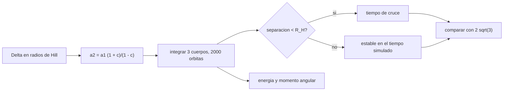

# B73-C17 — Estabilidad de sistemas exoplanetarios

<!-- nav:top -->
[🏠 Programa](../../../../README.md) · [📚 Bloque B73](../../../tronco-comun/B73-mecanica-celeste-resonancias-y-caos.md) · [← Anterior: B73-C16 — Dinámica de anillos](../B73-C16-dinamica-de-anillos/CLASE.md) · [Siguiente: B73-C18 — Satélites irregulares →](../B73-C18-satelites-irregulares/CLASE.md)
<!-- /nav -->

## 1. Ubicación, nivel y alcance

Clase 17 del bloque B73. Nivel N3. Sigue a [B73-C16](../B73-C16-dinamica-de-anillos/CLASE.md). Aquí estudias cuándo un sistema de dos planetas con órbitas casi circulares es estable, en función de su separación medida en radios de Hill mutuos: integras tres cuerpos con un leapfrog simpléctico durante hasta 2000 órbitas, mides el tiempo hasta el primer encuentro cercano y lo contrastas con el criterio `Δ > 2√3`. **El sistema es sintético**: no se pudo consultar el Archivo de Exoplanetas de la NASA (respondió 503 el 2026-11-10), así que no hay ningún exoplaneta real en esta clase.

## 2. Por qué esta clase existe

Muchos sistemas exoplanetarios son compactos y su existencia depende de no haberse desestabilizado. Un criterio simple de separación permite descartar configuraciones inviables antes de integrar. La decisión central: **¿cuán separados deben estar dos planetas para sobrevivir y cómo lo compruebo?**

## 3. Lo que podrás hacer al terminar

1. Calcular el radio de Hill mutuo de dos planetas.
2. Expresar la separación como `Δ = (a₂ − a₁)/R_H`.
3. Invertir `Δ` para hallar `a₂` y comprobar la consistencia.
4. Integrar tres cuerpos y medir el tiempo hasta un encuentro cercano.
5. Verificar la conservación de energía y momento angular de la integración.
6. Contrastar los resultados con el criterio `Δ > 2√3` y declarar su alcance.

La evidencia es la **mapa de estabilidad frente a separación (sintético)** del ejercicio 12 (sección 20).

## 4. Con qué llegas y cómo comprobarlo

1. ¿Qué es el radio de Hill?
2. ¿Qué es un encuentro cercano?
3. ¿Qué es un leapfrog?
4. ¿Qué es un sistema coplanar?
5. ¿Qué es un sistema sintético?

<details>
<summary>Ver respuestas</summary>

1. El radio de la región donde domina la gravedad de un planeta frente a la de la estrella. 2. Un paso de dos cuerpos a una distancia pequeña comparada con su radio de Hill. 3. Un integrador simpléctico de segundo orden. 4. Uno cuyas órbitas están en el mismo plano. 5. Uno propuesto para el ejemplo, sin correspondencia con un objeto real.
</details>

Con cuatro o cinco aciertos, sigue; si no, repasa los prerrequisitos.

## 5. Un caso de contexto y casos de referencia

Con dos planetas sintéticos de `m/M = 3×10⁻⁴` (R_H mutuo = `0,05848 (a₁+a₂)/2`), una separación `Δ = 2` provoca un encuentro cercano en `1,6` a `44,6` órbitas interiores según la fase inicial; con `Δ = 3`, en `41,8` y `348,8` órbitas para dos fases y ninguno en 2000 para la tercera; con `Δ ≥ 3,5` ninguno en 2000 órbitas. El criterio `2√3 = 3,4641` queda entre `3` y `3,5`. Es el **ejemplo conductor**. **El sistema es sintético.**

## 6. Vocabulario

El **radio de Hill mutuo** de dos planetas es `R_H = ((m₁+m₂)/(3M))^{1/3} (a₁+a₂)/2`. La **separación** `Δ` es `(a₂ − a₁)/R_H`. El **criterio de Gladman** para dos planetas en órbitas circulares es `Δ > 2√3 ≈ 3,46`. Un **encuentro cercano** es una separación entre planetas menor que `R_H`. El **tiempo de cruce** es el número de órbitas interiores hasta el primer encuentro.

## 7. Modelo mental: dos patinadores en una pista que casi se rozan



*Descripción textual:* a partir de `Δ` se obtiene `a₂`, se integra el sistema y se registra el primer encuentro cercano; las simulaciones se contrastan con el criterio `2√3` y con las conservaciones de la integración.

Analogía: dos patinadores en pistas contiguas: si sus pistas están lo bastante separadas nunca se tocan; si casi se rozan, cualquier pequeña desviación termina en un choque tras algunas vueltas. Límite: el criterio vale para órbitas circulares y dos planetas; con tres o más o con excentricidad, la frontera cambia.

## 8. La explicación, paso a paso

### 8.1 La separación

Con `m/M = 3×10⁻⁴` en cada planeta, `k = ((m₁+m₂)/(3M))^{1/3} = 0,05848`. Si `c = Δk/2`, entonces `a₂ = a₁(1 + c)/(1 − c)`. Para `Δ = 2, 3, 3,5, 4, 5, 6` resulta `a₂/a₁ = 1,1242, 1,1923, 1,2280, 1,2649, 1,3425, 1,4255`. Al volver a calcular `Δ` desde `a₂` se recupera el valor de entrada a `10⁻¹²`.

### 8.2 Simulaciones

Leapfrog con 200 pasos por periodo interior, hasta 2000 órbitas, fases iniciales del segundo planeta de `0°`, `90°` y `180°` (sintéticas). Evento: separación entre planetas `< R_H` o distancia a la estrella `> 3a₂`.

| `Δ` | fase 0° | fase 90° | fase 180° |
|---|---|---|---|
| 2,0 | 44,6 | 1,6 | 3,1 |
| 3,0 | > 2000 | 348,8 | 41,8 |
| 3,5 | > 2000 | > 2000 | > 2000 |
| 4,0 | > 2000 | > 2000 | > 2000 |
| 5,0 | > 2000 | > 2000 | > 2000 |
| 6,0 | > 2000 | > 2000 | > 2000 |

Los valores son órbitas interiores hasta el primer encuentro; «> 2000» significa que no hubo encuentro durante el tiempo simulado, no que sea estable para siempre.

### 8.3 Lectura

Con `Δ = 2` el sistema es inestable en pocas órbitas para las tres fases; con `Δ = 3` depende de la fase (una de las tres no se desestabiliza en 2000 órbitas); con `Δ ≥ 3,5` ninguna lo hace. Esto es coherente con una frontera cerca de `3,46`, pero 18 simulaciones con tres fases no determinan el umbral: solo lo acotan entre `3` y `3,5` para este tiempo.

### 8.4 Segunda vía: conservaciones

En las simulaciones sin encuentro, el error relativo máximo de energía es `1,8e-05` y el del momento angular `7,7e-14`: el leapfrog conserva el momento angular a precisión de máquina y la energía con un error de orden 2 (ver [B73-C08](../B73-C08-sistemas-de-n-cuerpos/CLASE.md) y [B73-C09](../B73-C09-integracion-de-largo-plazo/CLASE.md)).

### 8.5 Escala y límites

Con `a₁ = 0,1 UA` alrededor de una estrella de `GM` del Sol, el periodo interior sería de `11,55 d` y 2000 órbitas serían unos `63` años: es una escala ilustrativa. El tiempo de 2000 órbitas es muy corto frente a las edades de un sistema planetario; que no haya encuentros en ese tiempo no prueba estabilidad a largo plazo. El criterio de Gladman no se consultó en su fuente y solo se contrasta numéricamente.

## 9. Magnitudes, símbolos y unidades

| Símbolo | Qué es | Unidad | Valor / nota |
|---|---|---|---|
| `m/M` | cociente de masas de cada planeta (sintético) | — | 3×10⁻⁴ |
| `R_H` | radio de Hill mutuo | (a₁+a₂)/2 | 0,05848 |
| `Δ` | separación | radios de Hill mutuos | 2 a 6 |
| `t` | tiempo de cruce | órbitas interiores | 1,6 a > 2000 |
| `a₁` | semieje interior | unidad | 1 |

## 10. Convenciones y referencias

Sistema sintético con `GM_estrella = 1`, `a₁ = 1`, órbitas circulares coplanares; baricentro; leapfrog con 200 pasos por periodo interior. Tiempo en órbitas interiores. La escala en días y años usa `GM` del Sol y `1 UA = 149,6×10⁶ km` solo como ejemplo.

## 11. De dónde sale lo que afirmamos

| ID | Fuente | Localizador | Respalda | Estado |
|---|---|---|---|---|
| S1 | NASA/NSSDC, Sun Fact Sheet — https://nssdc.gsfc.nasa.gov/planetary/factsheet/sunfact.html (consultada 2026-11-10) | ficha leída; actualizada el 2024-05-09 | GM del Sol = 132 712 × 10⁶ km³/s² usado como estrella de ejemplo | Consultada |
| S2 | NASA/NSSDC, Planetary Fact Sheet (métrico) — https://nssdc.gsfc.nasa.gov/planetary/factsheet/ (consultada 2026-11-10) | tabla comparativa leída; actualizada el 2025-03-18 | 1 UA = 149,6 × 10⁶ km (distancia de la Tierra al Sol) para la escala ilustrativa | Consultada |
| — | Radio de Hill mutuo y criterio de Gladman `Δ > 2√3`; Archivo de Exoplanetas de la NASA no consultado (HTTP 503 el 2026-11-10) | — | las contrasta el laboratorio con simulaciones | No consultada en una fuente concreta |

Límites: el sistema es sintético (no es un exoplaneta real); no se consultó el Archivo de Exoplanetas de la NASA; el criterio de Gladman no se consultó en su fuente; 18 simulaciones y 2000 órbitas no determinan la frontera de estabilidad.

## 12. Cómo ver la frontera de estabilidad

| Magnitud | Valor |
|---|---|
| `Δ = 2` | encuentro en 1,6 a 44,6 órbitas |
| `Δ = 3` | encuentro en 41,8 y 348,8; una fase sin encuentro |
| `Δ ≥ 3,5` | sin encuentro en 2000 órbitas |
| `2√3` | 3,4641 |
| energía y momento angular | 1,8e-05 y 7,7e-14 |

Descripción larga: el tiempo de cruce crece de unas pocas órbitas a más de 2000 al subir la separación de 2 a 3,5 radios de Hill, con la frontera sin determinar con precisión.

## 13. Ejemplo trabajado: a₂ para Δ = 3,5

**Paso 1 · Constante.** `k = ((2×3×10⁻⁴)/3)^{1/3} = 0,05848`.

**Paso 2 · Parámetro.** `c = 3,5 × 0,05848/2 = 0,1023`.

**Paso 3 · Semieje.** `a₂/a₁ = (1 + 0,1023)/(1 − 0,1023) = 1,2280`.

**Paso 4 · Contraste.** El laboratorio devuelve `1,2280`.

## 14. Distintas formas de describir la estabilidad de dos planetas

**Por separación:** `Δ`. **Por tiempo:** primer encuentro. **Por conservación:** energía y `L`. **Por criterio:** `Δ` frente a `2√3`.

## 15. Práctica guiada

**Ejercicio 1 · con los pasos indicados.** Calcula `k` para `m/M = 3×10⁻⁴` en cada planeta. *Pasos:* `((6×10⁻⁴)/3)^{1/3}`.

<details><summary>Solución comentada</summary>

`0,05848`.
</details>

**Ejercicio 2 · con una pista.** Calcula `a₂/a₁` para `Δ = 4`. *Pista:* `c = Δk/2`.

<details><summary>Solución comentada</summary>

`1,2649`.
</details>

**Ejercicio 3 · casi autónomo.** ¿En cuántas órbitas se desestabiliza `Δ = 2` con la fase de 90°?

<details><summary>Solución comentada</summary>

`1,6` órbitas interiores.
</details>

## 16. Práctica autónoma, transferencia e integrador

**Ejercicio 4 · autónomo.** `a₂/a₁` para `Δ = 6`.

<details><summary>Solución comentada</summary>

`1,4255`.
</details>

**Ejercicio 5 · autónomo.** Valor de `2√3`.

<details><summary>Solución comentada</summary>

`3,4641`.
</details>

**Ejercicio 6 · autónomo.** ¿Qué le pasa a `Δ = 3` con la fase de 0°?

<details><summary>Solución comentada</summary>

No tuvo encuentros en 2000 órbitas.
</details>

**Ejercicio 7 · autónomo.** Escala de tiempo de 2000 órbitas con `a₁ = 0,1 UA`.

<details><summary>Solución comentada</summary>

`2000 × 11,55 d ≈ 63` años (ilustrativo).
</details>

**Ejercicio 8 · autónomo.** ¿Por qué «> 2000» no significa «estable para siempre»?

<details><summary>Solución comentada</summary>

Porque 2000 órbitas es un tiempo corto y la inestabilidad puede aparecer después.
</details>

**Ejercicio 9 · transferencia.** **Transferencia.** Un artículo afirma que un sistema compacto observado es estable porque `Δ = 3,6`. ¿Qué parte demuestra esta clase y cuál no?

<details><summary>Solución comentada</summary>

Que con `Δ = 3,5` ningún caso sintético tuvo encuentros en 2000 órbitas; no demuestra estabilidad de largo plazo ni vale para un sistema real con otras masas y excentricidades.
</details>

**Ejercicio 10 · transferencia.** **Transferencia.** Un colega usa el criterio de Gladman para tres planetas. ¿Qué advertencia le das?

<details><summary>Solución comentada</summary>

Que fue contrastado aquí solo para dos planetas en órbitas circulares; con tres o más cuerpos la frontera es más exigente y no se estudió.
</details>

**Ejercicio 11 · transferencia.** **Transferencia.** ¿Por qué la fase inicial cambia el resultado con `Δ = 3`?

<details><summary>Solución comentada</summary>

Porque la configuración geométrica del primer encuentro depende de la fase y el criterio es solo una frontera aproximada.
</details>

**Ejercicio 12 · integrador.** **Integrador.** Elabora tu *mapa de estabilidad frente a separación (sintético)*: tabla de `Δ`, `a₂`, tiempos de cruce por fase, conservaciones y una conclusión que declare los límites (tiempo corto, dos planetas, sintético).

<details><summary>Solución comentada</summary>

Secciones 8.1–8.5 y la salida del laboratorio.
</details>

## 17. Laboratorio: dos planetas sintéticos y su separación

El script [exoplanetas.py](exoplanetas.py) integra 18 sistemas (seis `Δ` y tres fases) hasta 2000 órbitas y mide el tiempo hasta el primer encuentro (**comprueba** tiempo medio de cruce no decreciente con `Δ`, energía `< 10⁻⁴`, momento angular `< 10⁻¹⁰` y la consistencia de `Δ ↔ a₂`).

**Datos:** `GM` del Sol y la UA de la NASA (consultados); el sistema planetario es **sintético**. **Predice antes de ejecutar:** ¿para qué `Δ` desaparecen los encuentros? (entre 3 y 3,5.) **Ejecución del 2026-11-10 (Python 3.12.9):**

```text
Python 3.12.9 (biblioteca estandar)
m/M = 0.0003 por planeta ; R_H mutuo = 0.05848 (a1+a2)/2 ; 2 sqrt(3) = 3.4641
Escala ilustrativa: a1 = 0.1 UA -> periodo interior = 11.55 d
 Delta   a2/a1   delta_calc  t_cruce(fase 0)  t_cruce(90)  t_cruce(180)  [orbitas interiores]   dE max (estables)  dL
   2.0   1.1242     2.000          44.6           1.6           3.1               -          -
   3.0   1.1923     3.000         >2000         348.8          41.8        1.81e-05    3.2e-14
   3.5   1.2280     3.500         >2000         >2000         >2000        8.85e-06    3.8e-14
   4.0   1.2649     4.000         >2000         >2000         >2000        5.41e-06    7.7e-14
   5.0   1.3425     5.000         >2000         >2000         >2000        4.37e-06    5.5e-14
   6.0   1.4255     6.000         >2000         >2000         >2000        1.84e-06    6.0e-14
Pruebas superadas.
```

```bash
python programa/clases/B73/B73-C17-estabilidad-de-sistemas-exoplanetarios/exoplanetas.py
```

**Límites:** dos planetas coplanares y circulares, `m/M` fija, 3 fases, 2000 órbitas, paso fijo; un encuentro cercano no es lo mismo que una expulsión.

## 18. Errores frecuentes y cómo corregirlos

**Tomar «> 2000» por estable para siempre.** Se corrige con 8.5.

**Medir `Δ` en unidades de `a` y no de `R_H`.** Se corrige con 8.1.

**Presentar el sistema como un exoplaneta real.** Se corrige con la sección 21.

**Extender el criterio a más de dos planetas.** Se corrige con el ejercicio 10.

## 19. Cómo sabrás que vas bien

Tras la sección 8: ¿entre qué valores de `Δ` esperabas la frontera y entre cuáles quedó? Si dudas, repasa el ejemplo 13. Tras el laboratorio: ¿qué comprueba? (ver la sección 17).

## 20. Qué entregas y cómo se evalúa

El producto es tu **mapa de estabilidad frente a separación (sintético)** (ejercicio 12).

| Criterio | Inicial | En desarrollo | Logrado | Destacado |
|---|---|---|---|---|
| Conceptos | Los confunde | Parciales | Calcula `Δ` y lee los tiempos de cruce | Explica los límites |
| Cálculo | Sin unidades | Con errores | Tablas completas con unidades | Calcula casos nuevos |
| Comprobación | Sin comprobar | Un caso | Contraste con una segunda vía | Interpreta las diferencias |
| Fuentes | Sin fuente | Sin fecha | Fuentes con fecha y estado | Declara lo sintético y lo no consultado |
| Límites | No los nombra | Uno | Tres | Discute qué falta del modelo |

**Condiciones críticas (no se compensan con promedio):** rotular el sistema como sintético; declarar que no se consultó el Archivo de Exoplanetas; no presentar «> 2000» como estabilidad permanente.

## 21. Ética, seguridad y límites

Clase educativa: los modelos son simplificados y sus datos son publicados con fuente o sintéticos rotulados; ningún resultado describe una trayectoria real ni sirve para planificar una misión.  Accesibilidad: tablas equivalentes a las gráficas, fórmulas en texto, ejercicios sin conexión.

## 22. Para cerrar y seguir

La separación en radios de Hill ordena la estabilidad de dos planetas sintéticos: `Δ = 2` se desestabiliza en decenas de órbitas, `Δ = 3` según la fase y `Δ ≥ 3,5` no en 2000 órbitas, cerca del `2√3 = 3,46` del criterio. Queda una pregunta: ¿cómo quedan capturados los satélites distantes de un planeta?

**Glosario español–inglés.** radio de Hill mutuo · *mutual Hill radius*; encuentro cercano · *close encounter*; criterio de Gladman · *Gladman criterion*; sistema compacto · *compact system*; tiempo de cruce · *crossing time*.

**Continuidad.** [B73-CC18](../B73-C18-satelites-irregulares/CLASE.md) estudia los satélites irregulares.

**Referencias:** ver sección 11.

<!-- nav:bottom -->
---

[← Anterior: B73-C16 — Dinámica de anillos](../B73-C16-dinamica-de-anillos/CLASE.md) · [📚 Bloque B73](../../../tronco-comun/B73-mecanica-celeste-resonancias-y-caos.md) · [Siguiente: B73-C18 — Satélites irregulares →](../B73-C18-satelites-irregulares/CLASE.md)
<!-- /nav -->
