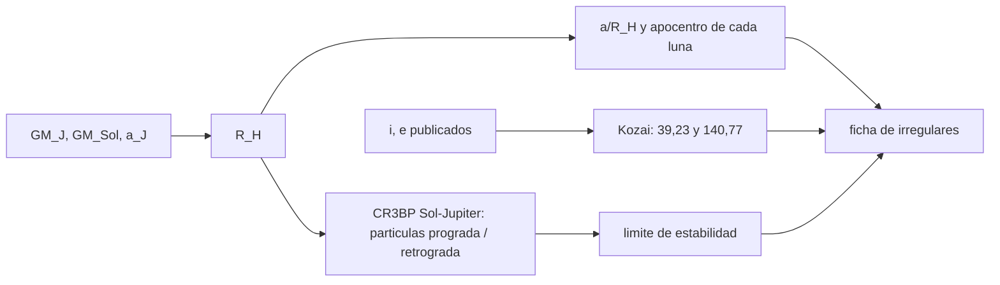

# B73-C18 — Satélites irregulares

<!-- nav:top -->
[🏠 Programa](../../../../README.md) · [📚 Bloque B73](../../../tronco-comun/B73-mecanica-celeste-resonancias-y-caos.md) · [← Anterior: B73-C17 — Estabilidad de sistemas exoplanetarios](../B73-C17-estabilidad-de-sistemas-exoplanetarios/CLASE.md) · [Siguiente: B73-C19 — Mecánica de sistemas lunares →](../B73-C19-mecanica-de-sistemas-lunares/CLASE.md)
<!-- /nav -->

## 1. Ubicación, nivel y alcance

Clase 18 del bloque B73. Nivel N3. Sigue a [B73-C17](../B73-C17-estabilidad-de-sistemas-exoplanetarios/CLASE.md). Aquí estudias los satélites irregulares: lunas lejanas, de órbitas excéntricas e inclinadas, muchas retrógradas. Con elementos publicados de ocho satélites de Júpiter y de Febe (Saturno) calculas la fracción de la esfera de Hill de Júpiter que ocupa cada uno, su inclinación frente a la crítica de Kozai y, con el problema restringido Sol–Júpiter, la estabilidad de partículas de prueba **sintéticas** en órbita progrado y retrógrada. Lo simulado no se presenta como observado.

## 2. Por qué esta clase existe

Los satélites irregulares son capturas: están lejos, en órbitas que ningún proceso de formación local explica. Ocupan una fracción de la esfera de Hill que depende del sentido de giro. La decisión central: **¿hasta qué distancia del planeta puede mantenerse una luna según gire en un sentido o en otro?**

## 3. Lo que podrás hacer al terminar

1. Calcular el radio de Hill de Júpiter con `GM` publicados.
2. Verificarlo contra la distancia numérica a L1.
3. Expresar el semieje y el apocentro de cada luna como fracción de `R_H`.
4. Clasificar las lunas por inclinación frente a la crítica de Kozai.
5. Simular partículas de prueba progradas y retrógradas y hallar su límite de estabilidad.
6. Distinguir lo publicado (elementos) de lo simulado (partículas sintéticas).

La evidencia es la **ficha de los irregulares de Júpiter con su estabilidad** del ejercicio 12 (sección 20).

## 4. Con qué llegas y cómo comprobarlo

1. ¿Qué es la esfera de Hill?
2. ¿Qué es una órbita retrógrada?
3. ¿Qué es la inclinación crítica de Kozai?
4. ¿Qué es la constante de Jacobi?
5. ¿Qué es una partícula de prueba?

<details>
<summary>Ver respuestas</summary>

1. La región donde la gravedad del planeta domina sobre la del Sol: `R_H = a(m/3M)^{1/3}`. 2. Una que gira en sentido contrario al giro del planeta alrededor del Sol (`i > 90°`). 3. El valor `arccos √(3/5) ≈ 39,2°` que separa dos comportamientos de la excentricidad inducida por un perturbador lejano. 4. La cantidad conservada del problema restringido de tres cuerpos. 5. Un cuerpo de masa despreciable usado para explorar la dinámica.
</details>

Con cuatro o cinco aciertos, sigue; si no, repasa los prerrequisitos.

## 5. Un caso de contexto y casos de referencia

El radio de Hill de Júpiter es `53 147 206 km` (`0,06827` de su semieje); la distancia numérica a L1 es `51 906 125 km` (`2,34%` menos). Himalia (`i = 27,5°`) está a `0,216 R_H`; Pasífae (`i = 151,4°`, retrógrada), a `0,445 R_H`. En la simulación sintética, una partícula progrado escapa a partir de `a = 0,5 R_H` y una retrógrada resiste hasta `1,0 R_H`. Es el **ejemplo conductor**. Los elementos son publicados; las partículas son **sintéticas**.

## 6. Vocabulario

Los **satélites irregulares** son lunas distantes con órbitas de gran excentricidad e inclinación, a menudo retrógradas. El **radio de Hill** de un planeta es `R_H = a_p (GM_p/(3GM_☉))^{1/3}`. Los **grupos de inclinación** se agrupan en torno a valores progrado (`≈ 27°`) y retrógrados (`≈ 150°–165°`). La **inclinación crítica de Kozai** es `arccos √(3/5) = 39,23°` y su suplemento `140,77°`. La **estabilidad progrado y retrógrada** se mide por el semieje máximo de una órbita circular que no escapa.

## 7. Modelo mental: un satélite que se mantiene en el borde de una burbuja



*Descripción textual:* los `GM` y el semieje dan el radio de Hill; los elementos publicados se expresan como fracción de `R_H` y se clasifican por inclinación; la simulación sintética acota el límite de estabilidad en ambos sentidos.

Analogía: el borde de una burbuja que contiene al planeta: cerca del centro, las lunas giran en paz; cerca del borde, el viento del Sol las arranca; pero el viento sopla distinto según giren a favor o en contra. Límite: el modelo es plano, circular y sin otras lunas ni la excentricidad de Júpiter.

## 8. La explicación, paso a paso

### 8.1 El radio de Hill

Con `GM_J = 126,687×10⁶ km³/s²`, `GM_☉ = 132 712×10⁶ km³/s²` y `a_J = 778,479×10⁶ km`, `R_H = 53 147 206 km`. La distancia de L1 al planeta, resuelta numéricamente en el CR3BP Sol–Júpiter (`μ = 9,5369e-04`), es `51 906 125 km`: `2,34%` por debajo de `R_H`, dentro del 5 % de tolerancia.

### 8.2 Elementos publicados y fracción de Hill

| Satélite | `a` (10³ km) | `a/R_H` | `(1+e)a/R_H` | `i` (°) | sentido |
|---|---|---|---|---|---|
| Leda | 11 165 | 0,210 | 0,245 | 27,46 | progrado |
| Himalia | 11 461 | 0,216 | 0,251 | 27,50 | progrado |
| Lysithea | 11 717 | 0,220 | 0,245 | 28,30 | progrado |
| Elara | 11 741 | 0,221 | 0,269 | 26,63 | progrado |
| Ananke | 21 276 | 0,400 | 0,498 | 148,9 | retrógrado |
| Carme | 23 404 | 0,440 | 0,552 | 164,9 | retrógrado |
| Pasífae | 23 624 | 0,445 | 0,626 | 151,4 | retrógrado |
| Sinope | 23 939 | 0,450 | 0,563 | 158,1 | retrógrado |

Febe (Saturno): `a = 12 944×10³ km`, `e = 0,164`, `i = 174,8°` (retrógrada); su fracción de Hill no se calcula aquí. Los progrados están dentro de `0,22 R_H` y los retrógrados llegan a `0,45 R_H` (apocentro hasta `0,626 R_H`).

### 8.3 Inclinación

La inclinación crítica de Kozai es `39,23°` (y `140,77°`). Ninguna de las `9` lunas de la lista tiene una inclinación entre ambas (`0` de 9): los progrados están en `26°–28°` y los retrógrados en `149°–175°`. Es una constatación de la lista, no una demostración de que esa región esté vacía en todo el sistema.

### 8.4 Segunda vía: partículas de prueba sintéticas

En el CR3BP plano Sol–Júpiter (RK4, `dt = 2×10⁻³`, 40 años de Júpiter), partículas sintéticas en órbita circular inicial a `f R_H`:

| `f` | progrado: escape (años) | retrógrado: escape (años) |
|---|---|---|
| 0,3 | no escapa | no escapa |
| 0,4 | no escapa | no escapa |
| 0,5 | 3,34 | no escapa |
| 0,6 | 0,46 | no escapa |
| 0,7 | 0,37 | no escapa |
| 0,8 | 0,32 | no escapa |
| 0,9 | 0,17 | no escapa |
| 1,0 | 0,13 | 1,39 |

Las órbitas retrógradas resisten hasta mucho más lejos que las progradas (`0,9 R_H` frente a `0,4 R_H` sin escape en 40 años). La constante de Jacobi se conserva a `2,9e-08` en las trayectorias que no escapan. Son resultados de una fase inicial y un tiempo corto; no son una tabla de estabilidad.

### 8.5 Qué no es este modelo

Un modelo plano, circular y sin excentricidad de Júpiter ni otras lunas; con una sola fase por órbita y 40 años de Júpiter. No explica cómo se capturaron los irregulares, y los resultados de partículas sintéticas no son observaciones de ningún satélite.

## 9. Magnitudes, símbolos y unidades

| Símbolo | Qué es | Unidad | Valor / nota |
|---|---|---|---|
| `R_H` | radio de Hill de Júpiter | km | 53 147 206 |
| `a/R_H` | semieje como fracción de Hill | — | 0,21 a 0,45 |
| `i` | inclinación | grados | 26,6 a 174,8 |
| `i_K` | inclinación crítica de Kozai | grados | 39,23 y 140,77 |
| `f` | fracción de Hill de una partícula sintética | — | 0,3 a 1,0 |

## 10. Convenciones y referencias

Elementos de la ficha NASA/NSSDC (inclinación respecto del plano orbital de Júpiter para los de Júpiter; los de Febe, respecto de la ficha saturniana). `R_H` con el semieje de Júpiter de su ficha. CR3BP plano en el marco sinódico; órbitas circulares kepleriana respecto de Júpiter; escape si `d > 1,5 R_H`. 40 años de Júpiter = 251 unidades.

## 11. De dónde sale lo que afirmamos

| ID | Fuente | Localizador | Respalda | Estado |
|---|---|---|---|---|
| S1 | NASA/NSSDC, Jovian Satellite Fact Sheet — https://nssdc.gsfc.nasa.gov/planetary/factsheet/joviansatfact.html (consultada 2026-11-10) | ficha leída; actualizada el 2023-12-06 | semieje, excentricidad e inclinación de Leda, Himalia, Lysithea, Elara, Ananke, Carme, Pasífae y Sinope | Consultada |
| S2 | NASA/NSSDC, Saturnian Satellite Fact Sheet — https://nssdc.gsfc.nasa.gov/planetary/factsheet/saturniansatfact.html (consultada 2026-11-10) | ficha leída; actualizada el 2025-07-22 | semieje, excentricidad e inclinación de Febe | Consultada |
| S3 | NASA/NSSDC, Jupiter Fact Sheet — https://nssdc.gsfc.nasa.gov/planetary/factsheet/jupiterfact.html (consultada 2026-11-10) | ficha leída; actualizada el 2024-10-02 | GM de Júpiter, semieje 778,479×10⁶ km y radio ecuatorial 71 492 km | Consultada |
| S4 | NASA/NSSDC, Sun Fact Sheet — https://nssdc.gsfc.nasa.gov/planetary/factsheet/sunfact.html (consultada 2026-11-10) | ficha leída; actualizada el 2024-05-09 | GM del Sol = 132 712 × 10⁶ km³/s² | Consultada |
| — | Radio de Hill, inclinación crítica de Kozai y límites de estabilidad prograda y retrógrada (resultados clásicos) | — | las verifica el laboratorio con L1 y con simulaciones | No consultada en una fuente concreta |

Límites: las partículas de prueba son sintéticas; no se consultó ninguna fuente sobre el origen o la captura de los irregulares ni sobre sus familias; el límite de estabilidad se obtiene con una fase inicial y 40 años de Júpiter.

## 12. Cómo ver el borde de la estabilidad

| Magnitud | Valor |
|---|---|
| `R_H` y L1 | 53 147 206 y 51 906 125 km |
| Himalia y Pasífae | 0,216 y 0,445 R_H |
| Kozai | 39,23° y 140,77° |
| límite progrado (sintético) | escape desde 0,5 R_H |
| límite retrógrado (sintético) | escape solo a 1,0 R_H |

Descripción larga: los progrados publicados están en el 22 % interior de la esfera de Hill, los retrógrados llegan al 45 %, y la simulación explica la asimetría: las órbitas progradas pierden la estabilidad mucho antes.

## 13. Ejemplo trabajado: la fracción de Hill de Pasífae

**Paso 1 · Radio de Hill.** `R_H = 53 147 206 km`.

**Paso 2 · Semieje.** `a = 23 624 000 km`.

**Paso 3 · Fracción.** `a/R_H = 0,445`.

**Paso 4 · Apocentro.** Con `e = 0,409`, `(1+e)a/R_H = 0,626`: la órbita llega a un 63 % del radio de Hill.

## 14. Distintas formas de describir un satélite irregular

**Por tamaño:** `a/R_H` y apocentro. **Por inclinación:** progrado o retrógrado, y Kozai. **Por estabilidad:** semieje máximo sin escape. **Por conservación:** `C` de Jacobi.

## 15. Práctica guiada

**Ejercicio 1 · con los pasos indicados.** Calcula `R_H` de Júpiter. *Pasos:* `a_J (GM_J/3GM_☉)^{1/3}`.

<details><summary>Solución comentada</summary>

`53 147 206 km`.
</details>

**Ejercicio 2 · con una pista.** ¿Qué fracción de Hill ocupa Himalia? *Pista:* `11 461 000/R_H`.

<details><summary>Solución comentada</summary>

`0,216`.
</details>

**Ejercicio 3 · casi autónomo.** ¿Qué dice el signo de `i − 90°` sobre una luna?

<details><summary>Solución comentada</summary>

Que es progrado (`i < 90°`) o retrógrado (`i > 90°`).
</details>

## 16. Práctica autónoma, transferencia e integrador

**Ejercicio 4 · autónomo.** `a/R_H` de Sinope.

<details><summary>Solución comentada</summary>

`23 939 000/53 147 206 = 0,450`.
</details>

**Ejercicio 5 · autónomo.** Apocentro de Carme en `R_H`.

<details><summary>Solución comentada</summary>

`0,552`.
</details>

**Ejercicio 6 · autónomo.** Límite de escape progrado en la simulación.

<details><summary>Solución comentada</summary>

`0,5 R_H` (3,34 años).
</details>

**Ejercicio 7 · autónomo.** ¿Cuántas lunas de la lista están entre las dos inclinaciones críticas?

<details><summary>Solución comentada</summary>

`0`.
</details>

**Ejercicio 8 · autónomo.** Diferencia entre `R_H` y L1.

<details><summary>Solución comentada</summary>

`2,34%`.
</details>

**Ejercicio 9 · transferencia.** **Transferencia.** Un colega concluye, con la simulación, que Carme «se capturó a 0,44 R_H». ¿Qué le dices?

<details><summary>Solución comentada</summary>

Que la simulación no estudia captura: solo muestra que una partícula retrógrada en esa región no escapa en 40 años.
</details>

**Ejercicio 10 · transferencia.** **Transferencia.** Si `i` de un asteroide capturado es `100°`, ¿qué predice Kozai?

<details><summary>Solución comentada</summary>

Que cae entre `39,23°` y `140,77°`, donde la excentricidad inducida por el Sol cambia de régimen; el laboratorio no estudia ese efecto.
</details>

**Ejercicio 11 · transferencia.** **Transferencia.** ¿Por qué los progrados de la lista están mucho más cerca de Júpiter que los retrógrados?

<details><summary>Solución comentada</summary>

Coincide con la simulación: las órbitas progradas pierden la estabilidad a partir de `0,5 R_H`, y no se afirma una causa más allá de ese contraste.
</details>

**Ejercicio 12 · integrador.** **Integrador.** Elabora tu *ficha de los irregulares de Júpiter con su estabilidad*: tabla de elementos como fracción de Hill, inclinaciones, límite de estabilidad por sentido (rotulado como sintético) y los límites del modelo.

<details><summary>Solución comentada</summary>

Secciones 8.1–8.5 y la salida del laboratorio.
</details>

## 17. Laboratorio: irregulares de Júpiter y estabilidad prograda/retrógrada

El script [irregulares.py](irregulares.py) calcula `R_H`, lo contrasta con L1, tabula nueve irregulares y simula partículas sintéticas progradas y retrógradas (**comprueba** `|R_H − L1|/R_H < 5 %`, `C` conservada a `10⁻⁶` en las que no escapan y un límite retrógrado mayor que el progrado).

**Datos:** elementos de las fichas NASA/NSSDC y `GM`, semieje y radio de Júpiter (consultados); las partículas son **sintéticas**. **Predice antes de ejecutar:** ¿desde qué fracción de Hill escapan las partículas progradas? (`≈ 0,5`.) **Ejecución del 2026-11-10 (Python 3.12.9):**

```text
Python 3.12.9 (biblioteca estandar)
R_H = a_J (GM_J / 3 GM_S)^(1/3) = 53,147,206 km (0.06827 a_J) ; radio de Jupiter = 71492 km
Segunda via: distancia de L1 a Jupiter (CR3BP) = 0.06668 a_J = 51,906,125 km ; diferencia con R_H = 2.34%
Inclinacion critica de Kozai: 39.23 y 140.77 grados
 satelite              a [km]      a/R_H   (1+e)a/R_H   i [grados]  sentido      en (Kozai, 180-Kozai)?
 Leda                  11,165,000    0.210       0.245       27.46   prógrado     no
 Himalia               11,461,000    0.216       0.251       27.50   prógrado     no
 Lysithea              11,717,000    0.220       0.245       28.30   prógrado     no
 Elara                 11,741,000    0.221       0.269       26.63   prógrado     no
 Ananke                21,276,000    0.400       0.498      148.90   retrogrado   no
 Carme                 23,404,000    0.440       0.552      164.90   retrogrado   no
 Pasiphae              23,624,000    0.445       0.626      151.40   retrogrado   no
 Sinope                23,939,000    0.450       0.563      158.10   retrogrado   no
 Phoebe (Saturno)      12,944,000   (el R_H de Saturno no se calcula aqui)           174.80   retrogrado   no
Satelites de la lista con inclinacion entre 39.2 y 140.8: 0
Simulacion CR3BP Sol-Jupiter (particulas SINTETICAS circulares, 40 anos de Jupiter; escape si d > 1.5 R_H):
   f = a/R_H   prograda: escape en [anos]   retrograda: escape en [anos]   dC prograda  dC retrograda
     0.30                no escapa                     no escapa            8.1e-09     2.9e-08
     0.40                no escapa                     no escapa            5.0e-10     2.5e-09
     0.50                     3.34                     no escapa            4.1e-05     4.6e-10
     0.60                     0.46                     no escapa            1.5e-11     1.5e-10
     0.70                     0.37                     no escapa            7.2e-09     7.7e-11
     0.80                     0.32                     no escapa            3.7e-01     5.1e-11
     0.90                     0.17                     no escapa            2.2e-15     8.2e-11
     1.00                     0.13                          1.39            0.0e+00     1.8e-10
Primera fraccion de R_H con escape: prograda = 0.5 ; retrograda = 1.0
Pruebas superadas.
```

```bash
python programa/clases/B73/B73-C18-satelites-irregulares/irregulares.py
```

**Límites:** CR3BP plano y circular, una fase, 40 años de Júpiter, partículas sintéticas, sin Saturno ni excentricidad de Júpiter.

## 18. Errores frecuentes y cómo corregirlos

**Confundir una partícula de prueba con un satélite real.** Se corrige con la sección 21.

**Ignorar que el sentido de giro cambia la estabilidad.** Se corrige con 8.4.

**Tomar `a/R_H` como medida de la captura.** Se corrige con el ejercicio 9.

**Aplicar Kozai sin el modelo de perturbación.** Se corrige con el ejercicio 10.

## 19. Cómo sabrás que vas bien

Tras la sección 8: ¿qué límite esperabas para las órbitas progradas y cuál obtuviste? Si dudas, repasa el ejemplo 13. Tras el laboratorio: ¿qué comprueba? (ver la sección 17).

## 20. Qué entregas y cómo se evalúa

El producto es tu **ficha de los irregulares de Júpiter con su estabilidad** (ejercicio 12).

| Criterio | Inicial | En desarrollo | Logrado | Destacado |
|---|---|---|---|---|
| Conceptos | Los confunde | Parciales | Calcula Hill y compara progrado y retrógrado | Explica los límites |
| Cálculo | Sin unidades | Con errores | Tablas completas con unidades | Calcula casos nuevos |
| Comprobación | Sin comprobar | Un caso | Contraste con una segunda vía | Interpreta las diferencias |
| Fuentes | Sin fuente | Sin fecha | Fuentes con fecha y estado | Declara lo sintético y lo no consultado |
| Límites | No los nombra | Uno | Tres | Discute qué falta del modelo |

**Condiciones críticas (no se compensan con promedio):** rotular las partículas como sintéticas; no presentar la simulación como observación ni como explicación de la captura; citar solo lo consultado.

## 21. Ética, seguridad y límites

Clase educativa: los modelos son simplificados y sus datos son publicados con fuente o sintéticos rotulados; ningún resultado describe una trayectoria real ni sirve para planificar una misión.  Accesibilidad: tablas equivalentes a las gráficas, fórmulas en texto, ejercicios sin conexión.

## 22. Para cerrar y seguir

Los progrados publicados viven en el `22 %` interior de la esfera de Hill de Júpiter (`53 147 206 km`) y los retrógrados llegan al `45 %`; la simulación sintética hace consistente esa asimetría, con escape progrado desde `0,5 R_H` y retrógrado solo a `1,0 R_H`. Queda una pregunta: ¿qué dinámica ordena un sistema de lunas regulares?

**Glosario español–inglés.** satélite irregular · *irregular satellite*; esfera de Hill · *Hill sphere*; inclinación crítica de Kozai · *critical Kozai inclination*; retrógrado · *retrograde*; progrado · *prograde*.

**Continuidad.** [B73-CC19](../B73-C19-mecanica-de-sistemas-lunares/CLASE.md) estudia la mecánica de sistemas lunares.

**Referencias:** ver sección 11.

<!-- nav:bottom -->
---

[← Anterior: B73-C17 — Estabilidad de sistemas exoplanetarios](../B73-C17-estabilidad-de-sistemas-exoplanetarios/CLASE.md) · [📚 Bloque B73](../../../tronco-comun/B73-mecanica-celeste-resonancias-y-caos.md) · [Siguiente: B73-C19 — Mecánica de sistemas lunares →](../B73-C19-mecanica-de-sistemas-lunares/CLASE.md)
<!-- /nav -->
