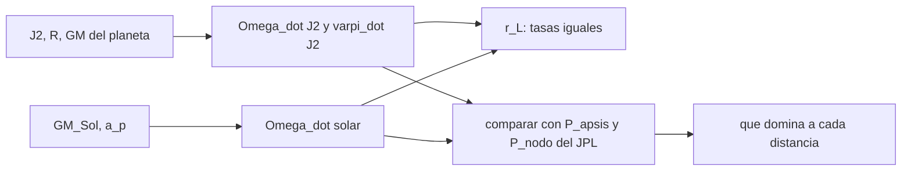

# B73-C19 — Mecánica de sistemas lunares

<!-- nav:top -->
[🏠 Programa](../../../../README.md) · [📚 Bloque B73](../../../tronco-comun/B73-mecanica-celeste-resonancias-y-caos.md) · [← Anterior: B73-C18 — Satélites irregulares](../B73-C18-satelites-irregulares/CLASE.md) · [Siguiente: B73-C20 — Proyecto de integración celeste de precisión →](../../../tronco-comun/B73-mecanica-celeste-resonancias-y-caos.md#b73-c20)
<!-- /nav -->

## 1. Ubicación, nivel y alcance

Clase 19 del bloque B73. Nivel N3. Sigue a [B73-C18](../B73-C18-satelites-irregulares/CLASE.md). Aquí estudias la mecánica de un sistema de lunas regulares: calculas los radios de Hill y de Laplace de Júpiter y Saturno con `GM`, `J₂` y radios publicados, las precesiones apsidal y nodal por el achatamiento (`J₂`) y por el Sol, las comparas con los periodos de precesión de los cuatro galileanos de la tabla del JPL, y verificas el radio de Laplace por igualdad de tasas. La comparación con el JPL es una prueba honesta de hasta dónde llega un modelo de `J₂` más el Sol. No hay datos sintéticos.

## 2. Por qué esta clase existe

Un sistema lunar es un problema de varios perturbadores: el achatamiento del planeta aleja los nodos y los ápsides, el Sol los tira, y las lunas se perturban entre sí. Saber cuál domina a cada distancia decide en qué plano y con qué precesión se mueve una luna. La decisión central: **¿qué perturbación domina a cada distancia y cuánto puedo confiar en un modelo de `J₂` más el Sol?**

## 3. Lo que podrás hacer al terminar

1. Calcular el radio de Hill de Júpiter y Saturno.
2. Calcular la regresión nodal y la precesión apsidal por `J₂` de una luna.
3. Añadir la regresión nodal solar y definir el radio de Laplace.
4. Comparar las predicciones con los periodos de precesión del JPL.
5. Reconocer cuándo una precesión está forzada por una resonancia (Io).
6. Ubicar a Titán e Jápeto respecto del radio de Laplace de Saturno.

La evidencia es la **ficha dinámica del sistema galileano** del ejercicio 12 (sección 20).

## 4. Con qué llegas y cómo comprobarlo

1. ¿Qué es el achatamiento `J₂`?
2. ¿Qué es la regresión nodal?
3. ¿Qué es la precesión apsidal?
4. ¿Qué es un plano de Laplace?
5. ¿Qué es un periodo de precesión?

<details>
<summary>Ver respuestas</summary>

1. El coeficiente adimensional del término cuadrupolar del potencial de un planeta oblato. 2. El giro lento del nodo ascendente de una órbita, en sentido contrario al movimiento orbital. 3. El giro lento de la línea de ápsides. 4. El plano alrededor del cual precesa la órbita de una luna por efecto combinado del planeta y del Sol. 5. El tiempo en dar una vuelta completa el ángulo que precesa.
</details>

Con cuatro o cinco aciertos, sigue; si no, repasa los prerrequisitos.

## 5. Un caso de contexto y casos de referencia

El radio de Hill de Júpiter es `53 147 206 km` y su radio de Laplace `2 324 328 km` (`32,5 R_J`): Calisto, a `0,81 r_L`, está cerca de donde el Sol domina. Para Europa, `J₂` solo da un periodo nodal de `38,8` años frente a `30,2` del JPL. El periodo apsidal de Ío en el JPL (`1,333` años = `486,9 d`) coincide con la circulación de la conjunción Ío–Europa de [B73-C10](../B73-C10-resonancias-de-movimiento-medio/CLASE.md) (`486,8 d`) dentro de `0,01%`. Es el **ejemplo conductor**. Todos los datos son publicados.

## 6. Vocabulario

El **radio de Hill** es `R_H = a_p (GM_p/(3GM_☉))^{1/3}`. La **regresión nodal por `J₂`** es `Ω̇ = −(3/2) J₂ (R/a)² n` y la **precesión apsidal por `J₂`**, `ϖ̇ ≈ 3 J₂ (R/a)² n`. La **regresión nodal solar** de un perturbador circular es `−(3/4) n_p²/n`. El **radio de Laplace** `r_L` (aquí definido igualando las dos tasas nodales) es `r_L⁵ = 2 J₂ R² a_p³ GM_p/GM_☉`; otras referencias lo definen con otro factor numérico.

## 7. Modelo mental: una peonza con dos manos que la empujan



*Descripción textual:* el planeta (`J₂`) y el Sol aportan tasas de precesión que se igualan en `r_L`; las predicciones se comparan con los periodos del JPL para saber qué más actúa.

Analogía: una peonza empujada por dos manos: cerca del eje manda la mano del planeta, lejos manda la del Sol; en medio, ambas importan. Límite: las otras lunas son manos adicionales que este modelo no incluye.

## 8. La explicación, paso a paso

### 8.1 Hill y Laplace

Con `GM`, `J₂` y radios de las fichas: `R_H(Júpiter) = 53 147 206 km`, `R_H(Saturno) = 65 403 164 km` (distancia al Sol de la ficha). Igualando `(3/2) J₂ (R/a)² n` con `(3/4) n_p²/n` se obtiene `r_L = 2 324 328 km = 32,5 R_J` (Júpiter) y `2 508 714 km = 41,6 R_S` (Saturno). Comprobando por separado las dos tasas en `r_L`, su cociente menos uno es `3,7e-15`.

### 8.2 Galileanos: modelo frente al JPL

| Luna | `a/R_J` | `a/r_L` | `P_ápside` `J₂` (años) | `P_ápside` JPL | `P_nodo` `J₂` | `P_nodo` `J₂+Sol` | `P_nodo` JPL |
|---|---|---|---|---|---|---|---|
| Ío | 5,90 | 0,181 | 3,814 | 1,333 | 7,628 | 7,626 | — |
| Europa | 9,39 | 0,289 | 19,379 | 1,394 | 38,759 | 38,681 | 30,202 |
| Ganímedes | 14,97 | 0,461 | 99,327 | 68,301 | 198,655 | 194,618 | 137,812 |
| Calisto | 26,33 | 0,810 | 716,782 | 277,921 | 1433,564 | 1062,573 | 577,264 |

El modelo no reproduce los periodos del JPL: Europa, Ganímedes y Calisto tienen periodos nodales entre un `28 %` y un `148 %` mayores que los del JPL. Con `J₂` y el Sol solos, las otras lunas, los términos de orden superior y la inclinación respecto del plano de Laplace no están. Para Calisto, añadir el Sol baja el periodo de `1434` a `1063` años: el sentido de la corrección es el correcto, el tamaño no basta.

### 8.3 Ío: una precesión forzada por la resonancia

La `J₂` solo daría a Ío un periodo apsidal de `3,81` años; el JPL da `1,333`. Esa cifra equivale a `486,9 d`, que es la circulación de la conjunción Ío–Europa (`n_Ío − 2n_Europa`, ficha NASA) de B73-C10: `486,8 d`, diferencia `0,01%`. En Ío el ápside sigue a la conjunción y no al achatamiento: es una precesión forzada por la resonancia.

### 8.4 Saturno

Para Saturno, `r_L = 2 508 714 km`. Titán (`1 221 870 km`) está a `0,487 r_L` y Jápeto (`3 560 850 km`), a `1,419 r_L`. Con esta definición Jápeto queda fuera del radio de Laplace y Titán dentro; la inclinación observada de Jápeto no se consultó. En fracción de Hill, Titán está a `0,0187 R_H` y Jápeto a `0,0544 R_H`; Calisto, a `0,0354 R_H` de Júpiter.

### 8.5 Lectura

Los galileanos y Titán están en el 4 % inferior de la esfera de Hill (Calisto a `0,0354 R_H`, Titán a `0,0187 R_H`); dentro de ellas, el achatamiento domina cerca del planeta y el Sol lejos, y las resonancias pueden dominar a ambos (Ío). La conclusión práctica es que una predicción nodal solo con `J₂` puede fallar un factor 2.

## 9. Magnitudes, símbolos y unidades

| Símbolo | Qué es | Unidad | Valor / nota |
|---|---|---|---|
| `J₂` | achatamiento | — | 0,014736 (Júpiter); 0,016298 (Saturno) |
| `R` | radio ecuatorial | km | 71 492 (J); 60 268 (S) |
| `r_L` | radio de Laplace | km | 2 324 328 (J); 2 508 714 (S) |
| `P_ápside, P_nodo` | periodos de precesión | años | ver 8.2 |
| `R_H` | radio de Hill | km | 53 147 206 (J); 65 403 164 (S) |

## 10. Convenciones y referencias

Órbitas casi circulares y de baja inclinación respecto del plano de Laplace; `1 año = 365,25 d`. `GM` de Saturno deducido con `G` de CODATA 2018. Los periodos «JPL» son las columnas `Papsis` y `Pnode` de la tabla de elementos de satélites (época 2000-01-01.5, plano de Laplace). Periodos de las lunas de la ficha NASA/NSSDC.

## 11. De dónde sale lo que afirmamos

| ID | Fuente | Localizador | Respalda | Estado |
|---|---|---|---|---|
| S1 | NASA/NSSDC, Jupiter Fact Sheet — https://nssdc.gsfc.nasa.gov/planetary/factsheet/jupiterfact.html (consultada 2026-11-10) | ficha leída; actualizada el 2024-10-02 | GM, radio ecuatorial 71 492 km, `J₂` = 14 736×10⁻⁶, semieje 778,479×10⁶ km y periodo de Júpiter | Consultada |
| S2 | NASA/NSSDC, Saturn Fact Sheet — https://nssdc.gsfc.nasa.gov/planetary/factsheet/saturnfact.html (consultada 2026-11-10) | ficha leída; actualizada el 2025-03-18 | masa 568,32×10²⁴ kg, radio ecuatorial 60 268 km y `J₂` = 16 298×10⁻⁶ de Saturno | Consultada |
| S3 | NASA/NSSDC, Sun Fact Sheet — https://nssdc.gsfc.nasa.gov/planetary/factsheet/sunfact.html (consultada 2026-11-10) | ficha leída; actualizada el 2024-05-09 | GM del Sol | Consultada |
| S4 | NASA/NSSDC, Planetary Fact Sheet (métrico) — https://nssdc.gsfc.nasa.gov/planetary/factsheet/ (consultada 2026-11-10) | tabla comparativa leída; actualizada el 2025-03-18 | distancia al Sol de Saturno 1432,0×10⁶ km | Consultada |
| S5 | NASA/NSSDC, Jovian Satellite Fact Sheet — https://nssdc.gsfc.nasa.gov/planetary/factsheet/joviansatfact.html (consultada 2026-11-10) | ficha leída; actualizada el 2023-12-06 | semiejes y periodos de los galileanos | Consultada |
| S6 | NASA/NSSDC, Saturnian Satellite Fact Sheet — https://nssdc.gsfc.nasa.gov/planetary/factsheet/saturniansatfact.html (consultada 2026-11-10) | ficha leída; actualizada el 2025-07-22 | semiejes de Titán y Jápeto | Consultada |
| S7 | NASA JPL SSD, Planetary Satellite Mean Elements — https://ssd.jpl.nasa.gov/sats/elem/ (consultada 2026-11-10) | tabla de elementos medios, época 2000-01-01.5 TDB; planos de Laplace (galileanos con JUP365, saturnianos con SAT441), eclíptica para la Luna (DE405) | columnas Papsis y Pnode de los galileanos | Consultada |
| S8 | NASA JPL SSD, Planetary Physical Parameters — https://ssd.jpl.nasa.gov/planets/phys_par.html (consultada 2026-11-10) | tabla de masas y radios medios; registro de cambios 2019-12-12 (CODATA 2018) | G de CODATA 2018 citada en el registro de cambios (2019-12-12) | Consultada |
| — | Fórmulas de precesión por `J₂` y por el Sol y radio de Laplace (resultados clásicos) | — | el laboratorio las contrasta con la tabla del JPL | No consultada en una fuente concreta |

Límites: no se consultó la inclinación observada de Jápeto ni el plano de Laplace publicado de ninguna luna; las fórmulas no incluyen la perturbación mutua de las lunas ni términos de orden superior; la definición de `r_L` usa un factor numérico propio.

## 12. Cómo ver quién domina

| Magnitud | Valor |
|---|---|
| `r_L` de Júpiter | 2 324 328 km (32,5 R_J) |
| Calisto en `r_L` | 0,810 |
| Europa: `P_nodo` modelo y JPL | 38,8 y 30,2 años |
| Ío: `P_ápside` JPL y circulación | 486,9 d y 486,8 d |
| Jápeto en `r_L` de Saturno | 1,419 |

Descripción larga: el achatamiento domina cerca de Júpiter, el Sol cerca de `r_L`, y el modelo simple se queda corto en factores de hasta 2,5 frente a los periodos del JPL.

## 13. Ejemplo trabajado: regresión nodal de Europa por J₂

**Paso 1 · Datos.** `R/a = 71 492/671 100 = 0,10653`; `n = 360°/3,551181 d = 101,37 °/d`; `J₂ = 0,014736`.

**Paso 2 · Tasa.** `Ω̇ = 1,5 × 0,014736 × 0,10653² × 101,37 = 0,0254 °/d`.

**Paso 3 · Periodo.** `360/0,0254 = 14 160 d = 38,8` años.

**Paso 4 · Contraste.** El JPL da `30,202` años: el modelo se queda corto en `28 %`.

## 14. Distintas formas de describir un sistema lunar

**Por jerarquía:** `R_H` y `r_L`. **Por precesión:** `Ω̇` y `ϖ̇`. **Por resonancia:** forzada por otras lunas. **Por comparación:** modelo frente a la tabla del JPL.

## 15. Práctica guiada

**Ejercicio 1 · con los pasos indicados.** Calcula `R_H` de Júpiter. *Pasos:* `a_J (GM_J/3GM_☉)^{1/3}`.

<details><summary>Solución comentada</summary>

`53 147 206 km`.
</details>

**Ejercicio 2 · con una pista.** ¿A cuántos `R_J` está Ío? *Pista:* `421 800/71 492`.

<details><summary>Solución comentada</summary>

`5,90`.
</details>

**Ejercicio 3 · casi autónomo.** ¿Qué luna está más cerca de `r_L` de Júpiter?

<details><summary>Solución comentada</summary>

Calisto: `a/r_L = 0,810`.
</details>

## 16. Práctica autónoma, transferencia e integrador

**Ejercicio 4 · autónomo.** Periodo nodal por `J₂` de Ganímedes.

<details><summary>Solución comentada</summary>

`198,7` años.
</details>

**Ejercicio 5 · autónomo.** Periodo nodal `J₂+Sol` de Calisto.

<details><summary>Solución comentada</summary>

`1062,6` años.
</details>

**Ejercicio 6 · autónomo.** Diferencia entre `P_ápside` de Ío del JPL y la circulación de la conjunción.

<details><summary>Solución comentada</summary>

`0,01%`.
</details>

**Ejercicio 7 · autónomo.** `a/r_L` de Titán.

<details><summary>Solución comentada</summary>

`0,487`.
</details>

**Ejercicio 8 · autónomo.** ¿Por qué el modelo falla más para Calisto?

<details><summary>Solución comentada</summary>

Porque está cerca de `r_L` y las otras lunas (en especial Ganímedes) la perturban; el modelo no las incluye.
</details>

**Ejercicio 9 · transferencia.** **Transferencia.** Un colega dice que el plano de Calisto debe ser el ecuatorial de Júpiter porque `J₂` domina. ¿Qué le muestras?

<details><summary>Solución comentada</summary>

Que a `0,81 r_L` el Sol ya cuenta mucho: añadirlo baja el periodo nodal de `1434` a `1063` años; el plano de referencia no es el ecuatorial.
</details>

**Ejercicio 10 · transferencia.** **Transferencia.** Un informe usa `J₂` solo para predecir el nodo de Europa a 30 años. ¿Qué error esperar?

<details><summary>Solución comentada</summary>

El periodo predicho difiere un `28 %` del del JPL: la tasa sería un `22 %` menor; no es adecuado para más precisión.
</details>

**Ejercicio 11 · transferencia.** **Transferencia.** ¿Qué indica que `P_ápside` de Ío del JPL coincida con la circulación de la conjunción Ío–Europa?

<details><summary>Solución comentada</summary>

Que la línea de ápsides de Ío es forzada por la resonancia con Europa, no por el achatamiento.
</details>

**Ejercicio 12 · integrador.** **Integrador.** Elabora tu *ficha dinámica del sistema galileano*: radios de Hill y Laplace, tabla de periodos modelo frente a JPL, el caso de Ío, la posición de Titán y Jápeto y una lista de lo que el modelo no incluye.

<details><summary>Solución comentada</summary>

Secciones 8.1–8.5 y la salida del laboratorio.
</details>

## 17. Laboratorio: Hill, Laplace y precesiones de las lunas galileanas

El script [sistemas_lunares.py](sistemas_lunares.py) calcula `R_H` y `r_L` de Júpiter y Saturno, las precesiones por `J₂` y por el Sol, las compara con la tabla del JPL y con la circulación de B73-C10 (**comprueba** igualdad de tasas en `r_L` `< 10⁻⁹` y `P_ápside` de Ío frente a la circulación `< 0,5 %`).

**Datos:** `GM`, `J₂`, radios, semiejes y periodos de las fichas NASA/NSSDC y del JPL (consultados); sin datos sintéticos. **Predice antes de ejecutar:** ¿cuánto valdrá `r_L` de Júpiter? (`≈ 2,3×10⁶ km`.) **Ejecución del 2026-11-10 (Python 3.12.9):**

```text
Python 3.12.9 (biblioteca estandar)
Radio de Hill: Jupiter = 53,147,206 km ; Saturno = 65,403,164 km (con la distancia al Sol de la ficha)
Radio de Laplace (igualdad de tasas nodales J2 y solar): Jupiter = 2,324,328 km (32.5 R_J ; 0.0437 R_H) ; Saturno = 2,508,714 km (41.6 R_S ; 0.0384 R_H)
Comprobacion en el radio de Laplace de Jupiter (n_p kepleriano de Jupiter): tasa J2 / tasa solar - 1 = 3.7e-15
Galileanos: precesion por J2 (y J2 + Sol) frente a los periodos del JPL (anos):
 luna       a/R_J   a/rL    P_apsis J2   P_apsis JPL    P_nodo J2   P_nodo J2+Sol   P_nodo JPL
 Io          5.90   0.181        3.814        1.333        7.628         7.626           -
 Europa      9.39   0.289       19.379        1.394       38.759        38.681      30.202
 Ganymede   14.97   0.461       99.327       68.301      198.655       194.618     137.812
 Callisto   26.33   0.810      716.782      277.921     1433.564      1062.573     577.264
Io: P_apsis (JPL) = 1.333 anos = 486.9 d ; circulacion de la conjuncion Io-Europa (B73-C10) = 486.8 d ; diferencia = 0.01%
Saturno: Titan a/r_L = 0.487 ; Iapetus a/r_L = 1.419 ; Titan a/R_H = 0.0187 ; Iapetus a/R_H = 0.0544
Pruebas superadas.
```

```bash
python programa/clases/B73/B73-C19-mecanica-de-sistemas-lunares/sistemas_lunares.py
```

**Límites:** modelo de `J₂` más el Sol, sin perturbación mutua de las lunas, `r_L` con un factor propio, y sin la inclinación respecto del plano de Laplace.

## 18. Errores frecuentes y cómo corregirlos

**Tomar el radio de Laplace por una frontera exacta.** Se corrige con la sección 10: su factor depende de la definición.

**Creer que `J₂` explica todas las precesiones.** Se corrige con 8.2 y 8.3.

**Confundir la precesión de Ío con la del achatamiento.** Se corrige con 8.3.

**Ignorar que los periodos del JPL son del plano de Laplace.** Se corrige con la sección 10.

## 19. Cómo sabrás que vas bien

Tras la sección 8: ¿qué periodo nodal esperabas para Europa y cuál obtuviste? Si dudas, repasa el ejemplo 13. Tras el laboratorio: ¿qué comprueba? (ver la sección 17).

## 20. Qué entregas y cómo se evalúa

El producto es tu **ficha dinámica del sistema galileano** (ejercicio 12).

| Criterio | Inicial | En desarrollo | Logrado | Destacado |
|---|---|---|---|---|
| Conceptos | Los confunde | Parciales | Calcula precesiones y las compara con el JPL | Explica los límites |
| Cálculo | Sin unidades | Con errores | Tablas completas con unidades | Calcula casos nuevos |
| Comprobación | Sin comprobar | Un caso | Contraste con una segunda vía | Interpreta las diferencias |
| Fuentes | Sin fuente | Sin fecha | Fuentes con fecha y estado | Declara lo sintético y lo no consultado |
| Límites | No los nombra | Uno | Tres | Discute qué falta del modelo |

**Condiciones críticas (no se compensan con promedio):** no presentar el modelo como exacto cuando falla hasta un factor 2,5; declarar la definición propia de `r_L`; citar solo lo consultado.

## 21. Ética, seguridad y límites

Clase educativa: los modelos son simplificados y sus datos son publicados con fuente o sintéticos rotulados; ningún resultado describe una trayectoria real ni sirve para planificar una misión.  Accesibilidad: tablas equivalentes a las gráficas, fórmulas en texto, ejercicios sin conexión.

## 22. Para cerrar y seguir

El achatamiento y el Sol dan precesiones del orden correcto pero no exactas (hasta un factor 2,5), el radio de Laplace de Júpiter queda en `2 324 328 km` y la precesión de Ío sigue a la conjunción con Europa (`0,01%`). Queda una pregunta: ¿cómo se integra un encuentro cercano con una luna sin perder exactitud?

**Glosario español–inglés.** radio de Laplace · *Laplace radius*; plano de Laplace · *Laplace plane*; regresión nodal · *nodal regression*; precesión apsidal · *apsidal precession*; achatamiento · *oblateness*.

**Continuidad.** [B73-CC20](../B73-C20-proyecto-de-integracion-celeste-de-precision/CLASE.md) trata los pasos cercanos a satélites naturales en integración de N cuerpos.

**Referencias:** ver sección 11.

<!-- nav:bottom -->
---

[← Anterior: B73-C18 — Satélites irregulares](../B73-C18-satelites-irregulares/CLASE.md) · [📚 Bloque B73](../../../tronco-comun/B73-mecanica-celeste-resonancias-y-caos.md) · [Siguiente: B73-C20 — Proyecto de integración celeste de precisión →](../../../tronco-comun/B73-mecanica-celeste-resonancias-y-caos.md#b73-c20)
<!-- /nav -->
