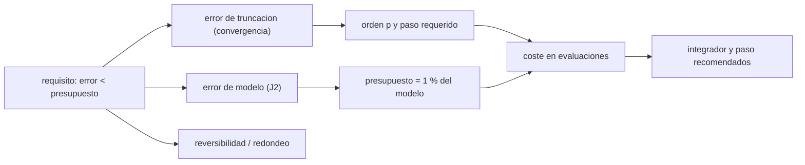

# B73-C20 — Proyecto de integración celeste de precisión

<!-- nav:top -->
[🏠 Programa](../../../../README.md) · [📚 Bloque B73](../../../tronco-comun/B73-mecanica-celeste-resonancias-y-caos.md) · [← Anterior: B73-C19 — Mecánica de sistemas lunares](../B73-C19-mecanica-de-sistemas-lunares/CLASE.md) · [Siguiente: B73-C21 — Pasos cercanos a satélites naturales en integración de N cuerpos →](../B73-C21-pasos-cercanos-a-satelites-naturales-en-integracion-de-n-cuerpos/CLASE.md)
<!-- /nav -->

## 1. Ubicación, nivel y alcance

Clase 20 del bloque B73, el proyecto integrador. Nivel N3. Reúne [B73-C08](../B73-C08-sistemas-de-n-cuerpos/CLASE.md) y [B73-C09](../B73-C09-integracion-de-largo-plazo/CLASE.md) en un informe de precisión: integras el sistema de Júpiter y los galileanos durante una órbita de Calisto con un leapfrog de orden 2 y un Yoshida de orden 4, mides la convergencia frente a una referencia de paso fino, estimas el error de modelo con el achatamiento `J₂` de Júpiter, compruebas la reversibilidad y decides, con un presupuesto de error, qué integrador y qué paso usar. Los `GM`, semiejes y `J₂` son publicados; las condiciones iniciales son **sintéticas**.

## 2. Por qué esta clase existe

Una integración «de precisión» no es la que usa el paso más pequeño sino la que mantiene el error numérico por debajo de la incertidumbre del modelo, con el menor coste. Sin ese presupuesto se gasta cómputo sin ganar exactitud o se afirma una exactitud que no existe. La decisión central: **¿qué integrador y qué paso garantizan que el error numérico sea despreciable frente al error de modelo?**

## 3. Lo que podrás hacer al terminar

1. Definir requisitos de precisión de una integración (horizonte, métrica, presupuesto).
2. Medir el orden de convergencia frente a una referencia de paso fino.
3. Estimar el error de modelo comparando con y sin `J₂`.
4. Comprobar la reversibilidad temporal.
5. Calcular el paso requerido y el coste de cada integrador para un presupuesto dado.
6. Redactar un informe de precisión con recomendación y límites.

La evidencia es la **informe de precisión de una integración** del ejercicio 12 (sección 20).

## 4. Con qué llegas y cómo comprobarlo

1. ¿Qué es una referencia de paso fino?
2. ¿Qué es el orden de un integrador?
3. ¿Qué es un error de modelo?
4. ¿Qué es un presupuesto de error?
5. ¿Qué es la reversibilidad?

<details>
<summary>Ver respuestas</summary>

1. Una solución con un paso mucho menor que sirve como valor casi exacto para medir errores. 2. El exponente `p` tal que el error global escala con `dt^p`. 3. La diferencia entre el sistema real y las ecuaciones que se integran. 4. La asignación de una cota a cada fuente de error para cumplir un requisito total. 5. Que integrar hacia adelante y hacia atrás con el mismo paso devuelve el estado inicial.
</details>

Con cuatro o cinco aciertos, sigue; si no, repasa los prerrequisitos.

## 5. Un caso de contexto y casos de referencia

Para una órbita de Calisto (`16,689 d`), el efecto de `J₂` de Júpiter sobre las posiciones es de `31 550 km`. Con `dt = 200 s` el leapfrog tiene un error de truncación de `557 km` (`1,8%` del efecto de `J₂`); Yoshida 4 con `dt = 400 s`, `1,67 km`, con tres veces más evaluaciones por paso pero `5e-05` del efecto. Para un presupuesto del 1 %, el leapfrog necesita `9 577` evaluaciones y Yoshida `2 919`. Es el **ejemplo conductor**. Las condiciones iniciales son **sintéticas**.

## 6. Vocabulario

El **presupuesto de error** reparte una cota entre truncación, redondeo y modelo. La **convergencia** mide el error frente a una referencia al variar `dt`: el orden estimado es `log₂(e(dt)/e(dt/2))`. El **error de modelo** aquí es el efecto de añadir `J₂`. El **coste** es el número de evaluaciones de la fuerza: leapfrog `1` por paso, Yoshida `3`. El **paso requerido** para un presupuesto `ε` es `dt·(ε/e)^{1/p}`.

## 7. Modelo mental: una balanza con tres platillos



*Descripción textual:* los requisitos fijan un presupuesto frente al error de modelo; la convergencia da el paso requerido de cada integrador; el coste decide cuál usar.

Analogía: una balanza con tres platillos: error de modelo, de truncación y de redondeo; de nada sirve afinar un platillo si otro pesa mil veces más. Límite: el presupuesto reparte errores independientes, y estos pueden combinarse de otra forma.

## 8. La explicación, paso a paso

### 8.1 Requisito y montaje

El sistema es el de B73-C08 (Júpiter y cuatro galileanos, condiciones sintéticas) con una referencia Yoshida 4 de `dt = 25 s` (57 677 pasos, 173 031 evaluaciones) y un horizonte de `16,689 d`. La métrica es la mayor diferencia de posición entre las cuatro lunas.

### 8.2 Convergencia

| método | `dt` (s) | evaluaciones | error de energía | error de posición (km) | orden |
|---|---|---|---|---|---|
| leapfrog | 1600 | 901 | 1,6e-06 | 35 585 | — |
| leapfrog | 800 | 1 802 | 5,8e-08 | 8 909 | 2,00 |
| leapfrog | 400 | 3 605 | 7,8e-09 | 2 227 | 2,00 |
| leapfrog | 200 | 7 210 | 3,3e-09 | 557 | 2,00 |
| Yoshida 4 | 3200 | 1 353 | 8,7e-08 | 6 861 | — |
| Yoshida 4 | 1600 | 2 703 | 3,2e-09 | 429 | 4,00 |
| Yoshida 4 | 800 | 5 406 | 1,9e-10 | 26,8 | 4,00 |
| Yoshida 4 | 400 | 10 815 | 1,2e-11 | 1,67 | 4,00 |

Los órdenes medidos son `2,00` y `4,00`: el código implementa los métodos que dice.

### 8.3 Error de modelo y reversibilidad

Añadir `J₂` de Júpiter (`14 736×10⁻⁶`, radio `71 492 km`) cambia las posiciones en `31 550 km` tras `16,689 d`. Esa cifra es la escala frente a la cual el error numérico se considera despreciable. La reversibilidad del leapfrog (`dt = 400 s`, `T` adelante y `T` atrás) da `5,9e-07 km`, es decir redondeo.

### 8.4 Presupuesto

Un presupuesto de truncación del 1 % del efecto de `J₂` son `315,5 km`. Extrapolando con el orden medido: el leapfrog necesita `dt ≈ 151 s` y `9 577` evaluaciones; Yoshida 4, `dt ≈ 1482 s` y `2 919` evaluaciones, `3,3` veces menos. Con ese presupuesto la integración de cuarto orden es más barata.

### 8.5 Recomendación y límites

Para este sistema, horizonte y presupuesto: Yoshida 4 con `dt ≈ 1400 s` (verificado con la referencia). Límites: horizonte corto (una órbita de Calisto), condiciones sintéticas, sin mareas ni relatividad; el error de modelo solo incluye `J₂` y no es la incertidumbre real del sistema; para horizontes mucho más largos hay que repetir el estudio, porque el error de fase crece.

## 9. Magnitudes, símbolos y unidades

| Símbolo | Qué es | Unidad | Valor / nota |
|---|---|---|---|
| `dt` | paso de tiempo | s | 200 a 3200 |
| `p` | orden estimado | — | 2,00 y 4,00 |
| `e_pos` | error de posición frente a la referencia | km | ver 8.2 |
| `ε` | presupuesto de truncación | km | 315,5 |
| `N_ev` | evaluaciones de la fuerza | — | ver 8.2 y 8.4 |

## 10. Convenciones y referencias

Marco del baricentro, plano `xy`. `GM` en km³/s²; `J₂` ecuatorial con aceleración central `−(3/2) J₂ GM R²/r⁴` sobre las lunas y reacción sobre Júpiter. Referencia: Yoshida 4 con `dt = 25 s`. Errores de posición como máximo sobre las cuatro lunas.

## 11. De dónde sale lo que afirmamos

| ID | Fuente | Localizador | Respalda | Estado |
|---|---|---|---|---|
| S1 | NASA JPL SSD, Planetary Satellite Physical Parameters — https://ssd.jpl.nasa.gov/sats/phys_par/ (consultada 2026-11-10) | tabla de GM y radio medio; GM de la Luna (DE440), los galileanos (JUP365), Titán, Encélado y Mimas (SAT441) | GM de Ío, Europa, Ganímedes y Calisto (JUP365) | Consultada |
| S2 | NASA/NSSDC, Jupiter Fact Sheet — https://nssdc.gsfc.nasa.gov/planetary/factsheet/jupiterfact.html (consultada 2026-11-10) | ficha leída; actualizada el 2024-10-02 | GM de Júpiter, radio ecuatorial 71 492 km y `J₂` = 14 736×10⁻⁶ | Consultada |
| S3 | NASA JPL SSD, Planetary Satellite Mean Elements — https://ssd.jpl.nasa.gov/sats/elem/ (consultada 2026-11-10) | tabla de elementos medios, época 2000-01-01.5 TDB; planos de Laplace (galileanos con JUP365, saturnianos con SAT441), eclíptica para la Luna (DE405) | semiejes medios de los galileanos (J2000) | Consultada |
| — | Leapfrog, composición de Yoshida de orden 4, acción de `J₂` sobre una luna ecuatorial (métodos y fórmulas estándar) | — | las verifica el laboratorio con la convergencia medida | No consultada en una fuente concreta |

Límites: las condiciones iniciales son sintéticas; el error de modelo incluye solo `J₂`; no se consultó una efeméride de referencia ni la incertidumbre real de los `GM`; el horizonte es de una órbita de Calisto.

## 12. Cómo ver el presupuesto

| Magnitud | Valor |
|---|---|
| órdenes medidos | 2,00 y 4,00 |
| efecto de `J₂` | 31 550 km |
| truncación leapfrog `dt = 200 s` | 557 km |
| truncación Yoshida `dt = 400 s` | 1,67 km |
| coste para el 1 % (leapfrog y Yoshida) | 9 577 y 2 919 |

Descripción larga: el error numérico baja con el orden esperado, el modelo domina por órdenes de magnitud y el integrador de cuarto orden cumple el mismo presupuesto con menos cuentas.

## 13. Ejemplo trabajado: el paso de Yoshida para un presupuesto del 1 %

**Paso 1 · Error medido.** Con `dt = 400 s`, `e = 1,67 km`.

**Paso 2 · Presupuesto.** `ε = 315,5 km`.

**Paso 3 · Paso requerido.** `dt = 400 × (ε/e)^{1/4} = 1482 s`.

**Paso 4 · Coste.** `2 919` evaluaciones.

## 14. Distintas formas de describir la precisión de una integración

**Por convergencia:** `e(dt)` y `p`. **Por modelo:** efecto de `J₂`. **Por reversibilidad:** ida y vuelta. **Por coste:** evaluaciones para el presupuesto.

## 15. Práctica guiada

**Ejercicio 1 · con los pasos indicados.** Calcula el orden entre `dt = 400` y `200 s` del leapfrog. *Pasos:* `log₂(e₄₀₀/e₂₀₀)`.

<details><summary>Solución comentada</summary>

`log₂(2 227/557) = 2,00`.
</details>

**Ejercicio 2 · con una pista.** ¿Cuántas evaluaciones hace Yoshida con 3605 pasos? *Pista:* 3 por paso.

<details><summary>Solución comentada</summary>

`10 815`.
</details>

**Ejercicio 3 · casi autónomo.** ¿Qué fracción del efecto de `J₂` es el error del leapfrog a `dt = 200 s`?

<details><summary>Solución comentada</summary>

`1,8%`.
</details>

## 16. Práctica autónoma, transferencia e integrador

**Ejercicio 4 · autónomo.** Orden estimado de Yoshida entre `dt = 800` y `400 s`.

<details><summary>Solución comentada</summary>

`4,00`.
</details>

**Ejercicio 5 · autónomo.** Evaluaciones del leapfrog para el 1 %.

<details><summary>Solución comentada</summary>

`9 577`.
</details>

**Ejercicio 6 · autónomo.** Cociente de coste leapfrog/Yoshida para el 1 %.

<details><summary>Solución comentada</summary>

`3,3`.
</details>

**Ejercicio 7 · autónomo.** ¿Por qué la reversibilidad da `6e-07 km`?

<details><summary>Solución comentada</summary>

Por redondeo: el leapfrog es reversible y el error acumulado es de máquina.
</details>

**Ejercicio 8 · autónomo.** ¿Qué pasa con el error de energía de Yoshida a `dt = 400 s`?

<details><summary>Solución comentada</summary>

Vale `1,2e-11`, mucho menor que el del leapfrog con `dt = 200 s` (`3,3e-09`).
</details>

**Ejercicio 9 · transferencia.** **Transferencia.** Un equipo propone `dt = 1 s` «por si acaso». ¿Qué le dices con este presupuesto?

<details><summary>Solución comentada</summary>

Que `dt = 1 s` costaría `≈ 1,4×10⁶` pasos y reduciría un error numérico que ya es `10⁻³` del error de modelo; el cómputo no mejora la exactitud física.
</details>

**Ejercicio 10 · transferencia.** **Transferencia.** El efecto de `J₂` se estima con una referencia de otro integrador. ¿Es válido comparar?

<details><summary>Solución comentada</summary>

Sí si ambos usan la misma referencia de paso fino; si no, la diferencia mezcla errores de truncación con el efecto físico.
</details>

**Ejercicio 11 · transferencia.** **Transferencia.** Un revisor pregunta si el resultado vale para un horizonte de 10 años. ¿Qué respondes?

<details><summary>Solución comentada</summary>

Que no: el estudio es de una órbita de Calisto; el error de fase crece con el tiempo y hay que repetir la convergencia en el horizonte pedido.
</details>

**Ejercicio 12 · integrador.** **Integrador.** Elabora tu *informe de precisión de una integración*: requisito y presupuesto, tabla de convergencia con órdenes, error de modelo, reversibilidad, paso requerido y coste, recomendación y límites.

<details><summary>Solución comentada</summary>

Secciones 8.1–8.5 y la salida del laboratorio.
</details>

## 17. Laboratorio: informe de precisión del sistema joviano

El script [integracion_precision.py](integracion_precision.py) integra con leapfrog y Yoshida 4 a varios pasos, mide convergencia frente a una referencia, el efecto de `J₂`, la reversibilidad y calcula el paso requerido para un presupuesto (**comprueba** órdenes dentro de ±0,4, truncación `< 10 %` y `< 0,1 %` del efecto de `J₂` y reversibilidad `< 10⁻⁶ km`).

**Datos:** `GM`, `J₂`, radio y semiejes de la NASA/JPL (consultados); condiciones iniciales **sintéticas**. **Predice antes de ejecutar:** ¿qué orden medirás para Yoshida? (`4`.) **Ejecución del 2026-11-10 (Python 3.12.9):**

```text
Python 3.12.9 (biblioteca estandar)
Referencia: Yoshida 4, dt = 25 s (57677 pasos, 173031 evaluaciones); T = 16.689 d
 metodo     dt [s]   pasos   evaluaciones   error de energia   error de posicion [km]   orden estimado
 leapfrog     1600     901          901           1.64e-06              3.558e+04            -
 leapfrog      800    1802         1802           5.79e-08              8.909e+03           2.00
 leapfrog      400    3605         3605           7.80e-09              2.227e+03           2.00
 leapfrog      200    7210         7210           3.34e-09              5.567e+02           2.00
 yoshida4     3200     451         1353           8.73e-08              6.861e+03            -
 yoshida4     1600     901         2703           3.23e-09              4.295e+02           4.00
 yoshida4      800    1802         5406           1.93e-10              2.682e+01           4.00
 yoshida4      400    3605        10815           1.20e-11              1.674e+00           4.00
Error de modelo: efecto de J2 de Jupiter sobre las posiciones tras 16.689 d = 31,549.7 km (maximo entre las cuatro lunas)
Reversibilidad (leapfrog, dt = 400 s, T adelante y T atras): diferencia de posicion = 5.91e-07 km
Presupuesto: error de truncacion leapfrog dt=200 s = 5.57e+02 km ; Yoshida dt=400 s = 1.67e+00 km ; modelo (J2) = 31,549.7 km ; cociente truncacion/modelo = 1.8e-02 y 5.3e-05
Con un presupuesto de truncacion del 1 % del efecto de J2 (315.5 km), extrapolando con el orden medido:
   leapfrog : dt requerido =   150.6 s ; pasos =     9577 ; evaluaciones =      9577
   yoshida4 : dt requerido =  1482.0 s ; pasos =      973 ; evaluaciones =      2919
Pruebas superadas.
```

```bash
python programa/clases/B73/B73-C20-proyecto-de-integracion-celeste-de-precision/integracion_precision.py
```

**Límites:** una órbita de Calisto, error de modelo solo con `J₂`, referencia de la propia familia de integradores, condiciones sintéticas.

## 18. Errores frecuentes y cómo corregirlos

**Reducir el paso sin un presupuesto.** Se corrige con 8.4 y el ejercicio 9.

**Confundir error numérico con incertidumbre física.** Se corrige con 8.3.

**Usar una referencia de un método peor.** Se corrige con 8.1.

**Extrapolar el paso a otro horizonte.** Se corrige con el ejercicio 11.

## 19. Cómo sabrás que vas bien

Tras la sección 8: ¿qué orden esperabas para Yoshida y cuál mediste? Si dudas, repasa el ejemplo 13. Tras el laboratorio: ¿qué comprueba? (ver la sección 17).

## 20. Qué entregas y cómo se evalúa

El producto es tu **informe de precisión de una integración** (ejercicio 12).

| Criterio | Inicial | En desarrollo | Logrado | Destacado |
|---|---|---|---|---|
| Conceptos | Los confunde | Parciales | Define un presupuesto y elige integrador | Explica los límites |
| Cálculo | Sin unidades | Con errores | Tablas completas con unidades | Calcula casos nuevos |
| Comprobación | Sin comprobar | Un caso | Contraste con una segunda vía | Interpreta las diferencias |
| Fuentes | Sin fuente | Sin fecha | Fuentes con fecha y estado | Declara lo sintético y lo no consultado |
| Límites | No los nombra | Uno | Tres | Discute qué falta del modelo |

**Condiciones críticas (no se compensan con promedio):** rotular las condiciones iniciales como sintéticas; presentar el presupuesto con su referencia; no extrapolar a otros horizontes; citar solo lo consultado.

## 21. Ética, seguridad y límites

Clase educativa: los modelos son simplificados y sus datos son publicados con fuente o sintéticos rotulados; ningún resultado describe una trayectoria real ni sirve para planificar una misión.  Accesibilidad: tablas equivalentes a las gráficas, fórmulas en texto, ejercicios sin conexión.

## 22. Para cerrar y seguir

Con órdenes medidos de `2,00` y `4,00`, un error de modelo de `31 550 km` y un presupuesto del 1 %, Yoshida 4 cumple con `2 919` evaluaciones frente a `9 577` del leapfrog. Queda una pregunta: ¿qué ocurre cuando un cuerpo pasa muy cerca de una luna?

**Glosario español–inglés.** presupuesto de error · *error budget*; convergencia · *convergence*; error de modelo · *model error*; referencia · *reference solution*; paso adaptativo · *adaptive step*.

**Continuidad.** [B73-CC21](../B73-C21-pasos-cercanos-a-satelites-naturales-en-integracion-de-n-cuerpos/CLASE.md) estudia los pasos cercanos a satélites naturales.

**Referencias:** ver sección 11.

<!-- nav:bottom -->
---

[← Anterior: B73-C19 — Mecánica de sistemas lunares](../B73-C19-mecanica-de-sistemas-lunares/CLASE.md) · [📚 Bloque B73](../../../tronco-comun/B73-mecanica-celeste-resonancias-y-caos.md) · [Siguiente: B73-C21 — Pasos cercanos a satélites naturales en integración de N cuerpos →](../B73-C21-pasos-cercanos-a-satelites-naturales-en-integracion-de-n-cuerpos/CLASE.md)
<!-- /nav -->
