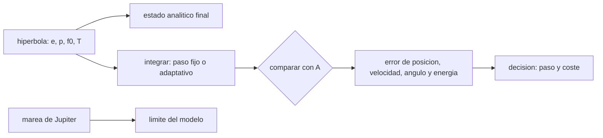

# B73-C21 — Pasos cercanos a satélites naturales en integración de N cuerpos

<!-- nav:top -->
[🏠 Programa](../../../../README.md) · [📚 Bloque B73](../../../tronco-comun/B73-mecanica-celeste-resonancias-y-caos.md) · [← Anterior: B73-C20 — Proyecto de integración celeste de precisión](../B73-C20-proyecto-de-integracion-celeste-de-precision/CLASE.md) · [Siguiente: B73-C22 — Capturas temporales y cuasi-satélites →](../B73-C22-capturas-temporales-y-cuasi-satelites/CLASE.md)
<!-- /nav -->

## 1. Ubicación, nivel y alcance

Clase 21 del bloque B73 (clase programada de la ampliación, ahora redactada). Nivel N3. Sigue a [B73-C20](../B73-C20-proyecto-de-integracion-celeste-de-precision/CLASE.md), cuyo presupuesto usaba un paso fijo adecuado para órbitas casi circulares. Aquí integras un paso cercano a Europa con gravedad solo de Europa y lo comparas con la solución hiperbólica analítica: leapfrog y Runge–Kutta 4 de paso fijo frente a RK4 con paso adaptativo `dt = η min(r/|v|, √(r³/GM))`. Los `GM`, radio y semieje de Europa son publicados; el cuerpo de prueba es **sintético**.

## 2. Por qué esta clase existe

Un encuentro con una luna cambia la dirección y la energía de un cuerpo en pocos minutos, y un paso de tiempo fijado para el resto del sistema puede dar un resultado muy erróneo allí. Pero un paso adaptativo también cuesta. La decisión central: **¿cómo elijo el paso en un encuentro cercano y cuánto gano frente a un paso fijo?**

## 3. Lo que podrás hacer al terminar

1. Calcular la solución hiperbólica analítica de un paso cercano.
2. Establecer el radio de Hill de una luna y su alcance en un modelo de dos cuerpos.
3. Integrar el encuentro con leapfrog y RK4 de paso fijo.
4. Implementar un paso adaptativo ligado a `r/|v|` y `√(r³/GM)`.
5. Comparar errores de posición, velocidad, ángulo de salida y energía con la solución analítica.
6. Cuantificar la ganancia del paso adaptativo a coste similar y acotar el error del modelo (marea de Júpiter).

La evidencia es la **comparación de errores de deflexión** del ejercicio 12 (sección 20).

## 4. Con qué llegas y cómo comprobarlo

1. ¿Qué es una órbita hiperbólica?
2. ¿Qué es la deflexión?
3. ¿Qué es el paso adaptativo?
4. ¿Qué es un radio de Hill?
5. ¿Qué es una marea?

<details>
<summary>Ver respuestas</summary>

1. Una trayectoria de excentricidad `e > 1`, con velocidad en el infinito `v_∞`. 2. El ángulo que gira la velocidad durante el paso: `2 arcsin(1/e)` entre asíntotas. 3. Elegir el paso de cada iteración según la escala de tiempo local del problema. 4. El radio de la región donde manda la gravedad de la luna frente a la del planeta. 5. La diferencia de atracción del cuerpo lejano entre dos puntos cercanos.
</details>

Con cuatro o cinco aciertos, sigue; si no, repasa los prerrequisitos.

## 5. Un caso de contexto y casos de referencia

Con `v_∞ = 5 km/s` (sintético), altura de periapsis de `100 km` sobre Europa (`r_p = 1660,8 km`) y salida a `r₀ = 0,5 R_H = 6 828 km` (`R_H = 13 657 km`), la excentricidad es `13,964`, el tiempo de vuelo `2585 s` y el ángulo entre las velocidades de entrada y salida `7,9379°`. RK4 de paso fijo `60 s` da un error de posición de `1,2e-03 km` con `44` pasos; el leapfrog, de `0,27 km`. Es el **ejemplo conductor**. El cuerpo de prueba es **sintético**.

## 6. Vocabulario

La **hipérbola** `r = p/(1 + e cos f)` con `p = r_p(1+e)` y `e = 1 + r_p v_∞²/GM` da el estado analítico en cada anomalía verdadera `f`; el tiempo de vuelo sale de la ecuación de Kepler hiperbólica `M = e sinh H − H`. La **deflexión asintótica** es `2 arcsin(1/e)`. El **paso adaptativo** `dt = η min(r/|v|, √(r³/GM))` es proporcional a la escala de tiempo local. La **marea de Júpiter** relativa es `2 GM_J r/a³ ÷ (GM_E/r²)`.

## 7. Modelo mental: una cámara lenta que se activa al pasar cerca



*Descripción textual:* la hipérbola da la respuesta exacta; los integradores se prueban contra ella con paso fijo y adaptativo y se decide por error y coste; la marea de Júpiter acota qué tan válido es el modelo de dos cuerpos.

Analogía: al pasar junto a una curva cerrada en bicicleta, se frena y se mira más a menudo; en la recta se puede mirar menos. El paso adaptativo hace eso con la integración. Límite: si la curva no es muy cerrada, mirar más a menudo en todos lados cuesta poco y no importa.

## 8. La explicación, paso a paso

### 8.1 La solución analítica

`R_H(Europa) = a_E (GM_E/(3GM_J))^{1/3} = 13 657 km`. Con `v_∞ = 5 km/s` y `r_p = 1660,8 km`, `e = 13,9640` y la velocidad en el periapsis es `5,3719 km/s`. La deflexión asintótica es `8,2132°`, pero entre `±f₀` (con `r₀ = 6 828 km`, no infinito) el ángulo es `7,9379°`: se compara contra este último. El tiempo de vuelo es `2584,7 s`.

### 8.2 Integraciones

| método | parámetro | pasos | error de posición (km) | error de ángulo (°) | error de energía |
|---|---|---|---|---|---|
| leapfrog | dt = 60 s | 44 | 2,72e-01 | 2,3e-03 | 1,1e-07 |
| leapfrog | dt = 20 s | 130 | 3,01e-02 | 2,6e-04 | 1,2e-08 |
| RK4 | dt = 60 s | 44 | 1,19e-03 | 1,0e-05 | 7,6e-08 |
| RK4 | dt = 20 s | 130 | 1,50e-05 | 1,3e-07 | 3,2e-10 |
| RK4 | dt = 5 s | 517 | 5,90e-08 | 5,1e-10 | 3,1e-13 |
| RK4 adaptativo | η = 0,01 | 427 | 6,90e-08 | 6,0e-10 | 3,8e-14 |
| RK4 adaptativo | η = 0,003 | 1421 | 5,58e-10 | 4,8e-12 | 2,0e-15 |

### 8.3 Lectura

En este encuentro liso, RK4 de paso fijo `60 s` ya da un error de posición de `1,2e-03 km` (≈ 1 m); el leapfrog con el mismo paso, de `0,27 km`. El orden se ve: bajar el paso de `60` a `20 s` baja el error del leapfrog `9×` (orden 2) y el de RK4 `79×` (orden 4). El paso mínimo del adaptativo con `η = 0,01` es `3,09 s`, cerca del periapsis.

### 8.4 Ganancia a coste similar

A un error de posición similar (`≈ 6×10⁻⁸ km`), RK4 con `dt = 5 s` hace `517` pasos y el adaptativo con `η = 0,01`, `427`: un `17%` menos de pasos. Es una ganancia moderada: el encuentro es corto y tiene una escala de tiempo que cambia solo un factor 4 entre `r₀` y `r_p`. La comparación «`dt = 60 s` frente a `η = 0,003`» (cociente de errores de `2e+06`) exagera, porque el adaptativo usa `1421` pasos frente a `44`. Con encuentros más profundos o más lentos, o excentricidades altas, la ganancia sería mayor; no se ensayó.

### 8.5 Límite del modelo

Solo se incluye la gravedad de Europa. La marea de Júpiter es `8,3%` de la gravedad de Europa a `r₀` y `0,12%` en el periapsis: para una predicción de precisión hay que integrar el sistema de varios cuerpos de [B73-C08](../B73-C08-sistemas-de-n-cuerpos/CLASE.md), con paso adaptativo, y la solución analítica deja de ser la referencia. Los errores de la tabla son respecto del modelo de dos cuerpos, no de la realidad.

## 9. Magnitudes, símbolos y unidades

| Símbolo | Qué es | Unidad | Valor / nota |
|---|---|---|---|
| `GM_E` | parámetro gravitacional de Europa | km³/s² | 3202,71210 |
| `r_p` | radio de periapsis | km | 1660,8 |
| `v_∞` | velocidad en el infinito (sintética) | km/s | 5 |
| `e` | excentricidad | — | 13,964 |
| `η` | parámetro del paso adaptativo | — | 0,01 y 0,003 |

## 10. Convenciones y referencias

Marco centrado en Europa, plano orbital `xy`, periapsis en `+x`. `R_H` con `a = 671 100 km`. Estado inicial a `r₀ = 0,5 R_H` en la rama de entrada (`f = −f₀`); estado final a `f = +f₀`. El error de ángulo es la diferencia con el ángulo entre las velocidades analíticas de entrada y salida.

## 11. De dónde sale lo que afirmamos

| ID | Fuente | Localizador | Respalda | Estado |
|---|---|---|---|---|
| S1 | NASA JPL SSD, Planetary Satellite Physical Parameters — https://ssd.jpl.nasa.gov/sats/phys_par/ (consultada 2026-11-10) | tabla de GM y radio medio; GM de la Luna (DE440), los galileanos (JUP365), Titán, Encélado y Mimas (SAT441) | GM de Europa = 3202,71210 km³/s² y radio medio 1560,8 km | Consultada |
| S2 | NASA JPL SSD, Planetary Satellite Mean Elements — https://ssd.jpl.nasa.gov/sats/elem/ (consultada 2026-11-10) | tabla de elementos medios, época 2000-01-01.5 TDB; planos de Laplace (galileanos con JUP365, saturnianos con SAT441), eclíptica para la Luna (DE405) | semieje medio de Europa 671 100 km | Consultada |
| S3 | NASA/NSSDC, Jupiter Fact Sheet — https://nssdc.gsfc.nasa.gov/planetary/factsheet/jupiterfact.html (consultada 2026-11-10) | ficha leída; actualizada el 2024-10-02 | GM de Júpiter = 126,687×10⁶ km³/s² | Consultada |
| — | Hipérbola de Kepler, deflexión `2 arcsin(1/e)` y ecuación de Kepler hiperbólica (resultados clásicos) | — | el laboratorio los usa como respuesta exacta | No consultada en una fuente concreta |

Límites: el cuerpo de prueba y su velocidad son sintéticos; el modelo omite la marea de Júpiter (hasta un 8,3 % a `r₀`); solo se ensayó un tipo de encuentro; no se consultó una referencia sobre pasos adaptativos en N cuerpos.

## 12. Cómo ver el error de un paso cercano

| Magnitud | Valor |
|---|---|
| error RK4 `dt = 60 s` | 1,2e-03 km (44 pasos) |
| error leapfrog `dt = 60 s` | 0,27 km |
| adaptativo `η = 0,01` | 6,9e-08 km (427 pasos) |
| ahorro de pasos a error similar | 17% |
| marea de Júpiter a `r₀` | 8,3% |

Descripción larga: todos los métodos reproducen la hipérbola a metros o mejor; el adaptativo ahorra pasos a igual error pero con una ganancia moderada en este encuentro liso.

## 13. Ejemplo trabajado: la excentricidad del encuentro

**Paso 1 · Datos.** `GM_E = 3202,71`, `r_p = 1660,8 km`, `v_∞ = 5 km/s`.

**Paso 2 · Excentricidad.** `e = 1 + r_p v_∞²/GM = 1 + 1660,8 × 25/3202,71`.

**Paso 3 · Resultado.** `e = 13,964`.

**Paso 4 · Deflexión.** `2 arcsin(1/e) = 8,213°`.

## 14. Distintas formas de describir un paso cercano

**Analítica:** hipérbola. **Numérica de paso fijo:** leapfrog, RK4. **Numérica adaptativa:** `η`. **Por marea:** error del modelo de dos cuerpos.

## 15. Práctica guiada

**Ejercicio 1 · con los pasos indicados.** Calcula `e` para `r_p = 1660,8 km`, `v_∞ = 5 km/s`. *Pasos:* `1 + r_p v²/GM`.

<details><summary>Solución comentada</summary>

`13,964`.
</details>

**Ejercicio 2 · con una pista.** Calcula la deflexión asintótica. *Pista:* `2 arcsin(1/e)`.

<details><summary>Solución comentada</summary>

`8,213°`.
</details>

**Ejercicio 3 · casi autónomo.** ¿Cuántos pasos hace RK4 con `dt = 60 s`?

<details><summary>Solución comentada</summary>

`44`.
</details>

## 16. Práctica autónoma, transferencia e integrador

**Ejercicio 4 · autónomo.** Error de posición de RK4 con `dt = 20 s`.

<details><summary>Solución comentada</summary>

`1,5e-05 km`.
</details>

**Ejercicio 5 · autónomo.** Cociente de errores del leapfrog entre `dt = 60` y `20 s`.

<details><summary>Solución comentada</summary>

`0,272/0,030 ≈ 9`: orden 2.
</details>

**Ejercicio 6 · autónomo.** Paso mínimo del adaptativo con `η = 0,01`.

<details><summary>Solución comentada</summary>

`3,09 s`.
</details>

**Ejercicio 7 · autónomo.** Marea de Júpiter en el periapsis.

<details><summary>Solución comentada</summary>

`0,12%` de la gravedad de Europa.
</details>

**Ejercicio 8 · autónomo.** ¿Cuál es el ahorro de pasos a error similar?

<details><summary>Solución comentada</summary>

`17%` con `η = 0,01` frente a `dt = 5 s`.
</details>

**Ejercicio 9 · transferencia.** **Transferencia.** Un colega afirma que el paso adaptativo es siempre mucho mejor que el fijo. ¿Qué le respondes con estos datos?

<details><summary>Solución comentada</summary>

A error similar solo ahorra `17%` de pasos en este encuentro; la ganancia depende de cuánto varíe la escala de tiempo; la comparación con un paso grueso la exagera.
</details>

**Ejercicio 10 · transferencia.** **Transferencia.** Un equipo usa el modelo de dos cuerpos para un paso de Europa a `0,5 R_H`. ¿Qué le adviertes?

<details><summary>Solución comentada</summary>

Que la marea de Júpiter es `8,3%` de la gravedad de Europa a esa distancia: hace falta el modelo de N cuerpos para precisión; el error de la tabla es solo del integrador.
</details>

**Ejercicio 11 · transferencia.** **Transferencia.** ¿Cómo usarías la solución analítica en una integración de N cuerpos real?

<details><summary>Solución comentada</summary>

Como prueba unitaria de la parte de dos cuerpos: si el integrador no reproduce la hipérbola al nivel esperado, no se puede confiar en él en el sistema completo.
</details>

**Ejercicio 12 · integrador.** **Integrador.** Elabora tu *comparación de errores de deflexión*: hipérbola analítica, tabla de errores de cada integrador y paso, ahorro de pasos a error similar, límite del modelo por la marea de Júpiter y recomendación.

<details><summary>Solución comentada</summary>

Secciones 8.1–8.5 y la salida del laboratorio.
</details>

## 17. Laboratorio: paso cercano a Europa: fijo frente a adaptativo

El script [encuentro_cercano.py](encuentro_cercano.py) integra el encuentro con cinco pasos fijos y dos adaptativos y compara con la hipérbola (**comprueba** adaptativo con `η = 0,003` con error de posición `< 1 km` y de ángulo `< 10⁻⁴°`, y paso fijo `dt = 60 s` con error mayor de 100 veces).

**Datos:** `GM`, radio y semieje de Europa y `GM` de Júpiter (consultados); cuerpo de prueba, `v_∞` y altura **sintéticos**. **Predice antes de ejecutar:** ¿cuánto ahorra el paso adaptativo a error similar? (`≈ 17 %`, no un factor.) **Ejecución del 2026-11-10 (Python 3.12.9):**

```text
Python 3.12.9 (biblioteca estandar)
Europa: R_H = 13,657 km ; r0 = 6,828 km ; r_p = 1660.8 km ; e = 13.9640 ; v_p = 5.3719 km/s ; deflexion analitica = 8.2132 grados ; tiempo de vuelo = 2584.7 s
Cota de la marea de Jupiter respecto de la gravedad de Europa: a r0 = 8.3% ; en el periapsis = 0.12% (se desprecia en el modelo)
Angulo entre las velocidades analiticas en -f0 y +f0 (r0 finito) = 7.9379 grados (la deflexion asintotica es 8.2132)
 metodo      parametro      pasos   paso minimo [s]   error posicion [km]   error velocidad [m/s]   error deflexion [grados]   error energia
 leapfrog       dt=60 s         44           60.00           2.718e-01             2.051e-01                2.307e-03      1.09e-07
 leapfrog       dt=20 s        130           20.00           3.013e-02             2.273e-02                2.557e-04      1.16e-08
 rk4            dt=60 s         44           60.00           1.189e-03             9.415e-04                1.040e-05      7.60e-08
 rk4            dt=20 s        130           20.00           1.504e-05             1.170e-05                1.313e-07      3.19e-10
 rk4            dt=5 s         517            5.00           5.902e-08             4.558e-08                5.128e-10      3.07e-13
 rk4 adaptativo eta=0.01       427            3.09           6.897e-08             5.295e-08                5.957e-10      3.77e-14
 rk4 adaptativo eta=0.003     1421            0.93           5.583e-10             4.287e-10                4.824e-12      2.00e-15
RK4 con dt = 60 s frente a RK4 adaptativo (eta = 0.003): error de posicion 2130335 veces mayor con 44 pasos frente a 1421
A coste similar: RK4 dt = 5 s (517 pasos, error 5.9e-08 km) frente a RK4 adaptativo eta = 0.01 (427 pasos, error 6.9e-08 km): ahorro de pasos = 17%
Pruebas superadas.
```

```bash
python programa/clases/B73/B73-C21-pasos-cercanos-a-satelites-naturales-en-integracion-de-n-cuerpos/encuentro_cercano.py
```

**Límites:** dos cuerpos, un solo tipo de encuentro, sin marea de Júpiter, paso adaptativo simple, RK4 no simpléctico.

## 18. Errores frecuentes y cómo corregirlos

**Comparar un paso grueso con uno adaptativo fino y concluir que el adaptativo es 10⁶ veces mejor.** Se corrige con 8.4.

**Usar la deflexión asintótica en vez del ángulo con `r₀` finito.** Se corrige con 8.1.

**Olvidar la marea de Júpiter.** Se corrige con 8.5.

**Cambiar el paso en un integrador simpléctico sin cuidado.** Se corrige con [B73-C09](../B73-C09-integracion-de-largo-plazo/CLASE.md): variar el paso rompe la conservación acotada de la energía.

## 19. Cómo sabrás que vas bien

Tras la sección 8: ¿cuánto ahorraba el adaptativo y cuánto esperabas? Si dudas, repasa el ejemplo 13. Tras el laboratorio: ¿qué comprueba? (ver la sección 17).

## 20. Qué entregas y cómo se evalúa

El producto es tu **comparación de errores de deflexión** (ejercicio 12).

| Criterio | Inicial | En desarrollo | Logrado | Destacado |
|---|---|---|---|---|
| Conceptos | Los confunde | Parciales | Compara integradores contra la hipérbola | Explica los límites |
| Cálculo | Sin unidades | Con errores | Tablas completas con unidades | Calcula casos nuevos |
| Comprobación | Sin comprobar | Un caso | Contraste con una segunda vía | Interpreta las diferencias |
| Fuentes | Sin fuente | Sin fecha | Fuentes con fecha y estado | Declara lo sintético y lo no consultado |
| Límites | No los nombra | Uno | Tres | Discute qué falta del modelo |

**Condiciones críticas (no se compensan con promedio):** rotular el cuerpo de prueba como sintético; no exagerar la ganancia del paso adaptativo; declarar el límite del modelo de dos cuerpos.

## 21. Ética, seguridad y límites

Clase educativa: los modelos son simplificados y sus datos son publicados con fuente o sintéticos rotulados; ningún resultado describe una trayectoria real ni sirve para planificar una misión.  Accesibilidad: tablas equivalentes a las gráficas, fórmulas en texto, ejercicios sin conexión.

## 22. Para cerrar y seguir

La hipérbola de Europa (`e = 13,96`, ángulo de salida `7,94°`) se reproduce a metros con RK4 de `60 s` y a `6e-10 km` con paso adaptativo; a error similar el adaptativo ahorra `17%` de pasos, y la marea de Júpiter limita el modelo de dos cuerpos a un `8%` a `r₀`. Queda una pregunta: ¿cómo puede un cuerpo quedar atrapado temporalmente cerca de un planeta?

**Glosario español–inglés.** paso cercano · *close approach*; hipérbola · *hyperbola*; paso adaptativo · *adaptive step*; deflexión · *deflection*; marea · *tide*.

**Continuidad.** [B73-CC22](../B73-C22-capturas-temporales-y-cuasi-satelites/CLASE.md) estudia las capturas temporales y los cuasi-satélites.

**Referencias:** ver sección 11.

<!-- nav:bottom -->
---

[← Anterior: B73-C20 — Proyecto de integración celeste de precisión](../B73-C20-proyecto-de-integracion-celeste-de-precision/CLASE.md) · [📚 Bloque B73](../../../tronco-comun/B73-mecanica-celeste-resonancias-y-caos.md) · [Siguiente: B73-C22 — Capturas temporales y cuasi-satélites →](../B73-C22-capturas-temporales-y-cuasi-satelites/CLASE.md)
<!-- /nav -->
