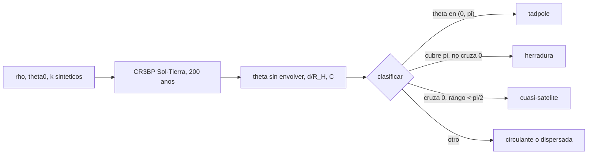

# B73-C22 — Capturas temporales y cuasi-satélites

<!-- nav:top -->
[🏠 Programa](../../../../README.md) · [📚 Bloque B73](../../../tronco-comun/B73-mecanica-celeste-resonancias-y-caos.md) · [← Anterior: B73-C21 — Pasos cercanos a satélites naturales en integración de N cuerpos](../B73-C21-pasos-cercanos-a-satelites-naturales-en-integracion-de-n-cuerpos/CLASE.md) · [Siguiente: B74-C01 — Modelos de observación →](../../B74/B74-C01-modelos-de-observacion/CLASE.md)
<!-- /nav -->

## 1. Ubicación, nivel y alcance

Clase 22 del bloque B73 (clase programada de la ampliación `0.2.0`, ahora redactada), con la que cierra el bloque. Nivel N3. Sigue a [B73-C21](../B73-C21-pasos-cercanos-a-satelites-naturales-en-integracion-de-n-cuerpos/CLASE.md). Aquí clasificas órbitas coorbitales de la Tierra en el problema restringido Sol–Tierra (tadpole, herradura y cuasi-satélite) a partir del ángulo heliocéntrico respecto de la Tierra, y estudias capturas temporales de partículas a `0,5 R_H` según su velocidad inicial. **Todas las partículas son sintéticas**; solo el `GM` del Sol y la distancia Sol–Tierra son datos publicados, y el `GM` de la Tierra es aproximado.

## 2. Por qué esta clase existe

Un asteroide puede acompañar a la Tierra durante siglos sin orbitarla: dando vueltas alrededor de L4 (tadpole), de L3–L4–L5 (herradura) o de la propia Tierra (cuasi-satélite); y puede ser capturado temporalmente dentro de su esfera de Hill. Distinguirlos requiere una clasificación operativa y una advertencia: no son satélites. La decisión central: **¿cómo se clasifica una órbita coorbital y qué significa «captura temporal»?**

## 3. Lo que podrás hacer al terminar

1. Calcular el radio de Hill de la Tierra con `GM` publicados.
2. Definir el ángulo coorbital `θ` sin envolver respecto de la Tierra.
3. Clasificar tadpole, herradura y cuasi-satélite con criterios explícitos.
4. Verificar la conservación de la constante de Jacobi en las simulaciones.
5. Medir el tiempo de captura temporal de partículas a `0,5 R_H` en función de su velocidad.
6. Distinguir un cuasi-satélite de un satélite y rotular lo sintético.

La evidencia es la **tabla de clasificación de órbitas coorbitales** del ejercicio 12 (sección 20).

## 4. Con qué llegas y cómo comprobarlo

1. ¿Qué es una órbita coorbital?
2. ¿Qué es el ángulo coorbital?
3. ¿Qué es el radio de Hill?
4. ¿Qué es una constante de Jacobi?
5. ¿Qué es un dato sintético?

<details>
<summary>Ver respuestas</summary>

1. Una órbita con el mismo semieje promedio que el planeta, es decir, resonancia 1:1. 2. La diferencia de longitud heliocéntrica entre el cuerpo y el planeta. 3. El radio de la región donde manda la gravedad del planeta: `R_H = a(μ/3)^{1/3}`. 4. La cantidad conservada del problema restringido de tres cuerpos. 5. Uno propuesto para el ejemplo, no medido.
</details>

Con cuatro o cinco aciertos, sigue; si no, repasa los prerrequisitos.

## 5. Un caso de contexto y casos de referencia

En el sistema Sol–Tierra (`μ = 3,0035e-06`, `R_H = 0,01000` UA `= 1 496 579 km`), una partícula sintética con `θ₀ = 50°` y `ρ = 1` oscila entre `50,0°` y `71,8°` (tadpole); con `ρ = 1,004` y `θ₀ = 20°`, entre `11,7°` y `348,3°` (herradura); con `ρ = 0,95` y `e = 0,05`, entre `-6,7°` y `6,7°` y a `4,7–11,7 R_H` de la Tierra (cuasi-satélite). Es el **ejemplo conductor**. **Las partículas son sintéticas.**

## 6. Vocabulario

El **ángulo coorbital** `θ = λ_part − λ_Tierra` (sin envolver) distingue: **tadpole** (`θ` oscila alrededor de `±60°` sin cruzar `0` ni `π`), **herradura** (`θ` cubre `π` sin cruzar `0` ni `2π`) y **cuasi-satélite** (`θ` oscila alrededor de `0` con una amplitud pequeña y la partícula se mantiene a unos pocos `R_H`). Una **captura temporal** es una permanencia dentro de la esfera de Hill por un tiempo finito antes de escapar.

## 7. Modelo mental: tres formas de acompañar a un corredor



*Descripción textual:* se integran 200 años de cada partícula sintética, se sigue `θ` sin envolver y se clasifica según cruce o no `0` y `π`; la constante de Jacobi sirve de comprobación.

Analogía: tres formas de acompañar a un corredor en una pista circular: ir un poco por delante o por detrás oscilando (tadpole), alternar yendo delante y detrás pasando por el lado opuesto (herradura), o rodearlo en pequeños lazos sin alejarse (cuasi-satélite). Límite: el cuasi-satélite no orbita a la Tierra: ambos orbitan al Sol.

## 8. La explicación, paso a paso

### 8.1 El modelo

CR3BP plano Sol–Tierra con `μ = GM_T/(GM_S+GM_T) = 3,0035e-06` (`GM_T` aproximado) y `R_H = (μ/3)^{1/3} = 0,01000` UA. Cada partícula parte con radio heliocéntrico `ρ`, ángulo `θ₀` y velocidad `k` veces la circular heliocéntrica (en unidades adimensionales). Se integran 200 años con RK4 (`dt = 0,01`).

### 8.2 Clasificación

| caso | `ρ` | `θ₀` | `k` | tipo | `θ` (°) | `d/R_H` | cruces de 0 |
|---|---|---|---|---|---|---|---|
| tadpole | 1,000 | 50 | 1,0000 | tadpole | 50,0 a 71,8 | 84–117 | 0 |
| herradura | 1,002 | 20 | 1,0000 | herradura | 16,9 a 343,1 | 29–200 | 0 |
| herradura | 1,004 | 20 | 1,0000 | herradura | 11,7 a 348,3 | 20–199 | 0 |
| herradura | 1,010 | 20 | 1,0000 | herradura | 3,6 a 356,4 | 6,3–201 | 0 |
| cuasi-satélite | 0,950 | 0,0001 | 1,0247 | cuasi-satelite | -6,7 a 6,7 | 4,7–11,7 | 407 |
| `e = 0,02` | 0,980 | 0,0001 | 1,0100 | circulante/dispersada | circula | 0,04–744 | 5 |

Los cinco primeros casos cumplen su criterio. El caso `e = 0,02` se acerca a `0,04 R_H` de la Tierra, es dispersado y sale de la coorbitalidad: no todo estado inicial parecido a un cuasi-satélite lo es.

### 8.3 Segunda vía: Jacobi

La deriva máxima de `C` en las trayectorias sin encuentro cercano (`d_min > 1 R_H`) es `5,7e-12`: la integración es consistente. El caso dispersado muestra `1,3e-01`, porque el paso fijo pierde exactitud en el encuentro (`0,04 R_H`); su clasificación no se usa como prueba.

### 8.4 Capturas temporales

Partículas sintéticas a `0,5 R_H` (`1 496 579` km × 0,5) de la Tierra con velocidad circular geocéntrica por un factor, progradas y retrógradas; escape si `d > 2 R_H`:

| factor | progrado | retrógrado |
|---|---|---|
| 0,6 | > 10 años | > 10 años |
| 0,8 | > 10 años | > 10 años |
| 1,0 | > 10 años | > 10 años |
| 1,2 | 0,44 años | 0,64 años |
| 1,4 | 0,25 años | 0,16 años |

Con velocidades de hasta la circular la partícula permanece en esa región los 10 años; con `1,2` y `1,4` veces escapa en menos de un año. Son capturas **temporales** de tipo sintético: permanencia finita, no órbita estable. A `0,5 R_H` esta partícula progrado no escapa en 10 años, mientras que en [B73-C18](../B73-C18-satelites-irregulares/CLASE.md) las partículas progradas de Júpiter sí escapaban desde `0,5 R_H` (en 3,3 años): el límite en fracción de Hill depende de `μ` (`3×10⁻⁶` frente a `10⁻³`), y no se comparó con la teoría.

### 8.5 Lo que no es

Un cuasi-satélite no es un satélite: `θ` libra alrededor de `0` pero la partícula orbita al Sol en un año con `a ≈ 1`; su distancia a la Tierra (`4,7–11,7 R_H`) la deja fuera de la esfera de Hill. El modelo es plano y circular, sin la Luna ni otros planetas; las partículas son sintéticas, no hay ningún asteroide real, y no se consultó ningún catálogo.

## 9. Magnitudes, símbolos y unidades

| Símbolo | Qué es | Unidad | Valor / nota |
|---|---|---|---|
| `μ` | parámetro de masa Sol–Tierra | — | 3,0035e-06 |
| `R_H` | radio de Hill de la Tierra | UA | 0,01000 (1 496 579 km) |
| `θ` | ángulo coorbital sin envolver | grados | ver 8.2 |
| `ρ, k` | radio y factor de velocidad iniciales | UA; — | ver 8.2 |
| `d/R_H` | distancia a la Tierra | — | ver 8.2 |

## 10. Convenciones y referencias

CR3BP plano en el marco sinódico adimensional (distancia Sol–Tierra = 1 UA = `149,6×10⁶ km`, tiempo = 1/(2π) años). `θ` medido desde el Sol; criterios explícitos en el docstring del script. Capturas: posición `0,5 R_H` sobre el eje que se aleja del Sol y velocidad geocéntrica circular por un factor, en el sentido progrado o retrógrado.

## 11. De dónde sale lo que afirmamos

| ID | Fuente | Localizador | Respalda | Estado |
|---|---|---|---|---|
| S1 | NASA/NSSDC, Sun Fact Sheet — https://nssdc.gsfc.nasa.gov/planetary/factsheet/sunfact.html (consultada 2026-11-10) | ficha leída; actualizada el 2024-05-09 | GM del Sol = 132 712 × 10⁶ km³/s² | Consultada |
| S2 | NASA/NSSDC, Planetary Fact Sheet (métrico) — https://nssdc.gsfc.nasa.gov/planetary/factsheet/ (consultada 2026-11-10) | tabla comparativa leída; actualizada el 2025-03-18 | distancia Sol–Tierra 149,6 × 10⁶ km | Consultada |
| S3 | NASA JPL SSD, Planetary Physical Parameters — https://ssd.jpl.nasa.gov/planets/phys_par.html (consultada 2026-11-10) | tabla de masas y radios medios; registro de cambios 2019-12-12 (CODATA 2018) | masa de la Tierra para `GM` ≈ 3,986×10⁵ km³/s² (aproximado) | Consultada |
| — | Clasificación de órbitas coorbitales (tadpole, herradura, cuasi-satélite); no se consultó ningún catálogo de asteroides ni de cuasi-satélites | — | los criterios son de este laboratorio | No consultada en una fuente concreta |

Límites: todas las condiciones iniciales y partículas son sintéticas; el `GM` de la Tierra es aproximado; los criterios de clasificación son operativos y propios; no se consultó ninguna fuente sobre cuasi-satélites o capturas temporales reales; solo una fase por caso.

## 12. Cómo ver los tipos de coorbital

| Magnitud | Valor |
|---|---|
| tadpole | `θ` en 50°–72° |
| herradura | `θ` en 12°–348° |
| cuasi-satélite | `θ` en ±6,7°; 407 cruces |
| deriva de `C` sin encuentros | 5,7e-12 |
| captura retrógrada con factor 1,2 | 0,64 años |

Descripción larga: tres comportamientos del ángulo coorbital en 200 años, con la constante de Jacobi intacta y una captura temporal que dura menos de un año con velocidad alta.

## 13. Ejemplo trabajado: clasificar un caso

**Paso 1 · Estado.** `ρ = 1,004`, `θ₀ = 20°`, `k = 1`.

**Paso 2 · Ángulo.** `θ` oscila entre `11,7°` y `348,3°`.

**Paso 3 · Criterio.** No cruza `0` ni `360°`, y cubre `180°`.

**Paso 4 · Tipo.** Herradura.

## 14. Distintas formas de describir una órbita coorbital

**Por ángulo:** tadpole, herradura, cuasi-satélite. **Por distancia:** `d/R_H`. **Por conservación:** Jacobi. **Por tiempo de residencia:** captura temporal.

## 15. Práctica guiada

**Ejercicio 1 · con los pasos indicados.** Calcula `R_H` de la Tierra en UA. *Pasos:* `(μ/3)^{1/3}`.

<details><summary>Solución comentada</summary>

`0,01000` UA.
</details>

**Ejercicio 2 · con una pista.** Pasa `R_H` a kilómetros. *Pista:* multiplica por `149,6×10⁶`.

<details><summary>Solución comentada</summary>

`1 496 579 km`.
</details>

**Ejercicio 3 · casi autónomo.** Clasifica `θ ∈ [50°, 71,8°]`.

<details><summary>Solución comentada</summary>

Tadpole: no cruza `0` ni `180°`.
</details>

## 16. Práctica autónoma, transferencia e integrador

**Ejercicio 4 · autónomo.** Tipo de `θ ∈ [11,7°, 348,3°]`.

<details><summary>Solución comentada</summary>

Herradura.
</details>

**Ejercicio 5 · autónomo.** Amplitud de `θ` del cuasi-satélite.

<details><summary>Solución comentada</summary>

`±6,7°`.
</details>

**Ejercicio 6 · autónomo.** Cruces de `θ` por 0 del cuasi-satélite en 200 años.

<details><summary>Solución comentada</summary>

`407`.
</details>

**Ejercicio 7 · autónomo.** Deriva de `C` sin encuentros.

<details><summary>Solución comentada</summary>

`5,7e-12`.
</details>

**Ejercicio 8 · autónomo.** Tiempo de escape retrógrado con factor 1,4.

<details><summary>Solución comentada</summary>

`0,16` años.
</details>

**Ejercicio 9 · transferencia.** **Transferencia.** Un titular dice que un asteroide es «una segunda luna de la Tierra» porque es cuasi-satélite. ¿Qué le dices?

<details><summary>Solución comentada</summary>

Que no orbita a la Tierra: orbita al Sol con un periodo de un año y su distancia es de `5–12 R_H`; la lectura del titular es incorrecta.
</details>

**Ejercicio 10 · transferencia.** **Transferencia.** ¿Por qué `e = 0,02` no dio un cuasi-satélite?

<details><summary>Solución comentada</summary>

Porque se acerca a `0,04 R_H` de la Tierra, es dispersado y sale de la coorbitalidad.
</details>

**Ejercicio 11 · transferencia.** **Transferencia.** ¿Qué se puede afirmar con estos resultados sobre cuerpos reales?

<details><summary>Solución comentada</summary>

Nada: las partículas son sintéticas y los criterios son propios; sirven para fijar la lógica de clasificación.
</details>

**Ejercicio 12 · integrador.** **Integrador.** Elabora tu *tabla de clasificación de órbitas coorbitales*: estados sintéticos, `θ`, distancia, cruces, tipo, deriva de Jacobi, tiempos de captura temporal y los límites del modelo.

<details><summary>Solución comentada</summary>

Secciones 8.1–8.5 y la salida del laboratorio.
</details>

## 17. Laboratorio: coorbitales Sol–Tierra y capturas temporales

El script [coorbitales.py](coorbitales.py) integra seis partículas sintéticas 200 años y diez de captura a `0,5 R_H` (**comprueba** los tipos tadpole, herradura y cuasi-satélite y `C` conservada a `10⁻⁷` sin encuentros).

**Datos:** `GM` del Sol y distancia Sol–Tierra de la NASA (consultados); `GM` de la Tierra aproximado; partículas **sintéticas**. **Predice antes de ejecutar:** ¿cuál será el tipo con `ρ = 1,004` y `θ₀ = 20°`? (herradura.) **Ejecución del 2026-11-10 (Python 3.12.9):**

```text
Python 3.12.9 (biblioteca estandar)
mu = 3.003487e-06 ; R_H = 0.01000 UA = 1,496,579 km
Clasificacion de orbitas coorbitales (particulas SINTETICAS; 200 anos):
 caso                                 rho      theta0  k       tipo                 theta en [grados]           d/R_H min..max    cruces de 0   deriva C
 tadpole (L4)                          1.000  50.0000 1.0000  tadpole              [     50.0,       71.8]    84.49.. 117.22           0     8.9e-16
 herradura delta=0.002                 1.002  20.0000 1.0000  herradura            [     16.9,      343.1]    29.44.. 199.65           0     8.9e-16
 herradura delta=0.004                 1.004  20.0000 1.0000  herradura            [     11.7,      348.3]    20.36.. 199.48           0     8.9e-16
 herradura delta=0.01                  1.010  20.0000 1.0000  herradura            [      3.6,      356.4]     6.33.. 200.96           0     1.3e-15
 cuasi-satelite e=0.05                 0.950   0.0001 1.0247  cuasi-satelite       [     -6.7,        6.7]     4.68..  11.75         407     5.7e-12
 e=0.02 (encuentros con la Tierra)     0.980   0.0001 1.0100  circulante/dispersada [ -40711.3,        2.0]     0.04.. 743.70           5     1.3e-01
Capturas temporales: particulas SINTETICAS a 0.5 R_H de la Tierra, velocidad circular geocentrica x factor; escape si d > 2 R_H (anos hasta el escape; '>10' = no escapa en 10 anos):
  factor      prograda   retrograda
    0.6          >10          >10
    0.8          >10          >10
    1.0          >10          >10
    1.2         0.44         0.64
    1.4         0.25         0.16
Pruebas superadas.
```

```bash
python programa/clases/B73/B73-C22-capturas-temporales-y-cuasi-satelites/coorbitales.py
```

**Límites:** CR3BP plano y circular, 200 años, sin Luna ni otros planetas, criterios propios, una fase por caso; no hay asteroides reales.

## 18. Errores frecuentes y cómo corregirlos

**Tomar un cuasi-satélite por un satélite.** Se corrige con 8.5.

**Clasificar con `θ` envuelto.** Se corrige con la definición de la sección 6 (hay que desenvolver).

**Usar la clasificación de un caso con encuentros cercanos.** Se corrige con 8.3.

**Dar los tiempos de captura como predicción real.** Se corrige con la sección 21.

## 19. Cómo sabrás que vas bien

Tras la sección 8: ¿qué tipo esperabas para `ρ = 1,004` y cuál obtuviste? Si dudas, repasa el ejemplo 13. Tras el laboratorio: ¿qué comprueba? (ver la sección 17).

## 20. Qué entregas y cómo se evalúa

El producto es tu **tabla de clasificación de órbitas coorbitales** (ejercicio 12).

| Criterio | Inicial | En desarrollo | Logrado | Destacado |
|---|---|---|---|---|
| Conceptos | Los confunde | Parciales | Clasifica coorbitales con criterios explícitos | Explica los límites |
| Cálculo | Sin unidades | Con errores | Tablas completas con unidades | Calcula casos nuevos |
| Comprobación | Sin comprobar | Un caso | Contraste con una segunda vía | Interpreta las diferencias |
| Fuentes | Sin fuente | Sin fecha | Fuentes con fecha y estado | Declara lo sintético y lo no consultado |
| Límites | No los nombra | Uno | Tres | Discute qué falta del modelo |

**Condiciones críticas (no se compensan con promedio):** rotular las partículas como sintéticas; no llamar satélite a un cuasi-satélite; no presentar los tiempos de captura como predicciones; citar solo lo consultado.

## 21. Ética, seguridad y límites

Clase educativa: los modelos son simplificados y sus datos son publicados con fuente o sintéticos rotulados; ningún resultado describe una trayectoria real ni sirve para planificar una misión.  Accesibilidad: tablas equivalentes a las gráficas, fórmulas en texto, ejercicios sin conexión.

## 22. Para cerrar y seguir

El ángulo coorbital sin envolver separa tadpole (`50°–72°`), herradura (`12°–348°`) y cuasi-satélite (`±6,7°`), con `C` conservada a `6e-12` y capturas temporales de menos de un año con velocidades altas. Con esto cierra el bloque: del problema restringido de tres cuerpos a las órbitas que acompañan a un planeta.

**Glosario español–inglés.** coorbital · *co-orbital*; tadpole · *tadpole orbit*; herradura · *horseshoe orbit*; cuasi-satélite · *quasi-satellite*; captura temporal · *temporary capture*.

**Continuidad.** [B74](../../../tronco-comun/B74-estimacion-de-orbitas-y-navegacion-espacial.md) abre el bloque siguiente, la estimación de órbitas y navegación espacial.

**Referencias:** ver sección 11.

<!-- nav:bottom -->
---

[← Anterior: B73-C21 — Pasos cercanos a satélites naturales en integración de N cuerpos](../B73-C21-pasos-cercanos-a-satelites-naturales-en-integracion-de-n-cuerpos/CLASE.md) · [📚 Bloque B73](../../../tronco-comun/B73-mecanica-celeste-resonancias-y-caos.md) · [Siguiente: B74-C01 — Modelos de observación →](../../B74/B74-C01-modelos-de-observacion/CLASE.md)
<!-- /nav -->
