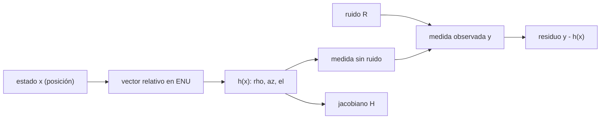

# B74-C01 — Modelos de observación

<!-- nav:top -->
[🏠 Programa](../../../../README.md) · [📚 Bloque B74](../../../tronco-comun/B74-estimacion-de-orbitas-y-navegacion-espacial.md) · [← Anterior: B73-C22 — Capturas temporales y cuasi-satélites](../../B73/B73-C22-capturas-temporales-y-cuasi-satelites/CLASE.md) · [Siguiente: B74-C02 — Observación angular y astrometría →](../B74-C02-observacion-angular-y-astrometria/CLASE.md)
<!-- /nav -->

## 1. Ubicación, nivel y alcance

Clase 1 del bloque B74. Nivel N3. Estimar una órbita empieza por escribir qué mediría un instrumento si el estado fuera conocido: eso es el **modelo de observación** `y = h(x)`. Aquí construyes `h` para una estación que mide alcance, azimut y elevación, derivas su jacobiano a mano y lo verificas con diferencias finitas. Necesitas vectores de estado y marcos de referencia de los bloques anteriores de A06; la estación y el satélite son sintéticos.

## 2. Por qué esta clase existe

Todo método de B74 (mínimos cuadrados, filtros, validación) deriva del par `h` y `H = ∂h/∂x`. La decisión central: **¿qué función y qué derivadas describen la medida, y cómo sé que están bien escritas antes de dárselas a un estimador?**

## 3. Lo que podrás hacer al terminar

1. Escribir `h(x)` para alcance, azimut y elevación en el marco ENU de una estación.
2. Calcular el jacobiano analítico y comprobarlo con diferencias centrales.
3. Distinguir residuo `y − h(x̂)` de error `x̂ − x`.
4. Traducir una incertidumbre angular en metros transversales a una distancia dada.
5. Propagar una covarianza de posición a covarianza de medida con `H P Hᵀ`.
6. Rotular lo sintético y lo no consultado en cada resultado.

La evidencia es la **ficha del modelo de observación de una estación** del ejercicio 12 (sección 20).

## 4. Con qué llegas y cómo comprobarlo

1. ¿Qué es un vector de estado orbital?
2. ¿Qué es una derivada parcial?
3. ¿Qué mide el azimut?
4. ¿Qué es un dato sintético?
5. ¿Qué es una verificación por segunda vía?

<details>
<summary>Ver respuestas</summary>

1. Posición y velocidad (a veces más parámetros) en un instante y un marco. 2. La variación de una función respecto de una variable con las demás fijas. 3. El ángulo horizontal desde el norte hacia el este. 4. Un dato generado para el ejemplo, no medido. 5. Calcular lo mismo con otro método y comparar.
</details>

Con cuatro o cinco aciertos, sigue; si no, repasa los prerrequisitos.

## 5. Un caso de contexto y casos de referencia

Una estación sintética (latitud −33,0°, longitud −70,0°) apunta a un satélite sintético a `1114,675 km`: azimut `66,038°`, elevación `63,782°`. Con una incertidumbre angular de `0,01°`, el error transversal es de `194,5 m`. Es el **ejemplo conductor**. Ninguna cifra describe un satélite real.

## 6. Vocabulario

El **modelo de observación** `h` asigna al estado `x` la medida que se esperaría sin ruido. El **residuo** es `y − h(x̂)`. El **jacobiano** `H = ∂h/∂x` linealiza la medida alrededor de `x̂`. El **marco ENU** (Este, Norte, Cenit) es el marco topocéntrico local de la estación. La **covarianza de medida** es `R` (ruido) o `H P Hᵀ` (efecto de la incertidumbre del estado).

## 7. Modelo mental: una linterna y una regla



*Descripción textual:* el estado se convierte en vector relativo, de él salen la medida esperada y el jacobiano; al sumar el ruido se obtiene la medida y su residuo.

Analogía: es como predecir qué lee una cinta métrica y una brújula antes de medir; el residuo es la diferencia entre lo leído y lo predicho. Límite: el modelo sin rotación terrestre, refracción ni retardo de luz es una simplificación; una medida real exige esos efectos (clases C02–C05).

## 8. La explicación, paso a paso

### 8.1 Del estado a la medida

Con el vector relativo `d = R_ENU (r − r_est)`: `ρ = |d|`, `az = atan2(d_E, d_N)`, `el = asin(d_U/ρ)`. Para el caso conductor `ρ = 1114,675 km`.

### 8.2 El jacobiano

Por la regla de la cadena, `H = (∂h/∂d) R_ENU`. La primera fila es `d/ρ` rotada: `[0,6701, -0,6608, -0,3381]`, el vector unitario de la línea de visión. Las filas angulares valen del orden de `10⁻⁶ rad/m`: un metro de movimiento transversal a 1000 km cambia el ángulo en un microrradián.

### 8.3 Dos vías para el jacobiano

Las diferencias centrales con paso de 1 m coinciden con el jacobiano analítico con diferencia relativa máxima `3,07e-10`. Esa comprobación valida el código, no la física del modelo.

### 8.4 Qué cuenta el residuo

Con ruido de `5 m` y `0,01°`, los residuos normalizados son del orden de 1. Un residuo normalizado de 10 señalaría un modelo mal escrito, un sesgo o un dato atípico. Si la incertidumbre del estado es `100 m` por eje, la medida esperada tiene `σ_ρ = 100,00 m`, `σ_az = 0,01164°` y `σ_el = 0,00514°`: la posición se transfiere en metros al alcance, pero el ángulo depende de la distancia.

## 9. Magnitudes, símbolos y unidades

| Símbolo | Qué es | Unidad | Valor / nota |
|---|---|---|---|
| `x` | estado orbital (posición) | m | vector de 3 componentes |
| `h(x)` | modelo de observación | m, rad | [ρ, az, el] |
| `H` | jacobiano de h | 1/m, rad/m | 3 × 3 |
| `R` | covarianza del ruido | m², rad² | diagonal (ilustrativa) |
| `ρ` | alcance | m |  |
| `az, el` | azimut y elevación | rad | entrada y salida en grados |

## 10. Convenciones y referencias

Marco inercial simplificado; la estación está fija (sin rotación terrestre); ENU definido por latitud y longitud geodésicas con radio ecuatorial 6 378 137 m (valor ilustrativo del elipsoide). Posiciones en m; ángulos en rad internamente, en grados en la salida. Ruido y geometría **ilustrativos**.

## 11. De dónde sale lo que afirmamos

| ID | Fuente | Localizador | Respalda | Estado |
|---|---|---|---|---|
| S1 | NIST, CODATA — Speed of light in vacuum — https://physics.nist.gov/cgi-bin/cuu/Value?c (consultada 2026-11-10) | entrada «c» | c = 299 792 458 m/s (exacta) | Consultada |
| S2 | NASA/JPL SSD, Horizons API — https://ssd-api.jpl.nasa.gov/doc/horizons.html (consultada 2026-11-10) | parámetros EPHEM_TYPE, COMMAND, CENTER, TLIST | Horizons entrega tablas de observador, vectores de estado, elementos y SPK; parámetros de la API | Consultada |
| — | Tapley, Schutz y Born, *Statistical Orbit Determination* (Elsevier, 2004); Montenbruck y Gill, *Satellite Orbits* (Springer, 2000) | — | fundamento teórico general de la clase | No consultada |

Límites: no se consultó un texto de determinación de órbitas; la forma de `h` y de su jacobiano se deriva en la clase y se verifica numéricamente. Horizons solo se consultó por la lista de observables de tipo observador; no se descargó ninguna efeméride.

## 12. Cómo ver el modelo de observación

| Magnitud | Valor |
|---|---|
| `ρ` (satélite sintético) | 1114,675 km |
| `az`, `el` | 66,038°, 63,782° |
| diferencia analítico/numérico | 3,07e-10 |
| error transversal de 0,01° | 194,5 m |
| `σ_ρ` con `σ_r` = 100 m | 100,00 m |

Descripción larga: el alcance hereda la incertidumbre de posición casi sin cambio, mientras que los ángulos la reducen según la distancia; el jacobiano analítico y el numérico coinciden.

## 13. Ejemplo trabajado: el error transversal de un ángulo

**Paso 1 · Distancia.** `ρ = 1114,675 km`.

**Paso 2 · Ángulo.** `0,01° = 1,745 × 10⁻⁴ rad`.

**Paso 3 · Arco.** `ρ θ = 194,5 m`.

**Paso 4 · Lectura.** Una medida angular con 0,01° fija la dirección del satélite con unos 195 m de incertidumbre transversal; un alcance de 5 m fija la distancia mucho mejor.

## 14. Distintas formas de describir una medida

**Por valor:** `y`. **Por modelo:** `h(x)`. **Por residuo:** `y − h(x̂)`. **Por sensibilidad:** `H`. **Por incertidumbre:** `R` y `H P Hᵀ`.

## 15. Práctica guiada

**Ejercicio 1 · guiado.** Calcula el error transversal de 0,02° a 1000 km. *Pasos:* convierte a radianes y multiplica por la distancia.

<details><summary>Solución comentada</summary>

`0,02° = 3,49 × 10⁻⁴ rad`; `× 1000 km = 349 m`.
</details>

**Ejercicio 2 · guiado.** Escribe `h` para la elevación y explica por qué usa `asin`. *Pista:* componente cenital sobre el módulo.

<details><summary>Solución comentada</summary>

`el = asin(d_U/ρ)`: el seno de la elevación es la fracción vertical del vector relativo.
</details>

**Ejercicio 3 · guiado.** ¿Qué fila de `H` vale `d/ρ`? *Pista:* derivada del módulo.

<details><summary>Solución comentada</summary>

La del alcance: la derivada de `|d|` respecto de `d` es el vector unitario.
</details>

## 16. Práctica autónoma, transferencia e integrador

**Ejercicio 4 · autónomo.** Si la estación mide solo `ρ`, ¿cuántas dimensiones del estado observa en una medida?

<details><summary>Solución comentada</summary>

Una: la proyección sobre la línea de visión; hacen falta más medidas con otra geometría.
</details>

**Ejercicio 5 · autónomo.** ¿Por qué las filas angulares de `H` son del orden de `1/ρ`?

<details><summary>Solución comentada</summary>

Un desplazamiento transversal `δ` cambia el ángulo en `δ/ρ`.
</details>

**Ejercicio 6 · autónomo.** Un residuo normalizado vale 8. Da dos causas posibles.

<details><summary>Solución comentada</summary>

Un sesgo no modelado o un atípico; también un `σ` subestimado.
</details>

**Ejercicio 7 · autónomo.** ¿Qué pasa con `az` cuando `el` se acerca a 90°?

<details><summary>Solución comentada</summary>

`ρ_h → 0` y `∂az/∂d` crece sin límite: es una singularidad del modelo; se evita con otras coordenadas.
</details>

**Ejercicio 8 · autónomo.** Para `σ_ρ = 5 m` y `σ_r = 100 m`, ¿qué domina la covarianza de la medida esperada?

<details><summary>Solución comentada</summary>

La incertidumbre de posición: 100 m frente a 5 m.
</details>

**Ejercicio 9 · transferencia.** **Transferencia.** Un colega valida el jacobiano comparándolo con diferencias finitas de paso 1e-12 m. ¿Es buena idea?

<details><summary>Solución comentada</summary>

No: el error de redondeo domina; se usa un paso del orden de la raíz del épsilon por la escala, o diferencias complejas.
</details>

**Ejercicio 10 · transferencia.** **Transferencia.** ¿Qué cambia en `h` si la estación rota con la Tierra?

<details><summary>Solución comentada</summary>

El vector relativo debe expresarse en el mismo marco que el estado en el instante de la medida; `r_est` depende del tiempo.
</details>

**Ejercicio 11 · transferencia.** **Transferencia.** Un instrumento mide ángulos de cielo (AR y Dec). ¿Cómo adaptas `h`?

<details><summary>Solución comentada</summary>

Se sustituyen `az, el` por ascensión recta y declinación del vector unitario en el marco celeste; el jacobiano cambia pero la estructura es la misma.
</details>

**Ejercicio 12 · integrador.** **Integrador.** Elabora tu *ficha del modelo de observación de una estación*: `h`, jacobiano analítico y numérico, residuo normalizado, error transversal y covarianza de medida, rotulando lo sintético.

<details><summary>Solución comentada</summary>

Secciones 8.1–8.4 y la salida del laboratorio.
</details>

## 17. Laboratorio: modelo de observación y jacobiano

El script [laboratorio.py](laboratorio.py) calcula `ρ`, `az`, `el` de un satélite sintético, el jacobiano analítico y el numérico, un residuo con ruido y la covarianza de medida (**comprueba** diferencia relativa < 1e-6 entre jacobianos).

**Datos:** estación y satélite **sintéticos**; ruido (`5 m`, `0,01°`) **ilustrativo**; radio terrestre ecuatorial de 6 378 137 m como valor ilustrativo. **Predice antes de ejecutar:** ¿cuántos metros transversales vale `0,01°` a ~1100 km? (≈ 195 m). **Ejecución del 2026-11-10 (Python 3.12.9, NumPy 2.4.4):**

```text
Python 3.12.9, NumPy 2.4.4 (datos SINTETICOS, semilla 7)
Estacion sintetica: lat -33.0 deg, lon -70.0 deg; marco inercial simplificado
h(r): rho = 1114.675 km, az = 66.038 deg, el = 63.782 deg
Jacobiano analitico [filas rho, az, el; columnas x, y, z] (1/m, rad/m):
  +6.7011e-01 -6.6077e-01 -3.3813e-01
  +4.2933e-07 +1.2318e-06 -1.5563e-06
  -6.3831e-07 -3.9660e-07 -4.9000e-07
Diferencia relativa maxima analitico/numerico = 3.07e-10
Residuos normalizados z = +0.001 +0.299 -0.274
0.01 deg a 1114.7 km equivalen a 194.5 m transversales
Con sigma_r = 100 m por eje: sigma_rho = 100.00 m, sigma_az = 0.01164 deg, sigma_el = 0.00514 deg
Pruebas superadas.
```

```bash
python programa/clases/B74/B74-C01-modelos-de-observacion/laboratorio.py
```

**Límites:** sin rotación terrestre, refracción ni retardo de luz; el jacobiano numérico comprueba el código, no el modelo; la geometría es una sola.

## 18. Errores frecuentes y cómo corregirlos

**Mezclar grados y radianes en el jacobiano.** Trabaja en radianes y convierte solo al imprimir.

**Confundir residuo con error.** El residuo compara medida y modelo; el error compara estimado y verdadero (que en la práctica se ignora).

**Usar el jacobiano sin comprobarlo.** Compara siempre con diferencias finitas, como en 8.3.

**Presentar la estación sintética como una real.** Rotula como sintético, como en la sección 10.

## 19. Cómo sabrás que vas bien

Tras la sección 8: ¿qué `σ` esperabas para el azimut y cuál obtuviste? Si dudas, repasa el ejemplo 13. Tras el laboratorio: ¿qué comprueba? (ver la sección 17).

## 20. Qué entregas y cómo se evalúa

El producto es tu **ficha del modelo de observación de una estación** (ejercicio 12).

| Criterio | Inicial | En desarrollo | Logrado | Destacado |
|---|---|---|---|---|
| Conceptos | Los confunde | Parciales | Escribe `h` y `H` con unidades | Explica los límites |
| Cálculo | Sin unidades | Con errores | Tablas completas con unidades | Calcula casos nuevos |
| Numérico | Sin comprobar | Un caso | Contraste con una segunda vía | Interpreta las diferencias |
| Fuentes | Sin fuente | Sin fecha | Fuentes con fecha y estado | Declara lo sintético y lo no consultado |
| Límites | No los nombra | Uno | Tres | Discute qué falta del modelo |

**Condiciones críticas (no se compensan con promedio):** no mezclar unidades angulares y rotular la estación y la geometría como sintéticas; rotular los datos como sintéticos y no presentar nada simulado como observado; citar solo lo consultado.

## 21. Ética, seguridad y límites

Clase educativa en estado E0: los modelos son simplificados y sus datos son sintéticos o ilustrativos; ningún resultado describe la órbita real de una nave ni sustituye a un producto de navegación de misión. Accesibilidad: tablas equivalentes a las gráficas, fórmulas en texto, ejercicios sin conexión. Tolerancias del laboratorio: jacobiano analítico frente a numérico, diferencia relativa < 1e-6; sin otras exigencias numéricas.

## 22. Para cerrar y seguir

Un modelo de observación de tres componentes y su jacobiano de 3 × 3 bastan para propagar la incertidumbre del estado a la medida: `σ_ρ = 100,00 m` con `σ_r` = 100 m. Queda una pregunta: ¿cómo se obtienen y se interpretan los ángulos reales del cielo?

**Glosario español–inglés.** modelo de observación · *measurement model*; jacobiano · *Jacobian*; residuo · *residual*; marco topocéntrico · *topocentric frame*; covarianza · *covariance*.

**Continuidad.** [B74-C02](../B74-C02-observacion-angular-y-astrometria/CLASE.md) estudia la observación angular y la astrometría.

**Referencias:** ver sección 11.

<!-- nav:bottom -->
---

[← Anterior: B73-C22 — Capturas temporales y cuasi-satélites](../../B73/B73-C22-capturas-temporales-y-cuasi-satelites/CLASE.md) · [📚 Bloque B74](../../../tronco-comun/B74-estimacion-de-orbitas-y-navegacion-espacial.md) · [Siguiente: B74-C02 — Observación angular y astrometría →](../B74-C02-observacion-angular-y-astrometria/CLASE.md)
<!-- /nav -->
