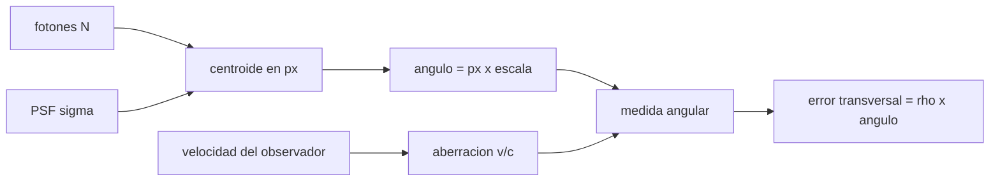

# B74-C02 — Observación angular y astrometría

<!-- nav:top -->
[🏠 Programa](../../../../README.md) · [📚 Bloque B74](../../../tronco-comun/B74-estimacion-de-orbitas-y-navegacion-espacial.md) · [← Anterior: B74-C01 — Modelos de observación](../B74-C01-modelos-de-observacion/CLASE.md) · [Siguiente: B74-C03 — Medición de alcance por radio →](../B74-C03-medicion-de-alcance-por-radio/CLASE.md)
<!-- /nav -->

## 1. Ubicación, nivel y alcance

Clase 2 del bloque B74. Nivel N3. La medida angular de la navegación y de la astrometría nace en un detector: un centroide en píxeles que hay que convertir en ángulo. Aquí calculas la escala de placa, la incertidumbre del centroide por fotones y la aberración anual, y la traduces en metros transversales. La imagen es sintética; la cámara es ilustrativa.

## 2. Por qué esta clase existe

Un ángulo de `0,01″` parece pequeño, pero a un millón de kilómetros son decenas de metros. La decisión central: **¿cuánta incertidumbre angular aporta el detector y cuánta es un efecto físico que hay que modelar (aberración)?**

## 3. Lo que podrás hacer al terminar

1. Convertir píxeles en segundos de arco con la escala de placa.
2. Estimar la incertidumbre del centroide con `σ_psf/√N` y comprobarla con Monte Carlo.
3. Calcular la aberración anual máxima `v/c`.
4. Traducir un error angular en metros transversales a una distancia dada.
5. Separar el error aleatorio del detector de un efecto sistemático.
6. Rotular lo sintético, lo ilustrativo y lo no consultado.

La evidencia es la **presupuesto de error de una medida angular** del ejercicio 12 (sección 20).

## 4. Con qué llegas y cómo comprobarlo

1. ¿Cuántos segundos de arco hay en un radián?
2. ¿Qué es la FWHM de una estrella?
3. ¿Qué es el ruido de Poisson?
4. ¿Qué es un centroide?
5. ¿Qué es una verificación por segunda vía?

<details>
<summary>Ver respuestas</summary>

1. Unos 206 265. 2. El ancho a media altura de su perfil, en píxeles. 3. La fluctuación √N de un recuento de N fotones. 4. El centro de masa de la intensidad. 5. Calcular lo mismo con otro método y comparar.
</details>

Con cuatro o cinco aciertos, sigue; si no, repasa los prerrequisitos.

## 5. Un caso de contexto y casos de referencia

Una estrella sintética con FWHM de `2,5 px` y `10 000` fotones se centra con `0,01048 px` de incertidumbre empírica (`0,01062 px` teórica), es decir `0,01622″` con una escala de `1,5470″/px`. La aberración anual máxima es de `20,493″`. Es el **ejemplo conductor**; ninguna cifra viene de una observación.

## 6. Vocabulario

La **escala de placa** es `p/f` en radianes por píxel (`p`: tamaño de píxel, `f`: focal). La **PSF** es la imagen de una fuente puntual. El **centroide por momentos** es `Σ I x / Σ I`. La **aberración** desplaza la dirección aparente por la velocidad del observador: máximo `v/c`. La **paralaje** es el desplazamiento por la posición del observador.

## 7. Modelo mental: contar granos de arena



*Descripción textual:* los fotones y la PSF fijan el centroide, la escala lo convierte en ángulo, la aberración añade un efecto sistemático y la distancia convierte el ángulo en metros.

Analogía: más fotones es como promediar más lanzamientos de dardos: el error cae con la raíz. Límite: el modelo solo incluye ruido de fotones; el ruido de fondo, de lectura y el error del catálogo de referencia no están.

## 8. La explicación, paso a paso

### 8.1 Escala de placa

Con píxel de 9 µm y focal 1,2 m, `p/f = 7,5 × 10⁻⁶ rad = 1,5470″/px` (ilustrativos).

### 8.2 Incertidumbre del centroide

Para ruido de Poisson, `σ_c = σ_psf/√N` por eje, con `σ_psf = FWHM/2,3548`. La simulación de 2000 imágenes por caso da `0,03396`, `0,01048` y `0,00338 px` para `N = 10³, 10⁴, 10⁵`; coincide con la teoría dentro del 5 %.

### 8.3 Aberración anual

La velocidad media de la Tierra, `2π·1 au/año = 29,7853 km/s`, da `v/c` con `c = 299 792 458 m/s` (NIST): **20,493″**. Es un efecto sistemático, no ruido, y se corrige con el modelo.

### 8.4 De ángulo a metros

`0,01″` a `10⁹ m` son `48,5 m` transversales: la astrometría de alta precisión es indispensable en espacio profundo.

## 9. Magnitudes, símbolos y unidades

| Símbolo | Qué es | Unidad | Valor / nota |
|---|---|---|---|
| `p` | tamaño de píxel | m | 9 × 10⁻⁶ (ilustrativo) |
| `f` | focal | m | 1,2 (ilustrativo) |
| `σ_psf` | ancho de la PSF | px | FWHM/2,3548 |
| `N` | fotones recogidos | — | 10³–10⁵ |
| `σ_c` | incertidumbre del centroide | px | por eje |
| `v/c` | aberración máxima | rad | 20,5″ para la Tierra |

## 10. Convenciones y referencias

Coordenadas de imagen en px, centradas; ángulos en segundos de arco; `c = 299 792 458 m/s`. Solo ruido de Poisson, sin fondo ni lectura. La unidad astronómica (1,495978707 × 10¹¹ m, valor IAU 2012) **no se consultó** en esta sesión.

## 11. De dónde sale lo que afirmamos

| ID | Fuente | Localizador | Respalda | Estado |
|---|---|---|---|---|
| S1 | NIST, CODATA — Speed of light in vacuum — https://physics.nist.gov/cgi-bin/cuu/Value?c (consultada 2026-11-10) | entrada «c» | c = 299 792 458 m/s (exacta) | Consultada |
| S2 | NASA/JPL SSD, Horizons API — https://ssd-api.jpl.nasa.gov/doc/horizons.html (consultada 2026-11-10) | parámetros EPHEM_TYPE, COMMAND, CENTER, TLIST | Horizons entrega tablas de observador, vectores de estado, elementos y SPK; parámetros de la API | Consultada |
| — | Montenbruck y Gill, *Satellite Orbits* (Springer, 2000); Tapley, Schutz y Born, *Statistical Orbit Determination* (Elsevier, 2004) | — | fundamento teórico general de la clase | No consultada |

Límites: la escala, el tamaño de píxel, la focal y el número de fotones son ilustrativos; el valor de la unidad astronómica no se consultó; no se usó ningún catálogo astrométrico.

## 12. Cómo ver el presupuesto angular

| Magnitud | Valor |
|---|---|
| escala de placa | 1,5470″/px |
| `σ_c` (`N = 10⁴`) | 0,01048 px |
| `σ` angular (`N = 10⁴`) | 0,01622″ |
| aberración máxima | 20,493″ |
| 0,01″ a 10⁶ km | 48,5 m |

Descripción larga: el error del centroide cae con la raíz del número de fotones; la aberración es mil veces mayor que el ruido de fotones y debe corregirse como sistemático.

## 13. Ejemplo trabajado: el presupuesto de una estrella

**Paso 1 · PSF.** `σ_psf = 2,5/2,3548 = 1,062 px`.

**Paso 2 · Centroide.** `σ_c = 1,062/√10 000 = 0,01062 px`.

**Paso 3 · Ángulo.** `0,01062 × 1,5470 = 0,01622″` aprox.

**Paso 4 · Metros.** A `10⁶ km`, eso son `48,5 m` por cada `0,01″`; el centroide aporta menos de un tercio de ese valor.

## 14. Distintas formas de describir un error angular

**Por píxeles:** `σ_c`. **Por ángulo:** `σ_c p/f`. **Por metros:** `ρ σ_θ`. **Por tipo:** aleatorio (fotones) o sistemático (aberración).

## 15. Práctica guiada

**Ejercicio 1 · guiado.** Calcula la escala de placa de un píxel de 6 µm con focal 0,5 m. *Pasos:* divide y multiplica por 206 265.

<details><summary>Solución comentada</summary>

`1,2 × 10⁻⁵ rad = 2,475″/px`.
</details>

**Ejercicio 2 · guiado.** Con `N = 4 × 10⁴` y `σ_psf = 1 px`, ¿cuánto vale `σ_c`? *Pista:* raíz de N.

<details><summary>Solución comentada</summary>

`1/200 = 0,005 px`.
</details>

**Ejercicio 3 · guiado.** ¿Qué `N` reduce `σ_c` a la mitad? *Pista:* proporcional a `1/√N`.

<details><summary>Solución comentada</summary>

Cuatro veces más fotones.
</details>

## 16. Práctica autónoma, transferencia e integrador

**Ejercicio 4 · autónomo.** Convierte `0,005 px` a segundos de arco con la escala del ejemplo.

<details><summary>Solución comentada</summary>

`0,005 × 1,5470 = 0,0077″`.
</details>

**Ejercicio 5 · autónomo.** ¿Qué distancia convierte `0,01″` en `100 m`?

<details><summary>Solución comentada</summary>

`100/(4,848 × 10⁻⁸) = 2,06 × 10⁹ m`.
</details>

**Ejercicio 6 · autónomo.** ¿Cuál es la aberración si el observador viaja a 7,6 km/s (órbita baja)?

<details><summary>Solución comentada</summary>

`7,6 × 10³/299 792 458 = 2,53 × 10⁻⁵ rad ≈ 5,2″`.
</details>

**Ejercicio 7 · autónomo.** ¿Por qué la aberración no se promedia al sumar imágenes?

<details><summary>Solución comentada</summary>

Porque es sistemática: tiene el mismo signo en todas.
</details>

**Ejercicio 8 · autónomo.** ¿Qué ruido añadiría un fondo de cielo?

<details><summary>Solución comentada</summary>

Un término de ruido de fondo que se suma en cuadratura al de fotones y aumenta `σ_c`.
</details>

**Ejercicio 9 · transferencia.** **Transferencia.** Un equipo reporta `σ = 0,001″` sin decir la distancia. ¿Es útil para la navegación?

<details><summary>Solución comentada</summary>

No: hay que convertirlo en metros con la distancia, y decir si es aleatorio o sistemático.
</details>

**Ejercicio 10 · transferencia.** **Transferencia.** ¿Qué falta en este presupuesto para una cámara real?

<details><summary>Solución comentada</summary>

Ruido de lectura y fondo, error del catálogo, distorsión óptica, calibración de la escala y el tiempo de la imagen.
</details>

**Ejercicio 11 · transferencia.** **Transferencia.** Una nave gira y la estrella se arrastra durante la exposición. ¿Cómo cambia `σ_c`?

<details><summary>Solución comentada</summary>

Aumenta: la PSF se ensancha y el centroide pierde precisión.
</details>

**Ejercicio 12 · integrador.** **Integrador.** Elabora tu *presupuesto de error de una medida angular*: escala, `σ_c` para tres `N`, aberración y error en metros a tres distancias, rotulando lo sintético y lo no consultado.

<details><summary>Solución comentada</summary>

Secciones 8.1–8.4 y la salida del laboratorio.
</details>

## 17. Laboratorio: centroide y aberración

El script [laboratorio.py](laboratorio.py) simula 2000 imágenes por caso, mide la dispersión del centroide, la compara con `σ_psf/√N` y calcula la aberración anual (**comprueba** dispersión empírica dentro del 5 % de la teórica).

**Datos:** imagen y cámara **sintéticas/ilustrativas**; `c` de NIST (consultado); unidad astronómica no consultada. **Predice antes de ejecutar:** ¿cuánto baja `σ_c` al multiplicar `N` por 10? (un factor `√10 ≈ 3,16`). **Ejecución del 2026-11-10 (Python 3.12.9, NumPy 2.4.4):**

```text
Python 3.12.9, NumPy 2.4.4 (imagen SINTETICA, semilla 11)
Escala de placa = 1.5470 arcsec/px (pixel 9 um, focal 1.2 m, ILUSTRATIVOS)
 N_fot    sigma_emp[px]  sigma_teo[px]  sigma[arcsec]
  1000        0.03396       0.03357       0.05253
 10000        0.01048       0.01062       0.01622
100000        0.00338       0.00336       0.00523
Velocidad orbital media de la Tierra = 29.7853 km/s ; aberracion maxima v/c = 20.493 arcsec
Un error de 0.01 arcsec a 1.0e6 km equivale a 48.5 m transversales
Pruebas superadas.
```

```bash
python programa/clases/B74/B74-C02-observacion-angular-y-astrometria/laboratorio.py
```

**Límites:** solo ruido de Poisson, centroide por momentos sin ventana; no hay catálogo ni distorsión.

## 18. Errores frecuentes y cómo corregirlos

**Confundir píxeles con segundos de arco.** Multiplica por la escala, como en 8.1.

**Tratar la aberración como ruido.** Es un sistemático que se modela, como en 8.3.

**Dar un ángulo sin distancia.** Convierte a metros, como en 8.4.

**Presentar la imagen sintética como real.** Rotula como sintético, como en la sección 10.

## 19. Cómo sabrás que vas bien

Tras la sección 8: ¿qué `σ_c` esperabas para `N = 10⁵` y cuál obtuviste? Si dudas, repasa el ejemplo 13. Tras el laboratorio: ¿qué comprueba? (ver la sección 17).

## 20. Qué entregas y cómo se evalúa

El producto es tu **presupuesto de error de una medida angular** (ejercicio 12).

| Criterio | Inicial | En desarrollo | Logrado | Destacado |
|---|---|---|---|---|
| Conceptos | Los confunde | Parciales | Calcula `σ_c` y la escala con unidades | Explica los límites |
| Cálculo | Sin unidades | Con errores | Tablas completas con unidades | Calcula casos nuevos |
| Numérico | Sin comprobar | Un caso | Contraste con una segunda vía | Interpreta las diferencias |
| Fuentes | Sin fuente | Sin fecha | Fuentes con fecha y estado | Declara lo sintético y lo no consultado |
| Límites | No los nombra | Uno | Tres | Discute qué falta del modelo |

**Condiciones críticas (no se compensan con promedio):** distinguir lo aleatorio de lo sistemático y rotular la cámara y la imagen como sintéticas; rotular los datos como sintéticos y no presentar nada simulado como observado; citar solo lo consultado.

## 21. Ética, seguridad y límites

Clase educativa en estado E0: los modelos son simplificados y sus datos son sintéticos o ilustrativos; ningún resultado describe la órbita real de una nave ni sustituye a un producto de navegación de misión. Accesibilidad: tablas equivalentes a las gráficas, fórmulas en texto, ejercicios sin conexión. Tolerancias del laboratorio: dispersión empírica/teórica del centroide dentro del 5 % (2000 realizaciones).

## 22. Para cerrar y seguir

Un centroide con `10⁴` fotones aporta `0,01622″`, y la aberración anual es de `20,493″`: lo sistemático domina al ruido. Queda una pregunta: ¿cómo se mide la distancia con una señal de radio?

**Glosario español–inglés.** escala de placa · *plate scale*; centroide · *centroid*; aberración · *aberration*; paralaje · *parallax*; función de dispersión del punto · *point spread function*.

**Continuidad.** [B74-C03](../B74-C03-medicion-de-alcance-por-radio/CLASE.md) estudia la medición de alcance por radio.

**Referencias:** ver sección 11.

<!-- nav:bottom -->
---

[← Anterior: B74-C01 — Modelos de observación](../B74-C01-modelos-de-observacion/CLASE.md) · [📚 Bloque B74](../../../tronco-comun/B74-estimacion-de-orbitas-y-navegacion-espacial.md) · [Siguiente: B74-C03 — Medición de alcance por radio →](../B74-C03-medicion-de-alcance-por-radio/CLASE.md)
<!-- /nav -->
