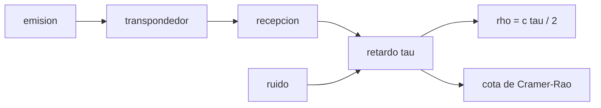

# B74-C03 — Medición de alcance por radio

<!-- nav:top -->
[🏠 Programa](../../../../README.md) · [📚 Bloque B74](../../../tronco-comun/B74-estimacion-de-orbitas-y-navegacion-espacial.md) · [← Anterior: B74-C02 — Observación angular y astrometría](../B74-C02-observacion-angular-y-astrometria/CLASE.md) · [Siguiente: B74-C04 — Doppler de navegación →](../B74-C04-doppler-de-navegacion/CLASE.md)
<!-- /nav -->

## 1. Ubicación, nivel y alcance

Clase 3 del bloque B74. Nivel N3. Medir el alcance por radio es medir un tiempo: la señal sale de la estación, la nave la devuelve y el retardo de ida y vuelta, multiplicado por `c` y dividido por dos, es la distancia. Aquí calculas retardos de ida y vuelta, conviertes errores de tiempo en errores de alcance y estimas el retardo de un pulso sintético en ruido comparándolo con la cota de Cramér–Rao.

## 2. Por qué esta clase existe

Un nanosegundo son quince centímetros de alcance, y un pulso ancho en ruido se mide con nanosegundos de incertidumbre. La decisión central: **¿cuánta precisión de alcance permite el ancho de banda y la relación señal/ruido, y qué hay que corregir además del retardo?**

## 3. Lo que podrás hacer al terminar

1. Calcular el tiempo de ida y vuelta de una señal para una distancia dada.
2. Convertir un error de retardo en un error de alcance.
3. Estimar el retardo de un pulso en ruido por Gauss–Newton.
4. Comparar la dispersión empírica con la cota de Cramér–Rao.
5. Evaluar cuánto se mueve la nave durante la medida.
6. Rotular lo sintético, lo ilustrativo y lo no consultado.

La evidencia es la **ficha de una medida de alcance con su presupuesto** del ejercicio 12 (sección 20).

## 4. Con qué llegas y cómo comprobarlo

1. ¿Qué vale la velocidad de la luz y en qué unidades?
2. ¿Qué es un pulso gaussiano?
3. ¿Qué es el ruido blanco?
4. ¿Qué es una cota de Cramér–Rao?
5. ¿Qué es una verificación por segunda vía?

<details>
<summary>Ver respuestas</summary>

1. 299 792 458 m/s, exacta. 2. Una señal con forma de campana. 3. Ruido con la misma potencia en todas las frecuencias. 4. Un límite inferior a la varianza de un estimador insesgado. 5. Calcular lo mismo con otro método y comparar.
</details>

Con cuatro o cinco aciertos, sigue; si no, repasa los prerrequisitos.

## 5. Un caso de contexto y casos de referencia

Un pulso sintético de `20 ns` de ancho y ruido de `0,2` se mide con una dispersión de `3,1159 ns` (cota `3,0045 ns`, cociente `1,037`), es decir `46,706 cm` de alcance. Es el **ejemplo conductor**; la señal es sintética.

## 6. Vocabulario

El **tiempo de ida y vuelta** (RTLT) es `2ρ/c` en el caso ideal. El **alcance** es `ρ = c τ/2`. La **cota de Cramér–Rao** limita la varianza del retardo: `σ_τ = σ_n/√Σ s′²`. El **ancho de banda efectivo** es el que aporta pendiente a la señal. El **retardo instrumental** es el tiempo que la señal tarda en los equipos.

## 7. Modelo mental: un eco en un cañón



*Descripción textual:* la señal emitida vuelve con un retardo; el ruido limita la precisión del retardo (cota de Cramér–Rao) y de él se obtiene el alcance.

Analogía: gritar en un cañón y medir cuándo vuelve el eco; un grito corto y fuerte da un tiempo más preciso que uno largo y débil. Límite: la medida real incluye el movimiento de la nave, la atmósfera, el retardo de los equipos y un código de pseudoruido que aquí no se simula.

## 8. La explicación, paso a paso

### 8.1 Del tiempo a la distancia

`ρ = c τ/2` con `c = 299 792 458 m/s` (NIST). Los retardos de ida y vuelta son `2,5644 s` a la distancia lunar (384 400 km), `998,0 s` a 1 au y `1497,0 s` a 1,5 au.

### 8.2 Del error de tiempo al de alcance

Un error de `1 ns` en el retardo son `14,99 cm` de alcance. Un error de tiempo de unos microsegundos son cientos de metros.

### 8.3 Precisión del retardo

Con el pulso de `20 ns`, muestreo de 100 MHz y ruido `0,2`, la cota es `3,0045 ns`; 3000 realizaciones dan `3,1159 ns` (cociente `1,037`) y un sesgo de `-11,36 ps`: el estimador casi alcanza la cota.

### 8.4 La nave se mueve

En órbita baja (1000 km, 7,5 km/s) la ida y vuelta dura `6,671 ms` y la nave avanza `50,0 m`: el modelo debe calcular la geometría en dos instantes (emisión y recepción).

## 9. Magnitudes, símbolos y unidades

| Símbolo | Qué es | Unidad | Valor / nota |
|---|---|---|---|
| `τ` | retardo de ida y vuelta | s | 1 ns ↔ 15 cm |
| `ρ` | alcance | m | c τ/2 |
| `c` | velocidad de la luz | m/s | 299 792 458 (exacta) |
| `s` | ancho del pulso | s | 20 × 10⁻⁹ (sintético) |
| `σ_n` | ruido por muestra | — | 0,2 (ilustrativo) |
| `σ_τ` | incertidumbre del retardo | s | cota de Cramér–Rao |

## 10. Convenciones y referencias

Retardo medido en el reloj de la estación (tiempo de ida y vuelta); alcance de una vía; sin atmósfera ni plasma; señal sintética muestreada a 100 MHz con ruido blanco gaussiano. Las distancias de la Luna y de 1 au son ilustrativas (no consultadas aquí).

## 11. De dónde sale lo que afirmamos

| ID | Fuente | Localizador | Respalda | Estado |
|---|---|---|---|---|
| S1 | NIST, CODATA — Speed of light in vacuum — https://physics.nist.gov/cgi-bin/cuu/Value?c (consultada 2026-11-10) | entrada «c» | c = 299 792 458 m/s (exacta) | Consultada |
| S2 | NASA/JPL, DSN Telecommunications Link Design Handbook 810-005 (índice) — https://deepspace.jpl.nasa.gov/dsndocs/810-005/ (consultada 2026-11-10) | página de presentación | el manual trata de los parámetros de desempeño de los enlaces de telecomunicaciones entre nave y DSN; los módulos de radiometría no se leyeron | Consultada (solo índice) |
| — | Thornton y Border, *Radiometric Tracking Techniques for Deep-Space Navigation* (JPL/Wiley, 2003); Montenbruck y Gill, *Satellite Orbits* (Springer, 2000) | — | fundamento teórico general de la clase | No consultada |

Límites: del manual del DSN solo se leyó la página de presentación; los módulos de alcance no se consultaron. La cota de Cramér–Rao es una relación estándar no consultada en una fuente concreta; el laboratorio la contrasta por simulación.

## 12. Cómo ver la medida de alcance

| Magnitud | Valor |
|---|---|
| RTLT Luna | 2,5644 s |
| 1 ns de retardo | 14,99 cm |
| `σ_τ` empírica | 3,1159 ns |
| cota de Cramér–Rao | 3,0045 ns |
| movimiento en LEO | 50,0 m |

Descripción larga: el estimador alcanza la cota con un 4 % de exceso; un nanosegundo pesa 15 cm y la nave se mueve decenas de metros durante la medida.

## 13. Ejemplo trabajado: el alcance de un eco lunar

**Paso 1 · Retardo.** `τ = 2,5644 s`.

**Paso 2 · Alcance.** `ρ = c τ/2 = 384 400 km`.

**Paso 3 · Error.** Con `σ_τ = 3,1159 ns`, `σ_ρ = 46,706 cm`.

**Paso 4 · Lectura.** El ruido del receptor es solo una parte del error: el retardo instrumental y la troposfera suelen dominar (clase C05).

## 14. Distintas formas de describir una medida de alcance

**Por tiempo:** `τ`. **Por distancia:** `ρ`. **Por ruido:** `σ_τ`. **Por cota:** Cramér–Rao. **Por movimiento:** `v τ`.

## 15. Práctica guiada

**Ejercicio 1 · guiado.** Calcula `ρ` para `τ = 2,5644 s`. *Pasos:* multiplica por `c` y divide por 2.

<details><summary>Solución comentada</summary>

`384 400 km`, la distancia lunar.
</details>

**Ejercicio 2 · guiado.** ¿Cuántos centímetros son 3 ns de retardo de ida y vuelta? *Pista:* usa 15 cm/ns.

<details><summary>Solución comentada</summary>

`≈ 45 cm`.
</details>

**Ejercicio 3 · guiado.** ¿Cuánto avanza una nave a 3 km/s durante un RTLT de 2,5644 s? *Pista:* velocidad por tiempo.

<details><summary>Solución comentada</summary>

`7,7 km`.
</details>

## 16. Práctica autónoma, transferencia e integrador

**Ejercicio 4 · autónomo.** RTLT a 10 au.

<details><summary>Solución comentada</summary>

`2 × 1,496 × 10¹² / 299 792 458 ≈ 9980 s`, unas 2,8 h.
</details>

**Ejercicio 5 · autónomo.** Si el ruido se duplica, ¿cómo cambia la cota?

<details><summary>Solución comentada</summary>

Se duplica, porque es proporcional a `σ_n`.
</details>

**Ejercicio 6 · autónomo.** Si el pulso se estrecha a la mitad, ¿cómo cambia la cota?

<details><summary>Solución comentada</summary>

Aproximadamente se reduce a la mitad: la pendiente crece.
</details>

**Ejercicio 7 · autónomo.** ¿Qué retardo corresponde a 1 m de alcance?

<details><summary>Solución comentada</summary>

`2 m / c = 6,67 ns`.
</details>

**Ejercicio 8 · autónomo.** ¿Por qué la cota no incluye el sesgo?

<details><summary>Solución comentada</summary>

Se refiere a estimadores insesgados; los sesgos instrumentales se tratan aparte.
</details>

**Ejercicio 9 · transferencia.** **Transferencia.** Un equipo mejora la relación señal/ruido en un factor 4. ¿Cuánto mejora el alcance?

<details><summary>Solución comentada</summary>

Un factor 4 en `σ_τ`, si el ancho de banda es el mismo.
</details>

**Ejercicio 10 · transferencia.** **Transferencia.** ¿Por qué la geometría debe calcularse en dos instantes?

<details><summary>Solución comentada</summary>

Porque la nave se mueve entre la emisión y la recepción; hay que iterar el tiempo de luz.
</details>

**Ejercicio 11 · transferencia.** **Transferencia.** ¿Qué falta para convertir este presupuesto en uno real?

<details><summary>Solución comentada</summary>

Retardo de los equipos, troposfera, ionosfera, plasma solar, calibración y movimiento de la estación.
</details>

**Ejercicio 12 · integrador.** **Integrador.** Elabora tu *ficha de una medida de alcance con su presupuesto*: RTLT, conversión tiempo–alcance, `σ_τ` frente a la cota y movimiento durante la medida, rotulando lo sintético y lo no consultado.

<details><summary>Solución comentada</summary>

Secciones 8.1–8.4 y la salida del laboratorio.
</details>

## 17. Laboratorio: retardo de un pulso en ruido

El script [laboratorio.py](laboratorio.py) calcula retardos de ida y vuelta, estima el retardo de un pulso sintético por Gauss–Newton y lo compara con la cota de Cramér–Rao (**comprueba** dispersión empírica dentro del 10 % de la cota).

**Datos:** `c` de NIST (consultado); señal, ruido y distancias **sintéticos/ilustrativos**. **Predice antes de ejecutar:** ¿cuántos centímetros son 1 ns de retardo de ida y vuelta? (≈ 15 cm). **Ejecución del 2026-11-10 (Python 3.12.9, NumPy 2.4.4):**

```text
Python 3.12.9, NumPy 2.4.4 (senal SINTETICA, semilla 5)
Tiempo de ida y vuelta (RTLT) = 2 rho / c:
  Luna 384400 km   RTLT =     2.5644 s
  1 au             RTLT =   998.0096 s
  Marte ~1.5 au    RTLT =  1497.0144 s
1 ns de error en el retardo de ida y vuelta = 14.99 cm de alcance
LEO (rho = 1000 km, v = 7.5 km/s): RTLT = 6.671 ms ; la nave se mueve 50.0 m durante la medida
Pulso gaussiano s = 20 ns, muestreo 100 MHz, ruido 0.2
sigma_tau empirica = 3.1159 ns ; cota de Cramer-Rao = 3.0045 ns ; cociente = 1.037
sesgo medio = -11.36 ps ; sigma de alcance = 46.706 cm
Pruebas superadas.
```

```bash
python programa/clases/B74/B74-C03-medicion-de-alcance-por-radio/laboratorio.py
```

**Límites:** un solo pulso gaussiano, ruido blanco, sin código de pseudoruido, sin movimiento ni propagación; la cota es asintótica.

## 18. Errores frecuentes y cómo corregirlos

**Olvidar dividir por 2.** El retardo es de ida y vuelta; el alcance es la mitad del camino.

**Ignorar el movimiento.** Compara con 8.4.

**Dar la precisión sin el ancho de banda.** La cota depende de la pendiente de la señal, como en 8.3.

**Presentar la señal sintética como real.** Rotula como sintético, como en la sección 10.

## 19. Cómo sabrás que vas bien

Tras la sección 8: ¿qué cociente esperabas respecto de la cota y cuál obtuviste? Si dudas, repasa el ejemplo 13. Tras el laboratorio: ¿qué comprueba? (ver la sección 17).

## 20. Qué entregas y cómo se evalúa

El producto es tu **ficha de una medida de alcance con su presupuesto** (ejercicio 12).

| Criterio | Inicial | En desarrollo | Logrado | Destacado |
|---|---|---|---|---|
| Conceptos | Los confunde | Parciales | Convierte tiempo en alcance con unidades | Explica los límites |
| Cálculo | Sin unidades | Con errores | Tablas completas con unidades | Calcula casos nuevos |
| Numérico | Sin comprobar | Un caso | Contraste con una segunda vía | Interpreta las diferencias |
| Fuentes | Sin fuente | Sin fecha | Fuentes con fecha y estado | Declara lo sintético y lo no consultado |
| Límites | No los nombra | Uno | Tres | Discute qué falta del modelo |

**Condiciones críticas (no se compensan con promedio):** dividir el retardo de ida y vuelta por 2 y rotular la señal como sintética; rotular los datos como sintéticos y no presentar nada simulado como observado; citar solo lo consultado.

## 21. Ética, seguridad y límites

Clase educativa en estado E0: los modelos son simplificados y sus datos son sintéticos o ilustrativos; ningún resultado describe la órbita real de una nave ni sustituye a un producto de navegación de misión. Accesibilidad: tablas equivalentes a las gráficas, fórmulas en texto, ejercicios sin conexión. Tolerancias del laboratorio: dispersión empírica del retardo dentro del 10 % de la cota (3000 realizaciones).

## 22. Para cerrar y seguir

El alcance se mide en nanosegundos: `1 ns` son `14,99 cm`, y un pulso de 20 ns con ruido 0,2 da `46,706 cm`. Queda una pregunta: ¿cómo se mide la velocidad radial con el desplazamiento de la frecuencia?

**Glosario español–inglés.** tiempo de ida y vuelta · *round-trip light time*; alcance · *range*; cota de Cramér–Rao · *Cramér–Rao bound*; transpondedor · *transponder*; retardo · *delay*.

**Continuidad.** [B74-C04](../B74-C04-doppler-de-navegacion/CLASE.md) estudia el Doppler de navegación.

**Referencias:** ver sección 11.

<!-- nav:bottom -->
---

[← Anterior: B74-C02 — Observación angular y astrometría](../B74-C02-observacion-angular-y-astrometria/CLASE.md) · [📚 Bloque B74](../../../tronco-comun/B74-estimacion-de-orbitas-y-navegacion-espacial.md) · [Siguiente: B74-C04 — Doppler de navegación →](../B74-C04-doppler-de-navegacion/CLASE.md)
<!-- /nav -->
