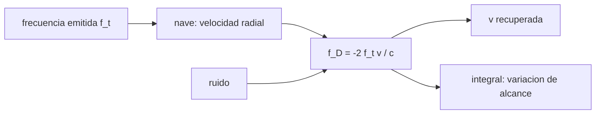

# B74-C04 — Doppler de navegación

<!-- nav:top -->
[🏠 Programa](../../../../README.md) · [📚 Bloque B74](../../../tronco-comun/B74-estimacion-de-orbitas-y-navegacion-espacial.md) · [← Anterior: B74-C03 — Medición de alcance por radio](../B74-C03-medicion-de-alcance-por-radio/CLASE.md) · [Siguiente: B74-C05 — Sesgos de estaciones terrestres →](../B74-C05-sesgos-de-estaciones-terrestres/CLASE.md)
<!-- /nav -->

## 1. Ubicación, nivel y alcance

Clase 4 del bloque B74. Nivel N3. El Doppler de navegación mide la velocidad con la que cambia el alcance, a partir del desplazamiento de la frecuencia de una portadora que va a la nave y vuelve. Aquí calculas el Doppler de dos sentidos, lo comparas con la expresión relativista exacta, recuperas la velocidad radial de una trayectoria sintética con ruido y obtienes la variación de alcance por integración.

## 2. Por qué esta clase existe

Una velocidad radial de `1 mm/s` produce un desplazamiento de decenas de milihercios, medible; por eso el Doppler es el observable más preciso de la navegación en espacio profundo. La decisión central: **¿qué información da el Doppler (velocidad en la línea de visión) y qué no (posición transversal)?**

## 3. Lo que podrás hacer al terminar

1. Calcular el Doppler de dos sentidos `f_D = −2 f_t ρ̇/c` con su signo.
2. Estimar el error del modelo no relativista frente al exacto.
3. Obtener la sensibilidad en Hz por m/s.
4. Recuperar la velocidad radial desde un Doppler con ruido.
5. Integrar la cuenta Doppler para obtener la variación de alcance.
6. Rotular lo sintético y lo ilustrativo.

La evidencia es la **ficha de una medida Doppler de dos sentidos** del ejercicio 12 (sección 20).

## 4. Con qué llegas y cómo comprobarlo

1. ¿Qué es el efecto Doppler?
2. ¿Qué es una velocidad radial?
3. ¿Qué es una portadora?
4. ¿Qué es integrar una señal en el tiempo?
5. ¿Qué es una verificación por segunda vía?

<details>
<summary>Ver respuestas</summary>

1. El cambio de frecuencia observado por el movimiento relativo entre fuente y observador. 2. La componente de la velocidad en la línea de visión. 3. La onda de radio cuya frecuencia se desplaza o modula. 4. Acumular su valor multiplicado por el intervalo. 5. Calcular lo mismo con otro método y comparar.
</details>

Con cuatro o cinco aciertos, sigue; si no, repasa los prerrequisitos.

## 5. Un caso de contexto y casos de referencia

Con una portadora ilustrativa de `7,2 GHz` y una velocidad radial de `30 km/s` el Doppler de dos sentidos es `-1440,997 kHz`; la sensibilidad es `48,0332 Hz` por m/s. Con ruido sintético de `0,05 mm/s` se recupera la velocidad con `0,0536 mm/s` rms. Es el **ejemplo conductor**; los datos son sintéticos.

## 6. Vocabulario

El **Doppler de dos sentidos** mide la diferencia entre la frecuencia emitida y la recibida tras el viaje de ida y vuelta. La **velocidad radial** `ρ̇` es la derivada del alcance. La **cuenta integrada** acumula ciclos de Doppler y da la variación de alcance. La **sensibilidad** es `2 f_t/c`.

## 7. Modelo mental: la sirena de una ambulancia



*Descripción textual:* la frecuencia emitida y la velocidad radial determinan el Doppler; del Doppler se recupera la velocidad y, integrándolo, la variación de alcance; el ruido se suma al Doppler.

Analogía: es como oír cómo cambia el tono de una sirena al pasar; el tono dice cuán rápido se acerca, no dónde está en la calle. Límite: el modelo es no relativista y no incluye la atmósfera, el plasma, el reloj de la estación ni el movimiento de la Tierra.

## 8. La explicación, paso a paso

### 8.1 La relación básica

`f_D = −2 f_t ρ̇/c`, con signo negativo si la nave se aleja. Para `30 km/s`: clásica `-1440,997 kHz`, exacta `-1440,853 kHz`. La diferencia relativa es `1,00e-04`, igual que `v/c = 1,0e-04`.

### 8.2 Sensibilidad

`2 f_t/c = 48,0332 Hz/(m/s)`: `1 mm/s` son `48,03 mHz`. Medir la frecuencia con milihercios da velocidades con décimas de milímetro por segundo.

### 8.3 Recuperar la velocidad

Con aceleración radial constante sintética (de 1500 m/s a 320 m/s en 590 s) y ruido de `0,05 mm/s`, la velocidad recuperada tiene un rms de `0,0536 mm/s`: el error del modelo es despreciable frente al ruido.

### 8.4 Integrar la cuenta

La suma de la cuenta Doppler da la variación del alcance: `546,0000 km` frente a `546,0000 km` verdaderos. Esa variación no fija el alcance absoluto: hace falta una constante inicial, que aporta la medida de alcance (C03) o la geometría.

## 9. Magnitudes, símbolos y unidades

| Símbolo | Qué es | Unidad | Valor / nota |
|---|---|---|---|
| `f_t` | frecuencia de subida | Hz | 7,2 × 10⁹ (ilustrativa) |
| `f_D` | desplazamiento Doppler de dos sentidos | Hz | −1441 kHz a 30 km/s |
| `ρ̇` | velocidad radial | m/s | positiva si se aleja |
| `c` | velocidad de la luz | m/s | 299 792 458 |
| `2 f_t/c` | sensibilidad | Hz/(m/s) | 48,03 |
| `σ_v` | ruido de velocidad | m/s | 5 × 10⁻⁵ (ilustrativo) |

## 10. Convenciones y referencias

Doppler de dos sentidos coherente, signo negativo para un alejamiento; `f_t` ilustrativa de 7,2 GHz (no tomada de ninguna especificación); relación no relativista con comparación exacta de ida y vuelta; muestras cada 10 s; datos sintéticos.

## 11. De dónde sale lo que afirmamos

| ID | Fuente | Localizador | Respalda | Estado |
|---|---|---|---|---|
| S1 | NIST, CODATA — Speed of light in vacuum — https://physics.nist.gov/cgi-bin/cuu/Value?c (consultada 2026-11-10) | entrada «c» | c = 299 792 458 m/s (exacta) | Consultada |
| S2 | NASA/JPL, DSN Telecommunications Link Design Handbook 810-005 (índice) — https://deepspace.jpl.nasa.gov/dsndocs/810-005/ (consultada 2026-11-10) | página de presentación | el manual trata de los parámetros de desempeño de los enlaces de telecomunicaciones entre nave y DSN; los módulos de radiometría no se leyeron | Consultada (solo índice) |
| — | Thornton y Border, *Radiometric Tracking Techniques for Deep-Space Navigation* (JPL/Wiley, 2003); Montenbruck y Gill, *Satellite Orbits* (Springer, 2000) | — | fundamento teórico general de la clase | No consultada |

Límites: el manual del DSN solo se leyó en su página de presentación: no se consultó ninguna relación de razón de transpondedor ni de frecuencias; la frecuencia usada es ilustrativa.

## 12. Cómo ver el Doppler de dos sentidos

| Magnitud | Valor |
|---|---|
| `f_D` a 30 km/s (clásica) | -1440,997 kHz |
| sensibilidad | 48,0332 Hz/(m/s) |
| 1 mm/s | 48,03 mHz |
| rms de la velocidad recuperada | 0,0536 mm/s |
| variación de alcance integrada | 546,0000 km |

Descripción larga: el Doppler es casi lineal en la velocidad radial; el término relativista es del orden de `v/c`; integrar la cuenta recupera el cambio de alcance pero no su valor absoluto.

## 13. Ejemplo trabajado: la velocidad desde un desplazamiento de frecuencia

**Paso 1 · Medida.** Se observa `f_D = −1 440,997 kHz`.

**Paso 2 · Sensibilidad.** `2 f_t/c = 48,0332 Hz/(m/s)`.

**Paso 3 · Velocidad.** `ρ̇ = −f_D/48,0332 = 30 000 m/s`.

**Paso 4 · Lectura.** La nave se aleja a 30 km/s en la línea de visión; nada se sabe de la velocidad transversal.

## 14. Distintas formas de describir una medida Doppler

**Por frecuencia:** `f_D`. **Por velocidad:** `ρ̇`. **Por cuenta:** `∫ f_D dt`. **Por alcance:** variación `Δρ`. **Por ruido:** `σ_v`.

## 15. Práctica guiada

**Ejercicio 1 · guiado.** Calcula `f_D` para `ρ̇ = 10 m/s` y `f_t = 7,2 GHz`. *Pasos:* multiplica por la sensibilidad.

<details><summary>Solución comentada</summary>

`−480,3 Hz`.
</details>

**Ejercicio 2 · guiado.** ¿Qué velocidad produce 1 Hz? *Pista:* inverso de la sensibilidad.

<details><summary>Solución comentada</summary>

`1/48,03 = 0,0208 m/s`.
</details>

**Ejercicio 3 · guiado.** ¿Cuántos ciclos cuenta el Doppler en 10 s a 100 m/s? *Pista:* `|f_D| × t`.

<details><summary>Solución comentada</summary>

`4803 Hz × 10 s = 48 033 ciclos`.
</details>

## 16. Práctica autónoma, transferencia e integrador

**Ejercicio 4 · autónomo.** ¿Cambia la sensibilidad si la frecuencia es 2,3 GHz?

<details><summary>Solución comentada</summary>

Sí: baja en proporción, a `2 f_t/c = 15,3 Hz/(m/s)`.
</details>

**Ejercicio 5 · autónomo.** ¿Qué error de velocidad produce un error de frecuencia de 0,1 Hz?

<details><summary>Solución comentada</summary>

`0,1/48,03 = 2,1 mm/s`.
</details>

**Ejercicio 6 · autónomo.** ¿Por qué el Doppler no basta para fijar la posición?

<details><summary>Solución comentada</summary>

Solo da la velocidad en la línea de visión; la geometría entre pases aporta el resto.
</details>

**Ejercicio 7 · autónomo.** Estima el error relativista de 5 km/s.

<details><summary>Solución comentada</summary>

`≈ v/c = 1,7 × 10⁻⁵` relativo.
</details>

**Ejercicio 8 · autónomo.** ¿Qué ocurre con la integral si hay un salto de ciclo?

<details><summary>Solución comentada</summary>

La variación de alcance se corre por un número entero de longitudes de onda: hay que detectarlo y corregirlo.
</details>

**Ejercicio 9 · transferencia.** **Transferencia.** Un analista usa el Doppler de un sentido con la fórmula de dos. ¿Qué error comete?

<details><summary>Solución comentada</summary>

Un factor 2 en la velocidad.
</details>

**Ejercicio 10 · transferencia.** **Transferencia.** ¿Qué efectos físicos faltan en este modelo?

<details><summary>Solución comentada</summary>

Troposfera, ionosfera, plasma solar, rotación terrestre, relatividad completa y el reloj de la estación.
</details>

**Ejercicio 11 · transferencia.** **Transferencia.** Dos trayectorias tienen el mismo `ρ̇(t)`. ¿Son indistinguibles con Doppler?

<details><summary>Solución comentada</summary>

Sí, salvo por el alcance inicial; se distinguen con alcance o con la variación de la geometría.
</details>

**Ejercicio 12 · integrador.** **Integrador.** Elabora tu *ficha de una medida Doppler de dos sentidos*: relación, signo, sensibilidad, error relativista, velocidad recuperada y variación de alcance, rotulando lo sintético.

<details><summary>Solución comentada</summary>

Secciones 8.1–8.4 y la salida del laboratorio.
</details>

## 17. Laboratorio: Doppler y velocidad radial

El script [laboratorio.py](laboratorio.py) calcula el Doppler clásico y el exacto, la sensibilidad, la velocidad recuperada con ruido y la variación de alcance por integración (**comprueba** error de velocidad menor que dos veces el ruido de entrada y de alcance menor que 20 m).

**Datos:** `c` de NIST (consultado); frecuencia, trayectoria y ruido **sintéticos/ilustrativos**. **Predice antes de ejecutar:** ¿qué diferencia relativa habrá entre la fórmula clásica y la exacta a 30 km/s? (≈ `v/c = 10⁻⁴`). **Ejecución del 2026-11-10 (Python 3.12.9, NumPy 2.4.4):**

```text
Python 3.12.9, NumPy 2.4.4 (trayectoria SINTETICA, semilla 3)
f_t = 7.2 GHz (ILUSTRATIVA); para rho_dot = 30 km/s: f_D clasica = -1440.997 kHz, exacta = -1440.853 kHz, dif. relativa = 1.00e-04
Sensibilidad = 2 f_t / c = 48.0332 Hz por (m/s) ; 1 mm/s -> 48.03 mHz
Velocidad radial recuperada: rms del error = 0.0536 mm/s (entrada 0.050 mm/s por muestra)
Variacion de alcance integrada tras 590 s = 546.0000 km (verdad 546.0000 km)
Diferencia relativa clasica/exacta a 30 km/s = 1.00e-04 (termino de orden v/c = 1.0e-04)
Pruebas superadas.
```

```bash
python programa/clases/B74/B74-C04-doppler-de-navegacion/laboratorio.py
```

**Límites:** sin propagación, sin reloj de estación, sin relatividad completa de la nave; el rectángulo de integración es simple.

## 18. Errores frecuentes y cómo corregirlos

**Confundir uno y dos sentidos.** Revisa el factor 2 de 8.1.

**Creer que el Doppler da la posición.** Da la velocidad radial; ver 8.4.

**Olvidar el signo.** Alejamiento = frecuencia recibida menor.

**Presentar los datos sintéticos como reales.** Rotula como sintético, como en la sección 10.

## 19. Cómo sabrás que vas bien

Tras la sección 8: ¿qué velocidad esperabas para `−1441 kHz` y cuál obtuviste? Si dudas, repasa el ejemplo 13. Tras el laboratorio: ¿qué comprueba? (ver la sección 17).

## 20. Qué entregas y cómo se evalúa

El producto es tu **ficha de una medida Doppler de dos sentidos** (ejercicio 12).

| Criterio | Inicial | En desarrollo | Logrado | Destacado |
|---|---|---|---|---|
| Conceptos | Los confunde | Parciales | Relaciona frecuencia y velocidad con signo | Explica los límites |
| Cálculo | Sin unidades | Con errores | Tablas completas con unidades | Calcula casos nuevos |
| Numérico | Sin comprobar | Un caso | Contraste con una segunda vía | Interpreta las diferencias |
| Fuentes | Sin fuente | Sin fecha | Fuentes con fecha y estado | Declara lo sintético y lo no consultado |
| Límites | No los nombra | Uno | Tres | Discute qué falta del modelo |

**Condiciones críticas (no se compensan con promedio):** usar el factor 2 de dos sentidos y rotular la frecuencia y los datos como ilustrativos; rotular los datos como sintéticos y no presentar nada simulado como observado; citar solo lo consultado.

## 21. Ética, seguridad y límites

Clase educativa en estado E0: los modelos son simplificados y sus datos son sintéticos o ilustrativos; ningún resultado describe la órbita real de una nave ni sustituye a un producto de navegación de misión. Accesibilidad: tablas equivalentes a las gráficas, fórmulas en texto, ejercicios sin conexión. Tolerancias del laboratorio: velocidad recuperada con rms < 2 veces el ruido de entrada; variación de alcance dentro de 20 m.

## 22. Para cerrar y seguir

El Doppler de dos sentidos entrega velocidades con una sensibilidad de `48,03 Hz/(m/s)`: `1 mm/s` son `48,03 mHz`. Queda una pregunta: ¿qué errores de la propia estación contaminan estas medidas?

**Glosario español–inglés.** Doppler de dos sentidos · *two-way Doppler*; velocidad radial · *range rate*; portadora · *carrier*; cuenta integrada · *integrated Doppler count*; sensibilidad · *sensitivity*.

**Continuidad.** [B74-C05](../B74-C05-sesgos-de-estaciones-terrestres/CLASE.md) estudia los sesgos de estaciones terrestres.

**Referencias:** ver sección 11.

<!-- nav:bottom -->
---

[← Anterior: B74-C03 — Medición de alcance por radio](../B74-C03-medicion-de-alcance-por-radio/CLASE.md) · [📚 Bloque B74](../../../tronco-comun/B74-estimacion-de-orbitas-y-navegacion-espacial.md) · [Siguiente: B74-C05 — Sesgos de estaciones terrestres →](../B74-C05-sesgos-de-estaciones-terrestres/CLASE.md)
<!-- /nav -->
