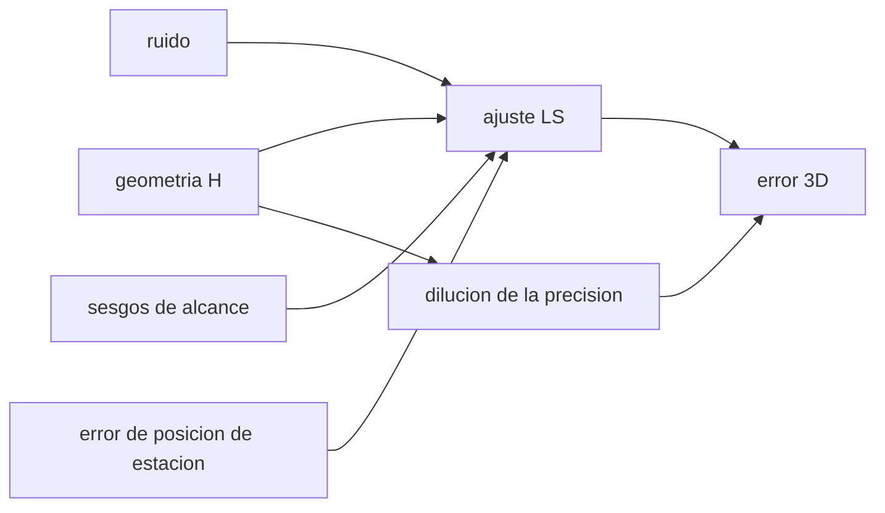

# B74-C05 — Sesgos de estaciones terrestres

<!-- nav:top -->
[🏠 Programa](../../../../README.md) · [📚 Bloque B74](../../../tronco-comun/B74-estimacion-de-orbitas-y-navegacion-espacial.md) · [← Anterior: B74-C04 — Doppler de navegación](../B74-C04-doppler-de-navegacion/CLASE.md) · [Siguiente: B74-C06 — Determinación inicial de órbita →](../B74-C06-determinacion-inicial-de-orbita/CLASE.md)
<!-- /nav -->

## 1. Ubicación, nivel y alcance

Clase 5 del bloque B74. Nivel N3. Una estación terrena no es un punto perfecto: su posición se conoce con error y sus equipos añaden un retardo constante (sesgo) a cada alcance. Aquí simulas un ajuste de posición con seis estaciones sintéticas, le aplicas errores de posición y sesgos, y ves cuánto empeoran el resultado y por qué estimar un sesgo común puede empeorarlo si la geometría es débil.

## 2. Por qué esta clase existe

Un error sistemático no se promedia: un sesgo de 3 m en cada estación no desaparece con más medidas. La decisión central: **¿qué sesgo conviene estimar, cuál conviene solo reconocer en la covarianza y cuándo el remedio empeora el problema?**

## 3. Lo que podrás hacer al terminar

1. Distinguir ruido aleatorio de error sistemático (sesgo) en una medida de alcance.
2. Predecir con la matriz de diseño el error de un ajuste por mínimos cuadrados.
3. Cuantificar el efecto de un error de posición de estación de 5 m.
4. Comparar estimar y no estimar un sesgo común.
5. Reconocer la degeneración entre un sesgo y la posición a lo largo de la línea de visión.
6. Rotular lo sintético y lo ilustrativo.

La evidencia es la **tabla de sensibilidad a sesgos** del ejercicio 12 (sección 20).

## 4. Con qué llegas y cómo comprobarlo

1. ¿Qué es un sesgo?
2. ¿Qué es una matriz de diseño?
3. ¿Qué es el rms?
4. ¿Qué es una incógnita colineal?
5. ¿Qué es una verificación por segunda vía?

<details>
<summary>Ver respuestas</summary>

1. Un error sistemático de valor aproximadamente constante. 2. La matriz de derivadas de las medidas respecto de las incógnitas. 3. La raíz de la media de los cuadrados. 4. Una cuya columna es combinación de otras: no se distingue. 5. Calcular lo mismo con otro método y comparar.
</details>

Con cuatro o cinco aciertos, sigue; si no, repasa los prerrequisitos.

## 5. Un caso de contexto y casos de referencia

Seis estaciones sintéticas miden alcances a una nave a 20 000 km de altitud con ruido de 1 m. El error 3D del ajuste es `4,142 m` (predicción lineal `4,193 m`). Con 5 m de error de posición por eje sube a `20,940 m`, con 3 m de sesgo por estación a `13,030 m`, y estimar un sesgo común empeora el ajuste hasta `42,049 m`. Es el **ejemplo conductor**; todo es sintético.

## 6. Vocabulario

El **sesgo de alcance** es un retardo constante en la medida. El **error de posición de estación** desplaza la línea de base. La **matriz de diseño** `H` tiene por filas las líneas de visión. La **dilución de la precisión** `√tr[(HᵀH)⁻¹]` mide la geometría. Un parámetro **de consideración** (*consider parameter*) se reconoce en la covarianza sin estimarlo.

## 7. Modelo mental: una cinta métrica mal calibrada



*Descripción textual:* la geometría, el ruido, los sesgos y los errores de posición de estación entran en el ajuste y determinan el error 3D; la geometría fija la dilución de la precisión.

Analogía: medir una mesa con una cinta cuyo cero está corrido; repetir la medida no corrige el corrimiento. Límite: en el laboratorio los sesgos son constantes y conocidos en distribución; en la práctica varían con el tiempo y la elevación.

## 8. La explicación, paso a paso

### 8.1 Qué predice la geometría

Con las seis líneas de visión de la nave a 20 000 km, `√tr[(HᵀH)⁻¹] σ = 4,193 m` para `σ = 1 m`. La simulación de 1000 realizaciones da `4,142 m` (cociente `0,988`).

### 8.2 Errores sistemáticos

Un error de posición de estación de 5 m por eje eleva el error a `20,940 m`; un sesgo de 3 m por estación, a `13,030 m`. Más medidas no los reducen.

### 8.3 Sesgo común

Un sesgo común de 10 m sin estimar produce `11,040 m` de error. Si se lo estima, el sesgo se separa del resto, pero el error sube a `42,049 m` (predicción lineal `41,838 m`): como las líneas de visión son casi paralelas, el sesgo es casi colineal con la posición a lo largo de ellas.

### 8.4 Cuando el remedio empeora

Estimar un sesgo común cuando los sesgos reales son distintos por estación da `132,950 m`: el estimador absorbe lo que no puede separar. La alternativa es reconocer el sesgo en la covarianza (parámetro de consideración) o mejorar la geometría con una estación cercana.

## 9. Magnitudes, símbolos y unidades

| Símbolo | Qué es | Unidad | Valor / nota |
|---|---|---|---|
| `H` | líneas de visión (matriz de diseño) | — | 6 × 3 |
| `σ` | ruido de alcance | m | 1 (ilustrativo) |
| `σ_pos` | error de posición de estación | m | 5 por eje (ilustrativo) |
| `σ_b` | sesgo por estación | m | 3 (ilustrativo) |
| `b` | sesgo común | m | 10 (ilustrativo) |
| `rms 3D` | error cuadrático medio de posición | m | 1000 realizaciones |

## 10. Convenciones y referencias

Posición de la nave y de las estaciones en un marco terrestre fijo simplificado; alcances de una vía en m; esfera de 6 378 137 m (valor ilustrativo); ruido y sesgos gaussianos independientes. Gauss–Newton con 6 iteraciones. Todo sintético.

## 11. De dónde sale lo que afirmamos

| ID | Fuente | Localizador | Respalda | Estado |
|---|---|---|---|---|
| S1 | NIST, CODATA — Speed of light in vacuum — https://physics.nist.gov/cgi-bin/cuu/Value?c (consultada 2026-11-10) | entrada «c» | c = 299 792 458 m/s (exacta) | Consultada |
| S2 | NASA/JPL, DSN Telecommunications Link Design Handbook 810-005 (índice) — https://deepspace.jpl.nasa.gov/dsndocs/810-005/ (consultada 2026-11-10) | página de presentación | el manual trata de los parámetros de desempeño de los enlaces de telecomunicaciones entre nave y DSN; los módulos de radiometría no se leyeron | Consultada (solo índice) |
| — | Tapley, Schutz y Born, *Statistical Orbit Determination* (Elsevier, 2004); Montenbruck y Gill, *Satellite Orbits* (Springer, 2000) | — | fundamento teórico general de la clase | No consultada |

Límites: no se consultó ningún texto sobre calibración de estaciones ni sobre parámetros de consideración; los niveles de error son ilustrativos y no representan los de ninguna red real. Del manual del DSN solo se leyó la página de presentación.

## 12. Cómo ver la sensibilidad a sesgos

| Magnitud | Valor |
|---|---|
| solo ruido | 4,142 m |
| + posición de estación | 20,940 m |
| + sesgo por estación | 13,030 m |
| sesgo común sin estimar | 11,040 m |
| sesgo común estimado | 42,049 m |

Descripción larga: los errores sistemáticos superan al ruido; estimar un sesgo común con geometría débil multiplica el error por diez.

## 13. Ejemplo trabajado: la dilución de la precisión

**Paso 1 · Matriz de diseño.** Seis filas con las líneas de visión unitarias.

**Paso 2 · Covarianza.** `(HᵀH)⁻¹ σ²`.

**Paso 3 · Error.** `√tr = 4,193 m` con `σ = 1 m`: la geometría multiplica el ruido por cuatro.

**Paso 4 · Con sesgo estimado.** El factor sube a `41,838 m`: añadir una incógnita casi colineal degrada el ajuste.

## 14. Distintas formas de describir el error de un ajuste

**Por ruido:** `√tr[(HᵀH)⁻¹] σ`. **Por sesgo:** `(HᵀH)⁻¹Hᵀb`. **Por posición de estación:** perturbación de `H` y de `y`. **Por simulación:** rms de Monte Carlo.

## 15. Práctica guiada

**Ejercicio 1 · guiado.** Si el ruido pasa de 1 m a 2 m, ¿cuánto vale el error 3D predicho? *Pista:* proporcional a `σ`.

<details><summary>Solución comentada</summary>

`2 × 4,193 m`.
</details>

**Ejercicio 2 · guiado.** ¿Cuánto vale el efecto de 10 m de sesgo común sin estimar? *Pista:* tabla de 8.3.

<details><summary>Solución comentada</summary>

`11,040 m`, menos que 10 m: parte del sesgo se proyecta en la posición.
</details>

**Ejercicio 3 · guiado.** ¿Qué ocurre con el error si añades una estación cerca de la nave? *Pista:* geometría.

<details><summary>Solución comentada</summary>

Mejora, porque la nueva línea de visión es muy distinta de las demás.
</details>

## 16. Práctica autónoma, transferencia e integrador

**Ejercicio 4 · autónomo.** ¿Qué significa que el rms con sesgo estimado sea 10 veces mayor?

<details><summary>Solución comentada</summary>

Que la geometría casi no distingue sesgo y posición.
</details>

**Ejercicio 5 · autónomo.** Un sesgo de 3 m por estación, ¿es aleatorio o sistemático entre medidas?

<details><summary>Solución comentada</summary>

Sistemático: es constante durante el pase.
</details>

**Ejercicio 6 · autónomo.** ¿Cuántas estaciones hacen falta para estimar 3 posiciones y un sesgo?

<details><summary>Solución comentada</summary>

Al menos cuatro, con geometría no degenerada.
</details>

**Ejercicio 7 · autónomo.** ¿Cómo cambia el error si las seis estaciones se agrupan en una región?

<details><summary>Solución comentada</summary>

Empeora: las líneas de visión se parecen.
</details>

**Ejercicio 8 · autónomo.** ¿Por qué el cociente rms/predicción no es 1,000?

<details><summary>Solución comentada</summary>

Porque 1000 realizaciones dejan una variabilidad estadística de unos pocos por ciento.
</details>

**Ejercicio 9 · transferencia.** **Transferencia.** Una agencia reporta una precisión «de 1 m» sin separar ruido y sesgo. ¿Qué preguntas haces?

<details><summary>Solución comentada</summary>

Qué sesgos se estimaron, cuáles no, qué geometría y cuántas estaciones.
</details>

**Ejercicio 10 · transferencia.** **Transferencia.** ¿Por qué conviene calibrar el retardo con una nave de posición conocida?

<details><summary>Solución comentada</summary>

Porque así el sesgo se observa directamente y deja de confundirse con la posición.
</details>

**Ejercicio 11 · transferencia.** **Transferencia.** En un ajuste real aparece una pendiente en los residuos con la elevación. ¿Qué sospechas?

<details><summary>Solución comentada</summary>

Un efecto atmosférico (troposfera) no modelado, que depende de la elevación.
</details>

**Ejercicio 12 · integrador.** **Integrador.** Elabora tu *tabla de sensibilidad a sesgos*: error 3D en los seis casos, predicción lineal, interpretación de cuándo estimar un sesgo y cuándo no, rotulando lo sintético.

<details><summary>Solución comentada</summary>

Secciones 8.1–8.4 y la salida del laboratorio.
</details>

## 17. Laboratorio: sesgos y posiciones de estación en un ajuste

El script [laboratorio.py](laboratorio.py) ajusta la posición de una nave con seis estaciones sintéticas y mide el efecto del ruido, de errores de posición y de sesgos con y sin estimar un sesgo común (**comprueba** rms sin errores sistemáticos dentro del 8 % de la predicción lineal).

**Datos:** geometría, ruido y sesgos **sintéticos/ilustrativos**; esfera de 6 378 137 m ilustrativa. **Predice antes de ejecutar:** ¿empeora o mejora el error al estimar un sesgo común cuando la nave está lejos? (empeora). **Ejecución del 2026-11-10 (Python 3.12.9, NumPy 2.4.4):**

```text
Python 3.12.9, NumPy 2.4.4 (geometria y errores SINTETICOS, semilla 13)
Prediccion lineal del rms 3D con ruido 1.0 m: 4.193 m
Prediccion lineal con un sesgo comun estimado: 41.838 m
caso                                           rms 3D [m]
a) solo ruido                                      4.142
b) + posicion de estacion                         20.940
c) + sesgo por estacion                           13.030
d) sesgo comun de 10 m sin estimarlo              11.040
f) sesgo comun de 10 m, estimado                  42.049
e) sesgo por estacion, estimando uno comun       132.950
Cociente rms/prediccion en el caso a) = 0.988
Pruebas superadas.
```

```bash
python programa/clases/B74/B74-C05-sesgos-de-estaciones-terrestres/laboratorio.py
```

**Límites:** sesgos constantes, sin troposfera, sin dinámica de la nave y con una sola geometría; el ajuste es estático.

## 18. Errores frecuentes y cómo corregirlos

**Creer que más medidas reducen un sesgo.** No lo hacen; ver 8.2.

**Estimar todo lo que se pueda.** Estimar un parámetro casi colineal degrada el ajuste; ver 8.3.

**Ignorar la geometría.** Calcula la dilución de la precisión antes, como en 8.1.

**Presentar la red sintética como una real.** Rotula como sintético, como en la sección 10.

## 19. Cómo sabrás que vas bien

Tras la sección 8: ¿qué error esperabas al estimar el sesgo común y cuál obtuviste? Si dudas, repasa el ejemplo 13. Tras el laboratorio: ¿qué comprueba? (ver la sección 17).

## 20. Qué entregas y cómo se evalúa

El producto es tu **tabla de sensibilidad a sesgos** (ejercicio 12).

| Criterio | Inicial | En desarrollo | Logrado | Destacado |
|---|---|---|---|---|
| Conceptos | Los confunde | Parciales | Separa ruido, sesgo y geometría | Explica los límites |
| Cálculo | Sin unidades | Con errores | Tablas completas con unidades | Calcula casos nuevos |
| Numérico | Sin comprobar | Un caso | Contraste con una segunda vía | Interpreta las diferencias |
| Fuentes | Sin fuente | Sin fecha | Fuentes con fecha y estado | Declara lo sintético y lo no consultado |
| Límites | No los nombra | Uno | Tres | Discute qué falta del modelo |

**Condiciones críticas (no se compensan con promedio):** distinguir sesgo de ruido y rotular la red y los errores como sintéticos; rotular los datos como sintéticos y no presentar nada simulado como observado; citar solo lo consultado.

## 21. Ética, seguridad y límites

Clase educativa en estado E0: los modelos son simplificados y sus datos son sintéticos o ilustrativos; ningún resultado describe la órbita real de una nave ni sustituye a un producto de navegación de misión. Accesibilidad: tablas equivalentes a las gráficas, fórmulas en texto, ejercicios sin conexión. Tolerancias del laboratorio: rms sin errores sistemáticos dentro del 8 % de la predicción lineal (1000 realizaciones).

## 22. Para cerrar y seguir

Un sesgo de 3 m por estación deja `13,030 m` de error, tres veces el del ruido; estimar un sesgo común con esta geometría lo lleva a `42,049 m`. Queda una pregunta: ¿cómo se obtiene una órbita inicial cuando aún no hay ajuste?

**Glosario español–inglés.** sesgo · *bias*; matriz de diseño · *design matrix*; dilución de la precisión · *dilution of precision*; parámetro de consideración · *consider parameter*; línea de base · *baseline*.

**Continuidad.** [B74-C06](../B74-C06-determinacion-inicial-de-orbita/CLASE.md) estudia la determinación inicial de órbita.

**Referencias:** ver sección 11.

<!-- nav:bottom -->
---

[← Anterior: B74-C04 — Doppler de navegación](../B74-C04-doppler-de-navegacion/CLASE.md) · [📚 Bloque B74](../../../tronco-comun/B74-estimacion-de-orbitas-y-navegacion-espacial.md) · [Siguiente: B74-C06 — Determinación inicial de órbita →](../B74-C06-determinacion-inicial-de-orbita/CLASE.md)
<!-- /nav -->
