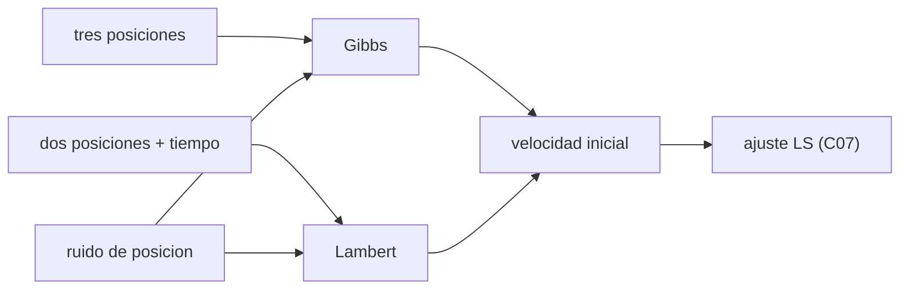

# B74-C06 — Determinación inicial de órbita

<!-- nav:top -->
[🏠 Programa](../../../../README.md) · [📚 Bloque B74](../../../tronco-comun/B74-estimacion-de-orbitas-y-navegacion-espacial.md) · [← Anterior: B74-C05 — Sesgos de estaciones terrestres](../B74-C05-sesgos-de-estaciones-terrestres/CLASE.md) · [Siguiente: B74-C07 — Ajuste por mínimos cuadrados →](../B74-C07-ajuste-por-minimos-cuadrados/CLASE.md)
<!-- /nav -->

## 1. Ubicación, nivel y alcance

Clase 6 del bloque B74. Nivel N3. Antes de ajustar una órbita hace falta una primera estimación suficientemente buena para linealizar. Aquí obtienes la velocidad a partir de posiciones con dos métodos clásicos de dos cuerpos: el de **Gibbs** (tres posiciones) y el de **Lambert** (dos posiciones y el tiempo entre ellas), y ves cómo el ruido de posición se amplifica cuando las observaciones están muy juntas. La órbita y las posiciones son sintéticas.

## 2. Por qué esta clase existe

Un ajuste por mínimos cuadrados converge solo si parte cerca de la solución. La decisión central: **¿qué método entrega una buena velocidad inicial con las observaciones disponibles, y cuánto empeora con el ruido y con poca separación angular?**

## 3. Lo que podrás hacer al terminar

1. Aplicar el método de Gibbs a tres posiciones coplanares.
2. Resolver el problema de Lambert con variables universales.
3. Verificar ambos métodos con una órbita de verdad conocida.
4. Medir cómo el ruido de posición se amplifica con la separación angular.
5. Explicar por qué la solución inicial no es la solución final.
6. Rotular lo sintético y lo no consultado.

La evidencia es la **órbita inicial con el error frente a la verdad sintética** del ejercicio 12 (sección 20).

## 4. Con qué llegas y cómo comprobarlo

1. ¿Qué es una órbita kepleriana?
2. ¿Qué es el vector de estado?
3. ¿Qué es el producto vectorial?
4. ¿Qué es una biseccion?
5. ¿Qué es una verificación por segunda vía?

<details>
<summary>Ver respuestas</summary>

1. La trayectoria de dos cuerpos bajo una fuerza central inversa del cuadrado. 2. Posición y velocidad en un instante. 3. Un vector perpendicular a los dos, de módulo igual al área del paralelogramo. 4. Un método que reduce a la mitad el intervalo donde está la raíz. 5. Calcular lo mismo con otro método y comparar.
</details>

Con cuatro o cinco aciertos, sigue; si no, repasa los prerrequisitos.

## 5. Un caso de contexto y casos de referencia

Una órbita sintética de `a = 8000 km` y `e = 0,1` (periodo `118,685 min`) se recupera con Lambert con un error de `6,4e-13 m/s` sin ruido. Con ruido de 10 m, Gibbs con posiciones separadas `1,83°` da un error de `14,107 m/s` y con `18,50°`, `0,154 m/s`. Es el **ejemplo conductor**; la órbita es sintética.

## 6. Vocabulario

El **método de Gibbs** halla la velocidad central con tres vectores de posición coplanares. El **problema de Lambert** halla la órbita que une dos posiciones en un tiempo dado. Las **variables universales** (con las funciones de Stumpff `C(z)`, `S(z)`) tratan igual elipses, parábolas e hipérbolas. La **órbita preliminar** es la entrada del ajuste.

## 7. Modelo mental: trazar un arco con tres clavos



*Descripción textual:* tres posiciones alimentan a Gibbs y dos más el tiempo alimentan a Lambert; ambos dan una velocidad inicial que parte del ruido y alimenta al ajuste.

Analogía: tres clavos fijan un arco único, pero si están muy juntos un pequeño error de colocación cambia mucho la curva. Límite: ambos métodos suponen dos cuerpos sin perturbaciones y posiciones ya expresadas en un marco inercial.

## 8. La explicación, paso a paso

### 8.1 Gibbs

Con `r₁, r₂, r₃` coplanares, Gibbs combina productos vectoriales para dar `v₂`. Sin ruido es exacto para cualquier separación (error ~`10⁻¹⁰ m/s` en el laboratorio): una cónica queda determinada por tres puntos coplanares.

### 8.2 Lambert

Con `r₁`, `r₂` y `Δt = 25 min`, la ecuación del tiempo de vuelo en la variable `z` se resuelve por bisección; el error de `v₁` es `6,4e-13 m/s`. Con ruido de 10 m por eje en ambas posiciones, el rms de `v₁` es `0,0191 m/s`.

### 8.3 El ruido se amplifica con la poca separación

El error de velocidad por el ruido de posición es del orden `σ_r/Δt`: con `Δt = 30 s` (separación `1,83°`) el rms es `14,107 m/s`; con 120 s, `0,861 m/s`; con 300 s, `0,154 m/s`.

### 8.4 Qué es una órbita preliminar

Ninguna de estas soluciones usa todas las observaciones ni su covarianza. Sirven de punto de partida al ajuste (C07) y, si el ruido es grande, el ajuste puede divergir.

## 9. Magnitudes, símbolos y unidades

| Símbolo | Qué es | Unidad | Valor / nota |
|---|---|---|---|
| `r₁, r₂, r₃` | posiciones | m | marco inercial |
| `v` | velocidad | m/s |  |
| `μ` | parámetro gravitacional | m³/s² | 3,986004 × 10¹⁴ (ilustrativo) |
| `Δt` | tiempo entre posiciones | s |  |
| `z` | variable universal de Lambert | — | z = α χ² |
| `C(z), S(z)` | funciones de Stumpff | — |  |

## 10. Convenciones y referencias

Marco inercial geocéntrico; dos cuerpos sin perturbaciones; μ = 3,986004 × 10¹⁴ m³/s² como valor nominal ilustrativo (no consultado aquí); ruido gaussiano de 10 m por eje; semilla 17. Datos sintéticos.

## 11. De dónde sale lo que afirmamos

| ID | Fuente | Localizador | Respalda | Estado |
|---|---|---|---|---|
| S1 | NIST, CODATA — Speed of light in vacuum — https://physics.nist.gov/cgi-bin/cuu/Value?c (consultada 2026-11-10) | entrada «c» | c = 299 792 458 m/s (exacta) | Consultada |
| S2 | NASA/JPL SSD, Horizons API — https://ssd-api.jpl.nasa.gov/doc/horizons.html (consultada 2026-11-10) | parámetros EPHEM_TYPE, COMMAND, CENTER, TLIST | Horizons entrega tablas de observador, vectores de estado, elementos y SPK; parámetros de la API | Consultada |
| — | Vallado, *Fundamentals of Astrodynamics and Applications* (4.ª ed., Microcosm, 2013); Curtis, *Orbital Mechanics for Engineering Students* (Elsevier); Tapley, Schutz y Born, *Statistical Orbit Determination* (Elsevier, 2004) | — | fundamento teórico general de la clase | No consultada |

Límites: los algoritmos de Gibbs y Lambert no se consultaron en una fuente concreta: se verifican con una órbita de verdad conocida; el valor de μ es ilustrativo y no se consultó. Horizons solo se consultó como referencia de tipos de salida.

## 12. Cómo ver la órbita inicial

| Magnitud | Valor |
|---|---|
| periodo | 118,685 min |
| error Lambert sin ruido | 6,4e-13 m/s |
| Gibbs, ruido 10 m, 30 s | 14,107 m/s |
| Gibbs, ruido 10 m, 300 s | 0,154 m/s |
| Lambert, ruido 10 m, 25 min | 0,0191 m/s |

Descripción larga: sin ruido ambos métodos son exactos; con ruido el error de velocidad cae con el tiempo entre posiciones, por lo que un arco largo es mucho mejor que tres puntos cercanos.

## 13. Ejemplo trabajado: el error de velocidad por el ruido

**Paso 1 · Estimación.** `σ_v ≈ √2 σ_r/Δt` para dos puntos separados `Δt`.

**Paso 2 · Valores.** Con `σ_r = 10 m` y `Δt = 1500 s`: `≈ 0,0094 m/s`; el laboratorio da `0,0191 m/s` con el efecto de la geometría.

**Paso 3 · Gibbs a 30 s.** `≈ 14 m/s`, tres órdenes mayor.

**Paso 4 · Lectura.** El arco largo mejora la velocidad por el cociente de los intervalos.

## 14. Distintas formas de describir una órbita inicial

**Por tres posiciones:** Gibbs. **Por dos posiciones y tiempo:** Lambert. **Por elementos:** `a, e, i, Ω, ω, ν`. **Por error:** diferencia de velocidad con la verdad.

## 15. Práctica guiada

**Ejercicio 1 · guiado.** Estima `σ_v` para dos posiciones con ruido de 20 m y 600 s de separación. *Pasos:* `√2 σ_r/Δt`.

<details><summary>Solución comentada</summary>

`√2 × 20/600 = 0,047 m/s`.
</details>

**Ejercicio 2 · guiado.** ¿Qué método usarías con tres posiciones de un mismo pase? *Pista:* hay tres vectores.

<details><summary>Solución comentada</summary>

Gibbs (con cuidado si están cerca).
</details>

**Ejercicio 3 · guiado.** ¿Qué entrada necesita Lambert además de las posiciones? *Pista:* es un problema de tiempo de vuelo.

<details><summary>Solución comentada</summary>

El tiempo entre ellas y μ.
</details>

## 16. Práctica autónoma, transferencia e integrador

**Ejercicio 4 · autónomo.** Si la separación se duplica, ¿cómo cambia el error de velocidad por ruido?

<details><summary>Solución comentada</summary>

Se reduce aproximadamente a la mitad.
</details>

**Ejercicio 5 · autónomo.** ¿Por qué Gibbs es exacto sin ruido?

<details><summary>Solución comentada</summary>

Porque tres puntos coplanares de una cónica la determinan y el método usa esa geometría.
</details>

**Ejercicio 6 · autónomo.** ¿Qué pasa si las tres posiciones no son coplanares?

<details><summary>Solución comentada</summary>

Hay inconsistencia; el método de Gibbs exige coplanaridad (se comprueba con el triple producto).
</details>

**Ejercicio 7 · autónomo.** ¿Qué entiende el ajuste LS por «punto de partida»?

<details><summary>Solución comentada</summary>

Un estado inicial desde el cual la linealización es válida.
</details>

**Ejercicio 8 · autónomo.** ¿Qué es un revolución múltiple en Lambert?

<details><summary>Solución comentada</summary>

Una solución que da más de una vuelta entre las dos posiciones; hay varias para un mismo tiempo.
</details>

**Ejercicio 9 · transferencia.** **Transferencia.** Un equipo propone Lambert con 3 horas entre posiciones de un satélite en órbita baja. ¿Qué riesgo hay?

<details><summary>Solución comentada</summary>

Varias revoluciones: hay que decidir el número de vueltas.
</details>

**Ejercicio 10 · transferencia.** **Transferencia.** ¿Qué falta si las posiciones vienen de radar con ruido de 100 m?

<details><summary>Solución comentada</summary>

Ponderación y ajuste; Gibbs y Lambert solo dan la primera estimación.
</details>

**Ejercicio 11 · transferencia.** **Transferencia.** Un cuerpo en órbita alrededor de la Luna: ¿qué cambia?

<details><summary>Solución comentada</summary>

Solo `μ`; los métodos son los mismos.
</details>

**Ejercicio 12 · integrador.** **Integrador.** Elabora tu *órbita inicial con el error frente a la verdad sintética*: Gibbs y Lambert, errores sin ruido y con ruido para tres separaciones, y el límite de cada método.

<details><summary>Solución comentada</summary>

Secciones 8.1–8.4 y la salida del laboratorio.
</details>

## 17. Laboratorio: Gibbs y Lambert sobre una órbita sintética

El script [laboratorio.py](laboratorio.py) genera posiciones de una órbita sintética, aplica Gibbs (tres separaciones) y Lambert (25 min) con y sin ruido de 10 m (**comprueba** errores sin ruido < 1e-6 m/s).

**Datos:** órbita, posiciones y ruido **sintéticos**; μ ilustrativo. **Predice antes de ejecutar:** ¿qué separación da menor error con ruido: 30 s o 300 s? (300 s). **Ejecución del 2026-11-10 (Python 3.12.9, NumPy 2.4.4):**

```text
Python 3.12.9, NumPy 2.4.4 (orbita SINTETICA, semilla 17)
Periodo = 118.685 min ; |r0| = 7259.099 km ; |v0| = 7745.699 m/s
Lambert (dt = 25 min, sin ruido): error de v1 = 6.431e-13 m/s
Gibbs (tres posiciones separadas dt cada una):
  dt [s]   sep. angular [deg]   error v2 sin ruido [m/s]   error v2 con ruido 10 m [m/s]
      30          1.835                2.558e-10                    14.1075
     120          7.363                2.822e-11                     0.8612
     300         18.497                9.932e-12                     0.1541
Lambert (dt = 25 min) con ruido de 10 m por eje en ambas posiciones: rms del error de v1 = 0.0191 m/s
Pruebas superadas.
```

```bash
python programa/clases/B74/B74-C06-determinacion-inicial-de-orbita/laboratorio.py
```

**Límites:** dos cuerpos, sin perturbaciones ni órbitas hiperbólicas; un solo número de revoluciones; ruido gaussiano en posición solamente.

## 18. Errores frecuentes y cómo corregirlos

**Usar Gibbs con puntos muy cercanos.** Amplifica el ruido; ver 8.3.

**Confundir orbita preliminar con solución.** Es solo el punto de partida; ver 8.4.

**Olvidar μ del cuerpo central.** Cámbialo para otro cuerpo.

**Presentar la órbita sintética como real.** Rotula como sintético, como en la sección 10.

## 19. Cómo sabrás que vas bien

Tras la sección 8: ¿qué error esperabas para Gibbs a 30 s y cuál obtuviste? Si dudas, repasa el ejemplo 13. Tras el laboratorio: ¿qué comprueba? (ver la sección 17).

## 20. Qué entregas y cómo se evalúa

El producto es tu **órbita inicial con el error frente a la verdad sintética** (ejercicio 12).

| Criterio | Inicial | En desarrollo | Logrado | Destacado |
|---|---|---|---|---|
| Conceptos | Los confunde | Parciales | Distingue Gibbs de Lambert y su entrada | Explica los límites |
| Cálculo | Sin unidades | Con errores | Tablas completas con unidades | Calcula casos nuevos |
| Numérico | Sin comprobar | Un caso | Contraste con una segunda vía | Interpreta las diferencias |
| Fuentes | Sin fuente | Sin fecha | Fuentes con fecha y estado | Declara lo sintético y lo no consultado |
| Límites | No los nombra | Uno | Tres | Discute qué falta del modelo |

**Condiciones críticas (no se compensan con promedio):** declarar μ y el marco inercial y rotular la órbita como sintética; rotular los datos como sintéticos y no presentar nada simulado como observado; citar solo lo consultado.

## 21. Ética, seguridad y límites

Clase educativa en estado E0: los modelos son simplificados y sus datos son sintéticos o ilustrativos; ningún resultado describe la órbita real de una nave ni sustituye a un producto de navegación de misión. Accesibilidad: tablas equivalentes a las gráficas, fórmulas en texto, ejercicios sin conexión. Tolerancias del laboratorio: errores de Gibbs y Lambert sin ruido < 1e-6 m/s.

## 22. Para cerrar y seguir

Con tres puntos a 30 s el ruido de 10 m da `14,107 m/s`; con 300 s baja a `0,154 m/s`. Queda una pregunta: ¿cómo se refina esa órbita usando todas las observaciones?

**Glosario español–inglés.** determinación inicial de órbita · *initial orbit determination*; método de Gibbs · *Gibbs method*; problema de Lambert · *Lambert problem*; variables universales · *universal variables*; órbita preliminar · *preliminary orbit*.

**Continuidad.** [B74-C07](../B74-C07-ajuste-por-minimos-cuadrados/CLASE.md) estudia el ajuste por mínimos cuadrados.

**Referencias:** ver sección 11.

<!-- nav:bottom -->
---

[← Anterior: B74-C05 — Sesgos de estaciones terrestres](../B74-C05-sesgos-de-estaciones-terrestres/CLASE.md) · [📚 Bloque B74](../../../tronco-comun/B74-estimacion-de-orbitas-y-navegacion-espacial.md) · [Siguiente: B74-C07 — Ajuste por mínimos cuadrados →](../B74-C07-ajuste-por-minimos-cuadrados/CLASE.md)
<!-- /nav -->
