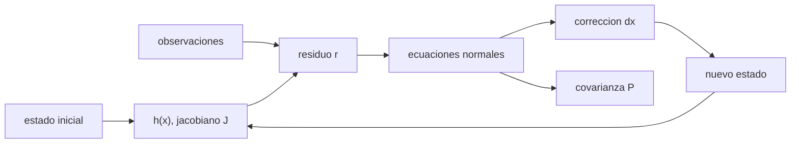

# B74-C07 — Ajuste por mínimos cuadrados

<!-- nav:top -->
[🏠 Programa](../../../../README.md) · [📚 Bloque B74](../../../tronco-comun/B74-estimacion-de-orbitas-y-navegacion-espacial.md) · [← Anterior: B74-C06 — Determinación inicial de órbita](../B74-C06-determinacion-inicial-de-orbita/CLASE.md) · [Siguiente: B74-C08 — Filtrado recursivo de estados →](../B74-C08-filtrado-recursivo-de-estados/CLASE.md)
<!-- /nav -->

## 1. Ubicación, nivel y alcance

Clase 7 del bloque B74. Nivel N3. El ajuste por mínimos cuadrados usa todas las observaciones a la vez para corregir un estado inicial (C06) y entregar, junto con la corrección, la covarianza que dice cuánto se puede creer. Aquí ajustas por Gauss–Newton ponderado una órbita sintética observada con alcance y velocidad de alcance desde dos estaciones, y contrastas la covarianza formal con una simulación de Monte Carlo.

## 2. Por qué esta clase existe

Un estado sin covarianza es un número sin garantía. La decisión central: **¿cuál es el estado que mejor explica las observaciones, qué incertidumbre tiene y cómo compruebo que esa incertidumbre es honesta?**

## 3. Lo que podrás hacer al terminar

1. Plantear las ecuaciones normales `HᵀWH δx = HᵀW r`.
2. Iterar Gauss–Newton hasta converger y leer el historial de `χ²`.
3. Obtener la covarianza formal `P = (HᵀWH)⁻¹`.
4. Comparar la covarianza formal con la dispersión de Monte Carlo.
5. Interpretar `χ²/grados de libertad` como prueba de consistencia.
6. Rotular lo sintético y lo ilustrativo.

La evidencia es la **solución por lotes con su covarianza** del ejercicio 12 (sección 20).

## 4. Con qué llegas y cómo comprobarlo

1. ¿Qué es un residuo?
2. ¿Qué es un peso estadístico?
3. ¿Qué es un jacobiano?
4. ¿Qué es un grado de libertad?
5. ¿Qué es una verificación por segunda vía?

<details>
<summary>Ver respuestas</summary>

1. La diferencia entre la medida y el valor que predice el modelo. 2. El inverso de la varianza de una medida. 3. La matriz de derivadas parciales de las medidas respecto del estado. 4. Cada observación no consumida por una incógnita. 5. Calcular lo mismo con otro método y comparar.
</details>

Con cuatro o cinco aciertos, sigue; si no, repasa los prerrequisitos.

## 5. Un caso de contexto y casos de referencia

Se ajusta una órbita sintética con `84` observaciones de alcance y velocidad de alcance desde dos estaciones. Partiendo de un error de `7071,1 m`, Gauss–Newton converge en `4` iteraciones a un error de `3,020 m` con `χ²/gl = 0,947`. Es el **ejemplo conductor**; los datos son sintéticos.

## 6. Vocabulario

Las **ecuaciones normales** resuelven el mínimo de `rᵀWr`. **Gauss–Newton** linealiza `h` y repite. La **covarianza formal** `P = (HᵀWH)⁻¹` supone modelo lineal y ruido bien descrito. El **`χ²`** es `rᵀWr`; su valor esperado es el número de grados de libertad. La **matriz de información** es `HᵀWH`.

## 7. Modelo mental: ajustar una recta con muchas manos



*Descripción textual:* cada iteración calcula residuos y jacobiano, resuelve las ecuaciones normales, corrige el estado y repite hasta converger; de las mismas ecuaciones sale la covarianza.

Analogía: ajustar una recta a puntos dispersos; los puntos más precisos pesan más y la dispersión de los puntos dice cuánto se puede mover la recta. Límite: el modelo es de dos cuerpos con estaciones fijas; no hay perturbaciones, rotación ni maniobras.

## 8. La explicación, paso a paso

### 8.1 Iteración

La corrección `δx = (HᵀWH)⁻¹ HᵀW r` se aplica cuatro veces como máximo: `χ²` pasa de un valor enorme a `73,86` y la corrección final es inferior a un milímetro.

### 8.2 Resultado y covarianza

El error final es de `3,020 m` en posición y `0,00237 m/s` en velocidad. La covarianza formal da `σ = (1,848, 17,342, 12,628) m` y `(0,00470, 0,01652, 0,00815) m/s`; el error real queda dentro de unos pocos sigma.

### 8.3 Consistencia: `χ²`

`χ² = 73,86` con `78` grados de libertad (cociente `0,947`). Un cociente cercano a 1 indica que los pesos describen el ruido; mucho mayor que 1 indica ruido subestimado o modelo incompleto.

### 8.4 Segunda vía: Monte Carlo

Con 100 realizaciones de ruido, el cociente entre la dispersión empírica y la formal está entre `0,923` y `1,100`: la covarianza formal describe bien la dispersión en este problema casi lineal.

## 9. Magnitudes, símbolos y unidades

| Símbolo | Qué es | Unidad | Valor / nota |
|---|---|---|---|
| `x` | estado (r, v) | m, m/s | 6 incógnitas |
| `H` | jacobiano | — | 84 × 6 |
| `W` | matriz de pesos | 1/m², s²/m² | diagonal, 1/σ² |
| `r` | residuo | m, m/s | y − h(x) |
| `P` | covarianza formal | m², (m/s)² | (HᵀWH)⁻¹ |
| `χ²` | suma ponderada de residuos al cuadrado | — | esperado ≈ gl |

## 10. Convenciones y referencias

Marco inercial simplificado con estaciones fijas; dos cuerpos con μ = 3,986004 × 10¹⁴ m³/s² (ilustrativo, no consultado); observaciones de alcance (σ = 10 m) y velocidad de alcance (σ = 0,01 m/s) cada 60 s durante 20 min; ruido gaussiano; semilla 19. Todo sintético.

## 11. De dónde sale lo que afirmamos

| ID | Fuente | Localizador | Respalda | Estado |
|---|---|---|---|---|
| S1 | NIST, CODATA — Speed of light in vacuum — https://physics.nist.gov/cgi-bin/cuu/Value?c (consultada 2026-11-10) | entrada «c» | c = 299 792 458 m/s (exacta) | Consultada |
| S2 | NASA/JPL SSD, Horizons API — https://ssd-api.jpl.nasa.gov/doc/horizons.html (consultada 2026-11-10) | parámetros EPHEM_TYPE, COMMAND, CENTER, TLIST | Horizons entrega tablas de observador, vectores de estado, elementos y SPK; parámetros de la API | Consultada |
| — | Tapley, Schutz y Born, *Statistical Orbit Determination* (Elsevier, 2004); Bar-Shalom, Li y Kirubarajan, *Estimation with Applications to Tracking and Navigation* (Wiley, 2001); Montenbruck y Gill, *Satellite Orbits* (Springer, 2000) | — | fundamento teórico general de la clase | No consultada |

Límites: el algoritmo de Gauss–Newton y la covarianza formal son relaciones estándar que no se consultaron en una fuente concreta: el laboratorio las contrasta con una simulación de Monte Carlo. Horizons solo se consultó como referencia de formatos.

## 12. Cómo ver el ajuste por lotes

| Magnitud | Valor |
|---|---|
| iteraciones | 4 |
| error final de posición | 3,020 m |
| `σ` formal en x | 1,848 m |
| `χ²/gl` | 0,947 |
| cociente empírico/formal | entre 0,923 y 1,100 |

Descripción larga: el ajuste converge en pocas iteraciones, el error real es del tamaño de la covarianza formal y `χ²/gl` cercano a 1 confirma que los pesos describen el ruido.

## 13. Ejemplo trabajado: una iteración de Gauss–Newton

**Paso 1 · Residuos.** Con el estado inicial, `r = y − h(x₀)`, y `χ² = 73,86` al final.

**Paso 2 · Jacobiano.** `J` de 84 × 6 por diferencias centrales.

**Paso 3 · Normales.** `δx = (JᵀWJ)⁻¹ JᵀW r`.

**Paso 4 · Covarianza.** `P = (JᵀWJ)⁻¹`, con `σ_x = 1,848 m`; la dirección de menor información (y, z) tiene mayor incertidumbre.

## 14. Distintas formas de describir una solución por lotes

**Por estado:** `x̂`. **Por covarianza:** `P`. **Por residuos:** `r`, `χ²`. **Por información:** `HᵀWH`. **Por simulación:** dispersión de Monte Carlo.

## 15. Práctica guiada

**Ejercicio 1 · guiado.** Calcula los grados de libertad si hay 84 observaciones y 6 incógnitas. *Pasos:* resta.

<details><summary>Solución comentada</summary>

`84 − 6 = 78`.
</details>

**Ejercicio 2 · guiado.** Si `χ² = 156` con 78 grados de libertad, ¿qué sugiere? *Pista:* cociente 2.

<details><summary>Solución comentada</summary>

Ruido subestimado por `√2` o un modelo incompleto.
</details>

**Ejercicio 3 · guiado.** ¿Qué pasa con `P` si todos los `σ` se duplican? *Pista:* `W = 1/σ²`.

<details><summary>Solución comentada</summary>

`P` se multiplica por 4.
</details>

## 16. Práctica autónoma, transferencia e integrador

**Ejercicio 4 · autónomo.** ¿Por qué el error de `y` y `z` es mayor que el de `x`?

<details><summary>Solución comentada</summary>

La geometría de las dos estaciones observa mejor esa dirección.
</details>

**Ejercicio 5 · autónomo.** ¿Cuántas observaciones mínimas se necesitan para 6 incógnitas?

<details><summary>Solución comentada</summary>

Al menos 6, con geometría no degenerada.
</details>

**Ejercicio 6 · autónomo.** ¿Qué ocurre si el estado inicial está muy lejos?

<details><summary>Solución comentada</summary>

La linealización falla y Gauss–Newton puede divergir.
</details>

**Ejercicio 7 · autónomo.** ¿Qué observable aporta más a la velocidad: alcance o velocidad de alcance?

<details><summary>Solución comentada</summary>

La velocidad de alcance, con `σ = 0,01 m/s`.
</details>

**Ejercicio 8 · autónomo.** ¿Qué diría un cociente empírico/formal de 2?

<details><summary>Solución comentada</summary>

Que la covarianza formal es optimista: faltan errores en el modelo.
</details>

**Ejercicio 9 · transferencia.** **Transferencia.** Un resumen de misión reporta una incertidumbre de posición sin decir de dónde sale. ¿Qué preguntas haces?

<details><summary>Solución comentada</summary>

Qué observaciones, qué pesos, qué modelo, qué sesgos incluye y si pasó pruebas de consistencia.
</details>

**Ejercicio 10 · transferencia.** **Transferencia.** ¿Cómo se incluye un sesgo de alcance como incógnita?

<details><summary>Solución comentada</summary>

Se añade una columna a `H` y una fila a `x̂`; ver C05 sobre degeneraciones.
</details>

**Ejercicio 11 · transferencia.** **Transferencia.** ¿Qué cambia si hay maniobras?

<details><summary>Solución comentada</summary>

El modelo dinámico las incluye como parámetros o se parte el arco en dos.
</details>

**Ejercicio 12 · integrador.** **Integrador.** Elabora tu *solución por lotes con su covarianza*: ecuaciones normales, historial de iteraciones, covarianza formal, `χ²/gl` y comparación con Monte Carlo, rotulando lo sintético.

<details><summary>Solución comentada</summary>

Secciones 8.1–8.4 y la salida del laboratorio.
</details>

## 17. Laboratorio: ajuste por lotes de una órbita

El script [laboratorio.py](laboratorio.py) ajusta por Gauss–Newton una órbita sintética observada con alcance y velocidad de alcance, calcula la covarianza formal y la contrasta con 100 realizaciones (**comprueba** cociente sigma empírica/formal entre 0,85 y 1,15 y convergencia).

**Datos:** órbita, estaciones y ruido **sintéticos/ilustrativos**; μ ilustrativo. **Predice antes de ejecutar:** ¿cuántas iteraciones hacen falta para bajar de 1 mm la corrección? (3–4). **Ejecución del 2026-11-10 (Python 3.12.9, NumPy 2.4.4):**

```text
Python 3.12.9, NumPy 2.4.4 (orbita y observaciones SINTETICAS, semilla 19)
Observaciones: 84 (alcance y velocidad de alcance, 2 estaciones, 21 instantes); incognitas: 6
Error inicial: 7071.1 m, 7.07 m/s
iter   chi2        |dr| [m]    |dv| [m/s]
  1  92619720.67    7025.5365     7.064784
  2      149.24      60.8473     0.035573
  3       73.86       0.0115     0.000004
  4       73.86       0.0000     0.000000
Error final: posicion 3.020 m, velocidad 0.00237 m/s
sigma formal (x,y,z) [m] = 1.848 17.342 12.628 ; (vx,vy,vz) [m/s] = 0.00470 0.01652 0.00815
chi2 final = 73.86 para 78 grados de libertad (cociente 0.947)
Cociente sigma empirica / sigma formal (100 realizaciones): 1.021 1.100 1.090 0.937 0.923 0.932
Pruebas superadas.
```

```bash
python programa/clases/B74/B74-C07-ajuste-por-minimos-cuadrados/laboratorio.py
```

**Límites:** dos cuerpos, estaciones fijas, sin sesgos ni perturbaciones; Monte Carlo con solo 100 realizaciones (incertidumbre de ~7 % en cada cociente).

## 18. Errores frecuentes y cómo corregirlos

**Usar la covarianza formal sin comprobarla.** Contrástala con Monte Carlo o con `χ²`, como en 8.3–8.4.

**Pesar igual medidas de distinta precisión.** Usa `W = 1/σ²`.

**Partir de un estado muy lejano.** Usa una órbita preliminar (C06).

**Presentar los datos sintéticos como reales.** Rotula como sintético, como en la sección 10.

## 19. Cómo sabrás que vas bien

Tras la sección 8: ¿qué `χ²/gl` esperabas y cuál obtuviste? Si dudas, repasa el ejemplo 13. Tras el laboratorio: ¿qué comprueba? (ver la sección 17).

## 20. Qué entregas y cómo se evalúa

El producto es tu **solución por lotes con su covarianza** (ejercicio 12).

| Criterio | Inicial | En desarrollo | Logrado | Destacado |
|---|---|---|---|---|
| Conceptos | Los confunde | Parciales | Plantea las ecuaciones normales y la covarianza | Explica los límites |
| Cálculo | Sin unidades | Con errores | Tablas completas con unidades | Calcula casos nuevos |
| Numérico | Sin comprobar | Un caso | Contraste con una segunda vía | Interpreta las diferencias |
| Fuentes | Sin fuente | Sin fecha | Fuentes con fecha y estado | Declara lo sintético y lo no consultado |
| Límites | No los nombra | Uno | Tres | Discute qué falta del modelo |

**Condiciones críticas (no se compensan con promedio):** reportar la covarianza junto con el estado y rotular los datos como sintéticos; rotular los datos como sintéticos y no presentar nada simulado como observado; citar solo lo consultado.

## 21. Ética, seguridad y límites

Clase educativa en estado E0: los modelos son simplificados y sus datos son sintéticos o ilustrativos; ningún resultado describe la órbita real de una nave ni sustituye a un producto de navegación de misión. Accesibilidad: tablas equivalentes a las gráficas, fórmulas en texto, ejercicios sin conexión. Tolerancias del laboratorio: cociente de desviaciones empírica/formal entre 0,85 y 1,15; corrección final < 1 mm.

## 22. Para cerrar y seguir

Con `84` observaciones el ajuste converge a `3,020 m`, y su covarianza formal resulta coherente con Monte Carlo (`χ²/gl = 0,947`). Queda una pregunta: ¿cómo actualizar la solución cada vez que llega una nueva medida?

**Glosario español–inglés.** mínimos cuadrados · *least squares*; ecuaciones normales · *normal equations*; matriz de información · *information matrix*; residuo · *residual*; covarianza formal · *formal covariance*.

**Continuidad.** [B74-C08](../B74-C08-filtrado-recursivo-de-estados/CLASE.md) estudia el filtrado recursivo de estados.

**Referencias:** ver sección 11.

<!-- nav:bottom -->
---

[← Anterior: B74-C06 — Determinación inicial de órbita](../B74-C06-determinacion-inicial-de-orbita/CLASE.md) · [📚 Bloque B74](../../../tronco-comun/B74-estimacion-de-orbitas-y-navegacion-espacial.md) · [Siguiente: B74-C08 — Filtrado recursivo de estados →](../B74-C08-filtrado-recursivo-de-estados/CLASE.md)
<!-- /nav -->
