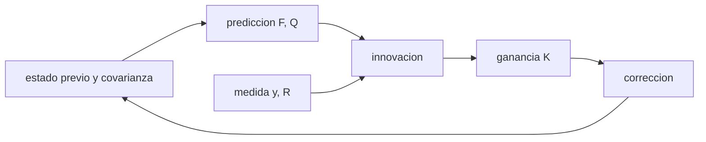

# B74-C08 — Filtrado recursivo de estados

<!-- nav:top -->
[🏠 Programa](../../../../README.md) · [📚 Bloque B74](../../../tronco-comun/B74-estimacion-de-orbitas-y-navegacion-espacial.md) · [← Anterior: B74-C07 — Ajuste por mínimos cuadrados](../B74-C07-ajuste-por-minimos-cuadrados/CLASE.md) · [Siguiente: B74-C09 — Filtro de Kalman extendido →](../B74-C09-filtro-de-kalman-extendido/CLASE.md)
<!-- /nav -->

## 1. Ubicación, nivel y alcance

Clase 8 del bloque B74. Nivel N3. Un ajuste por lotes espera a tener todos los datos; un filtro actualiza el estado con cada medida nueva. Aquí ves que, para un modelo lineal y sin ruido de proceso, el filtro recursivo reproduce exactamente el ajuste por lotes; que con ruido de proceso el filtro sigue una trayectoria cambiante; y que una previa mal elegida puede dar un resultado equivocado con una incertidumbre engañosamente pequeña. Todo en una dimensión y con datos sintéticos.

## 2. Por qué esta clase existe

Una nave en vuelo recibe medidas continuamente y necesita su estado ahora. La decisión central: **¿cuándo es el filtro equivalente al ajuste por lotes, qué añade el ruido de proceso y cómo evito que una previa errónea domine?**

## 3. Lo que podrás hacer al terminar

1. Escribir la actualización de Bayes gaussiana como predicción y corrección.
2. Demostrar numéricamente que mínimos cuadrados recursivos equivale al ajuste por lotes.
3. Distinguir ruido de medida `R` de ruido de proceso `Q`.
4. Leer la ganancia de Kalman y la covarianza estacionaria.
5. Reconocer el riesgo de una previa sobreconfiada y equivocada.
6. Rotular lo sintético y lo ilustrativo.

La evidencia es la **comparación recursivo frente a lotes** del ejercicio 12 (sección 20).

## 4. Con qué llegas y cómo comprobarlo

1. ¿Qué es una distribución gaussiana?
2. ¿Qué es un modelo lineal `y = Hx`?
3. ¿Qué es una covarianza?
4. ¿Qué es una previa?
5. ¿Qué es una verificación por segunda vía?

<details>
<summary>Ver respuestas</summary>

1. Una campana descrita por su media y su varianza. 2. Una medida proporcional al estado. 3. La matriz de varianzas y covarianzas del error. 4. La estimación que tenías antes de la nueva medida. 5. Calcular lo mismo con otro método y comparar.
</details>

Con cuatro o cinco aciertos, sigue; si no, repasa los prerrequisitos.

## 5. Un caso de contexto y casos de referencia

Se mide la posición de un móvil cada segundo durante 60 s con ruido de 5 m. El ajuste por lotes da `v₀ = 11,99228 m/s`; mínimos cuadrados recursivos coincide con una diferencia de `1,78e-10`. Con aceleración aleatoria, el filtro de Kalman tiene un error de `2,337 m` frente a `4,668 m` de la medida cruda. Es el **ejemplo conductor**; los datos son sintéticos.

## 6. Vocabulario

La **predicción** propaga el estado y la covarianza con el modelo (`F`, `Q`). La **corrección** incorpora una medida con la **ganancia de Kalman** `K = P Hᵀ (H P Hᵀ + R)⁻¹`. El **ruido de proceso** `Q` modela lo que el modelo no sabe. La **innovación** es `y − H x̂⁻`. Una **previa difusa** tiene una covarianza enorme.

## 7. Modelo mental: actualizar un promedio



*Descripción textual:* el estado previo se predice con el modelo, la medida genera la innovación, la ganancia pondera la corrección y el nuevo estado vuelve a ser la previa del siguiente paso.

Analogía: el promedio móvil se actualiza con cada dato sin releer los anteriores; el filtro hace lo mismo pero pesa por incertidumbres. Límite: el filtro lineal exige un modelo lineal gaussiano; los casos no lineales se tratan en C09 y C10.

## 8. La explicación, paso a paso

### 8.1 Recursivo igual a lotes

Con previa difusa y sin ruido de proceso, mínimos cuadrados recursivos y el ajuste por lotes coinciden con diferencia máxima `1,78e-10`. El lote da `p₀ = 99,8777 m` y `v₀ = 11,99228 m/s` con `σ = 1,307 m` y `0,03727 m/s`.

### 8.2 El filtro de Kalman sin ruido de proceso

En `t = 60 s` el Kalman con `q = 0` coincide con el lote (`6,37e-09 m`) y su `σ_p` es `1,275 m`: Bayes recursivo y mínimos cuadrados son el mismo estimador.

### 8.3 Con ruido de proceso

Si la aceleración es aleatoria (`q = 0,05 (m/s²)²`), el filtro sigue la trayectoria con `2,337 m` rms frente a `4,668 m` de la medida cruda. La ganancia estacionaria es `K = (0,2583, 0,0385)` y `σ_p = 2,541 m`. Un `q` mayor sube la ganancia y el filtro olvida antes.

### 8.4 La previa

Una previa informativa y correcta da un error final de `0,586 m` con `σ = 1,272 m`. Una previa **sobreconfiada y equivocada** (200 m en vez de 100 m, `σ = 1 m`) da `214,878 m` de error y una `σ` de solo `0,651 m`: la covarianza dice que todo va bien y el estado es erróneo.

## 9. Magnitudes, símbolos y unidades

| Símbolo | Qué es | Unidad | Valor / nota |
|---|---|---|---|
| `x` | estado (p, v) | m, m/s |  |
| `F` | matriz de transición | — | [[1, Δt],[0, 1]] |
| `Q` | covarianza del ruido de proceso | m², (m/s)² | q = 0,05 (m/s²)² (ilustrativo) |
| `R` | covarianza de la medida | m² | 25 |
| `K` | ganancia de Kalman | — | (0,258; 0,0385) |
| `P` | covarianza del estado | m², (m/s)² |  |

## 10. Convenciones y referencias

Una dimensión; Δt = 1 s; medida de posición con σ = 5 m; ruido de proceso por aceleración aleatoria discreta; semilla 23. Todo sintético.

## 11. De dónde sale lo que afirmamos

| ID | Fuente | Localizador | Respalda | Estado |
|---|---|---|---|---|
| S1 | NIST, CODATA — Speed of light in vacuum — https://physics.nist.gov/cgi-bin/cuu/Value?c (consultada 2026-11-10) | entrada «c» | c = 299 792 458 m/s (exacta) | Consultada |
| S2 | NASA/JPL SSD, Horizons API — https://ssd-api.jpl.nasa.gov/doc/horizons.html (consultada 2026-11-10) | parámetros EPHEM_TYPE, COMMAND, CENTER, TLIST | Horizons entrega tablas de observador, vectores de estado, elementos y SPK; parámetros de la API | Consultada |
| — | Bar-Shalom, Li y Kirubarajan, *Estimation with Applications to Tracking and Navigation* (Wiley, 2001); Tapley, Schutz y Born, *Statistical Orbit Determination* (Elsevier, 2004) | — | fundamento teórico general de la clase | No consultada |

Límites: las ecuaciones del filtro de Kalman son relaciones estándar no consultadas en una fuente concreta: el laboratorio las contrasta con el ajuste por lotes. Ni NIST ni Horizons respaldan el filtro; se citan solo por constantes y formatos.

## 12. Cómo ver el filtro frente al lote

| Magnitud | Valor |
|---|---|
| RLS frente a lotes | 1,78e-10 |
| Kalman (q = 0) frente a lotes | 6,37e-09 m |
| rms con `q > 0` | 2,337 m |
| ganancia estacionaria | (0,2583, 0,0385) |
| previa equivocada | 214,878 m, σ = 0,651 m |

Descripción larga: el filtro reproduce el lote cuando el modelo es exacto, supera a la medida cruda cuando hay dinámica y puede engañar con una previa sobreconfiada.

## 13. Ejemplo trabajado: una actualización escalar

**Paso 1 · Previa.** Posición estimada 100 m con `σ = 10 m`.

**Paso 2 · Medida.** `y = 108 m` con `σ = 5 m`.

**Paso 3 · Ganancia.** `K = 100/(100 + 25) = 0,8`.

**Paso 4 · Corrección.** Estimación `100 + 0,8 × 8 = 106,4 m`, `σ = 4,47 m`: la medida pesa más porque es más precisa.

## 14. Distintas formas de describir un filtro

**Por pasos:** predicción y corrección. **Por ganancia:** `K`. **Por pesos:** previa frente a medida. **Por equivalencia:** lotes con `Q = 0`.

## 15. Práctica guiada

**Ejercicio 1 · guiado.** Calcula la ganancia si la previa tiene `σ = 3 m` y la medida `σ = 4 m`. *Pasos:* `P/(P + R)`.

<details><summary>Solución comentada</summary>

`9/(9 + 16) = 0,36`.
</details>

**Ejercicio 2 · guiado.** ¿Cuál es la nueva varianza? *Pista:* `(1 − K) P`.

<details><summary>Solución comentada</summary>

`0,64 × 9 = 5,76 m²`, `σ = 2,4 m`.
</details>

**Ejercicio 3 · guiado.** ¿Qué ganancia hay si `R → ∞`? *Pista:* medida inútil.

<details><summary>Solución comentada</summary>

`K → 0`: se ignora la medida.
</details>

## 16. Práctica autónoma, transferencia e integrador

**Ejercicio 4 · autónomo.** ¿Cómo cambia la ganancia estacionaria si `Q` aumenta?

<details><summary>Solución comentada</summary>

Aumenta: el filtro confía más en las medidas.
</details>

**Ejercicio 5 · autónomo.** Con `q = 0` y muchos datos, ¿qué ocurre con la ganancia?

<details><summary>Solución comentada</summary>

Tiende a 0: el filtro deja de aprender.
</details>

**Ejercicio 6 · autónomo.** ¿Qué es la innovación y qué debería cumplir?

<details><summary>Solución comentada</summary>

`y − H x̂⁻`; debe ser de media cero y covarianza `S` (ver C23).
</details>

**Ejercicio 7 · autónomo.** ¿Por qué una previa con `σ = 1 m` equivocada es peligrosa?

<details><summary>Solución comentada</summary>

Pesa mucho y tarda en corregirse; la covarianza es engañosa.
</details>

**Ejercicio 8 · autónomo.** ¿Cómo se inicializa un filtro sin conocimiento previo?

<details><summary>Solución comentada</summary>

Con covarianza muy grande (previa difusa), cuidando la estabilidad numérica.
</details>

**Ejercicio 9 · transferencia.** **Transferencia.** Un operador sube `Q` hasta que el filtro «sigue» todos los datos. ¿Qué pierde?

<details><summary>Solución comentada</summary>

La suavización: el filtro pasa a copiar el ruido.
</details>

**Ejercicio 10 · transferencia.** **Transferencia.** ¿Qué cambia si las medidas llegan irregularmente?

<details><summary>Solución comentada</summary>

Se predice con el Δt real en cada paso; ver C24 para medidas retardadas.
</details>

**Ejercicio 11 · transferencia.** **Transferencia.** Un satélite hace una maniobra no modelada. ¿Qué verías en las innovaciones?

<details><summary>Solución comentada</summary>

Una deriva sistemática y una `χ²` alta; hay que subir `Q` o modelar la maniobra.
</details>

**Ejercicio 12 · integrador.** **Integrador.** Elabora tu *comparación recursivo frente a lotes*: diferencia RLS–lotes, Kalman con `q = 0`, seguimiento con `q > 0` y efecto de dos previas, rotulando lo sintético.

<details><summary>Solución comentada</summary>

Secciones 8.1–8.4 y la salida del laboratorio.
</details>

## 17. Laboratorio: lotes, recursivo y Kalman

El script [laboratorio.py](laboratorio.py) compara el ajuste por lotes con mínimos cuadrados recursivos y Kalman, sigue un móvil con aceleración aleatoria y prueba dos previas (**comprueba** RLS = lotes (< 1e-6), Kalman con q = 0 igual al lote (< 1e-3 m) y filtro mejor que la medida cruda).

**Datos:** trayectoria y medidas **sintéticas**; ruido y `q` **ilustrativos**. **Predice antes de ejecutar:** ¿se parece el rms del filtro al de la medida cruda? (es aproximadamente la mitad). **Ejecución del 2026-11-10 (Python 3.12.9, NumPy 2.4.4):**

```text
Python 3.12.9, NumPy 2.4.4 (datos SINTETICOS, semilla 23)
Lotes: p0 = 99.8777 m, v0 = 11.99228 m/s ; sigma = 1.307 m, 0.03727 m/s
RLS vs lotes: diferencia maxima = 1.78e-10
Kalman (q = 0) vs lotes en t = 60 s: |dp| = 6.37e-09 m ; sigma_p final = 1.275 m
Seguimiento con q = 0.05 (m/s2)^2: rms posicion del filtro = 2.337 m frente a 4.668 m de la medida cruda
Ganancia estacionaria K = (0.2583, 0.0385) ; sigma_p estacionaria = 2.541 m
Previa informativa correcta: error final 0.586 m, sigma 1.272 m
Previa sobreconfiada y equivocada: error final 214.878 m, sigma 0.651 m (no refleja el error)
Pruebas superadas.
```

```bash
python programa/clases/B74/B74-C08-filtrado-recursivo-de-estados/laboratorio.py
```

**Límites:** modelo lineal gaussiano de una dimensión; `q` conocido; sin pruebas de consistencia (ver C23).

## 18. Errores frecuentes y cómo corregirlos

**Creer que el filtro siempre supera al lote.** Con `Q = 0` son iguales; ver 8.2.

**Fijar `Q = 0` en un sistema que no es exacto.** El filtro se «duerme»; ver 8.3.

**Confiar en una previa sin probarla.** Compara la previa con la primera medida; ver 8.4.

**Presentar los datos sintéticos como reales.** Rotula como sintético, como en la sección 10.

## 19. Cómo sabrás que vas bien

Tras la sección 8: ¿qué diferencia esperabas entre RLS y lotes y cuál obtuviste? Si dudas, repasa el ejemplo 13. Tras el laboratorio: ¿qué comprueba? (ver la sección 17).

## 20. Qué entregas y cómo se evalúa

El producto es tu **comparación recursivo frente a lotes** (ejercicio 12).

| Criterio | Inicial | En desarrollo | Logrado | Destacado |
|---|---|---|---|---|
| Conceptos | Los confunde | Parciales | Distingue predicción, corrección, `Q` y `R` | Explica los límites |
| Cálculo | Sin unidades | Con errores | Tablas completas con unidades | Calcula casos nuevos |
| Numérico | Sin comprobar | Un caso | Contraste con una segunda vía | Interpreta las diferencias |
| Fuentes | Sin fuente | Sin fecha | Fuentes con fecha y estado | Declara lo sintético y lo no consultado |
| Límites | No los nombra | Uno | Tres | Discute qué falta del modelo |

**Condiciones críticas (no se compensan con promedio):** declarar Q y R y rotular el movimiento y las medidas como sintéticos; rotular los datos como sintéticos y no presentar nada simulado como observado; citar solo lo consultado.

## 21. Ética, seguridad y límites

Clase educativa en estado E0: los modelos son simplificados y sus datos son sintéticos o ilustrativos; ningún resultado describe la órbita real de una nave ni sustituye a un producto de navegación de misión. Accesibilidad: tablas equivalentes a las gráficas, fórmulas en texto, ejercicios sin conexión. Tolerancias del laboratorio: RLS y lotes < 1e-6; Kalman (q = 0) y lote < 1e-3 m en la posición final.

## 22. Para cerrar y seguir

El filtro con `q = 0` es el ajuste por lotes hecho paso a paso; con `q > 0` sigue la dinámica (`2,337 m` frente a `4,668 m`). Queda una pregunta: ¿cómo se extiende esto a una órbita, cuyo modelo no es lineal?

**Glosario español–inglés.** filtro de Kalman · *Kalman filter*; ganancia · *gain*; ruido de proceso · *process noise*; innovación · *innovation*; previa difusa · *diffuse prior*.

**Continuidad.** [B74-C09](../B74-C09-filtro-de-kalman-extendido/CLASE.md) estudia el filtro de Kalman extendido.

**Referencias:** ver sección 11.

<!-- nav:bottom -->
---

[← Anterior: B74-C07 — Ajuste por mínimos cuadrados](../B74-C07-ajuste-por-minimos-cuadrados/CLASE.md) · [📚 Bloque B74](../../../tronco-comun/B74-estimacion-de-orbitas-y-navegacion-espacial.md) · [Siguiente: B74-C09 — Filtro de Kalman extendido →](../B74-C09-filtro-de-kalman-extendido/CLASE.md)
<!-- /nav -->
