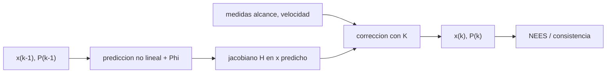

# B74-C09 — Filtro de Kalman extendido

<!-- nav:top -->
[🏠 Programa](../../../../README.md) · [📚 Bloque B74](../../../tronco-comun/B74-estimacion-de-orbitas-y-navegacion-espacial.md) · [← Anterior: B74-C08 — Filtrado recursivo de estados](../B74-C08-filtrado-recursivo-de-estados/CLASE.md) · [Siguiente: B74-C10 — Filtro de Kalman no lineal →](../B74-C10-filtro-de-kalman-no-lineal/CLASE.md)
<!-- /nav -->

## 1. Ubicación, nivel y alcance

Clase 9 del bloque B74. Nivel N3. El filtro de Kalman extendido (EKF) aplica el esquema predicción–corrección de C08 a un sistema no lineal: propaga el estado con la dinámica no lineal, propaga la covarianza con la matriz de transición linealizada y corrige con el jacobiano de la medida. Aquí lo aplicas a la órbita sintética de C07, lo comparas con el ajuste por lotes y compruebas con el NEES si sus covarianzas son honestas, también cuando la linealización empieza a fallar.

## 2. Por qué esta clase existe

Una órbita no es lineal en el estado, pero a cortos intervalos y con errores pequeños se comporta casi como tal. La decisión central: **¿hasta cuándo es válida la linealización del EKF y cómo me doy cuenta de que dejó de serlo?**

## 3. Lo que podrás hacer al terminar

1. Escribir los pasos del EKF con matriz de transición y jacobiano de medida.
2. Obtener la matriz de transición por diferencias centrales de un propagador.
3. Comparar el estado final del EKF con el del ajuste por lotes.
4. Calcular el NEES medio de varias realizaciones.
5. Reconocer la pérdida de consistencia con errores iniciales grandes.
6. Rotular lo sintético y lo ilustrativo.

La evidencia es la **filtro extendido de una órbita sintética** del ejercicio 12 (sección 20).

## 4. Con qué llegas y cómo comprobarlo

1. ¿Qué es la matriz de transición de estado?
2. ¿Qué es linealizar?
3. ¿Qué es el NEES?
4. ¿Qué hace la ganancia de Kalman?
5. ¿Qué es una verificación por segunda vía?

<details>
<summary>Ver respuestas</summary>

1. La que relaciona un error de estado en `t₀` con el error en `t`. 2. Sustituir una función por su derivada en un punto. 3. El error de estimación normalizado: `eᵀ P⁻¹ e`. 4. Pondera la innovación según las incertidumbres. 5. Calcular lo mismo con otro método y comparar.
</details>

Con cuatro o cinco aciertos, sigue; si no, repasa los prerrequisitos.

## 5. Un caso de contexto y casos de referencia

Con una incertidumbre inicial de 200 m y 0,2 m/s, el EKF lleva el error de `445,6 m` a `12,69 m` y coincide con el ajuste por lotes a `1,037 m`; su NEES medio es `4,57`. Con 2 km y 2 m/s de incertidumbre inicial, el NEES sube a `16,99`. Es el **ejemplo conductor**; todo es sintético.

## 6. Vocabulario

El **EKF** linealiza la dinámica y la medida alrededor de la estimación actual. La **matriz de transición** `Φ` propaga la covarianza: `P⁻ = Φ P Φᵀ + Q`. El **jacobiano de medida** `H` se evalúa en el estado predicho. El **NEES** es `eᵀ P⁻¹ e` y vale en promedio la dimensión del estado si el filtro es consistente. La **forma de Joseph** conserva la simetría de `P`.

## 7. Modelo mental: seguir un camino con una linterna



*Descripción textual:* cada paso predice con el modelo no lineal, linealiza la medida, corrige con la ganancia y se comprueba con el NEES que la covarianza sea honesta.

Analogía: caminar de noche con una linterna que ilumina solo unos metros: avanzas con la mejor dirección local; si el camino gira bruscamente, la dirección local engaña. Límite: el EKF usa solo la derivada primera; con errores iniciales grandes la aproximación falla.

## 8. La explicación, paso a paso

### 8.1 El paso

Predicción: `x⁻ = f(x)`, `P⁻ = Φ P Φᵀ + Q`. Corrección: `K = P⁻ Hᵀ (H P⁻ Hᵀ + R)⁻¹`, `x = x⁻ + K (y − h(x⁻))`, y `P` en forma de Joseph.

### 8.2 Resultado del caso conductor

Con 40 pasos de 30 s y dos estaciones, el error de posición baja de `445,6 m` a `12,69 m` y el de velocidad a `0,00710 m/s`. La covarianza final da `σ = (6,58, 15,32, 5,81) m`.

### 8.3 Segunda vía: lotes

El ajuste por lotes de los mismos datos, propagado al instante final, difiere del EKF en `1,037 m`: la pequeña diferencia es el efecto de linealizar paso a paso.

### 8.4 Consistencia y límite de la linealización

El NEES medio de 40 realizaciones es `4,57` con la incertidumbre inicial pequeña (un valor por debajo de 6 indica una covarianza algo conservadora; con 40 realizaciones la incertidumbre de la media es de ~0,5). Con 2 km y 2 m/s sube a `16,99`: el filtro está sobreconfiado porque la linealización ya no describe el error.

## 9. Magnitudes, símbolos y unidades

| Símbolo | Qué es | Unidad | Valor / nota |
|---|---|---|---|
| `Φ` | matriz de transición de estado | — | 6 × 6, por diferencias centrales |
| `H` | jacobiano de la medida | — | 2 × 6 por estación |
| `K` | ganancia | — | 6 × 2 |
| `Q` | ruido de proceso | (m/s)² | 1e-8 en velocidad (ilustrativo) |
| `R` | covarianza de medida | m², (m/s)² | diag(100, 10⁻⁴) |
| `NEES` | error normalizado | — | ≈ 6 si consistente |

## 10. Convenciones y referencias

Mismo marco, órbita y estaciones fijas de C07; dos cuerpos con μ = 3,986004 × 10¹⁴ m³/s² (ilustrativo, no consultado); medidas cada 30 s; semilla 29; todo sintético.

## 11. De dónde sale lo que afirmamos

| ID | Fuente | Localizador | Respalda | Estado |
|---|---|---|---|---|
| S1 | NIST, CODATA — Speed of light in vacuum — https://physics.nist.gov/cgi-bin/cuu/Value?c (consultada 2026-11-10) | entrada «c» | c = 299 792 458 m/s (exacta) | Consultada |
| S2 | NASA/JPL SSD, Horizons API — https://ssd-api.jpl.nasa.gov/doc/horizons.html (consultada 2026-11-10) | parámetros EPHEM_TYPE, COMMAND, CENTER, TLIST | Horizons entrega tablas de observador, vectores de estado, elementos y SPK; parámetros de la API | Consultada |
| — | Bar-Shalom, Li y Kirubarajan, *Estimation with Applications to Tracking and Navigation* (Wiley, 2001); Tapley, Schutz y Born, *Statistical Orbit Determination* (Elsevier, 2004); Montenbruck y Gill, *Satellite Orbits* (Springer, 2000) | — | fundamento teórico general de la clase | No consultada |

Límites: las ecuaciones del EKF y la prueba NEES son relaciones estándar no consultadas en una fuente concreta; el laboratorio las contrasta con el ajuste por lotes y con una simulación.

## 12. Cómo ver el filtro extendido

| Magnitud | Valor |
|---|---|
| error inicial | 445,6 m |
| error final del EKF | 12,69 m |
| diferencia con lotes | 1,037 m |
| NEES (incertidumbre inicial pequeña) | 4,57 |
| NEES (incertidumbre inicial grande) | 16,99 |

Descripción larga: el EKF converge al nivel del ajuste por lotes cuando el error inicial es pequeño y pierde consistencia cuando es grande.

## 13. Ejemplo trabajado: el NEES de un caso

**Paso 1 · Error.** `e = x̂ − x`, un vector de 6 componentes.

**Paso 2 · Normalización.** `eᵀ P⁻¹ e`.

**Paso 3 · Comparación.** El valor esperado es 6 (los grados de libertad).

**Paso 4 · Lectura.** El promedio de 40 casos es `4,57`; con error inicial grande es `16,99`, y el filtro «cree» saber más de lo que sabe.

## 14. Distintas formas de describir el estado de un filtro

**Por estado:** `x̂`. **Por covarianza:** `P`. **Por innovación:** `y − h(x⁻)`. **Por consistencia:** NEES. **Por equivalencia:** ajuste por lotes.

## 15. Práctica guiada

**Ejercicio 1 · guiado.** ¿Qué dimensión tiene `Φ` para un estado de 6 componentes? *Pista:* relaciona 6 con 6.

<details><summary>Solución comentada</summary>

6 × 6.
</details>

**Ejercicio 2 · guiado.** Calcula el valor esperado del NEES para 6 grados de libertad. *Pista:* media de una `χ²₆`.

<details><summary>Solución comentada</summary>

6.
</details>

**Ejercicio 3 · guiado.** ¿Por qué se usa la forma de Joseph? *Pista:* simetría y positividad de `P`.

<details><summary>Solución comentada</summary>

Porque conserva `P` simétrica y semidefinida positiva ante errores de redondeo.
</details>

## 16. Práctica autónoma, transferencia e integrador

**Ejercicio 4 · autónomo.** ¿Qué ocurre con `P` si `Q = 0` y hay muchas medidas?

<details><summary>Solución comentada</summary>

Decrece sin límite y el filtro deja de corregir (puede divergir si el modelo no es exacto).
</details>

**Ejercicio 5 · autónomo.** ¿Qué signo de error indica un NEES menor que 6?

<details><summary>Solución comentada</summary>

Ninguno: indica que `P` es mayor que el error real (filtro conservador).
</details>

**Ejercicio 6 · autónomo.** ¿Por qué el jacobiano `H` se evalúa en el estado predicho?

<details><summary>Solución comentada</summary>

Porque es la mejor estimación disponible antes de la corrección.
</details>

**Ejercicio 7 · autónomo.** ¿Cómo detectas que la linealización falla sin conocer la verdad?

<details><summary>Solución comentada</summary>

Con el NIS y los residuos de las innovaciones (C23).
</details>

**Ejercicio 8 · autónomo.** ¿Qué pasa si el paso entre medidas se alarga a 10 minutos?

<details><summary>Solución comentada</summary>

Aumenta la no linealidad de la propagación del error y el EKF pierde precisión.
</details>

**Ejercicio 9 · transferencia.** **Transferencia.** Un equipo inicializa el EKF con 50 km de error y el filtro diverge. ¿Qué proponen?

<details><summary>Solución comentada</summary>

Una órbita preliminar mejor (C06), un ajuste por lotes inicial o un filtro de iteración.
</details>

**Ejercicio 10 · transferencia.** **Transferencia.** ¿Qué cambia si la nave hace una maniobra no modelada?

<details><summary>Solución comentada</summary>

Las innovaciones se desvían y el filtro necesita `Q` mayor o un modelo de maniobra.
</details>

**Ejercicio 11 · transferencia.** **Transferencia.** ¿Qué cambia si las estaciones se mueven con la rotación terrestre?

<details><summary>Solución comentada</summary>

`h` incluye la posición de la estación en función del tiempo; el jacobiano cambia pero la estructura es la misma.
</details>

**Ejercicio 12 · integrador.** **Integrador.** Elabora tu *filtro extendido de una órbita sintética*: pasos del EKF, error inicial y final, comparación con lotes y NEES medio para dos incertidumbres iniciales, rotulando lo sintético.

<details><summary>Solución comentada</summary>

Secciones 8.1–8.4 y la salida del laboratorio.
</details>

## 17. Laboratorio: EKF sobre una órbita sintética

El script [laboratorio.py](laboratorio.py) ejecuta un EKF con medidas de alcance y velocidad de alcance de dos estaciones, lo compara con el ajuste por lotes y mide el NEES medio con dos incertidumbres iniciales (**comprueba** error final menor que el inicial, diferencia con lotes < 10 m, NEES entre 3 y 10 y mayor con incertidumbre inicial grande).

**Datos:** órbita, estaciones, ruido y `Q` **sintéticos/ilustrativos**; μ ilustrativo. **Predice antes de ejecutar:** ¿sube o baja el NEES con una incertidumbre inicial diez veces mayor? (sube). **Ejecución del 2026-11-10 (Python 3.12.9, NumPy 2.4.4):**

```text
Python 3.12.9, NumPy 2.4.4 (orbita y observaciones SINTETICAS, semilla 29)
Caso conductor (P0: 200 m, 0.2 m/s): error inicial = 445.6 m ; error final del EKF = 12.69 m ; velocidad final = 0.00710 m/s
sigma formal final (x,y,z) [m] = 6.58 15.32 5.81
Diferencia EKF frente al ajuste por lotes en el instante final = 1.037 m
NEES medio de 40 realizaciones con P0 pequena = 4.57 (esperado cercano a 6)
NEES medio de 40 realizaciones con P0 grande (2 km, 2 m/s) = 16.99 (la linealizacion falla)
Pruebas superadas.
```

```bash
python programa/clases/B74/B74-C09-filtro-de-kalman-extendido/laboratorio.py
```

**Límites:** dos cuerpos y estaciones fijas; solo 40 realizaciones (la media del NEES tiene ~0,5 de incertidumbre); `Q` mínimo.

## 18. Errores frecuentes y cómo corregirlos

**Creer que el EKF siempre es consistente.** Comprueba el NEES, como en 8.4.

**Linealizar lejos de la solución.** Mejora la órbita inicial.

**Tomar un `Q` nulo.** El filtro se vuelve ciego; ver C08.

**Presentar los datos sintéticos como reales.** Rotula como sintético, como en la sección 10.

## 19. Cómo sabrás que vas bien

Tras la sección 8: ¿qué NEES esperabas con error inicial grande y cuál obtuviste? Si dudas, repasa el ejemplo 13. Tras el laboratorio: ¿qué comprueba? (ver la sección 17).

## 20. Qué entregas y cómo se evalúa

El producto es tu **filtro extendido de una órbita sintética** (ejercicio 12).

| Criterio | Inicial | En desarrollo | Logrado | Destacado |
|---|---|---|---|---|
| Conceptos | Los confunde | Parciales | Escribe los pasos del EKF y el NEES | Explica los límites |
| Cálculo | Sin unidades | Con errores | Tablas completas con unidades | Calcula casos nuevos |
| Numérico | Sin comprobar | Un caso | Contraste con una segunda vía | Interpreta las diferencias |
| Fuentes | Sin fuente | Sin fecha | Fuentes con fecha y estado | Declara lo sintético y lo no consultado |
| Límites | No los nombra | Uno | Tres | Discute qué falta del modelo |

**Condiciones críticas (no se compensan con promedio):** comprobar la consistencia con el NEES y rotular la órbita y las estaciones como sintéticas; rotular los datos como sintéticos y no presentar nada simulado como observado; citar solo lo consultado.

## 21. Ética, seguridad y límites

Clase educativa en estado E0: los modelos son simplificados y sus datos son sintéticos o ilustrativos; ningún resultado describe la órbita real de una nave ni sustituye a un producto de navegación de misión. Accesibilidad: tablas equivalentes a las gráficas, fórmulas en texto, ejercicios sin conexión. Tolerancias del laboratorio: diferencia EKF–lotes < 10 m; NEES medio entre 3 y 10 con incertidumbre pequeña.

## 22. Para cerrar y seguir

El EKF logra `12,69 m` y un NEES de `4,57` con incertidumbre inicial pequeña, pero `16,99` con una grande. Queda una pregunta: ¿qué filtro no linealiza con la derivada?

**Glosario español–inglés.** filtro de Kalman extendido · *extended Kalman filter*; matriz de transición · *state transition matrix*; consistencia · *consistency*; forma de Joseph · *Joseph form*; innovación · *innovation*.

**Continuidad.** [B74-C10](../B74-C10-filtro-de-kalman-no-lineal/CLASE.md) estudia el filtro de Kalman no lineal.

**Referencias:** ver sección 11.

<!-- nav:bottom -->
---

[← Anterior: B74-C08 — Filtrado recursivo de estados](../B74-C08-filtrado-recursivo-de-estados/CLASE.md) · [📚 Bloque B74](../../../tronco-comun/B74-estimacion-de-orbitas-y-navegacion-espacial.md) · [Siguiente: B74-C10 — Filtro de Kalman no lineal →](../B74-C10-filtro-de-kalman-no-lineal/CLASE.md)
<!-- /nav -->
