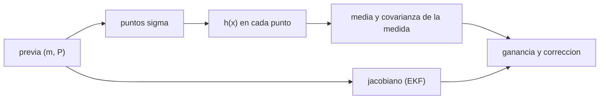

# B74-C10 — Filtro de Kalman no lineal

<!-- nav:top -->
[🏠 Programa](../../../../README.md) · [📚 Bloque B74](../../../tronco-comun/B74-estimacion-de-orbitas-y-navegacion-espacial.md) · [← Anterior: B74-C09 — Filtro de Kalman extendido](../B74-C09-filtro-de-kalman-extendido/CLASE.md) · [Siguiente: B74-C11 — Matrices de covarianza — Estimación de órbitas y navegación espacial →](../B74-C11-matrices-de-covarianza-estimacion-de-orbitas-y-navegacion-espacial/CLASE.md)
<!-- /nav -->

## 1. Ubicación, nivel y alcance

Clase 10 del bloque B74. Nivel N3. Cuando la medida es muy no lineal (por ejemplo, un azimut con gran incertidumbre a gran distancia), el jacobiano del EKF describe mal la propagación de la incertidumbre. El filtro de puntos sigma (UKF) elige unos pocos puntos que representan la distribución, los pasa por la función no lineal y recompone la media y la covarianza sin derivadas. Aquí los comparas con una referencia de Bayes por muestreo de importancia sobre un problema sintético de alcance y azimut.

## 2. Por qué esta clase existe

Un filtro puede dar una estimación aceptable y una covarianza falsa. La decisión central: **¿cuándo basta el EKF y cuándo la covarianza obliga a usar un filtro no lineal, y cómo lo verifico con una referencia?**

## 3. Lo que podrás hacer al terminar

1. Describir la transformada unscented: puntos sigma, pesos y recomposición.
2. Aplicar EKF y UKF a una actualización de alcance y azimut.
3. Construir una referencia de Bayes por muestreo de importancia.
4. Comparar error cuadrático medio y NEES de los tres.
5. Manejar correctamente la media angular.
6. Rotular lo sintético y lo ilustrativo.

La evidencia es la **comparación EKF frente a UKF** del ejercicio 12 (sección 20).

## 4. Con qué llegas y cómo comprobarlo

1. ¿Qué es una cota de error cuadrático medio?
2. ¿Qué es una descomposición de Cholesky?
3. ¿Qué es la media angular?
4. ¿Qué es un muestreo de importancia?
5. ¿Qué es una verificación por segunda vía?

<details>
<summary>Ver respuestas</summary>

1. La media del cuadrado del error. 2. La factorización `P = L Lᵀ` de una covarianza. 3. La dirección del promedio de los vectores unitarios, no el promedio de los ángulos. 4. Muestras de la previa ponderadas por la verosimilitud. 5. Calcular lo mismo con otro método y comparar.
</details>

Con cuatro o cinco aciertos, sigue; si no, repasa los prerrequisitos.

## 5. Un caso de contexto y casos de referencia

Un objeto sintético a 7000 km con incertidumbre de 300 km se observa con alcance (5 km) y azimut (0,15 rad). El error cuadrático medio es casi igual en los tres métodos (`295,6`, `295,5` y `296,7 km` rms), pero el NEES del EKF es `7,36` y el del UKF, `2,00`, frente al valor esperado 2 y al `2,07` de la referencia. Es el **ejemplo conductor**; el sensor es sintético.

## 6. Vocabulario

La **transformada unscented** aproxima la distribución con `2n+1` **puntos sigma** y los pesos `w_m`, `w_c`. El **UKF** la aplica a la propagación y a la medida. El **muestreo de importancia** pondera muestras de la previa con la verosimilitud para aproximar la posterior de Bayes. El **ECM** es el error cuadrático medio. Los parámetros `α, β, κ` fijan la dispersión de los puntos.

## 7. Modelo mental: sondear una montaña en pocos puntos



*Descripción textual:* el UKF toma puntos de la previa, los pasa por la medida no lineal y recompone estadísticos; el EKF sustituye ese paso por el jacobiano; ambos terminan en la corrección.

Analogía: medir la forma de una colina con unos pocos sondeos bien repartidos en vez de usar solo la pendiente local. Límite: con unos pocos puntos la distribución posterior puede quedar mal descrita si es multimodal o muy asimétrica.

## 8. La explicación, paso a paso

### 8.1 La transformada unscented

Con `n = 2` hay 5 puntos: la media y `m ± columnas de √((n+λ)P)`. La media y covarianza de la medida salen de sumas ponderadas. No se calculan derivadas.

### 8.2 La actualización del EKF

El EKF evalúa `H` en la media y supone que la covarianza posterior es `P − K S Kᵀ`. Si la medida angular es muy incierta, la curvatura del arco de azimut no cabe en la linealización.

### 8.3 Resultado

En 400 casos el error rms es casi idéntico: `295,61 km` (EKF), `295,53 km` (UKF) y `296,67 km` (Bayes), porque la previa domina. La diferencia está en la covarianza: el NEES medio vale `7,359` para el EKF (sobreconfiado, 3,7 veces el esperado), `1,995` para el UKF y `2,070` para la referencia.

### 8.4 Lección

Un buen error medio no demuestra una buena covarianza. El NEES revela la sobreconfianza del EKF y confirma que el UKF es consistente en este caso; la referencia de Bayes sirve de verdad de comparación cuando se puede calcular.

## 9. Magnitudes, símbolos y unidades

| Símbolo | Qué es | Unidad | Valor / nota |
|---|---|---|---|
| `n` | dimensión del estado | — | 2 |
| `λ` | parámetro de escala | — | α²(n+κ) − n |
| `α, β, κ` | parámetros del UKF | — | 0,5; 2; 0 |
| `w_m, w_c` | pesos de los puntos sigma | — | suman 1 (w_m) |
| `S` | covarianza de la innovación | km², rad² |  |
| `NEES` | error normalizado | — | esperado 2 |

## 10. Convenciones y referencias

Plano (x, y) en km, sensor en el origen; alcance en km y azimut en rad; previa gaussiana de 300 km por eje; ruido de azimut ilustrativo y exagerado; referencia con 100 000 muestras; semilla 31. Todo sintético.

## 11. De dónde sale lo que afirmamos

| ID | Fuente | Localizador | Respalda | Estado |
|---|---|---|---|---|
| S1 | NIST, CODATA — Speed of light in vacuum — https://physics.nist.gov/cgi-bin/cuu/Value?c (consultada 2026-11-10) | entrada «c» | c = 299 792 458 m/s (exacta) | Consultada |
| S2 | NASA/JPL SSD, Horizons API — https://ssd-api.jpl.nasa.gov/doc/horizons.html (consultada 2026-11-10) | parámetros EPHEM_TYPE, COMMAND, CENTER, TLIST | Horizons entrega tablas de observador, vectores de estado, elementos y SPK; parámetros de la API | Consultada |
| — | Julier y Uhlmann, «Unscented filtering and nonlinear estimation», *Proc. IEEE* 92(3), 2004; Bar-Shalom, Li y Kirubarajan, *Estimation with Applications to Tracking and Navigation* (Wiley, 2001) | — | fundamento teórico general de la clase | No consultada |

Límites: el UKF y el muestreo de importancia no se consultaron en una fuente concreta (la referencia natural es Julier y Uhlmann, 2004, no consultada); el laboratorio compara con una referencia de Bayes por simulación.

## 12. Cómo ver la comparación de filtros

| Magnitud | Valor |
|---|---|
| rms EKF | 295,61 km |
| rms UKF | 295,53 km |
| NEES EKF | 7,359 |
| NEES UKF | 1,995 |
| NEES Bayes | 2,070 |

Descripción larga: los tres dan un error medio similar, pero solo el UKF y la referencia producen una covarianza coherente con el error.

## 13. Ejemplo trabajado: el peso de la media angular

**Paso 1 · Problema.** Promediar azimuts de 359° y 1° da 180° si se suman los ángulos.

**Paso 2 · Solución.** Se promedian `sin` y `cos` y se toma `atan2`.

**Paso 3 · Resultado.** 0°, la media correcta.

**Paso 4 · Lectura.** En el laboratorio el azimut se envuelve a `[−π, π]` en la innovación y en el promedio ponderado de los puntos sigma.

## 14. Distintas formas de describir un filtro no lineal

**Por jacobiano:** EKF. **Por puntos sigma:** UKF. **Por muestras:** partículas o importancia. **Por consistencia:** NEES. **Por error medio:** ECM.

## 15. Práctica guiada

**Ejercicio 1 · guiado.** ¿Cuántos puntos sigma se usan para un estado de 6 componentes? *Pista:* `2n + 1`.

<details><summary>Solución comentada</summary>

13.
</details>

**Ejercicio 2 · guiado.** ¿Qué NEES esperas para un estado de dimensión 2? *Pista:* media de una `χ²₂`.

<details><summary>Solución comentada</summary>

2.
</details>

**Ejercicio 3 · guiado.** Si el NEES medio es 7,4, ¿el filtro es optimista o conservador? *Pista:* NEES grande significa error grande frente a `P`.

<details><summary>Solución comentada</summary>

Optimista (sobreconfiado): la covarianza es menor que el error real.
</details>

## 16. Práctica autónoma, transferencia e integrador

**Ejercicio 4 · autónomo.** ¿Por qué el ECM de los tres es casi igual?

<details><summary>Solución comentada</summary>

Porque la previa de 300 km domina sobre la medida angular de ~1000 km transversales.
</details>

**Ejercicio 5 · autónomo.** ¿Qué cambiaría con un azimut de 0,01 rad?

<details><summary>Solución comentada</summary>

La medida sería muy informativa y los tres métodos darían errores y NEES similares (casi lineal).
</details>

**Ejercicio 6 · autónomo.** ¿Qué pasa con el UKF si `P` no es definida positiva?

<details><summary>Solución comentada</summary>

Falla la factorización de Cholesky; se corrige con raíces cuadradas de la covarianza o regularización.
</details>

**Ejercicio 7 · autónomo.** ¿Qué coste tiene el UKF frente al EKF?

<details><summary>Solución comentada</summary>

`2n + 1` evaluaciones de `h` en vez de un jacobiano.
</details>

**Ejercicio 8 · autónomo.** ¿Por qué se usa 100 000 muestras en la referencia?

<details><summary>Solución comentada</summary>

Para que el error de Monte Carlo de la referencia sea pequeño frente a las diferencias que se miden.
</details>

**Ejercicio 9 · transferencia.** **Transferencia.** Un equipo cambia de EKF a UKF y el rms no mejora. ¿Deben concluir que no sirve?

<details><summary>Solución comentada</summary>

No: hay que mirar la consistencia (NEES), no solo el rms.
</details>

**Ejercicio 10 · transferencia.** **Transferencia.** ¿Qué otro método usarías si la posterior es bimodal?

<details><summary>Solución comentada</summary>

Un filtro de partículas o de mezcla de gaussianas.
</details>

**Ejercicio 11 · transferencia.** **Transferencia.** ¿Cómo adaptas el laboratorio a una nave con alcance y Doppler?

<details><summary>Solución comentada</summary>

Se sustituye `h` por [alcance, velocidad de alcance] y se amplía el estado a posición y velocidad.
</details>

**Ejercicio 12 · integrador.** **Integrador.** Elabora tu *comparación EKF frente a UKF*: ECM y NEES de EKF, UKF y Bayes, explicación de la diferencia y límites, rotulando lo sintético.

<details><summary>Solución comentada</summary>

Secciones 8.1–8.4 y la salida del laboratorio.
</details>

## 17. Laboratorio: EKF, UKF y Bayes en una actualización no lineal

El script [laboratorio.py](laboratorio.py) compara EKF, UKF y una referencia de muestreo de importancia en 400 realizaciones (**comprueba** la referencia no es peor que EKF/UKF en ECM (±5 %) y su NEES está entre 1,6 y 2,4).

**Datos:** objeto, sensor y ruido **sintéticos/ilustrativos**. **Predice antes de ejecutar:** ¿qué filtro tendrá el NEES más alejado de 2? (el EKF). **Ejecución del 2026-11-10 (Python 3.12.9, NumPy 2.4.4):**

```text
Python 3.12.9, NumPy 2.4.4 (objeto y sensor SINTETICOS, semilla 31)
filtro    ECM [km^2]   rms [km]   NEES medio (esperado 2)
EKF        87384.8     295.61     7.359
UKF        87338.0     295.53     1.995
Bayes      88013.6     296.67     2.070
Pruebas superadas.
```

```bash
python programa/clases/B74/B74-C10-filtro-de-kalman-no-lineal/laboratorio.py
```

**Límites:** una sola actualización, previa gaussiana y azimut con ruido exagerado; no hay dinámica; la referencia es aproximada (100 000 muestras).

## 18. Errores frecuentes y cómo corregirlos

**Juzgar un filtro solo por el rms.** Mira el NEES, como en 8.4.

**Promediar ángulos como números.** Usa seno y coseno, como en el ejemplo 13.

**Usar un `α` grande.** Los puntos se alejan de la media; ver 8.1.

**Presentar el sensor sintético como real.** Rotula como sintético, como en la sección 10.

## 19. Cómo sabrás que vas bien

Tras la sección 8: ¿qué filtro esperabas con mejor NEES y cuál fue? Si dudas, repasa el ejemplo 13. Tras el laboratorio: ¿qué comprueba? (ver la sección 17).

## 20. Qué entregas y cómo se evalúa

El producto es tu **comparación EKF frente a UKF** (ejercicio 12).

| Criterio | Inicial | En desarrollo | Logrado | Destacado |
|---|---|---|---|---|
| Conceptos | Los confunde | Parciales | Distingue linealización de puntos sigma | Explica los límites |
| Cálculo | Sin unidades | Con errores | Tablas completas con unidades | Calcula casos nuevos |
| Numérico | Sin comprobar | Un caso | Contraste con una segunda vía | Interpreta las diferencias |
| Fuentes | Sin fuente | Sin fecha | Fuentes con fecha y estado | Declara lo sintético y lo no consultado |
| Límites | No los nombra | Uno | Tres | Discute qué falta del modelo |

**Condiciones críticas (no se compensan con promedio):** juzgar un filtro por su consistencia y rotular el sensor como sintético; rotular los datos como sintéticos y no presentar nada simulado como observado; citar solo lo consultado.

## 21. Ética, seguridad y límites

Clase educativa en estado E0: los modelos son simplificados y sus datos son sintéticos o ilustrativos; ningún resultado describe la órbita real de una nave ni sustituye a un producto de navegación de misión. Accesibilidad: tablas equivalentes a las gráficas, fórmulas en texto, ejercicios sin conexión. Tolerancias del laboratorio: referencia no peor que EKF/UKF en ECM dentro de 5 %; NEES de la referencia entre 1,6 y 2,4.

## 22. Para cerrar y seguir

Con un azimut incierto, EKF y UKF tienen el mismo error medio (`295,6` y `295,5 km`), pero el NEES del EKF es `7,36` y el del UKF `2,00`. Queda una pregunta: ¿cómo se interpretan las matrices de covarianza que acompañan a cada estado?

**Glosario español–inglés.** filtro de Kalman no lineal · *nonlinear Kalman filter*; transformada unscented · *unscented transform*; puntos sigma · *sigma points*; muestreo de importancia · *importance sampling*; error normalizado · *normalized estimation error squared*.

**Continuidad.** [B74-C11](../B74-C11-matrices-de-covarianza-estimacion-de-orbitas-y-navegacion-espacial/CLASE.md) estudia las matrices de covarianza.

**Referencias:** ver sección 11.

<!-- nav:bottom -->
---

[← Anterior: B74-C09 — Filtro de Kalman extendido](../B74-C09-filtro-de-kalman-extendido/CLASE.md) · [📚 Bloque B74](../../../tronco-comun/B74-estimacion-de-orbitas-y-navegacion-espacial.md) · [Siguiente: B74-C11 — Matrices de covarianza — Estimación de órbitas y navegación espacial →](../B74-C11-matrices-de-covarianza-estimacion-de-orbitas-y-navegacion-espacial/CLASE.md)
<!-- /nav -->
