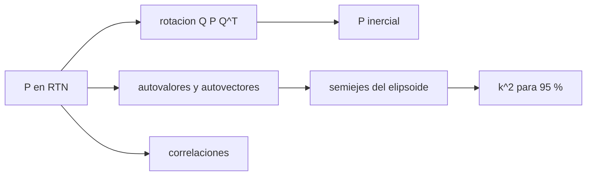

# B74-C11 — Matrices de covarianza — Estimación de órbitas y navegación espacial

<!-- nav:top -->
[🏠 Programa](../../../../README.md) · [📚 Bloque B74](../../../tronco-comun/B74-estimacion-de-orbitas-y-navegacion-espacial.md) · [← Anterior: B74-C10 — Filtro de Kalman no lineal](../B74-C10-filtro-de-kalman-no-lineal/CLASE.md) · [Siguiente: B74-C12 — Propagación de incertidumbre — Estimación de órbitas y navegación espacial →](../B74-C12-propagacion-de-incertidumbre-estimacion-de-orbitas-y-navegacion-espacial/CLASE.md)
<!-- /nav -->

## 1. Ubicación, nivel y alcance

Clase 11 del bloque B74. Nivel N3. Una matriz de covarianza es el resultado más importante de una estimación después del propio estado: dice cuánto se desconoce y en qué direcciones. Aquí lees una covarianza de posición de un satélite sintético en el marco RTN (radial, transversal, normal), la rotas al marco inercial, calculas sus semiejes, sus correlaciones y la varianza condicional, y compruebas por Monte Carlo qué fracción de la probabilidad contiene el elipsoide de confianza.

## 2. Por qué esta clase existe

Los números de la diagonal engañan: dos errores muy correlacionados pueden ser individualmente grandes y conjuntamente pequeños. La decisión central: **¿qué dicen realmente los autovalores, las correlaciones y el elipsoide, y qué probabilidad encierra cada «k sigma» en tres dimensiones?**

## 3. Lo que podrás hacer al terminar

1. Rotar una covarianza entre marcos con `Q P Qᵀ`.
2. Obtener semiejes y orientación del elipsoide por autovalores.
3. Comprobar que traza, determinante y autovalores son invariantes a la rotación.
4. Calcular la correlación y la varianza condicional.
5. Determinar el `k²` de un contenido de probabilidad en tres dimensiones.
6. Rotular lo sintético y lo ilustrativo.

La evidencia es la **ficha de interpretación de una covarianza** del ejercicio 12 (sección 20).

## 4. Con qué llegas y cómo comprobarlo

1. ¿Qué es una matriz simétrica definida positiva?
2. ¿Qué es un autovalor?
3. ¿Qué es la correlación?
4. ¿Qué es el marco RTN?
5. ¿Qué es una verificación por segunda vía?

<details>
<summary>Ver respuestas</summary>

1. Una con autovalores todos positivos; una covarianza válida lo es. 2. Un factor por el que una matriz estira una dirección propia. 3. La covarianza dividida por el producto de las desviaciones estándar. 4. El marco local de la órbita: radial, transversal (a lo largo de la trayectoria) y normal al plano. 5. Calcular lo mismo con otro método y comparar.
</details>

Con cuatro o cinco aciertos, sigue; si no, repasa los prerrequisitos.

## 5. Un caso de contexto y casos de referencia

Un satélite sintético tiene `σ_R = 50 m`, `σ_T = 500 m`, `σ_N = 100 m` y correlación `−0,9` entre R y T. Sus semiejes 1σ son `21,71`, `100,00` y `502,02 m`; el elipsoide del 95 % tiene un semieje mayor de `1403,4 m`. Es el **ejemplo conductor**; la covarianza es sintética.

## 6. Vocabulario

La **matriz de covarianza** `P` tiene las varianzas en la diagonal y las covarianzas fuera. Los **autovalores** son las varianzas en los ejes principales del **elipsoide de error**. La **correlación** `ρ_ij = P_ij/√(P_ii P_jj)`. La **varianza condicional** de `T` dado `R` es `σ_T²(1−ρ²)`. El **contenido** del elipsoide `k²` es la probabilidad de que el error caiga dentro.

## 7. Modelo mental: una nube de puntos con forma de puro



*Descripción textual:* la covarianza se rota entre marcos, sus autovalores dan los semiejes del elipsoide, las correlaciones muestran la forma y `k²` convierte el elipsoide en una probabilidad.

Analogía: una nube de puntos con forma de puro; el eje largo es la dirección de mayor incertidumbre y sus extremos no coinciden con los ejes de coordenadas. Límite: un elipsoide solo describe bien una distribución gaussiana; las posiciones reales a lo largo de una órbita son curvas (banana) y requieren otras representaciones.

## 8. La explicación, paso a paso

### 8.1 Rotar sin cambiar la incertidumbre

La covarianza inercial `P_I = Q P Qᵀ` tiene los mismos autovalores (`471,18`, `10000,00`, `252028,82 m²`), la misma traza (`262500,0 m²`) y el mismo determinante que la RTN. Lo que cambia son las diagonales: `σ` inercial por eje `(50,0, 498,9, 105,2) m`.

### 8.2 Los ejes principales

El semieje mayor 1σ es `502,02 m`, casi la dirección transversal; el menor, `21,71 m`, aparece por la fuerte correlación R–T (−0,9): conocer una de las dos componentes reduce mucho la incertidumbre de la otra.

### 8.3 Correlación y varianza condicional

Con ρ = −0,9, la `σ_T` marginal de 500 m baja a `217,94 m` si se conoce R. En el marco inercial la correlación x–y vale `-0,900`.

### 8.4 Qué probabilidad encierra «k sigma»

En 3D el contenido de un elipsoide `1σ` es solo `0,1987`. Para el 68,27 % hace falta `k² = 3,5268` y para el 95 %, `k² = 7,8147`. El laboratorio lo confirma con 200 000 muestras: `0,9504` dentro del elipsoide del 95 %.

## 9. Magnitudes, símbolos y unidades

| Símbolo | Qué es | Unidad | Valor / nota |
|---|---|---|---|
| `P` | covarianza de posición | m² | 3 × 3 |
| `Q` | rotación RTN → inercial | — | columnas R, T, N |
| `λ_i` | autovalores | m² | 471; 10 000; 252 029 |
| `ρ` | correlación | — | −0,9 entre R y T |
| `k²` | parámetro del elipsoide | — | 7,8147 (95 %, 3 gl) |
| `F(k²)` | contenido de probabilidad | — | erf(√(k²/2)) − √(2k²/π) e^(−k²/2) |

## 10. Convenciones y referencias

Marco RTN con R = r/|r|, N = r × v normalizado, T = N × R; estado sintético r = (7000, 0, 0) km, v = (0, 7,5; 0,5) km/s; covarianza gaussiana; semilla 37. Todo sintético. El contenido del elipsoide se calcula con la fórmula exacta de 3 grados de libertad.

## 11. De dónde sale lo que afirmamos

| ID | Fuente | Localizador | Respalda | Estado |
|---|---|---|---|---|
| S1 | NIST, CODATA — Speed of light in vacuum — https://physics.nist.gov/cgi-bin/cuu/Value?c (consultada 2026-11-10) | entrada «c» | c = 299 792 458 m/s (exacta) | Consultada |
| S2 | CCSDS 502.0-B-3, Orbit Data Messages, Blue Book, abril de 2023 — https://ccsds.org/Pubs/502x0b3e1.pdf (consultada 2026-11-10, texto extraído con PyMuPDF) | alcance (sección 1) y lista de usos | existen los mensajes OPM, OMM, OEM y OCM; usos: planificación de seguimiento, predicciones, comparación de órbitas, propagación y reconstrucción de órbitas | Consultada (solo alcance) |
| — | Tapley, Schutz y Born, *Statistical Orbit Determination* (Elsevier, 2004); Bar-Shalom, Li y Kirubarajan, *Estimation with Applications to Tracking and Navigation* (Wiley, 2001) | — | fundamento teórico general de la clase | No consultada |

Límites: de la norma CCSDS 502.0-B-3 solo se consultó el alcance y la existencia de los mensajes; no se leyó la sección sobre el tratamiento de covarianzas. Las propiedades de matrices de covarianza son estándar y se verifican en el laboratorio.

## 12. Cómo ver una covarianza

| Magnitud | Valor |
|---|---|
| semiejes 1σ | 21,71, 100,00, 502,02 m |
| traza | 262500,0 m² |
| σ_T condicionada | 217,94 m |
| `k²` al 95 % | 7,8147 |
| fracción Monte Carlo | 0,9504 |

Descripción larga: rotar no cambia la incertidumbre total; la correlación aplana el elipsoide; el contenido de un elipsoide de k sigma en 3D es mucho menor que el intervalo 1D.

## 13. Ejemplo trabajado: el contenido de un elipsoide

**Paso 1 · Fórmula.** `F(k²) = erf(√(k²/2)) − √(2k²/π) e^(−k²/2)`.

**Paso 2 · Valor.** Para `k² = 1`: `F = 0,1987`.

**Paso 3 · Inversión.** Para 95 %, se busca `F(k²) = 0,95` por bisección: `k² = 7,8147`.

**Paso 4 · Semieje.** Semieje mayor `= σ_mayor √k² = 1403,4 m`.

## 14. Distintas formas de describir una incertidumbre de posición

**Por matriz:** `P`. **Por semiejes:** `√λ`. **Por correlación:** `ρ_ij`. **Por probabilidad:** `k²`. **Por marco:** RTN o inercial.

## 15. Práctica guiada

**Ejercicio 1 · guiado.** Calcula el determinante de un bloque 2 × 2 con `σ_R = 50`, `σ_T = 500` y `ρ = −0,9`. *Pasos:* `σ_R² σ_T² (1 − ρ²)`.

<details><summary>Solución comentada</summary>

`2500 × 250 000 × 0,19 = 1,1875 × 10⁸ m⁴`.
</details>

**Ejercicio 2 · guiado.** ¿Qué traza tiene `P`? *Pista:* suma de varianzas.

<details><summary>Solución comentada</summary>

`2500 + 250 000 + 10 000 = 262 500 m²`.
</details>

**Ejercicio 3 · guiado.** ¿Cuál es la varianza condicional de R dado T? *Pista:* `σ_R²(1 − ρ²)`.

<details><summary>Solución comentada</summary>

`2500 × 0,19 = 475 m²`, `σ = 21,8 m`.
</details>

## 16. Práctica autónoma, transferencia e integrador

**Ejercicio 4 · autónomo.** ¿Por qué la traza es invariante a la rotación?

<details><summary>Solución comentada</summary>

Porque es la suma de los autovalores y la rotación es una semejanza ortogonal.
</details>

**Ejercicio 5 · autónomo.** ¿Qué ocurre con los semiejes si todas las varianzas se multiplican por 4?

<details><summary>Solución comentada</summary>

Se duplican.
</details>

**Ejercicio 6 · autónomo.** ¿Qué `k²` da el 99 % en 3D?

<details><summary>Solución comentada</summary>

Cerca de 11,34 (se obtiene invirtiendo la fórmula).
</details>

**Ejercicio 7 · autónomo.** ¿Qué diría un autovalor negativo?

<details><summary>Solución comentada</summary>

Que la matriz no es una covarianza válida: error numérico o mal condicionamiento.
</details>

**Ejercicio 8 · autónomo.** ¿Cómo cambia la forma si ρ pasa de −0,9 a 0?

<details><summary>Solución comentada</summary>

Se pierde el aplanamiento: la nube se vuelve más redonda en el plano R–T.
</details>

**Ejercicio 9 · transferencia.** **Transferencia.** Un informe dice «error de ±500 m a 1σ». ¿Qué preguntas haces?

<details><summary>Solución comentada</summary>

En qué eje, en qué marco, cuáles son las correlaciones y cuánta probabilidad encierra en 3D.
</details>

**Ejercicio 10 · transferencia.** **Transferencia.** ¿Por qué la nube de errores de posición a lo largo de una órbita larga se curva?

<details><summary>Solución comentada</summary>

Porque el error de velocidad se convierte en desplazamiento a lo largo de un arco; el elipsoide lineal lo aproxima mal.
</details>

**Ejercicio 11 · transferencia.** **Transferencia.** Dos nubes con la misma traza, ¿tienen el mismo riesgo de colisión?

<details><summary>Solución comentada</summary>

No: depende de la orientación del elipsoide respecto de la geometría del encuentro.
</details>

**Ejercicio 12 · integrador.** **Integrador.** Elabora tu *ficha de interpretación de una covarianza*: P en dos marcos, semiejes, correlaciones, varianza condicional y `k²` para dos contenidos, rotulando lo sintético.

<details><summary>Solución comentada</summary>

Secciones 8.1–8.4 y la salida del laboratorio.
</details>

## 17. Laboratorio: lectura de una covarianza

El script [laboratorio.py](laboratorio.py) rota una covarianza RTN al marco inercial, calcula autovalores, correlaciones, varianza condicional y `k²`, y los verifica con 200 000 muestras (**comprueba** invariancia de autovalores, traza y determinante y fracción del 95 % entre 0,948 y 0,952).

**Datos:** covarianza y estado **sintéticos/ilustrativos**. **Predice antes de ejecutar:** ¿qué probabilidad encierra el elipsoide de 1σ en 3D? (≈ 20 %). **Ejecución del 2026-11-10 (Python 3.12.9, NumPy 2.4.4):**

```text
Python 3.12.9, NumPy 2.4.4 (covarianza SINTETICA, semilla 37)
P en RTN [m^2]:
        2500.0     -22500.0          0.0
      -22500.0     250000.0          0.0
           0.0          0.0      10000.0
P en el marco inercial [m^2]:
        2500.0     -22450.2      -1496.7
      -22450.2     248938.1      15929.2
       -1496.7      15929.2      11061.9
Autovalores: 471.18 10000.00 252028.82 ; semiejes 1-sigma = 21.71 100.00 502.02 m
Traza RTN = 262500.0 ; traza inercial = 262500.0 ; det RTN = 1.1875e+12 ; det inercial = 1.1875e+12
Correlaciones en el marco inercial (x-y, x-z, y-z): -0.900 -0.285 +0.304
sigma inercial por eje = 50.0 498.9 105.2 m (los ejes no coinciden con los del elipsoide)
sigma_T marginal = 500.0 m ; sigma_T condicionada a conocer R = 217.94 m
k^2 para contenido 95 % (3 gl) = 7.8147 ; k^2 para 68.27 % = 3.5268 ; 1-sigma 1D contiene solo el 19.87 % en 3D (F(1) = 0.1987)
Fraccion Monte Carlo dentro del elipsoide k^2 = 7.815: 0.9504 (esperado 0.9500)
Semieje mayor del elipsoide al 95 % = 1403.4 m (sigma mayor 502.0 m x 2.795)
Pruebas superadas.
```

```bash
python programa/clases/B74/B74-C11-matrices-de-covarianza-estimacion-de-orbitas-y-navegacion-espacial/laboratorio.py
```

**Límites:** gaussiana y lineal; posición solamente; no se incluye la velocidad ni la forma curva de la nube.

## 18. Errores frecuentes y cómo corregirlos

**Creer que 1σ encierra el 68 % en 3D.** Solo el 19,9 %; ver 8.4.

**Leer solo la diagonal.** Mira correlaciones y autovalores.

**Comparar covarianzas en marcos distintos.** Rota al mismo marco.

**Presentar la covarianza sintética como real.** Rotula como sintético, como en la sección 10.

## 19. Cómo sabrás que vas bien

Tras la sección 8: ¿qué probabilidad esperabas para el elipsoide de 1σ y cuál es? Si dudas, repasa el ejemplo 13. Tras el laboratorio: ¿qué comprueba? (ver la sección 17).

## 20. Qué entregas y cómo se evalúa

El producto es tu **ficha de interpretación de una covarianza** (ejercicio 12).

| Criterio | Inicial | En desarrollo | Logrado | Destacado |
|---|---|---|---|---|
| Conceptos | Los confunde | Parciales | Interpreta autovalores, correlación y `k²` | Explica los límites |
| Cálculo | Sin unidades | Con errores | Tablas completas con unidades | Calcula casos nuevos |
| Numérico | Sin comprobar | Un caso | Contraste con una segunda vía | Interpreta las diferencias |
| Fuentes | Sin fuente | Sin fecha | Fuentes con fecha y estado | Declara lo sintético y lo no consultado |
| Límites | No los nombra | Uno | Tres | Discute qué falta del modelo |

**Condiciones críticas (no se compensan con promedio):** indicar el marco y las correlaciones de toda covarianza y rotular la covarianza como sintética; rotular los datos como sintéticos y no presentar nada simulado como observado; citar solo lo consultado.

## 21. Ética, seguridad y límites

Clase educativa en estado E0: los modelos son simplificados y sus datos son sintéticos o ilustrativos; ningún resultado describe la órbita real de una nave ni sustituye a un producto de navegación de misión. Accesibilidad: tablas equivalentes a las gráficas, fórmulas en texto, ejercicios sin conexión. Tolerancias del laboratorio: invariantes a la rotación dentro de 1e-9 relativa; fracción Monte Carlo del 95 % entre 0,948 y 0,952.

## 22. Para cerrar y seguir

La covarianza sintética tiene un semieje mayor 1σ de `502,02 m` y el elipsoide del 95 % lo lleva a `1403,4 m`; el elipsoide de 1σ encierra solo el `0,1987` de la probabilidad. Queda una pregunta: ¿cómo evoluciona la incertidumbre con el tiempo?

**Glosario español–inglés.** matriz de covarianza · *covariance matrix*; elipsoide de error · *error ellipsoid*; correlación · *correlation*; autovalor · *eigenvalue*; marco RTN · *RTN frame*.

**Continuidad.** [B74-C12](../B74-C12-propagacion-de-incertidumbre-estimacion-de-orbitas-y-navegacion-espacial/CLASE.md) estudia la propagación de incertidumbre.

**Referencias:** ver sección 11.

<!-- nav:bottom -->
---

[← Anterior: B74-C10 — Filtro de Kalman no lineal](../B74-C10-filtro-de-kalman-no-lineal/CLASE.md) · [📚 Bloque B74](../../../tronco-comun/B74-estimacion-de-orbitas-y-navegacion-espacial.md) · [Siguiente: B74-C12 — Propagación de incertidumbre — Estimación de órbitas y navegación espacial →](../B74-C12-propagacion-de-incertidumbre-estimacion-de-orbitas-y-navegacion-espacial/CLASE.md)
<!-- /nav -->
