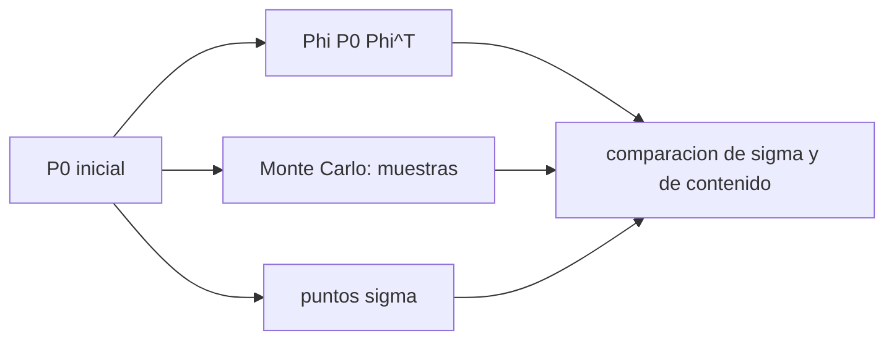

# B74-C12 — Propagación de incertidumbre — Estimación de órbitas y navegación espacial

<!-- nav:top -->
[🏠 Programa](../../../../README.md) · [📚 Bloque B74](../../../tronco-comun/B74-estimacion-de-orbitas-y-navegacion-espacial.md) · [← Anterior: B74-C11 — Matrices de covarianza — Estimación de órbitas y navegación espacial](../B74-C11-matrices-de-covarianza-estimacion-de-orbitas-y-navegacion-espacial/CLASE.md) · [Siguiente: B74-C13 — Navegación óptica →](../B74-C13-navegacion-optica/CLASE.md)
<!-- /nav -->

## 1. Ubicación, nivel y alcance

Clase 12 del bloque B74. Nivel N3. Una covarianza no se queda quieta: la dinámica la estira, sobre todo a lo largo de la trayectoria. Aquí propagas la incertidumbre inicial de una órbita sintética de tres maneras (matriz de transición lineal, Monte Carlo y puntos sigma) durante 1, 10 y 50 periodos, y compruebas hasta cuándo el elipsoide lineal describe a la nube de posibles estados.

## 2. Por qué esta clase existe

Una predicción de dónde estará un satélite dentro de semanas necesita su incertidumbre, y esa incertidumbre se vuelve curva. La decisión central: **¿cuándo basta la covarianza lineal y cuándo hay que propagar la distribución completa?**

## 3. Lo que podrás hacer al terminar

1. Propagar una covarianza con `Φ P Φᵀ`.
2. Obtener `Φ` por diferencias centrales y comprobar que su determinante vale 1.
3. Comparar la propagación lineal con Monte Carlo y con puntos sigma.
4. Medir la fracción de muestras que cae dentro del elipsoide lineal del 95 %.
5. Explicar el crecimiento lineal de la incertidumbre a lo largo de la trayectoria.
6. Rotular lo sintético y lo ilustrativo.

La evidencia es la **comparación de tres propagaciones** del ejercicio 12 (sección 20).

## 4. Con qué llegas y cómo comprobarlo

1. ¿Qué es la matriz de transición?
2. ¿Qué es un periodo orbital?
3. ¿Qué es una distribución gaussiana?
4. ¿Qué es una dirección a lo largo de la trayectoria?
5. ¿Qué es una verificación por segunda vía?

<details>
<summary>Ver respuestas</summary>

1. La matriz que lleva un pequeño error de estado inicial al error en `t`. 2. El tiempo de una vuelta. 3. Una campana descrita por media y covarianza. 4. La dirección de la velocidad. 5. Calcular lo mismo con otro método y comparar.
</details>

Con cuatro o cinco aciertos, sigue; si no, repasa los prerrequisitos.

## 5. Un caso de contexto y casos de referencia

Una órbita sintética con incertidumbre inicial de 100 m y 0,1 m/s por eje tiene, tras un periodo, una desviación a lo largo de la trayectoria de `2691,9 m` (lineal) y `2699,2 m` (Monte Carlo); tras 50 periodos, `134503` y `136551 m`, pero solo `0,264` de las muestras caen dentro del elipsoide lineal del 95 %. Es el **ejemplo conductor**; la órbita es sintética.

## 6. Vocabulario

La **matriz de transición** `Φ(t, t₀)` linealiza la propagación. La **propagación lineal de la covarianza** es `P(t) = Φ P₀ Φᵀ`. **Monte Carlo** propaga muestras. La **transformada unscented** propaga `2n+1` puntos. El **elipsoide lineal** deja de contener la distribución cuando la nube se curva.

## 7. Modelo mental: un abanico de trayectorias



*Descripción textual:* la misma covarianza inicial se propaga de tres maneras y se comparan las desviaciones y la fracción de muestras que queda dentro del elipsoide lineal.

Analogía: un grupo de corredores que parten juntos en una pista circular con velocidades ligeramente distintas se alarga en fila, y la fila se curva con la pista. Límite: el modelo es de dos cuerpos; sin perturbaciones ni maniobras, y con una incertidumbre inicial gaussiana.

## 8. La explicación, paso a paso

### 8.1 Propagación lineal

La matriz de transición, calculada con diferencias centrales, propaga la covarianza. Para una órbita kepleriana su determinante vale 1 (`1,000000`): el volumen del espacio de fases se conserva, aunque la forma se estire.

### 8.2 Tres métodos, un periodo

Tras un periodo la desviación a lo largo de la trayectoria es `2691,9`, `2699,2` y `2691,9 m` con STM, Monte Carlo y puntos sigma; la fracción dentro del elipsoide lineal del 95 % es `0,950`.

### 8.3 Crecimiento con el tiempo

La incertidumbre a lo largo de la trayectoria crece casi linealmente con el tiempo: `26901 m` a 10 periodos y `134503 m` a 50, porque un error de velocidad cambia el periodo y por tanto la fase.

### 8.4 Cuándo falla el elipsoide

A 10 periodos solo `0,863` de las muestras queda dentro del elipsoide lineal del 95 %; a 50 periodos, `0,264`. La nube se curva (forma de plátano) y el elipsoide, que es recto, deja fuera casi todo. Las desviaciones estándar siguen coincidiendo con las lineales dentro del 2 %, pero la forma de la distribución ya no es gaussiana en coordenadas cartesianas.

## 9. Magnitudes, símbolos y unidades

| Símbolo | Qué es | Unidad | Valor / nota |
|---|---|---|---|
| `Φ` | matriz de transición de estado | — | 6 × 6 |
| `P₀` | covarianza inicial | m², (m/s)² | diag(100², 0,1²) |
| `T` | periodo | s | 6080,09 |
| `σ_a` | desviación a lo largo de la trayectoria | m | 2692 m (1 periodo) |
| `det Φ` | determinante de la matriz de transición | — | 1 |
| `α, β, κ` | parámetros de los puntos sigma | — | 1; 2; 3 − n |

## 10. Convenciones y referencias

Órbita sintética en un marco inercial; μ = 3,986004 × 10¹⁴ m³/s² (ilustrativo, no consultado); incertidumbre inicial sin correlaciones; Monte Carlo con 4000 muestras; semilla 41. Todo sintético.

## 11. De dónde sale lo que afirmamos

| ID | Fuente | Localizador | Respalda | Estado |
|---|---|---|---|---|
| S1 | NIST, CODATA — Speed of light in vacuum — https://physics.nist.gov/cgi-bin/cuu/Value?c (consultada 2026-11-10) | entrada «c» | c = 299 792 458 m/s (exacta) | Consultada |
| S2 | CCSDS 502.0-B-3, Orbit Data Messages, Blue Book, abril de 2023 — https://ccsds.org/Pubs/502x0b3e1.pdf (consultada 2026-11-10, texto extraído con PyMuPDF) | alcance (sección 1) y lista de usos | existen los mensajes OPM, OMM, OEM y OCM; usos: planificación de seguimiento, predicciones, comparación de órbitas, propagación y reconstrucción de órbitas | Consultada (solo alcance) |
| — | Tapley, Schutz y Born, *Statistical Orbit Determination* (Elsevier, 2004); Montenbruck y Gill, *Satellite Orbits* (Springer, 2000); Vallado, *Fundamentals of Astrodynamics and Applications* (4.ª ed., Microcosm, 2013) | — | fundamento teórico general de la clase | No consultada |

Límites: no se consultó ninguna referencia sobre propagación de covarianzas no lineales; de CCSDS 502.0-B-3 solo se leyó el alcance. Los resultados son de un modelo de dos cuerpos con datos sintéticos.

## 12. Cómo ver la propagación de la incertidumbre

| Magnitud | Valor |
|---|---|
| σ a lo largo, 1 periodo (STM/MC) | 2691,9 / 2699,2 m |
| σ a lo largo, 50 periodos (STM/MC) | 134503 / 136551 m |
| dentro del elipsoide al 95 % (1 periodo) | 0,950 |
| dentro del elipsoide al 95 % (10 periodos) | 0,863 |
| dentro del elipsoide al 95 % (50 periodos) | 0,264 |

Descripción larga: la sigma lineal sigue siendo una buena medida de la dispersión, pero el elipsoide lineal pierde la mayor parte de las muestras tras unas decenas de periodos.

## 13. Ejemplo trabajado: la deriva por un error de velocidad

**Paso 1 · Error de velocidad.** `δv = 0,1 m/s` a lo largo de la trayectoria.

**Paso 2 · Efecto en el semieje.** `δa = 2 a² v δv/μ ≈ 194 m` y el periodo cambia `δT = 1,5 T δa/a ≈ 0,245 s`.

**Paso 3 · Deriva.** Por periodo la nave se adelanta o atrasa `v δT ≈ 1,8 km`; en `N` periodos, `N` veces eso: crece linealmente.

**Paso 4 · Lectura.** Un solo eje de velocidad aporta ~1,8 km; con los demás errores el laboratorio da `2691,9 m` tras 1 periodo y `134503 m` tras 50: casi 50 veces más.

## 14. Distintas formas de describir la incertidumbre propagada

**Por matriz:** `Φ P₀ Φᵀ`. **Por muestras:** Monte Carlo. **Por puntos:** unscented. **Por probabilidad:** fracción en el elipsoide. **Por tiempo:** número de periodos.

## 15. Práctica guiada

**Ejercicio 1 · guiado.** Si `σ_a` es 2692 m tras 1 periodo y crece linealmente, ¿cuánto vale tras 10? *Pasos:* multiplica por 10.

<details><summary>Solución comentada</summary>

`26 920 m`, cerca del `26901 m` del laboratorio.
</details>

**Ejercicio 2 · guiado.** ¿Qué determinante tiene `Φ` en un sistema hamiltoniano? *Pista:* conservación del volumen.

<details><summary>Solución comentada</summary>

1.
</details>

**Ejercicio 3 · guiado.** ¿Qué fracción debería caer en el elipsoide del 95 % si la gaussiana valiera? *Pista:* es el contenido.

<details><summary>Solución comentada</summary>

0,95.
</details>

## 16. Práctica autónoma, transferencia e integrador

**Ejercicio 4 · autónomo.** ¿Qué ocurre con `σ_a` si el error inicial de velocidad se reduce a 0,01 m/s?

<details><summary>Solución comentada</summary>

Se reduce unas 10 veces.
</details>

**Ejercicio 5 · autónomo.** ¿Por qué la `σ` de la STM coincide con la de Monte Carlo pero el elipsoide falla?

<details><summary>Solución comentada</summary>

La dispersión sigue creciendo linealmente, pero la forma se curva y no es un elipsoide.
</details>

**Ejercicio 6 · autónomo.** ¿Qué representa «plátano»?

<details><summary>Solución comentada</summary>

La forma curva de la nube de errores en coordenadas cartesianas.
</details>

**Ejercicio 7 · autónomo.** ¿Cómo evitarías el problema?

<details><summary>Solución comentada</summary>

Propagar en elementos orbitales o con coordenadas curvilíneas, o usar mezclas de gaussianas.
</details>

**Ejercicio 8 · autónomo.** ¿Qué coste tiene Monte Carlo frente a la STM?

<details><summary>Solución comentada</summary>

N propagaciones frente a 12 (diferencias centrales de 6 variables).
</details>

**Ejercicio 9 · transferencia.** **Transferencia.** Una agencia reporta un riesgo de conjunción con una covarianza lineal tras 30 días de propagación. ¿Qué dudas planteas?

<details><summary>Solución comentada</summary>

Si el elipsoide lineal describe la nube; podría subestimar la probabilidad en las colas.
</details>

**Ejercicio 10 · transferencia.** **Transferencia.** ¿Qué cambia si hay arrastre atmosférico aleatorio?

<details><summary>Solución comentada</summary>

La incertidumbre a lo largo de la trayectoria crece aún más rápido y no es lineal en el tiempo.
</details>

**Ejercicio 11 · transferencia.** **Transferencia.** ¿Qué cambia en una órbita muy excéntrica?

<details><summary>Solución comentada</summary>

La STM cambia rápidamente cerca del periapsis y la no linealidad aparece antes.
</details>

**Ejercicio 12 · integrador.** **Integrador.** Elabora tu *comparación de tres propagaciones*: tabla de `σ_a` por método y por número de periodos, fracción dentro del elipsoide lineal y una recomendación sobre cuándo usar cada método, rotulando lo sintético.

<details><summary>Solución comentada</summary>

Secciones 8.1–8.4 y la salida del laboratorio.
</details>

## 17. Laboratorio: propagación lineal, Monte Carlo y puntos sigma

El script [laboratorio.py](laboratorio.py) propaga la covarianza de una órbita sintética 1, 10 y 50 periodos con tres métodos y mide la fracción que cae dentro del elipsoide lineal (**comprueba** coincidencia lineal/Monte Carlo del 5 % a un periodo y `det Φ = 1`).

**Datos:** órbita, covarianza inicial y muestras **sintéticas/ilustrativas**; μ ilustrativo. **Predice antes de ejecutar:** ¿qué fracción caerá dentro del elipsoide lineal tras 50 periodos? (mucho menos que 0,95). **Ejecución del 2026-11-10 (Python 3.12.9, NumPy 2.4.4):**

```text
Python 3.12.9, NumPy 2.4.4 (orbita y covarianza SINTETICAS, semilla 41)
Periodo = 6080.09 s ; P0: 100 m y 0.1 m/s por eje
n_per  sigma_along STM[m]  sigma_along MC[m]  sigma_along UT[m]  det(STM)   dentro 95% lineal
    1            2691.9            2699.2            2691.9   1.000000         0.950
   10           26900.7           26645.8           26900.6   1.000000         0.863
   50          134502.7          136551.0          134493.2   1.000000         0.264
Pruebas superadas.
```

```bash
python programa/clases/B74/B74-C12-propagacion-de-incertidumbre-estimacion-de-orbitas-y-navegacion-espacial/laboratorio.py
```

**Límites:** dos cuerpos, gaussiana inicial, 4000 muestras (incertidumbre de ~1,2 % en la sigma de Monte Carlo); no hay maniobras ni perturbaciones.

## 18. Errores frecuentes y cómo corregirlos

**Creer que la sigma lineal basta para toda probabilidad.** Comprueba con 8.4.

**Calcular la STM con un paso inadecuado.** Usa pasos de 1 m y 1e-3 m/s.

**Olvidar que la incertidumbre en la trayectoria crece.** Ver 8.3.

**Presentar la órbita sintética como real.** Rotula como sintético, como en la sección 10.

## 19. Cómo sabrás que vas bien

Tras la sección 8: ¿qué fracción esperabas dentro del elipsoide tras 50 periodos y cuál obtuviste? Si dudas, repasa el ejemplo 13. Tras el laboratorio: ¿qué comprueba? (ver la sección 17).

## 20. Qué entregas y cómo se evalúa

El producto es tu **comparación de tres propagaciones** (ejercicio 12).

| Criterio | Inicial | En desarrollo | Logrado | Destacado |
|---|---|---|---|---|
| Conceptos | Los confunde | Parciales | Propaga una covarianza y compara con Monte Carlo | Explica los límites |
| Cálculo | Sin unidades | Con errores | Tablas completas con unidades | Calcula casos nuevos |
| Numérico | Sin comprobar | Un caso | Contraste con una segunda vía | Interpreta las diferencias |
| Fuentes | Sin fuente | Sin fecha | Fuentes con fecha y estado | Declara lo sintético y lo no consultado |
| Límites | No los nombra | Uno | Tres | Discute qué falta del modelo |

**Condiciones críticas (no se compensan con promedio):** comprobar la validez del elipsoide lineal y rotular la órbita como sintética; rotular los datos como sintéticos y no presentar nada simulado como observado; citar solo lo consultado.

## 21. Ética, seguridad y límites

Clase educativa en estado E0: los modelos son simplificados y sus datos son sintéticos o ilustrativos; ningún resultado describe la órbita real de una nave ni sustituye a un producto de navegación de misión. Accesibilidad: tablas equivalentes a las gráficas, fórmulas en texto, ejercicios sin conexión. Tolerancias del laboratorio: σ lineal y Monte Carlo a un periodo dentro del 5 %; det Φ = 1 dentro de 1e-4.

## 22. Para cerrar y seguir

La incertidumbre a lo largo de la trayectoria pasa de `2692 m` a `134503 m` en 50 periodos, y el elipsoide lineal del 95 % solo contiene el `0,264` de la nube. Queda una pregunta: ¿cómo se obtiene la posición con imágenes ópticas?

**Glosario español–inglés.** matriz de transición · *state transition matrix*; propagación de covarianza · *covariance propagation*; Monte Carlo · *Monte Carlo*; forma de plátano · *banana shape*; punto sigma · *sigma point*.

**Continuidad.** [B74-C13](../B74-C13-navegacion-optica/CLASE.md) estudia la navegación óptica.

**Referencias:** ver sección 11.

<!-- nav:bottom -->
---

[← Anterior: B74-C11 — Matrices de covarianza — Estimación de órbitas y navegación espacial](../B74-C11-matrices-de-covarianza-estimacion-de-orbitas-y-navegacion-espacial/CLASE.md) · [📚 Bloque B74](../../../tronco-comun/B74-estimacion-de-orbitas-y-navegacion-espacial.md) · [Siguiente: B74-C13 — Navegación óptica →](../B74-C13-navegacion-optica/CLASE.md)
<!-- /nav -->
