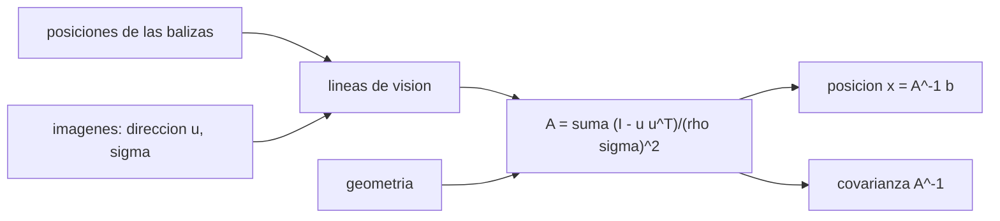

# B74-C13 — Navegación óptica

<!-- nav:top -->
[🏠 Programa](../../../../README.md) · [📚 Bloque B74](../../../tronco-comun/B74-estimacion-de-orbitas-y-navegacion-espacial.md) · [← Anterior: B74-C12 — Propagación de incertidumbre — Estimación de órbitas y navegación espacial](../B74-C12-propagacion-de-incertidumbre-estimacion-de-orbitas-y-navegacion-espacial/CLASE.md) · [Siguiente: B74-C14 — Navegación con cámaras estelares →](../B74-C14-navegacion-con-camaras-estelares/CLASE.md)
<!-- /nav -->

## 1. Ubicación, nivel y alcance

Clase 13 del bloque B74. Nivel N3. La navegación óptica fija la posición de una nave a partir de imágenes de cuerpos de posición conocida (planetas, satélites, asteroides) tomadas contra el fondo de estrellas: cada imagen da una dirección, y varias direcciones se cruzan en la posición de la nave. Aquí triangulas con tres balizas sintéticas a cientos de millones de kilómetros, comparas la covarianza prevista con Monte Carlo y ves cuánto empeora la solución cuando las balizas están casi en la misma dirección.

## 2. Por qué esta clase existe

Una dirección conocida con un microrradián son cientos de kilómetros a la distancia de un planeta. La decisión central: **¿cuánta incertidumbre de posición produce una cierta incertidumbre angular y cómo depende de la geometría de las balizas?**

## 3. Lo que podrás hacer al terminar

1. Plantear el ajuste de mínimos cuadrados de líneas de visión.
2. Calcular la covarianza `A⁻¹` con `A = Σ (I − uuᵀ)/(ρσ)²`.
3. Comparar la covarianza prevista con Monte Carlo.
4. Explicar por qué una geometría estrecha pierde precisión en una dirección.
5. Convertir una incertidumbre angular y una distancia en kilómetros.
6. Rotular lo sintético y lo ilustrativo.

La evidencia es la **ajuste de posición por triangulación** del ejercicio 12 (sección 20).

## 4. Con qué llegas y cómo comprobarlo

1. ¿Qué es un vector unitario?
2. ¿Qué es una proyección transversal?
3. ¿Cuántos segundos de arco son 0,0003°?
4. ¿Qué es una baliza (*beacon*) de navegación?
5. ¿Qué es una verificación por segunda vía?

<details>
<summary>Ver respuestas</summary>

1. Un vector de módulo 1 que indica una dirección. 2. La componente perpendicular a una dirección: `I − uuᵀ`. 3. 1,08″. 4. Un cuerpo de posición conocida usado como referencia. 5. Calcular lo mismo con otro método y comparar.
</details>

Con cuatro o cinco aciertos, sigue; si no, repasa los prerrequisitos.

## 5. Un caso de contexto y casos de referencia

Con una incertidumbre de `0,0003°` (1,08″) por imagen y balizas a 100, 150 y 200 millones de kilómetros, una geometría amplia da `σ_3D = 951,9 km`, y una estrecha (balizas dentro de 15°), `3812,2 km`, es decir `4,00` veces más. Es el **ejemplo conductor**; las balizas y las direcciones son sintéticas.

## 6. Vocabulario

La **línea de visión** de una baliza pasa por su posición con dirección `u`. La **navegación óptica** triangula esas líneas. La **matriz de información** `A = Σ (I − uuᵀ)/(ρσ)²` suma la información transversal de cada imagen. La **geometría** fija cuánta información hay en cada dirección. Una **baliza** es un cuerpo de efemérides conocida (clase C20 y C21).

## 7. Modelo mental: orientarse con tres faros



*Descripción textual:* las imágenes de las balizas dan líneas de visión; su información transversal suma la matriz `A`, de la que salen la posición y su covarianza; la geometría decide la forma de `A`.

Analogía: orientarse en el mar con la dirección a tres faros; si los tres están casi en la misma dirección, sabes bien el rumbo lateral pero casi nada de la distancia. Límite: el modelo supone direcciones sin sesgo, efemérides exactas y sin tiempo de luz; los errores de efemérides o de centroide de un cuerpo extendido (ver C25) añaden sistemáticos.

## 8. La explicación, paso a paso

### 8.1 La información de una imagen

Cada imagen de una baliza a distancia `ρ` con incertidumbre angular `σ` informa sobre la posición **transversal** a la línea de visión, con varianza `(ρσ)²`. A lo largo de la línea no informa.

### 8.2 La combinación

`A = Σ (I − uᵢuᵢᵀ)/(ρᵢσ)²` suma esa información; la posición es `x = A⁻¹ b` y la covarianza, `P = A⁻¹`. Con `σ = 1,08″` y balizas a 100–200 millones de km, `1″` corresponde a ~480 km a 100 millones de km.

### 8.3 Geometría amplia y estrecha

Con balizas separadas 90° a 210°, la mayor incertidumbre por eje es `710,9 km`, con un `σ_3D = 951,9 km`. Con balizas dentro de 15°, el eje común queda casi sin información: `σ_3D = 3812,2 km`, `4,00` veces mayor.

### 8.4 Contraste con Monte Carlo

En 3000 realizaciones, la desviación empírica de cada componente coincide con la prevista por `A⁻¹` dentro del 8 %: la fórmula describe bien un problema casi lineal.

## 9. Magnitudes, símbolos y unidades

| Símbolo | Qué es | Unidad | Valor / nota |
|---|---|---|---|
| `u` | dirección unitaria a la baliza | — |  |
| `ρ` | distancia a la baliza | m | 1,0–2,0 × 10¹¹ |
| `σ` | incertidumbre angular | rad | 5,2 × 10⁻⁶ (0,0003°) |
| `A` | matriz de información | m⁻² | 3 × 3 |
| `P` | covarianza de posición | m² | A⁻¹ |
| `σ_3D` | raíz de la traza de P | km | 952 (amplia) |

## 10. Convenciones y referencias

Marco de referencia local con la nave en el origen; balizas sintéticas en direcciones (azimut, elevación) dadas; direcciones con error gaussiano transversal isotrópico; sin sesgos, sin tiempo de luz ni aberración; semilla 43. Todo sintético.

## 11. De dónde sale lo que afirmamos

| ID | Fuente | Localizador | Respalda | Estado |
|---|---|---|---|---|
| S1 | NIST, CODATA — Speed of light in vacuum — https://physics.nist.gov/cgi-bin/cuu/Value?c (consultada 2026-11-10) | entrada «c» | c = 299 792 458 m/s (exacta) | Consultada |
| S2 | NASA/JPL SSD, Horizons API — https://ssd-api.jpl.nasa.gov/doc/horizons.html (consultada 2026-11-10) | parámetros EPHEM_TYPE, COMMAND, CENTER, TLIST | Horizons entrega tablas de observador, vectores de estado, elementos y SPK; parámetros de la API | Consultada |
| — | Tapley, Schutz y Born, *Statistical Orbit Determination* (Elsevier, 2004); Montenbruck y Gill, *Satellite Orbits* (Springer, 2000) | — | fundamento teórico general de la clase | No consultada |

Límites: no se consultó ninguna referencia sobre navegación óptica de misiones; Horizons solo se consultó como proveedor de efemérides (no se descargó ninguna). La fórmula de la matriz de información se deriva en la clase y se contrasta con Monte Carlo.

## 12. Cómo ver la triangulación óptica

| Magnitud | Valor |
|---|---|
| σ angular | 1,08″ (0,0003°) |
| σ 3D, geometría amplia | 951,9 km |
| σ 3D, geometría estrecha | 3812,2 km |
| cociente estrecha/amplia | 4,00 |
| σ 3D empírica (amplia) | 956,5 km |

Descripción larga: la precisión de posición depende de la distancia a las balizas y de su separación angular; la fórmula coincide con la simulación.

## 13. Ejemplo trabajado: de un ángulo a kilómetros

**Paso 1 · Ángulo.** `σ = 1,08″ = 5,24 × 10⁻⁶ rad`.

**Paso 2 · Distancia.** A `ρ = 10⁸ km`: `ρσ = 524 km` por eje transversal.

**Paso 3 · Una sola baliza.** Incertidumbre de ~524 km en dos direcciones y nada en la tercera.

**Paso 4 · Tres balizas.** Al combinarlas desde direcciones distintas, `σ_3D = 951,9 km`.

## 14. Distintas formas de describir una solución de navegación óptica

**Por direcciones:** `uᵢ`. **Por información:** `A`. **Por posición:** `x = A⁻¹ b`. **Por covarianza:** `P`. **Por geometría:** separación angular.

## 15. Práctica guiada

**Ejercicio 1 · guiado.** Calcula la incertidumbre transversal de 2″ a 150 millones de km. *Pasos:* convierte a radianes y multiplica.

<details><summary>Solución comentada</summary>

`9,7 × 10⁻⁶ × 1,5 × 10⁸ = 1454 km`.
</details>

**Ejercicio 2 · guiado.** ¿En qué dirección no informa una sola imagen? *Pista:* línea de visión.

<details><summary>Solución comentada</summary>

A lo largo de la línea de visión.
</details>

**Ejercicio 3 · guiado.** ¿Qué ocurre con `A` si dos balizas están en la misma dirección? *Pista:* el rango se reduce.

<details><summary>Solución comentada</summary>

Informa dos veces sobre las mismas dos direcciones transversales y deja un eje sin información.
</details>

## 16. Práctica autónoma, transferencia e integrador

**Ejercicio 4 · autónomo.** ¿Cómo cambia `σ_3D` si el ruido angular se divide por 2?

<details><summary>Solución comentada</summary>

Se divide por 2.
</details>

**Ejercicio 5 · autónomo.** ¿Y si la distancia a las balizas se duplica?

<details><summary>Solución comentada</summary>

Se duplica.
</details>

**Ejercicio 6 · autónomo.** ¿Por qué con tres balizas casi en línea el eje común queda mal?

<details><summary>Solución comentada</summary>

Porque todas informan sobre planos casi paralelos; falta información a lo largo del eje.
</details>

**Ejercicio 7 · autónomo.** ¿Qué ventaja tiene usar un cuerpo cercano?

<details><summary>Solución comentada</summary>

`ρσ` es menor: más precisión por imagen.
</details>

**Ejercicio 8 · autónomo.** ¿Qué pasa si una efeméride de baliza tiene 100 km de error?

<details><summary>Solución comentada</summary>

Ese error se propaga a la posición como un sesgo de 100 km transversales a la línea de visión.
</details>

**Ejercicio 9 · transferencia.** **Transferencia.** Un equipo mejora el centroide de 0,3 píxeles a 0,1 píxeles. ¿Cuánto mejora la posición?

<details><summary>Solución comentada</summary>

Un factor 3 en `σ`, y por tanto en `σ_3D`, si dominan los errores aleatorios.
</details>

**Ejercicio 10 · transferencia.** **Transferencia.** ¿Qué pasa si las imágenes se toman a horas distintas?

<details><summary>Solución comentada</summary>

La nave se mueve entre imágenes; hay que incluir la dinámica (filtro) o el tiempo de cada imagen.
</details>

**Ejercicio 11 · transferencia.** **Transferencia.** ¿Por qué conviene mezclar balizas de distintas distancias?

<details><summary>Solución comentada</summary>

Para repartir la información y evitar degeneraciones; además las cercanas son más precisas.
</details>

**Ejercicio 12 · integrador.** **Integrador.** Elabora tu *ajuste de posición por triangulación*: matriz `A`, covarianza prevista, comparación con Monte Carlo y efecto de la geometría, rotulando lo sintético.

<details><summary>Solución comentada</summary>

Secciones 8.1–8.4 y la salida del laboratorio.
</details>

## 17. Laboratorio: triangulación óptica con tres balizas

El script [laboratorio.py](laboratorio.py) triangula la posición de una nave con tres líneas de visión sintéticas, compara la covarianza prevista con 3000 realizaciones y repite con geometría estrecha (**comprueba** desviación empírica dentro del 8 % de la prevista en cada eje).

**Datos:** balizas, direcciones y ruido **sintéticos/ilustrativos**. **Predice antes de ejecutar:** ¿cuántas veces peor es la geometría estrecha? (alrededor de 4). **Ejecución del 2026-11-10 (Python 3.12.9, NumPy 2.4.4):**

```text
Python 3.12.9, NumPy 2.4.4 (geometria y direcciones SINTETICAS, semilla 43)
sigma angular por imagen = 0.0003 deg = 1.080 arcsec ; distancias a las balizas = 1.0, 1.5 y 2.0e8 km
geometria   sigma prevista (x,y,z) [km]        sigma empirica (x,y,z) [km]      sigma 3D prevista [km]
amplia         710.9    480.3    412.4        710.2    499.1    401.7         951.9
estrecha      3756.2    512.1    402.6       3770.1    519.4    389.3        3812.2
Cociente 3D estrecha/amplia = 4.00
Pruebas superadas.
```

```bash
python programa/clases/B74/B74-C13-navegacion-optica/laboratorio.py
```

**Límites:** sin sesgos, aberración, tiempo de luz ni errores de efemérides; las balizas son puntos; el ajuste es estático.

## 18. Errores frecuentes y cómo corregirlos

**Creer que una imagen da la distancia.** Solo da dirección; ver 8.1.

**Usar balizas casi alineadas.** Pierde un eje; ver 8.3.

**Ignorar la distancia a la baliza.** `ρσ` fija la escala; ver el ejemplo 13.

**Presentar las balizas sintéticas como reales.** Rotula como sintético, como en la sección 10.

## 19. Cómo sabrás que vas bien

Tras la sección 8: ¿cuántas veces peor esperabas la geometría estrecha y cuántas fue? Si dudas, repasa el ejemplo 13. Tras el laboratorio: ¿qué comprueba? (ver la sección 17).

## 20. Qué entregas y cómo se evalúa

El producto es tu **ajuste de posición por triangulación** (ejercicio 12).

| Criterio | Inicial | En desarrollo | Logrado | Destacado |
|---|---|---|---|---|
| Conceptos | Los confunde | Parciales | Plantea `A` y la covarianza de la triangulación | Explica los límites |
| Cálculo | Sin unidades | Con errores | Tablas completas con unidades | Calcula casos nuevos |
| Numérico | Sin comprobar | Un caso | Contraste con una segunda vía | Interpreta las diferencias |
| Fuentes | Sin fuente | Sin fecha | Fuentes con fecha y estado | Declara lo sintético y lo no consultado |
| Límites | No los nombra | Uno | Tres | Discute qué falta del modelo |

**Condiciones críticas (no se compensan con promedio):** indicar la geometría y las distancias de las balizas y rotularlas como sintéticas; rotular los datos como sintéticos y no presentar nada simulado como observado; citar solo lo consultado.

## 21. Ética, seguridad y límites

Clase educativa en estado E0: los modelos son simplificados y sus datos son sintéticos o ilustrativos; ningún resultado describe la órbita real de una nave ni sustituye a un producto de navegación de misión. Accesibilidad: tablas equivalentes a las gráficas, fórmulas en texto, ejercicios sin conexión. Tolerancias del laboratorio: desviación empírica dentro del 8 % de la prevista (3000 realizaciones).

## 22. Para cerrar y seguir

Con 1,08″ por imagen la posición queda en `951,9 km` con buena geometría y `3812,2 km` con mala. Queda una pregunta: ¿cómo se obtienen las direcciones de las estrellas con las que se orienta la nave?

**Glosario español–inglés.** navegación óptica · *optical navigation*; baliza · *beacon*; línea de visión · *line of sight*; matriz de información · *information matrix*; triangulación · *triangulation*.

**Continuidad.** [B74-C14](../B74-C14-navegacion-con-camaras-estelares/CLASE.md) estudia la navegación con cámaras estelares.

**Referencias:** ver sección 11.

<!-- nav:bottom -->
---

[← Anterior: B74-C12 — Propagación de incertidumbre — Estimación de órbitas y navegación espacial](../B74-C12-propagacion-de-incertidumbre-estimacion-de-orbitas-y-navegacion-espacial/CLASE.md) · [📚 Bloque B74](../../../tronco-comun/B74-estimacion-de-orbitas-y-navegacion-espacial.md) · [Siguiente: B74-C14 — Navegación con cámaras estelares →](../B74-C14-navegacion-con-camaras-estelares/CLASE.md)
<!-- /nav -->
