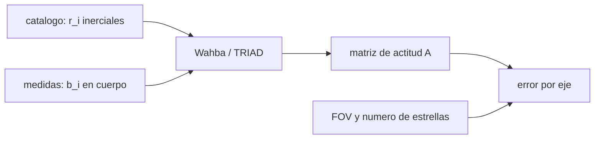

# B74-C14 — Navegación con cámaras estelares

<!-- nav:top -->
[🏠 Programa](../../../../README.md) · [📚 Bloque B74](../../../tronco-comun/B74-estimacion-de-orbitas-y-navegacion-espacial.md) · [← Anterior: B74-C13 — Navegación óptica](../B74-C13-navegacion-optica/CLASE.md) · [Siguiente: B74-C15 — Geometría de la red de seguimiento →](../B74-C15-geometria-de-la-red-de-seguimiento/CLASE.md)
<!-- /nav -->

## 1. Ubicación, nivel y alcance

Clase 14 del bloque B74. Nivel N3. Una cámara estelar (*star tracker*) fotografía estrellas, las identifica en un catálogo y obtiene la orientación (actitud) de la nave. Esa actitud es necesaria para apuntar las cámaras de navegación óptica (C13) y las antenas. Aquí calculas la actitud con TRIAD (dos vectores) y con el problema de Wahba resuelto por descomposición en valores singulares (todas las estrellas) sobre estrellas sintéticas, y mides cuánto mejora el error con el número de estrellas y por qué el giro alrededor del eje óptico es el peor eje.

## 2. Por qué esta clase existe

Un error de actitud de unos segundos de arco desplaza a un objeto a un millón de kilómetros por decenas de metros, y un error de giro mayor en el eje óptico es normal. La decisión central: **¿cuántas estrellas y qué campo de visión hacen falta para cada eje de la actitud?**

## 3. Lo que podrás hacer al terminar

1. Describir el problema de Wahba y su solución por SVD.
2. Aplicar TRIAD a dos vectores.
3. Medir cómo escala el error transversal con `1/√N`.
4. Explicar por qué el giro alrededor del eje óptico es el eje peor.
5. Calcular el error de actitud en arcsec desde una simulación de Monte Carlo.
6. Rotular lo sintético y lo ilustrativo.

La evidencia es la **estimación de actitud con su error** del ejercicio 12 (sección 20).

## 4. Con qué llegas y cómo comprobarlo

1. ¿Qué es una matriz de rotación?
2. ¿Qué es la SVD?
3. ¿Qué es el eje óptico?
4. ¿Qué es un segundo de arco?
5. ¿Qué es una verificación por segunda vía?

<details>
<summary>Ver respuestas</summary>

1. Una matriz ortogonal de determinante 1 que cambia de marco. 2. La descomposición de una matriz en `U Σ Vᵀ`. 3. La línea hacia la que apunta la cámara. 4. 1/3600 de grado. 5. Calcular lo mismo con otro método y comparar.
</details>

Con cuatro o cinco aciertos, sigue; si no, repasa los prerrequisitos.

## 5. Un caso de contexto y casos de referencia

Con estrellas sintéticas dentro de 8° de semiángulo y ruido de 5″ por eje, el error transversal es `2,39″` con 5 estrellas y `1,15″` con 20, y el giro alrededor del eje óptico es `12,09″`, `10,56` veces peor. Es el **ejemplo conductor**; las estrellas y la actitud son sintéticas.

## 6. Vocabulario

El **problema de Wahba** minimiza `Σ wᵢ |bᵢ − A rᵢ|²` sobre matrices de rotación `A`. **TRIAD** construye dos ternas ortonormales con dos estrellas. La solución por **SVD** usa `B = Σ bᵢ rᵢᵀ = U S Vᵀ` y `A = U diag(1,1,det) Vᵀ`. El **giro** (*roll*) es la rotación alrededor del eje óptico. El **campo de visión** (FOV) es el ángulo que abarca el sensor.

## 7. Modelo mental: orientarse con las estrellas como mapa



*Descripción textual:* los vectores del catálogo y los medidos en el cuerpo alimentan a TRIAD o a Wahba, que dan la actitud; el campo de visión y el número de estrellas determinan el error por eje.

Analogía: orientar un mapa con dos o más puntos de referencia en el horizonte; con puntos muy juntos acertarás la dirección de mirada pero no el giro del mapa. Límite: se supone identificación correcta de las estrellas y un ruido isotrópico; no hay aberración ni distorsión de la óptica.

## 8. La explicación, paso a paso

### 8.1 TRIAD

Con dos vectores medidos `b₁, b₂` y sus catálogos `r₁, r₂`, TRIAD toma `b₁` como eje principal y construye la terna con `b₁ × b₂`. Es simple pero descarta información del segundo vector.

### 8.2 Wahba por SVD

Con `N` estrellas, `A = U diag(1,1,det U det V) Vᵀ` donde `U S Vᵀ = Σ bᵢ rᵢᵀ`. El resultado es el óptimo de mínimos cuadrados con pesos iguales.

### 8.3 El error con el número de estrellas

El error transversal baja de `2,39″` (5 estrellas) a `1,15″` (20); el cociente es `0,478`, cercano a `1/√4 = 0,5`. Con solo dos estrellas, las desviaciones son de `10,1″` (TRIAD) y `12,0″` (SVD), dominadas por pares casi colineales (colas pesadas).

### 8.4 El giro alrededor del eje óptico

Con un campo de 8° de semiángulo, las estrellas están casi en la misma dirección y el giro alrededor del eje óptico se determina por su posición angular alrededor del centro: `12,09″` frente a `1,15″` transversal, un factor `10,56`. Un campo mayor reduce ese factor (aproximadamente como 1/ángulo del campo).

## 9. Magnitudes, símbolos y unidades

| Símbolo | Qué es | Unidad | Valor / nota |
|---|---|---|---|
| `A` | matriz de actitud (inercial → cuerpo) | — | 3 × 3, rotación |
| `bᵢ` | vectores medidos | — | unitarios, marco del cuerpo |
| `rᵢ` | vectores del catálogo | — | unitarios, marco inercial |
| `B` | matriz de perfil | — | Σ bᵢ rᵢᵀ |
| `σ` | ruido por eje transversal | arcsec | 5 (ilustrativo) |
| `N` | estrellas | — | 2, 5, 20 |

## 10. Convenciones y referencias

Marco de la cámara con eje óptico z; estrellas uniformes en un cono de 8° de semiángulo; ruido transversal gaussiano de 5″ por eje; 2000 realizaciones por caso; semilla 47. Todo sintético.

## 11. De dónde sale lo que afirmamos

| ID | Fuente | Localizador | Respalda | Estado |
|---|---|---|---|---|
| S1 | NIST, CODATA — Speed of light in vacuum — https://physics.nist.gov/cgi-bin/cuu/Value?c (consultada 2026-11-10) | entrada «c» | c = 299 792 458 m/s (exacta) | Consultada |
| S2 | NASA/JPL NAIF, SPICE Tutorials (índice) — https://naif.jpl.nasa.gov/naif/tutorials.html (consultada 2026-11-10) | lista de tipos de kernel | SPK, CK, PCK, IK, FK, LSK, SCLK y DSK y su función | Consultada |
| — | Wertz (ed.), *Spacecraft Attitude Determination and Control* (Reidel, 1978); Tapley, Schutz y Born, *Statistical Orbit Determination* (Elsevier, 2004) | — | fundamento teórico general de la clase | No consultada |

Límites: el problema de Wahba, TRIAD y la solución por SVD son relaciones estándar no consultadas en una fuente concreta (la referencia natural es Wertz, no consultada); NAIF solo se usó para ubicar la actitud en SPICE (kernels CK/FK, ver C21).

## 12. Cómo ver la actitud con cámara estelar

| Magnitud | Valor |
|---|---|
| transversal, N = 5 | 2,39″ |
| transversal, N = 20 | 1,15″ |
| giro, N = 20 | 12,09″ |
| cociente N = 20 / N = 5 | 0,478 |
| giro/transversal | 10,56 |

Descripción larga: el error transversal sigue la ley `1/√N`; el giro alrededor del eje óptico es varias veces peor porque el campo de visión es estrecho.

## 13. Ejemplo trabajado: de arcsec a metros

**Paso 1 · Error de actitud.** `1,15″ = 1,15/206 265 rad`.

**Paso 2 · Distancia.** A `10⁹ m` desplaza un objeto transversalmente `1,15 × 10⁹/206 265 ≈ 5,6 km` (aprox.).

**Paso 3 · Giro.** Con el error de giro, un objeto a 8° del eje óptico se desplaza como `giro × distancia al centro`, ya menor.

**Paso 4 · Lectura.** La actitud limita la apuntamiento de la cámara de navegación óptica.

## 14. Distintas formas de describir la actitud

**Por matriz:** `A`. **Por vectores:** `bᵢ ↔ rᵢ`. **Por error:** arcsec por eje. **Por número:** N de estrellas. **Por campo:** FOV.

## 15. Práctica guiada

**Ejercicio 1 · guiado.** Si el error transversal con 5 estrellas es 2,4″, ¿cuánto esperas con 20? *Pasos:* factor `√(5/20)`.

<details><summary>Solución comentada</summary>

`1,2″`.
</details>

**Ejercicio 2 · guiado.** ¿Cuántos grados de libertad tiene una actitud? *Pista:* rotaciones en 3D.

<details><summary>Solución comentada</summary>

3.
</details>

**Ejercicio 3 · guiado.** ¿Cuántas estrellas mínimas hacen falta? *Pista:* cada vector unitario aporta 2 grados de libertad.

<details><summary>Solución comentada</summary>

Dos, no colineales.
</details>

## 16. Práctica autónoma, transferencia e integrador

**Ejercicio 4 · autónomo.** ¿Qué ocurre con el error de giro si el campo de visión se duplica?

<details><summary>Solución comentada</summary>

Baja aproximadamente a la mitad.
</details>

**Ejercicio 5 · autónomo.** ¿Por qué TRIAD descarta información?

<details><summary>Solución comentada</summary>

Usa un vector como eje exacto y el otro solo para el giro.
</details>

**Ejercicio 6 · autónomo.** ¿Qué pasa si una estrella está mal identificada?

<details><summary>Solución comentada</summary>

Un atípico grande: hay que rechazarlo (consenso).
</details>

**Ejercicio 7 · autónomo.** ¿Cómo afectaría un ruido de 10″ en lugar de 5″?

<details><summary>Solución comentada</summary>

El error se duplicaría.
</details>

**Ejercicio 8 · autónomo.** ¿Por qué los *star trackers* se instalan en pares con ejes ortogonales?

<details><summary>Solución comentada</summary>

Para que el eje de giro peor de uno se cubra con el eje transversal del otro.
</details>

**Ejercicio 9 · transferencia.** **Transferencia.** Un equipo cambia a un FOV de 4° para ganar resolución. ¿Qué empeora?

<details><summary>Solución comentada</summary>

El giro alrededor del eje óptico y el número de estrellas.
</details>

**Ejercicio 10 · transferencia.** **Transferencia.** ¿Qué falta para obtener una actitud real a partir de este laboratorio?

<details><summary>Solución comentada</summary>

Centroides, distorsión, identificación, aberración de velocidad y filtro dinámico con giroscopios.
</details>

**Ejercicio 11 · transferencia.** **Transferencia.** ¿Cómo se traduce el error de actitud en error de apuntamiento de la cámara óptica?

<details><summary>Solución comentada</summary>

Es el mismo ángulo transversal; el giro afecta a los objetos fuera del eje.
</details>

**Ejercicio 12 · integrador.** **Integrador.** Elabora tu *estimación de actitud con su error*: método, error por eje para N = 2, 5 y 20, escala `1/√N`, factor de giro y límites, rotulando lo sintético.

<details><summary>Solución comentada</summary>

Secciones 8.1–8.4 y la salida del laboratorio.
</details>

## 17. Laboratorio: actitud con TRIAD y Wahba

El script [laboratorio.py](laboratorio.py) estima la actitud con estrellas sintéticas por TRIAD y por SVD y mide el error en 2000 realizaciones (**comprueba** escala `1/√N` (cociente entre 0,45 y 0,55) y giro más de 3 veces peor).

**Datos:** estrellas, actitud y ruido **sintéticos/ilustrativos**. **Predice antes de ejecutar:** ¿cuántas veces peor es el giro que el error transversal? (más de 3). **Ejecución del 2026-11-10 (Python 3.12.9, NumPy 2.4.4):**

```text
Python 3.12.9, NumPy 2.4.4 (estrellas y actitud SINTETICAS, semilla 47)
ruido = 5 arcsec por eje transversal ; FOV = 8 grados de semiangulo ; 2000 realizaciones por caso
metodo   N    sigma_x [arcsec]  sigma_y [arcsec]  sigma_giro z [arcsec]
TRIAD    2            12.29             7.98              128.57
SVD      2            15.15             8.84              168.48
SVD      5             2.40             2.38               28.18
SVD     20             1.16             1.13               12.09
Cociente de error transversal N=20 / N=5 = 0.478 (esperado 0.500)
Cociente giro/transversal con N=20 = 10.56 (campo estrecho: el giro alrededor del eje optico es peor)
Pruebas superadas.
```

```bash
python programa/clases/B74/B74-C14-navegacion-con-camaras-estelares/laboratorio.py
```

**Límites:** identificación perfecta, sin distorsión ni aberración, sin dinámica; con N = 2 las colas pesadas impiden usar la desviación estándar como indicador fiable.

## 18. Errores frecuentes y cómo corregirlos

**Creer que el error de giro iguala al transversal.** Es mayor; ver 8.4.

**Usar estrellas casi colineales.** El problema se degenera; ver 8.3.

**Mezclar marcos.** `bᵢ` en el cuerpo y `rᵢ` en el inercial.

**Presentar las estrellas sintéticas como reales.** Rotula como sintético, como en la sección 10.

## 19. Cómo sabrás que vas bien

Tras la sección 8: ¿qué error de giro esperabas con 20 estrellas y cuál obtuviste? Si dudas, repasa el ejemplo 13. Tras el laboratorio: ¿qué comprueba? (ver la sección 17).

## 20. Qué entregas y cómo se evalúa

El producto es tu **estimación de actitud con su error** (ejercicio 12).

| Criterio | Inicial | En desarrollo | Logrado | Destacado |
|---|---|---|---|---|
| Conceptos | Los confunde | Parciales | Plantea Wahba y distingue ejes transversales y de giro | Explica los límites |
| Cálculo | Sin unidades | Con errores | Tablas completas con unidades | Calcula casos nuevos |
| Numérico | Sin comprobar | Un caso | Contraste con una segunda vía | Interpreta las diferencias |
| Fuentes | Sin fuente | Sin fecha | Fuentes con fecha y estado | Declara lo sintético y lo no consultado |
| Límites | No los nombra | Uno | Tres | Discute qué falta del modelo |

**Condiciones críticas (no se compensan con promedio):** indicar el campo de visión y el número de estrellas y rotular los datos como sintéticos; rotular los datos como sintéticos y no presentar nada simulado como observado; citar solo lo consultado.

## 21. Ética, seguridad y límites

Clase educativa en estado E0: los modelos son simplificados y sus datos son sintéticos o ilustrativos; ningún resultado describe la órbita real de una nave ni sustituye a un producto de navegación de misión. Accesibilidad: tablas equivalentes a las gráficas, fórmulas en texto, ejercicios sin conexión. Tolerancias del laboratorio: cociente de error transversal N=20/N=5 entre 0,45 y 0,55; giro/transversal > 3.

## 22. Para cerrar y seguir

Con 20 estrellas el error transversal es `1,15″` pero el de giro `12,09″`. Queda una pregunta: ¿cómo depende la precisión de la posición de la geometría de las estaciones de la red?

**Glosario español–inglés.** cámara estelar · *star tracker*; problema de Wahba · *Wahba's problem*; actitud · *attitude*; giro alrededor del eje óptico · *boresight roll*; campo de visión · *field of view*.

**Continuidad.** [B74-C15](../B74-C15-geometria-de-la-red-de-seguimiento/CLASE.md) estudia la geometría de la red de seguimiento.

**Referencias:** ver sección 11.

<!-- nav:bottom -->
---

[← Anterior: B74-C13 — Navegación óptica](../B74-C13-navegacion-optica/CLASE.md) · [📚 Bloque B74](../../../tronco-comun/B74-estimacion-de-orbitas-y-navegacion-espacial.md) · [Siguiente: B74-C15 — Geometría de la red de seguimiento →](../B74-C15-geometria-de-la-red-de-seguimiento/CLASE.md)
<!-- /nav -->
