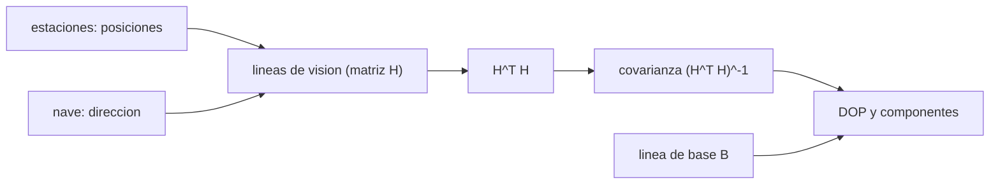

# B74-C15 — Geometría de la red de seguimiento

<!-- nav:top -->
[🏠 Programa](../../../../README.md) · [📚 Bloque B74](../../../tronco-comun/B74-estimacion-de-orbitas-y-navegacion-espacial.md) · [← Anterior: B74-C14 — Navegación con cámaras estelares](../B74-C14-navegacion-con-camaras-estelares/CLASE.md) · [Siguiente: B74-C16 — Sincronización temporal →](../B74-C16-sincronizacion-temporal/CLASE.md)
<!-- /nav -->

## 1. Ubicación, nivel y alcance

Clase 15 del bloque B74. Nivel N3. Con la misma precisión de medida, una red de estaciones bien repartida determina la posición de una nave mucho mejor que otra agrupada. La razón es geométrica: con alcances, la posición transversal depende de la **línea de base** entre estaciones. Aquí comparas dos redes sintéticas de tres estaciones (una amplia y otra agrupada) con la matriz de información `HᵀH` para 1000 direcciones de una nave a un millón de kilómetros.

## 2. Por qué esta clase existe

La precisión de seguimiento no se compra solo con mejores receptores. La decisión central: **¿qué configuración de estaciones y qué observables dan información en las tres direcciones, y cuánto vale la línea de base?**

## 3. Lo que podrás hacer al terminar

1. Calcular la dilución de la precisión `√tr[(HᵀH)⁻¹]` para una red.
2. Descomponer la incertidumbre en componente a lo largo de la línea de visión y transversal.
3. Relacionar la incertidumbre transversal con `σρ/B`.
4. Comparar una red amplia con una agrupada.
5. Detectar una geometría singular por el número de condición.
6. Rotular lo sintético y lo ilustrativo.

La evidencia es la **mapa de dilución de la precisión** del ejercicio 12 (sección 20).

## 4. Con qué llegas y cómo comprobarlo

1. ¿Qué es una línea de base?
2. ¿Qué es el número de condición?
3. ¿Qué es una matriz de información?
4. ¿Qué es un alcance simultáneo?
5. ¿Qué es una verificación por segunda vía?

<details>
<summary>Ver respuestas</summary>

1. La distancia entre dos estaciones. 2. El cociente entre el mayor y el menor valor singular de una matriz. 3. `HᵀH/σ²`: la inversa de la covarianza de un ajuste lineal. 4. Una medida de distancia tomada al mismo tiempo desde varias estaciones. 5. Calcular lo mismo con otro método y comparar.
</details>

Con cuatro o cinco aciertos, sigue; si no, repasa los prerrequisitos.

## 5. Un caso de contexto y casos de referencia

Una nave a `10⁹ m` se observa con alcance de 1 m desde tres estaciones sintéticas. La red amplia (línea de base de `11700 km`) da una incertidumbre 3D mediana de `314,5 m`; la agrupada (`912 km`), `81418 m`: `259` veces peor. Es el **ejemplo conductor**; las estaciones y las direcciones son sintéticas.

## 6. Vocabulario

La **dilución de la precisión** (DOP) es `√tr[(HᵀH)⁻¹]`: cuánto amplifica la geometría el ruido de la medida. La **línea de base** `B` es la separación entre estaciones. La **componente de línea de visión** y la **transversal** son las incertidumbres a lo largo de la dirección de la nave y perpendicular a ella. El **número de condición** mide la cercanía a la singularidad.

## 7. Modelo mental: ver un objeto lejano con un solo ojo o con dos



*Descripción textual:* las posiciones de estaciones y nave definen las líneas de visión, de ellas sale la matriz de información, su inversa da la covarianza y el DOP; la línea de base domina la componente transversal.

Analogía: estimar la distancia a un objeto lejano con un solo ojo es difícil; con dos ojos separados la separación (la línea de base) da la paralaje. Límite: la clase supone alcance simultáneo y sin máscara de horizonte; en la práctica la rotación terrestre sustituye estaciones simultáneas por pases sucesivos.

## 8. La explicación, paso a paso

### 8.1 La matriz de información

Con alcances, cada fila de `H` es el vector unitario de la estación a la nave. La covarianza de la posición es `σ²(HᵀH)⁻¹`. Si las filas son casi iguales, `HᵀH` es casi singular.

### 8.2 Línea de base

Para una nave a `ρ` y estaciones separadas `B`, la incertidumbre transversal es del orden `σρ/B`: `85,5 m` para la red amplia y `1096,6 m` para la agrupada. El laboratorio da `222,4` y `57570 m` (medianas transversales), del orden de la predicción con factor de unos 2.

### 8.3 Comparación de redes

Con 1000 direcciones, la red amplia tiene una incertidumbre 3D mediana de `314,5 m` (p95 `2869,3 m`) y la agrupada `81418 m` (p95 `348038 m`). La razón de medianas es `259`.

### 8.4 Qué no cubre

No hay máscara de horizonte ni rotación terrestre ni Doppler. Un observable Doppler o la rotación de la Tierra aportan geometría adicional durante el pase; por eso las redes reales (DSN y similares) usan estaciones separadas ~120° y observables diferenciales como el DDOR (C17).

## 9. Magnitudes, símbolos y unidades

| Símbolo | Qué es | Unidad | Valor / nota |
|---|---|---|---|
| `H` | matriz de líneas de visión | — | 3 × 3 |
| `σ` | incertidumbre del alcance | m | 1 (ilustrativo) |
| `B` | línea de base | km | 11 700 (amplia); 912 (agrupada) |
| `ρ` | distancia a la nave | m | 10⁹ |
| `DOP` | dilución de la precisión | — | √tr[(HᵀH)⁻¹] |
| `κ` | número de condición | — | < 10¹² |

## 10. Convenciones y referencias

Esfera terrestre de 6 378 137 m (valor ilustrativo); tres estaciones por red; nave en 1000 direcciones aleatorias (semilla 53); alcances simultáneos con σ = 1 m; sin máscara de horizonte. Todo sintético.

## 11. De dónde sale lo que afirmamos

| ID | Fuente | Localizador | Respalda | Estado |
|---|---|---|---|---|
| S1 | NIST, CODATA — Speed of light in vacuum — https://physics.nist.gov/cgi-bin/cuu/Value?c (consultada 2026-11-10) | entrada «c» | c = 299 792 458 m/s (exacta) | Consultada |
| S2 | NASA/JPL, DSN Telecommunications Link Design Handbook 810-005 (índice) — https://deepspace.jpl.nasa.gov/dsndocs/810-005/ (consultada 2026-11-10) | página de presentación | el manual trata de los parámetros de desempeño de los enlaces de telecomunicaciones entre nave y DSN; los módulos de radiometría no se leyeron | Consultada (solo índice) |
| — | Thornton y Border, *Radiometric Tracking Techniques for Deep-Space Navigation* (JPL/Wiley, 2003); Montenbruck y Gill, *Satellite Orbits* (Springer, 2000) | — | fundamento teórico general de la clase | No consultada |

Límites: del manual del DSN solo se leyó la página de presentación; no se consultó la ubicación real de las estaciones: las redes son sintéticas. La relación `σρ/B` es una estimación de orden de magnitud no consultada en una fuente concreta.

## 12. Cómo ver la dilución de la precisión

| Magnitud | Valor |
|---|---|
| línea de base amplia | 11700 km |
| σ 3D mediana, amplia | 314,5 m |
| σ 3D mediana, agrupada | 81418 m |
| razón agrupada/amplia | 259 |
| predicción σρ/B, amplia | 85,5 m |

Descripción larga: la red amplia es varios cientos de veces mejor que la agrupada con las mismas medidas; la incertidumbre transversal se rige por `σρ/B`.

## 13. Ejemplo trabajado: el orden de magnitud por línea de base

**Paso 1 · Datos.** `σ = 1 m`, `ρ = 10⁹ m`, `B = 1,17 × 10⁷ m`.

**Paso 2 · Estimación.** `σρ/B = 85,5 m`.

**Paso 3 · Laboratorio.** Mediana transversal `222,4 m`: del mismo orden.

**Paso 4 · Con red agrupada.** `B = 9,1 × 10⁵ m` da `1097 m`, y el laboratorio `57570 m`.

## 14. Distintas formas de describir la geometría de una red

**Por línea de base:** `B`. **Por matriz:** `HᵀH`. **Por DOP:** `√tr`. **Por componentes:** visión y transversal. **Por condición:** `κ`.

## 15. Práctica guiada

**Ejercicio 1 · guiado.** Calcula `σρ/B` para `σ = 0,5 m`, `ρ = 3 × 10⁹ m` y `B = 10⁷ m`. *Pasos:* multiplica y divide.

<details><summary>Solución comentada</summary>

`150 m`.
</details>

**Ejercicio 2 · guiado.** Si dos estaciones están a 90° de la nave, ¿qué sabes de la geometría? *Pista:* ángulo entre líneas de visión.

<details><summary>Solución comentada</summary>

Las líneas de visión son ortogonales: la información es máxima.
</details>

**Ejercicio 3 · guiado.** ¿Qué pasa con `HᵀH` si las tres filas coinciden? *Pista:* rango.

<details><summary>Solución comentada</summary>

Es singular (rango 1).
</details>

## 16. Práctica autónoma, transferencia e integrador

**Ejercicio 4 · autónomo.** ¿Cómo cambia la incertidumbre transversal si `ρ` se duplica?

<details><summary>Solución comentada</summary>

Se duplica.
</details>

**Ejercicio 5 · autónomo.** ¿Por qué el Doppler ayuda cuando solo hay una estación?

<details><summary>Solución comentada</summary>

La rotación terrestre cambia la geometría durante el pase y aporta información transversal.
</details>

**Ejercicio 6 · autónomo.** ¿Qué pasa si añades una cuarta estación en el mismo sitio?

<details><summary>Solución comentada</summary>

Casi no mejora: no cambia la línea de base.
</details>

**Ejercicio 7 · autónomo.** ¿Cómo afecta un sesgo de alcance común a la DOP?

<details><summary>Solución comentada</summary>

La matriz de información ampliada tiene una columna casi colineal; ver C05.
</details>

**Ejercicio 8 · autónomo.** ¿Por qué el p95 es tanto mayor que la mediana en la red amplia?

<details><summary>Solución comentada</summary>

Porque algunas direcciones tienen geometría casi degenerada.
</details>

**Ejercicio 9 · transferencia.** **Transferencia.** Una agencia propone añadir una estación a 800 km de otra. ¿Qué mejora esperas?

<details><summary>Solución comentada</summary>

Muy poca información transversal; mejor una a miles de km.
</details>

**Ejercicio 10 · transferencia.** **Transferencia.** ¿Qué otros observables aumentan la línea de base efectiva?

<details><summary>Solución comentada</summary>

Observables diferenciales (DDOR) entre estaciones muy distantes.
</details>

**Ejercicio 11 · transferencia.** **Transferencia.** ¿Qué cambia si la nave está a 100 millones de km en lugar de mil?

<details><summary>Solución comentada</summary>

La incertidumbre transversal crece con la distancia y la geometría de línea de base importa más.
</details>

**Ejercicio 12 · integrador.** **Integrador.** Elabora tu *mapa de dilución de la precisión*: tabla de DOP (mediana y p95) de las dos redes, descomposición en componentes y comparación con `σρ/B`, rotulando lo sintético.

<details><summary>Solución comentada</summary>

Secciones 8.1–8.4 y la salida del laboratorio.
</details>

## 17. Laboratorio: dilución de la precisión de dos redes

El script [laboratorio.py](laboratorio.py) calcula la covarianza de posición de una nave desde dos redes sintéticas en 1000 direcciones y la compara con `σρ/B` (**comprueba** mediana transversal entre 0,5 y 4 veces `σρ/B` y red agrupada más de 5 veces peor).

**Datos:** estaciones, direcciones y ruido **sintéticos/ilustrativos**. **Predice antes de ejecutar:** ¿cuántas veces peor es la red agrupada? (cientos de veces). **Ejecución del 2026-11-10 (Python 3.12.9, NumPy 2.4.4):**

```text
Python 3.12.9, NumPy 2.4.4 (estaciones y direcciones SINTETICAS, semilla 53)
nave a 1.0e+09 m ; alcance sigma = 1 m ; 1000 direcciones
red       dir. validas   sigma 3D mediana [m]  p95 [m]   sigma transversal mediana [m]   linea de base [km]
amplia          1000                314.5    2869.3                222.4            11700
agrupada         934              81417.8  348038.2              57570.5              912
sigma 3D agrupada / amplia (medianas) = 258.9
Prediccion sigma_alcance*rho/B: amplia = 85.5 m, agrupada = 1096.6 m
Pruebas superadas.
```

```bash
python programa/clases/B74/B74-C15-geometria-de-la-red-de-seguimiento/laboratorio.py
```

**Límites:** sin horizonte, sin rotación terrestre ni Doppler; solo alcance simultáneo; la estimación `σρ/B` es de orden de magnitud.

## 18. Errores frecuentes y cómo corregirlos

**Creer que más estaciones siempre mejoran.** Depende de la línea de base; ver 8.2.

**Olvidar el número de condición.** Detecta la singularidad; ver 8.1.

**Confundir DOP con error.** Es un factor que multiplica el ruido.

**Presentar la red sintética como la real.** Rotula como sintético, como en la sección 10.

## 19. Cómo sabrás que vas bien

Tras la sección 8: ¿cuántas veces peor esperabas la red agrupada y cuántas fue? Si dudas, repasa el ejemplo 13. Tras el laboratorio: ¿qué comprueba? (ver la sección 17).

## 20. Qué entregas y cómo se evalúa

El producto es tu **mapa de dilución de la precisión** (ejercicio 12).

| Criterio | Inicial | En desarrollo | Logrado | Destacado |
|---|---|---|---|---|
| Conceptos | Los confunde | Parciales | Relaciona línea de base y precisión transversal | Explica los límites |
| Cálculo | Sin unidades | Con errores | Tablas completas con unidades | Calcula casos nuevos |
| Numérico | Sin comprobar | Un caso | Contraste con una segunda vía | Interpreta las diferencias |
| Fuentes | Sin fuente | Sin fecha | Fuentes con fecha y estado | Declara lo sintético y lo no consultado |
| Límites | No los nombra | Uno | Tres | Discute qué falta del modelo |

**Condiciones críticas (no se compensan con promedio):** indicar la línea de base y rotular las estaciones como sintéticas; rotular los datos como sintéticos y no presentar nada simulado como observado; citar solo lo consultado.

## 21. Ética, seguridad y límites

Clase educativa en estado E0: los modelos son simplificados y sus datos son sintéticos o ilustrativos; ningún resultado describe la órbita real de una nave ni sustituye a un producto de navegación de misión. Accesibilidad: tablas equivalentes a las gráficas, fórmulas en texto, ejercicios sin conexión. Tolerancias del laboratorio: mediana transversal entre 0,5 y 4 veces σρ/B para la red amplia; razón de redes > 5.

## 22. Para cerrar y seguir

Con las mismas medidas, la red agrupada es `259` veces peor que la amplia (`81418` frente a `314,5 m`). Queda una pregunta: ¿cómo influye el reloj en estas medidas?

**Glosario español–inglés.** dilución de la precisión · *dilution of precision*; línea de base · *baseline*; matriz de información · *information matrix*; número de condición · *condition number*; red de seguimiento · *tracking network*.

**Continuidad.** [B74-C16](../B74-C16-sincronizacion-temporal/CLASE.md) estudia la sincronización temporal.

**Referencias:** ver sección 11.

<!-- nav:bottom -->
---

[← Anterior: B74-C14 — Navegación con cámaras estelares](../B74-C14-navegacion-con-camaras-estelares/CLASE.md) · [📚 Bloque B74](../../../tronco-comun/B74-estimacion-de-orbitas-y-navegacion-espacial.md) · [Siguiente: B74-C16 — Sincronización temporal →](../B74-C16-sincronizacion-temporal/CLASE.md)
<!-- /nav -->
