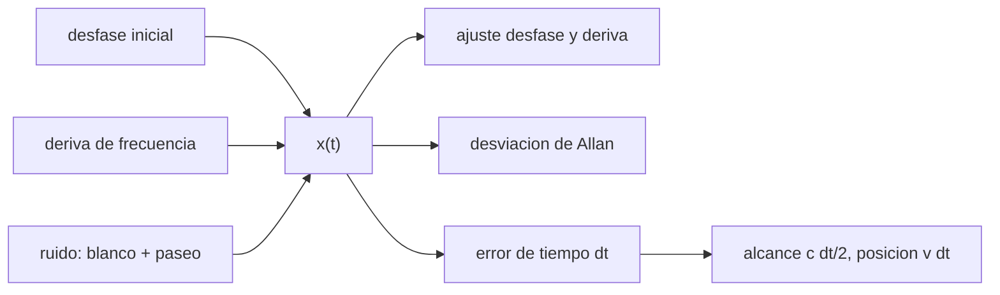

# B74-C16 — Sincronización temporal

<!-- nav:top -->
[🏠 Programa](../../../../README.md) · [📚 Bloque B74](../../../tronco-comun/B74-estimacion-de-orbitas-y-navegacion-espacial.md) · [← Anterior: B74-C15 — Geometría de la red de seguimiento](../B74-C15-geometria-de-la-red-de-seguimiento/CLASE.md) · [Siguiente: B74-C17 — Navegación en espacio profundo →](../B74-C17-navegacion-en-espacio-profundo/CLASE.md)
<!-- /nav -->

## 1. Ubicación, nivel y alcance

Clase 16 del bloque B74. Nivel N3. Toda medida de navegación es una medida de tiempo o está marcada con un tiempo. Un reloj con desfase, deriva y ruido convierte sus errores en errores de alcance, de posición y de velocidad. Aquí simulas un reloj sintético, ajustas su desfase y su deriva, calculas su estabilidad con la desviación de Allan y conviertes un error de tiempo en metros en cada observable.

## 2. Por qué esta clase existe

Un microsegundo son 150 m de alcance de ida y vuelta, y un reloj no estable sobre una hora ya acumula decenas de nanosegundos de error de predicción. La decisión central: **¿qué parte del error de tiempo se calibra, cuál se estima y cuál queda como ruido?**

## 3. Lo que podrás hacer al terminar

1. Escribir el modelo de reloj: desfase, deriva y ruido.
2. Ajustar desfase y deriva a una ventana de datos.
3. Calcular la desviación de Allan para varios tiempos de promediado.
4. Convertir un error de tiempo en error de alcance, posición y transferencia de tiempo.
5. Explicar el error de una transferencia de tiempo de dos sentidos por la asimetría del trayecto.
6. Rotular lo sintético y lo ilustrativo.

La evidencia es la **presupuesto de error por tiempo** del ejercicio 12 (sección 20).

## 4. Con qué llegas y cómo comprobarlo

1. ¿Qué es la estabilidad de un reloj?
2. ¿Qué es una deriva lineal?
3. ¿Qué es un ruido blanco de frecuencia?
4. ¿Qué es un paseo aleatorio?
5. ¿Qué es una verificación por segunda vía?

<details>
<summary>Ver respuestas</summary>

1. Cuánto varía su frecuencia en un tiempo dado. 2. Un cambio constante por unidad de tiempo. 3. Fluctuaciones aleatorias e independientes de la frecuencia. 4. Una suma acumulada de pasos aleatorios. 5. Calcular lo mismo con otro método y comparar.
</details>

Con cuatro o cinco aciertos, sigue; si no, repasa los prerrequisitos.

## 5. Un caso de contexto y casos de referencia

Un reloj sintético con desfase de 2 µs y frecuencia relativa de `1,0×10⁻⁹` se ajusta con un residuo de `0,19 ns` en 600 s; su desviación de Allan a 1 s es `9,99e-12`. Un error de 1 µs equivale a `149,9 m` de alcance de ida y vuelta. Es el **ejemplo conductor**; el reloj es sintético.

## 6. Vocabulario

El **desfase** `x(t)` es la diferencia de tiempo entre el reloj y la referencia. La **frecuencia fraccional** `y = dx/dt`. La **desviación de Allan** `σ_y(τ)` mide la estabilidad a un tiempo de promediado `τ`. El **ruido blanco de frecuencia** domina a corto plazo y el **paseo aleatorio de frecuencia** a largo plazo. La **transferencia de tiempo de dos sentidos** estima el desfase suponiendo trayectos simétricos.

## 7. Modelo mental: un reloj de pared que atrasa



*Descripción textual:* el desfase combina un valor inicial, una deriva y ruido; se ajusta un modelo, se caracteriza su estabilidad y se convierte el error de tiempo en error de alcance o de posición.

Analogía: un reloj de pared que atrasa un poco cada día: puedes corregir su atraso medio, pero no sus irregularidades. Límite: el reloj sintético tiene solo tres tipos de ruido; los relojes reales tienen otros procesos (parpadeo de frecuencia, efectos de temperatura).

## 8. La explicación, paso a paso

### 8.1 Modelo de reloj y ajuste

Con `x(t) = x₀ + y₀ t + ...` más ruido, un ajuste lineal sobre 600 s recupera el desfase (`2,0006 µs`) y la frecuencia (`1,0038e-09`, frente a `1,0035e-09` verdadera), con un residuo de `0,19 ns`.

### 8.2 Predicción

Extrapolar el ajuste una hora después deja un error de `0,057 µs`: el paseo aleatorio de frecuencia y la deriva impiden una predicción perfecta.

### 8.3 Desviación de Allan

`σ_y(1 s) = 9,99e-12` (cercana al ruido blanco inyectado de `1,0×10⁻¹¹`), `3,09e-12` a 10 s, `1,34e-12` a 100 s y `7,34e-12` a 1000 s: baja mientras domina el ruido blanco y sube cuando domina el paseo aleatorio.

### 8.4 De tiempo a metros

Un error de `1 µs` son `149,9 m` de alcance de ida y vuelta, `299,8 m` de alcance de una vía y `7,50 mm` de posición de una nave a 7,5 km/s. En una transferencia de tiempo de dos sentidos, una asimetría de 20 ns genera `10,0 ns` de error de desfase.

## 9. Magnitudes, símbolos y unidades

| Símbolo | Qué es | Unidad | Valor / nota |
|---|---|---|---|
| `x(t)` | desfase del reloj | s |  |
| `y` | frecuencia fraccional | — | 1,0 × 10⁻⁹ (sintética) |
| `σ_y(τ)` | desviación de Allan | — | 1,0 × 10⁻¹¹ a 1 s |
| `c δt` | error de alcance de una vía | m | 300 m por µs |
| `c δt/2` | error de alcance de ida y vuelta | m | 150 m por µs |
| `v δt` | error de posición de la nave | m | 7,5 mm por µs a 7,5 km/s |

## 10. Convenciones y referencias

Escala de tiempo local del reloj frente a una referencia ideal; muestras cada 1 s durante 20 000 s; ruido blanco de frecuencia 10⁻¹¹ y paseo aleatorio de 10⁻¹³ √s (ilustrativos); `c = 299 792 458 m/s` (NIST). Todo sintético.

## 11. De dónde sale lo que afirmamos

| ID | Fuente | Localizador | Respalda | Estado |
|---|---|---|---|---|
| S1 | NIST, CODATA — Speed of light in vacuum — https://physics.nist.gov/cgi-bin/cuu/Value?c (consultada 2026-11-10) | entrada «c» | c = 299 792 458 m/s (exacta) | Consultada |
| S2 | NASA/JPL NAIF, SPICE Tutorials (índice) — https://naif.jpl.nasa.gov/naif/tutorials.html (consultada 2026-11-10) | lista de tipos de kernel | SPK, CK, PCK, IK, FK, LSK, SCLK y DSK y su función | Consultada |
| — | Thornton y Border, *Radiometric Tracking Techniques for Deep-Space Navigation* (JPL/Wiley, 2003); Montenbruck y Gill, *Satellite Orbits* (Springer, 2000) | — | fundamento teórico general de la clase | No consultada |

Límites: NAIF se consultó solo por los tipos de kernel (LSK y SCLK para la conversión de tiempo, ver C21); no se consultó ninguna referencia sobre estabilidad de relojes ni sobre estándares de tiempo (UTC, TAI, TDB): los números de reloj son sintéticos.

## 12. Cómo ver el presupuesto de error por tiempo

| Magnitud | Valor |
|---|---|
| residuo del ajuste | 0,19 ns |
| error de predicción a 1 h | 0,057 µs |
| Allan a 1 s | 9,99e-12 |
| 1 µs en alcance de ida y vuelta | 149,9 m |
| 1 µs en posición a 7,5 km/s | 7,50 mm |

Descripción larga: el ajuste lineal absorbe el desfase y la deriva; el error de predicción lo marca el paseo aleatorio; un microsegundo pesa cientos de metros en alcance pero milímetros en posición.

## 13. Ejemplo trabajado: del reloj al alcance

**Paso 1 · Error de tiempo.** `δt = 1 µs`.

**Paso 2 · Ida y vuelta.** El alcance cambia `c δt/2 = 149,9 m`.

**Paso 3 · Posición.** Una nave a 7,5 km/s cambia `v δt = 7,50 mm` en 1 µs, despreciable.

**Paso 4 · Lectura.** El tiempo importa mucho para el alcance y poco para la posición de la nave; ambos efectos son sistemáticos.

## 14. Distintas formas de describir un reloj

**Por desfase:** `x(t)`. **Por frecuencia:** `y`. **Por estabilidad:** `σ_y(τ)`. **Por efecto:** `c δt/2`. **Por transferencia:** asimetría/2.

## 15. Práctica guiada

**Ejercicio 1 · guiado.** Calcula `c δt/2` para `δt = 10 ns`. *Pasos:* multiplica y divide.

<details><summary>Solución comentada</summary>

`1,5 m`.
</details>

**Ejercicio 2 · guiado.** ¿Qué desviación de Allan tendría un reloj con ruido blanco de frecuencia de 10⁻¹² a 1 s y a 100 s? *Pista:* decrece como `1/√τ`.

<details><summary>Solución comentada</summary>

`10⁻¹²` y `10⁻¹³`.
</details>

**Ejercicio 3 · guiado.** ¿Cuánto vale un desfase que crece a 1×10⁻⁹ s/s tras un día? *Pista:* 86 400 s.

<details><summary>Solución comentada</summary>

`86 µs`.
</details>

## 16. Práctica autónoma, transferencia e integrador

**Ejercicio 4 · autónomo.** ¿Qué desviación de Allan crece con `τ` en el ruido de paseo aleatorio?

<details><summary>Solución comentada</summary>

La que crece como `√τ`.
</details>

**Ejercicio 5 · autónomo.** ¿Qué pasa con el error de predicción si el paseo aleatorio de frecuencia se duplica?

<details><summary>Solución comentada</summary>

Se duplica.
</details>

**Ejercicio 6 · autónomo.** ¿Por qué el Doppler es menos sensible al desfase que el alcance?

<details><summary>Solución comentada</summary>

Mide frecuencia (derivada del tiempo), no un instante absoluto.
</details>

**Ejercicio 7 · autónomo.** Una asimetría de 100 ns en un trayecto de dos sentidos, ¿qué error causa?

<details><summary>Solución comentada</summary>

50 ns de desfase.
</details>

**Ejercicio 8 · autónomo.** ¿Qué ocurre si la ventana de ajuste se alarga a 3000 s?

<details><summary>Solución comentada</summary>

El residuo aumenta si hay paseo aleatorio, porque el modelo lineal no lo captura.
</details>

**Ejercicio 9 · transferencia.** **Transferencia.** Un grupo calibra el desfase una vez al día. ¿Qué verifica?

<details><summary>Solución comentada</summary>

Que la deriva y el paseo aleatorio no lleven el error por encima del presupuesto entre calibraciones.
</details>

**Ejercicio 10 · transferencia.** **Transferencia.** ¿Qué cambia si la estación usa un maser de hidrógeno?

<details><summary>Solución comentada</summary>

La estabilidad de corto plazo es mucho mejor; el término dominante pasa al medio de propagación.
</details>

**Ejercicio 11 · transferencia.** **Transferencia.** ¿Cómo detectas un error de tiempo en los residuos de un ajuste?

<details><summary>Solución comentada</summary>

Un patrón proporcional a la velocidad de cambio del observable.
</details>

**Ejercicio 12 · integrador.** **Integrador.** Elabora tu *presupuesto de error por tiempo*: ajuste de reloj, Allan para cuatro `τ`, conversión de 1 µs a alcance y posición y efecto de una asimetría de dos sentidos, rotulando lo sintético.

<details><summary>Solución comentada</summary>

Secciones 8.1–8.4 y la salida del laboratorio.
</details>

## 17. Laboratorio: reloj sintético y conversión de tiempo a metros

El script [laboratorio.py](laboratorio.py) simula un reloj con desfase, deriva y ruido, ajusta una recta, calcula la desviación de Allan y convierte errores de tiempo en alcance y posición (**comprueba** frecuencia ajustada dentro del 5 % y Allan(1 s) dentro del 25 % del ruido inyectado).

**Datos:** reloj **sintético/ilustrativo**; `c` de NIST (consultado). **Predice antes de ejecutar:** ¿cuántos metros de alcance de ida y vuelta son 1 µs? (150 m). **Ejecución del 2026-11-10 (Python 3.12.9, NumPy 2.4.4):**

```text
Python 3.12.9, NumPy 2.4.4 (reloj SINTETICO, semilla 59)
Ajuste lineal en 600 s: desfase = 2.0006 us ; frecuencia = 1.0038e-09 (verdadera media 1.0035e-09) ; residuo rms = 0.19 ns
Residuo extrapolado 1 h despues: error de prediccion = 0.057 us
tau [s]   Allan
      1   9.989e-12
     10   3.089e-12
    100   1.340e-12
   1000   7.343e-12
Ruido blanco de frecuencia inyectado = 1.0e-11 a 1 s (Allan(1 s) / inyectado = 0.999)
Un error de tiempo de 1 us equivale a: alcance de ida y vuelta c dt / 2 = 149.9 m ; a una via c dt = 299.8 m ; posicion de una nave a 7.5 km/s = 7.50 mm
Transferencia de tiempo de dos sentidos: asimetria de trayecto de 20 ns -> error de desfase = 10.0 ns
Pruebas superadas.
```

```bash
python programa/clases/B74/B74-C16-sincronizacion-temporal/laboratorio.py
```

**Límites:** solo ruido blanco y paseo aleatorio de frecuencia; Allan no solapado; sin relatividad ni retardo atmosférico.

## 18. Errores frecuentes y cómo corregirlos

**Confundir desfase con frecuencia.** Uno es tiempo, la otra su derivada; ver 8.1.

**Olvidar el factor 1/2 en ida y vuelta.** Ver 8.4.

**Esperar que el ajuste prediga indefinidamente.** Ver 8.2.

**Presentar el reloj sintético como real.** Rotula como sintético, como en la sección 10.

## 19. Cómo sabrás que vas bien

Tras la sección 8: ¿cuántos metros esperabas para 1 µs y cuántos fueron? Si dudas, repasa el ejemplo 13. Tras el laboratorio: ¿qué comprueba? (ver la sección 17).

## 20. Qué entregas y cómo se evalúa

El producto es tu **presupuesto de error por tiempo** (ejercicio 12).

| Criterio | Inicial | En desarrollo | Logrado | Destacado |
|---|---|---|---|---|
| Conceptos | Los confunde | Parciales | Distingue desfase, frecuencia y estabilidad | Explica los límites |
| Cálculo | Sin unidades | Con errores | Tablas completas con unidades | Calcula casos nuevos |
| Numérico | Sin comprobar | Un caso | Contraste con una segunda vía | Interpreta las diferencias |
| Fuentes | Sin fuente | Sin fecha | Fuentes con fecha y estado | Declara lo sintético y lo no consultado |
| Límites | No los nombra | Uno | Tres | Discute qué falta del modelo |

**Condiciones críticas (no se compensan con promedio):** aplicar el factor 1/2 de ida y vuelta y rotular el reloj como sintético; rotular los datos como sintéticos y no presentar nada simulado como observado; citar solo lo consultado.

## 21. Ética, seguridad y límites

Clase educativa en estado E0: los modelos son simplificados y sus datos son sintéticos o ilustrativos; ningún resultado describe la órbita real de una nave ni sustituye a un producto de navegación de misión. Accesibilidad: tablas equivalentes a las gráficas, fórmulas en texto, ejercicios sin conexión. Tolerancias del laboratorio: frecuencia ajustada dentro del 5 %; Allan(1 s) dentro del 25 % del ruido inyectado.

## 22. Para cerrar y seguir

Un error de 1 µs son `149,9 m` de alcance de ida y vuelta pero solo `7,50 mm` de posición de la nave; el reloj sintético se predice una hora con `0,057 µs` de error. Queda una pregunta: ¿cómo se combinan todos estos observables para navegar en espacio profundo?

**Glosario español–inglés.** desviación de Allan · *Allan deviation*; deriva · *drift*; desfase de reloj · *clock offset*; transferencia de tiempo de dos sentidos · *two-way time transfer*; estabilidad · *stability*.

**Continuidad.** [B74-C17](../B74-C17-navegacion-en-espacio-profundo/CLASE.md) estudia la navegación en espacio profundo.

**Referencias:** ver sección 11.

<!-- nav:bottom -->
---

[← Anterior: B74-C15 — Geometría de la red de seguimiento](../B74-C15-geometria-de-la-red-de-seguimiento/CLASE.md) · [📚 Bloque B74](../../../tronco-comun/B74-estimacion-de-orbitas-y-navegacion-espacial.md) · [Siguiente: B74-C17 — Navegación en espacio profundo →](../B74-C17-navegacion-en-espacio-profundo/CLASE.md)
<!-- /nav -->
