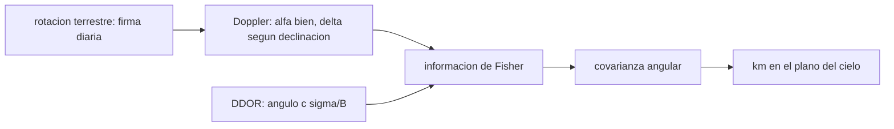

# B74-C17 — Navegación en espacio profundo

<!-- nav:top -->
[🏠 Programa](../../../../README.md) · [📚 Bloque B74](../../../tronco-comun/B74-estimacion-de-orbitas-y-navegacion-espacial.md) · [← Anterior: B74-C16 — Sincronización temporal](../B74-C16-sincronizacion-temporal/CLASE.md) · [Siguiente: B74-C18 — Estimación autónoma a bordo →](../B74-C18-estimacion-autonoma-a-bordo/CLASE.md)
<!-- /nav -->

## 1. Ubicación, nivel y alcance

Clase 17 del bloque B74. Nivel N3. A cientos de millones de kilómetros la nave se ve como un punto casi inmóvil, y la navegación combina observables de naturaleza distinta: el alcance fija la distancia, el Doppler fija la velocidad en la línea de visión y la rotación terrestre da una firma diaria que revela la dirección; el DDOR (*delta differential one-way ranging*) mide un ángulo muy preciso en el plano del cielo. Aquí calculas, con la información de Fisher, qué precisión angular da el Doppler de una sola estación según la declinación de la nave y qué aporta el DDOR.

## 2. Por qué esta clase existe

El Doppler apenas distingue la declinación cuando la nave está cerca del ecuador celeste: la firma de la rotación terrestre depende de `sin δ`. La decisión central: **¿qué observable cubre la dirección que los demás no ven?**

## 3. Lo que podrás hacer al terminar

1. Escribir la velocidad de alcance de una estación en rotación para una nave lejana.
2. Calcular la información de Fisher para ascensión recta y declinación.
3. Explicar la ambigüedad de declinación del Doppler a baja declinación.
4. Estimar el ángulo de un DDOR con `cσ_τ/B`.
5. Combinar información de dos observables por suma de matrices de información.
6. Rotular lo sintético, lo ilustrativo y lo no consultado.

La evidencia es la **ficha de observabilidad en espacio profundo** del ejercicio 12 (sección 20).

## 4. Con qué llegas y cómo comprobarlo

1. ¿Qué son ascensión recta y declinación?
2. ¿Qué es la información de Fisher?
3. ¿Qué es el plano del cielo?
4. ¿Qué es un nrad?
5. ¿Qué es una verificación por segunda vía?

<details>
<summary>Ver respuestas</summary>

1. Las coordenadas del cielo: longitud y latitud celestes. 2. La inversa de la covarianza mínima alcanzable para un estimador insesgado. 3. El plano perpendicular a la línea de visión. 4. Un nanorradián, 10⁻⁹ rad. 5. Calcular lo mismo con otro método y comparar.
</details>

Con cuatro o cinco aciertos, sigue; si no, repasa los prerrequisitos.

## 5. Un caso de contexto y casos de referencia

Con 8 h de Doppler (0,1 mm/s) de una estación a 35° de latitud, la incertidumbre en declinación es `19,5 nrad` a 60°, `33,8 nrad` a 30°, `97,3 nrad` a 10° y no hay información a 0°. Un DDOR de 0,1 ns sobre 8000 km da `3,75 nrad` (`0,37 km` a 100 millones de km). Es el **ejemplo conductor**; todo es sintético.

## 6. Vocabulario

La **velocidad de alcance por rotación terrestre** es `−ωR cosφ cosδ sin(ωt + λ − α)`. La **ambigüedad de declinación** es la pérdida de sensibilidad a `δ` cuando `δ → 0`. El **DDOR** resta los retardos de una señal de la nave y de un cuásar medidos en dos estaciones lejanas; da un ángulo con precisión `cσ_τ/B`. La **información de Fisher** suma las contribuciones de cada observable.

## 7. Modelo mental: oír pasar un tren desde un andén que gira



*Descripción textual:* el Doppler de una estación rotante da información sobre la ascensión recta y, según la declinación, sobre la declinación; el DDOR añade un ángulo; ambas informaciones se suman y dan la covarianza angular.

Analogía: oír un tren desde un andén que gira sobre sí mismo; el cambio de tono revela a qué lado está el tren, pero no a qué altura si el tren pasa justo a nuestra altura. Límite: el modelo supone nave de dirección fija, una sola estación y ruido blanco; el DDOR real requiere dos estaciones, un cuásar de calibración y correcciones de ionosfera y troposfera.

## 8. La explicación, paso a paso

### 8.1 La firma diurna

La estación a latitud `φ` tiene una velocidad proyectada en la línea de visión que oscila con período de un día y amplitud `ωR cosφ cosδ`. La fase da `α`.

### 8.2 Sensibilidad a la declinación

La derivada respecto de `δ` es proporcional a `sin δ`: se anula en el ecuador celeste. Con la información de Fisher y una previa débil de 1 rad, la incertidumbre en declinación es `19,5 nrad` a 60°, `33,8 nrad` a 30° y `97,3 nrad` a 10°; a 0° el Doppler no aporta información (queda la previa). La ascensión recta se determina con `18,6` a `40,3 nrad`.

### 8.3 El DDOR

Con `σ_τ = 0,1 ns` y `B = 8000 km`, el ángulo se mide con `3,75 nrad`, es decir `0,37 km` en el plano del cielo a 100 millones de km. Es independiente de la declinación.

### 8.4 Combinar

Al sumar la información del DDOR en la dirección de la declinación, la incertidumbre combinada es `3,75 nrad` a 0° (frente a la ausencia de información del Doppler), y `3,68 nrad` a 60°. Cada observable cubre lo que el otro no ve.

## 9. Magnitudes, símbolos y unidades

| Símbolo | Qué es | Unidad | Valor / nota |
|---|---|---|---|
| `ω` | velocidad angular de rotación terrestre | rad/s | 7,2921159 × 10⁻⁵ (ilustrativo, no consultado) |
| `R, φ` | radio y latitud de la estación | m, rad | 6 378 137; 35° |
| `α, δ` | ascensión recta y declinación | rad |  |
| `σ_v` | ruido de velocidad de alcance | m/s | 10⁻⁴ |
| `σ_τ, B` | precisión de retardo y línea de base del DDOR | s, m | 0,1 ns; 8 × 10⁶ |
| `σ_DDOR` | ángulo del DDOR | rad | cσ_τ/B = 3,75 nrad |

## 10. Convenciones y referencias

Nave lejana de dirección fija; una estación con rotación terrestre uniforme; muestras de velocidad de alcance cada 60 s durante 8 h; previa débil de 1 rad para evitar una matriz singular; `c = 299 792 458 m/s` (NIST). Todo sintético; la velocidad angular de la Tierra no se consultó.

## 11. De dónde sale lo que afirmamos

| ID | Fuente | Localizador | Respalda | Estado |
|---|---|---|---|---|
| S1 | NIST, CODATA — Speed of light in vacuum — https://physics.nist.gov/cgi-bin/cuu/Value?c (consultada 2026-11-10) | entrada «c» | c = 299 792 458 m/s (exacta) | Consultada |
| S2 | NASA/JPL, DSN Telecommunications Link Design Handbook 810-005 (índice) — https://deepspace.jpl.nasa.gov/dsndocs/810-005/ (consultada 2026-11-10) | página de presentación | el manual trata de los parámetros de desempeño de los enlaces de telecomunicaciones entre nave y DSN; los módulos de radiometría no se leyeron | Consultada (solo índice) |
| — | Thornton y Border, *Radiometric Tracking Techniques for Deep-Space Navigation* (JPL/Wiley, 2003); Montenbruck y Gill, *Satellite Orbits* (Springer, 2000) | — | fundamento teórico general de la clase | No consultada |

Límites: del manual del DSN solo se leyó la página de presentación: no se consultó ningún parámetro real de DDOR (precisión, líneas de base, cuásares); la página sobre DDOR de la NASA no estuvo disponible. La velocidad angular de la Tierra y su radio no se consultaron en esta sesión.

## 12. Cómo ver la observabilidad angular

| Magnitud | Valor |
|---|---|
| σ_δ a 60° (Doppler) | 19,5 nrad |
| σ_δ a 10° (Doppler) | 97,3 nrad |
| σ_δ a 0° (Doppler) | sin información |
| DDOR | 3,75 nrad |
| σ_δ combinada a 0° | 3,75 nrad |

Descripción larga: el Doppler pierde la declinación cerca del ecuador celeste; el DDOR la recupera; un nanorradián a 100 millones de km son 0,1 km.

## 13. Ejemplo trabajado: un nanorradián en kilómetros

**Paso 1 · Ángulo.** `σ_DDOR = 3,75 nrad`.

**Paso 2 · Distancia.** `10⁸ km`.

**Paso 3 · Longitud.** `3,75 × 10⁻⁹ × 10⁸ km = 0,37 km`.

**Paso 4 · Lectura.** Cuatro nanorradianes son cientos de metros a la distancia de Marte.

## 14. Distintas formas de describir la dirección de una nave lejana

**Por Doppler:** firma diaria. **Por DDOR:** ángulo diferencial. **Por información:** suma de matrices. **Por covarianza:** `(F)⁻¹`. **Por km:** `σρ`.

## 15. Práctica guiada

**Ejercicio 1 · guiado.** Convierte 20 nrad a 150 millones de km. *Pasos:* multiplica.

<details><summary>Solución comentada</summary>

`20 × 10⁻⁹ × 1,5 × 10⁸ km = 3 km`.
</details>

**Ejercicio 2 · guiado.** ¿Qué `σ_τ` hace falta para 1 nrad con B = 8000 km? *Pista:* `σ = Bθ/c`.

<details><summary>Solución comentada</summary>

`8 × 10⁶ × 10⁻⁹/3 × 10⁸ ≈ 27 ps`.
</details>

**Ejercicio 3 · guiado.** ¿Qué pasa con la sensibilidad del Doppler a δ cuando δ = 0? *Pista:* `sin 0`.

<details><summary>Solución comentada</summary>

Se anula.
</details>

## 16. Práctica autónoma, transferencia e integrador

**Ejercicio 4 · autónomo.** ¿Por qué la ascensión recta se determina bien con una estación?

<details><summary>Solución comentada</summary>

Porque la fase de la firma diaria depende de `α` directamente.
</details>

**Ejercicio 5 · autónomo.** ¿Qué ocurre con la información si la sesión dura 12 h en lugar de 8?

<details><summary>Solución comentada</summary>

Aumenta (más ciclos) y la incertidumbre disminuye.
</details>

**Ejercicio 6 · autónomo.** ¿Qué aporta una segunda estación a otra longitud?

<details><summary>Solución comentada</summary>

Otra firma desfasada; mejora `α` y, a baja declinación, ayuda mediante la línea de base.
</details>

**Ejercicio 7 · autónomo.** ¿Cómo afecta un error de la latitud de la estación?

<details><summary>Solución comentada</summary>

Cambia la amplitud de la firma y sesga δ.
</details>

**Ejercicio 8 · autónomo.** ¿Qué mide el cuásar de referencia del DDOR?

<details><summary>Solución comentada</summary>

Un punto de ángulo conocido que calibra los retardos instrumentales y del medio.
</details>

**Ejercicio 9 · transferencia.** **Transferencia.** Un equipo reporta 1 nrad de precisión sin decir el observable. ¿Qué preguntas haces?

<details><summary>Solución comentada</summary>

Qué observable, qué línea de base, qué calibraciones y si es un ángulo o una posición.
</details>

**Ejercicio 10 · transferencia.** **Transferencia.** ¿Qué falta en este modelo para ser real?

<details><summary>Solución comentada</summary>

Troposfera, ionosfera, plasma solar, maniobras, perturbaciones y errores de efemérides del cuásar.
</details>

**Ejercicio 11 · transferencia.** **Transferencia.** ¿Qué otros observables cubren la declinación?

<details><summary>Solución comentada</summary>

DDOR, alcance con rotación y, en una aproximación planetaria, la navegación óptica (C13).
</details>

**Ejercicio 12 · integrador.** **Integrador.** Elabora tu *ficha de observabilidad en espacio profundo*: σ_α y σ_δ del Doppler para cuatro declinaciones, ángulo del DDOR en nrad y km, y la combinación, rotulando lo sintético y lo no consultado.

<details><summary>Solución comentada</summary>

Secciones 8.1–8.4 y la salida del laboratorio.
</details>

## 17. Laboratorio: Doppler y DDOR en la dirección de una nave

El script [laboratorio.py](laboratorio.py) calcula la información de Fisher de la dirección de una nave lejana con Doppler de una estación para cuatro declinaciones y añade un DDOR (**comprueba** la incertidumbre en declinación disminuye al aumentar la declinación y el DDOR la reduce más de 10 veces a 0°).

**Datos:** geometría, ruido y DDOR **sintéticos/ilustrativos**; `c` de NIST (consultado); ω y R no consultados. **Predice antes de ejecutar:** ¿qué ocurre con δ a 0° con solo Doppler? (no hay información). **Ejecución del 2026-11-10 (Python 3.12.9, NumPy 2.4.4):**

```text
Python 3.12.9, NumPy 2.4.4 (geometria y ruido SINTETICOS)
Doppler de una estacion (latitud 35 grados, 8 h, sigma_v = 0.1 mm/s) ; DDOR: sigma_retardo = 0.1 ns, B = 8000 km
delta [deg]   sigma_alfa [nrad]   sigma_delta [nrad]   cociente delta/alfa   sigma_delta con DDOR [nrad]
        0             18.63    sin informacion                  --                    3.75
       10             20.44              97.35                 4.8                    3.74
       30             23.24              33.81                 1.5                    3.72
       60             40.25              19.52                 0.5                    3.68
Angulo DDOR = c sigma_tau / B = 3.75 nrad ; a 1.0e8 km equivale a 0.37 km
Pruebas superadas.
```

```bash
python programa/clases/B74/B74-C17-navegacion-en-espacio-profundo/laboratorio.py
```

**Límites:** nave de dirección fija, una estación y ruido blanco; la previa de 1 rad regulariza el caso singular; sin medio de propagación.

## 18. Errores frecuentes y cómo corregirlos

**Creer que el Doppler fija toda la dirección.** Falla a baja declinación; ver 8.2.

**Confundir un ángulo con una posición.** Convierte con la distancia; ejemplo 13.

**Ignorar la previa.** Documenta qué previa se usó.

**Presentar los números sintéticos como reales.** Rotula como sintético, como en la sección 10.

## 19. Cómo sabrás que vas bien

Tras la sección 8: ¿qué esperabas del Doppler a 0° y qué obtuviste? Si dudas, repasa el ejemplo 13. Tras el laboratorio: ¿qué comprueba? (ver la sección 17).

## 20. Qué entregas y cómo se evalúa

El producto es tu **ficha de observabilidad en espacio profundo** (ejercicio 12).

| Criterio | Inicial | En desarrollo | Logrado | Destacado |
|---|---|---|---|---|
| Conceptos | Los confunde | Parciales | Explica la ambigüedad de declinación y el aporte del DDOR | Explica los límites |
| Cálculo | Sin unidades | Con errores | Tablas completas con unidades | Calcula casos nuevos |
| Numérico | Sin comprobar | Un caso | Contraste con una segunda vía | Interpreta las diferencias |
| Fuentes | Sin fuente | Sin fecha | Fuentes con fecha y estado | Declara lo sintético y lo no consultado |
| Límites | No los nombra | Uno | Tres | Discute qué falta del modelo |

**Condiciones críticas (no se compensan con promedio):** declarar la previa utilizada y rotular los datos como sintéticos; rotular los datos como sintéticos y no presentar nada simulado como observado; citar solo lo consultado.

## 21. Ética, seguridad y límites

Clase educativa en estado E0: los modelos son simplificados y sus datos son sintéticos o ilustrativos; ningún resultado describe la órbita real de una nave ni sustituye a un producto de navegación de misión. Accesibilidad: tablas equivalentes a las gráficas, fórmulas en texto, ejercicios sin conexión. Tolerancias del laboratorio: σ_δ decreciente con la declinación; combinación DDOR más de 10 veces mejor a 0°.

## 22. Para cerrar y seguir

Con Doppler de una estación la declinación se pierde a 0° pero a 60° llega a `19,5 nrad`; el DDOR la fija con `3,75 nrad` en cualquier caso. Queda una pregunta: ¿cómo se hace esta estimación a bordo, sin red de estaciones?

**Glosario español–inglés.** navegación en espacio profundo · *deep-space navigation*; DDOR · *delta-DOR*; declinación · *declination*; información de Fisher · *Fisher information*; plano del cielo · *plane of the sky*.

**Continuidad.** [B74-C18](../B74-C18-estimacion-autonoma-a-bordo/CLASE.md) estudia la estimación autónoma a bordo.

**Referencias:** ver sección 11.

<!-- nav:bottom -->
---

[← Anterior: B74-C16 — Sincronización temporal](../B74-C16-sincronizacion-temporal/CLASE.md) · [📚 Bloque B74](../../../tronco-comun/B74-estimacion-de-orbitas-y-navegacion-espacial.md) · [Siguiente: B74-C18 — Estimación autónoma a bordo →](../B74-C18-estimacion-autonoma-a-bordo/CLASE.md)
<!-- /nav -->
