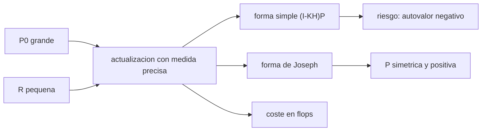

# B74-C18 — Estimación autónoma a bordo

<!-- nav:top -->
[🏠 Programa](../../../../README.md) · [📚 Bloque B74](../../../tronco-comun/B74-estimacion-de-orbitas-y-navegacion-espacial.md) · [← Anterior: B74-C17 — Navegación en espacio profundo](../B74-C17-navegacion-en-espacio-profundo/CLASE.md) · [Siguiente: B74-C19 — Métricas de precisión de navegación →](../B74-C19-metricas-de-precision-de-navegacion/CLASE.md)
<!-- /nav -->

## 1. Ubicación, nivel y alcance

Clase 18 del bloque B74. Nivel N3. Un filtro a bordo corre en un procesador con precisión y tiempo limitados y sin ayuda de tierra. Aquí ejecutas el mismo filtro de Kalman sobre una órbita sintética en doble y en simple precisión, con la forma simple y con la forma de Joseph de actualizar la covarianza, en un caso moderado y en un caso de estrés (medidas muy precisas y covarianza inicial enorme), y estimas el coste de cálculo por paso. Verás cuándo la forma simple pierde la positividad de la covarianza y por qué la forma de Joseph se usa a bordo.

## 2. Por qué esta clase existe

Una covarianza con un autovalor negativo no es una covarianza: el filtro deja de ser fiable sin avisar. La decisión central: **¿qué formulación numérica y qué coste permite el procesador de a bordo sin perder consistencia?**

## 3. Lo que podrás hacer al terminar

1. Contar las operaciones de punto flotante de un paso de filtro con `n` estados y `m` medidas.
2. Comparar la forma simple y la de Joseph de la actualización de covarianza.
3. Medir la asimetría y el menor autovalor de `P` en simple y doble precisión.
4. Reconocer un caso de estrés numérico (gran rango dinámico).
5. Relacionar la precisión del filtro con la calidad de la medida y de la previa.
6. Rotular lo sintético y lo ilustrativo.

La evidencia es la **presupuesto de cómputo y de error a bordo** del ejercicio 12 (sección 20).

## 4. Con qué llegas y cómo comprobarlo

1. ¿Qué es la precisión simple (float32)?
2. ¿Qué es un autovalor negativo en una covarianza?
3. ¿Qué es la forma de Joseph?
4. ¿Qué es un flop?
5. ¿Qué es una verificación por segunda vía?

<details>
<summary>Ver respuestas</summary>

1. Unos 7 dígitos decimales significativos. 2. Una señal de que la matriz no es una covarianza válida. 3. `P = (I−KH)P(I−KH)ᵀ + KRKᵀ`. 4. Una operación de punto flotante. 5. Calcular lo mismo con otro método y comparar.
</details>

Con cuatro o cinco aciertos, sigue; si no, repasa los prerrequisitos.

## 5. Un caso de contexto y casos de referencia

El mismo filtro de 6 estados con medidas de posición de 5 cm termina con `P` de menor autovalor `1,55e-09` con la forma simple en simple precisión, igual que con Joseph. En un caso de estrés (0,1 mm y covarianza inicial de 100 km) la forma simple en float32 da `-3,15e-10` (negativo) y una asimetría de `0,44`, mientras Joseph en float32 conserva `1,11e-17`. Es el **ejemplo conductor**; la órbita y las medidas son sintéticas.

## 6. Vocabulario

La **forma de Joseph** conserva la simetría y la semidefinición positiva de `P` en cada actualización. El **rango dinámico** es el cociente entre la mayor y la menor incertidumbre. La **asimetría relativa** es `‖P − Pᵀ‖/‖P‖`. El **coste** se cuenta en operaciones de punto flotante por paso. La **precisión simple** (`float32`) es habitual en procesadores de vuelo.

## 7. Modelo mental: una balanza muy sensible



*Descripción textual:* una medida muy precisa con una covarianza inicial enorme tensiona la actualización; la forma simple puede perder la positividad, la de Joseph la conserva y ambas tienen un coste calculable.

Analogía: pesar una pluma en una balanza de camión y restarla: el redondeo de la balanza pesa más que la pluma. Límite: el filtro del laboratorio no linealiza con el estado estimado (usa la verdad para la matriz de transición); aísla solo el efecto numérico de la covarianza.

## 8. La explicación, paso a paso

### 8.1 El filtro y su coste

Un paso con `n = 6` estados y `m = 3` medidas cuesta unas `1431` operaciones de punto flotante (propagación de `P`, ganancia y actualización): a 10 Hz son unos 14 kflop/s, trivial para un procesador moderno; el coste real a bordo lo dominan el propagador y el procesamiento de imágenes.

### 8.2 Caso base

Con medidas de 5 cm y `P₀` de 10 km, las tres variantes (doble precisión con Joseph, simple con Joseph y simple con la forma simple) terminan con el mismo error rms de `0,0235 m` y un menor autovalor de `P` de `1,55e-09 m²`: no hay diferencia práctica.

### 8.3 Caso de estrés

Con medidas de 0,1 mm, `P₀` de 100 km y sin ruido de proceso, el menor autovalor es `1,09e-17` (doble, Joseph), `1,11e-17` (simple, Joseph) y `-3,15e-10` (simple, forma simple): este último es **negativo** y la asimetría llega a `0,44`. El error rms de posición es `0,0004 m` frente a `0,000015 m` con Joseph.

### 8.4 Lo que se aprende

La forma de Joseph cuesta unas pocas operaciones más y protege contra la pérdida de positividad. Otras defensas: factorizaciones de raíz cuadrada, doble precisión para `P`, escalar el estado, y monitorizar el menor autovalor y la asimetría como alarma de a bordo.

## 9. Magnitudes, símbolos y unidades

| Símbolo | Qué es | Unidad | Valor / nota |
|---|---|---|---|
| `n, m` | estados y medidas | — | 6 y 3 |
| `P` | covarianza | m², (m/s)² |  |
| `K` | ganancia | — | 6 × 3 |
| `flops` | operaciones de punto flotante por paso | — | 1431 |
| `λ_min` | menor autovalor de P | m² | > 0 si es válida |
| `asimetría` | ‖P − Pᵀ‖/‖P‖ | — | < 1e-6 deseable |

## 10. Convenciones y referencias

Órbita sintética con μ = 3,986004 × 10¹⁴ m³/s² (ilustrativo, no consultado); 200 pasos de 10 s; medidas de posición gaussianas; la verdad se propaga en doble precisión; la covarianza en float32 o float64; semilla 61. Todo sintético.

## 11. De dónde sale lo que afirmamos

| ID | Fuente | Localizador | Respalda | Estado |
|---|---|---|---|---|
| S1 | NIST, CODATA — Speed of light in vacuum — https://physics.nist.gov/cgi-bin/cuu/Value?c (consultada 2026-11-10) | entrada «c» | c = 299 792 458 m/s (exacta) | Consultada |
| S2 | NASA/JPL NAIF, SPICE Tutorials (índice) — https://naif.jpl.nasa.gov/naif/tutorials.html (consultada 2026-11-10) | lista de tipos de kernel | SPK, CK, PCK, IK, FK, LSK, SCLK y DSK y su función | Consultada |
| — | Bar-Shalom, Li y Kirubarajan, *Estimation with Applications to Tracking and Navigation* (Wiley, 2001); Tapley, Schutz y Born, *Statistical Orbit Determination* (Elsevier, 2004) | — | fundamento teórico general de la clase | No consultada |

Límites: no se consultó ninguna referencia sobre filtros de vuelo ni estándares de software a bordo; NAIF solo respalda la lista de tipos de kernel. La forma de Joseph es una relación estándar no consultada en una fuente concreta; el laboratorio la contrasta con la forma simple y con doble precisión.

## 12. Cómo ver el filtro a bordo

| Magnitud | Valor |
|---|---|
| flops por paso | 1431 |
| λ_min (estrés, float32 simple) | -3,15e-10 |
| λ_min (estrés, float32 Joseph) | 1,11e-17 |
| asimetría (estrés, simple) | 0,44 |
| rms error (estrés, simple) | 0,0004 m |

Descripción larga: en casos moderados no hay diferencia; en un caso de estrés la forma simple pierde la positividad mientras que Joseph la conserva incluso en simple precisión.

## 13. Ejemplo trabajado: un autovalor negativo

**Paso 1 · Actualización simple.** `P⁺ = (I − KH) P`.

**Paso 2 · Redondeo.** En float32, `I − KH` pierde dígitos cuando `K ≈ 1`.

**Paso 3 · Resultado.** El menor autovalor pasa a `-3,15e-10`.

**Paso 4 · Lectura.** `P` ya no es una covarianza y el filtro puede dar un error muy superior al que declara.

## 14. Distintas formas de describir un filtro de a bordo

**Por formulación:** simple o Joseph. **Por precisión:** float32 o float64. **Por coste:** flops por paso. **Por salud:** λ_min y asimetría. **Por error:** rms de posición.

## 15. Práctica guiada

**Ejercicio 1 · guiado.** Cuenta las operaciones de multiplicar dos matrices de 6 × 6. *Pasos:* `2n³`.

<details><summary>Solución comentada</summary>

`432`.
</details>

**Ejercicio 2 · guiado.** ¿Qué mide la asimetría relativa de `P`? *Pista:* `P = Pᵀ`.

<details><summary>Solución comentada</summary>

Cuánto se aparta `P` de una matriz simétrica.
</details>

**Ejercicio 3 · guiado.** ¿Cuál es el valor esperado de la asimetría en doble precisión? *Pista:* épsilon.

<details><summary>Solución comentada</summary>

Del orden de `10⁻¹⁶` a `10⁻¹²`.
</details>

## 16. Práctica autónoma, transferencia e integrador

**Ejercicio 4 · autónomo.** ¿Por qué la forma de Joseph es más robusta?

<details><summary>Solución comentada</summary>

La suma de dos términos cuadráticos es siempre semidefinida positiva.
</details>

**Ejercicio 5 · autónomo.** ¿Qué ocurre si se simetriza `P` tras cada paso con `(P + Pᵀ)/2`?

<details><summary>Solución comentada</summary>

Se evita la asimetría pero no se garantiza la positividad.
</details>

**Ejercicio 6 · autónomo.** ¿Qué coste tiene un filtro de 12 estados y 6 medidas?

<details><summary>Solución comentada</summary>

Aproximadamente 8 veces el de 6 estados por el factor `n³`.
</details>

**Ejercicio 7 · autónomo.** ¿Qué alarma de a bordo propondrías?

<details><summary>Solución comentada</summary>

Comprobar autovalores de `P` y la desviación de `χ²` de las innovaciones.
</details>

**Ejercicio 8 · autónomo.** ¿Cómo afectaría un proceso Q > 0?

<details><summary>Solución comentada</summary>

Añade varianza a cada paso y reduce el rango dinámico del caso.
</details>

**Ejercicio 9 · transferencia.** **Transferencia.** Un proveedor propone float16 para ahorrar cómputo. ¿Qué analizas?

<details><summary>Solución comentada</summary>

Rango dinámico de `P`, pérdida de positividad y precisión de las medidas.
</details>

**Ejercicio 10 · transferencia.** **Transferencia.** Un filtro a bordo diverge tras 2 horas de buenas medidas. ¿Qué compruebas primero?

<details><summary>Solución comentada</summary>

Si `P` conserva simetría y positividad, y si `Q` es demasiado pequeño.
</details>

**Ejercicio 11 · transferencia.** **Transferencia.** ¿Qué ventaja da una factorización de raíz cuadrada?

<details><summary>Solución comentada</summary>

Propaga `√P` en lugar de `P`, que duplica la precisión efectiva.
</details>

**Ejercicio 12 · integrador.** **Integrador.** Elabora tu *presupuesto de cómputo y de error a bordo*: coste en flops, tabla de variantes en dos casos, interpretación de la pérdida de positividad y alarmas propuestas, rotulando lo sintético.

<details><summary>Solución comentada</summary>

Secciones 8.1–8.4 y la salida del laboratorio.
</details>

## 17. Laboratorio: filtro a bordo: precisión y coste

El script [laboratorio.py](laboratorio.py) ejecuta el mismo filtro en doble y simple precisión con forma simple y de Joseph, en un caso base y en uno de estrés, y estima el coste por paso (**comprueba** la forma de Joseph en simple precisión mantiene autovalores positivos en los dos casos).

**Datos:** órbita y medidas **sintéticas/ilustrativas**; μ ilustrativo. **Predice antes de ejecutar:** ¿qué variante pierde la positividad en el caso de estrés? (float32 con la forma simple). **Ejecución del 2026-11-10 (Python 3.12.9, NumPy 2.4.4):**

```text
Python 3.12.9, NumPy 2.4.4 (orbita y medidas SINTETICAS, semilla 61)
200 pasos de 10 s
Caso base: sigma de medida = 0.05 m ; P0 = 1e+04 m y 10 m/s ; Q = 1e-10
variante                   menor autovalor de P [m^2]   asimetria relativa   rms error pos. ultimos 50 pasos [m]
float64 Joseph                            1.550e-09           3.90e-17                           0.0235
float32 Joseph                            1.551e-09           1.29e-08                           0.0235
float32 simple                            1.551e-09           1.15e-08                           0.0238
Caso estres: sigma de medida = 0.0001 m ; P0 = 1e+05 m y 10 m/s ; Q = 0e+00
variante                   menor autovalor de P [m^2]   asimetria relativa   rms error pos. ultimos 50 pasos [m]
float64 Joseph                            1.086e-17           2.29e-12                           0.0000
float32 Joseph                            1.112e-17           1.47e-07                           0.0000
float32 simple                           -3.146e-10           4.44e-01                           0.0004
Coste aproximado por paso (n = 6, m = 3): 1431 operaciones de punto flotante ; a 10 Hz: 14.3 kflop/s
Pruebas superadas.
```

```bash
python programa/clases/B74/B74-C18-estimacion-autonoma-a-bordo/laboratorio.py
```

**Límites:** la matriz de transición usa la trayectoria verdadera; no hay medidas no lineales ni pruebas de consistencia; los recuentos de flops son analíticos y aproximados.

## 18. Errores frecuentes y cómo corregirlos

**Creer que float32 siempre basta.** En un caso de estrés pierde la positividad; ver 8.3.

**Olvidar simetrizar o usar Joseph.** Ver 8.4.

**Estimar el coste solo con `n`.** También cuentan `m` y el propagador.

**Presentar el caso sintético como un vuelo real.** Rotula como sintético, como en la sección 10.

## 19. Cómo sabrás que vas bien

Tras la sección 8: ¿qué variante esperabas que fallara y cuál fue? Si dudas, repasa el ejemplo 13. Tras el laboratorio: ¿qué comprueba? (ver la sección 17).

## 20. Qué entregas y cómo se evalúa

El producto es tu **presupuesto de cómputo y de error a bordo** (ejercicio 12).

| Criterio | Inicial | En desarrollo | Logrado | Destacado |
|---|---|---|---|---|
| Conceptos | Los confunde | Parciales | Distingue la forma simple de la de Joseph y su efecto numérico | Explica los límites |
| Cálculo | Sin unidades | Con errores | Tablas completas con unidades | Calcula casos nuevos |
| Numérico | Sin comprobar | Un caso | Contraste con una segunda vía | Interpreta las diferencias |
| Fuentes | Sin fuente | Sin fecha | Fuentes con fecha y estado | Declara lo sintético y lo no consultado |
| Límites | No los nombra | Uno | Tres | Discute qué falta del modelo |

**Condiciones críticas (no se compensan con promedio):** monitorizar autovalores y asimetría de la covarianza y rotular los datos como sintéticos; rotular los datos como sintéticos y no presentar nada simulado como observado; citar solo lo consultado.

## 21. Ética, seguridad y límites

Clase educativa en estado E0: los modelos son simplificados y sus datos son sintéticos o ilustrativos; ningún resultado describe la órbita real de una nave ni sustituye a un producto de navegación de misión. Accesibilidad: tablas equivalentes a las gráficas, fórmulas en texto, ejercicios sin conexión. Tolerancias del laboratorio: Joseph en float32 con autovalores > 0 en los dos casos; sin otras exigencias.

## 22. Para cerrar y seguir

La forma simple en simple precisión deja un autovalor de `-3,15e-10` en el caso de estrés; Joseph lo conserva positivo (`1,11e-17`). Queda una pregunta: ¿cómo se cuantifica la precisión de una solución de navegación?

**Glosario español–inglés.** filtro a bordo · *onboard filter*; forma de Joseph · *Joseph form*; precisión simple · *single precision*; rango dinámico · *dynamic range*; semidefinida positiva · *positive semidefinite*.

**Continuidad.** [B74-C19](../B74-C19-metricas-de-precision-de-navegacion/CLASE.md) estudia las métricas de precisión de navegación.

**Referencias:** ver sección 11.

<!-- nav:bottom -->
---

[← Anterior: B74-C17 — Navegación en espacio profundo](../B74-C17-navegacion-en-espacio-profundo/CLASE.md) · [📚 Bloque B74](../../../tronco-comun/B74-estimacion-de-orbitas-y-navegacion-espacial.md) · [Siguiente: B74-C19 — Métricas de precisión de navegación →](../B74-C19-metricas-de-precision-de-navegacion/CLASE.md)
<!-- /nav -->
