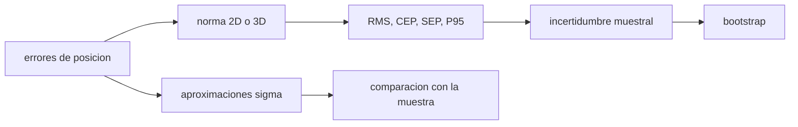

# B74-C19 — Métricas de precisión de navegación

<!-- nav:top -->
[🏠 Programa](../../../../README.md) · [📚 Bloque B74](../../../tronco-comun/B74-estimacion-de-orbitas-y-navegacion-espacial.md) · [← Anterior: B74-C18 — Estimación autónoma a bordo](../B74-C18-estimacion-autonoma-a-bordo/CLASE.md) · [Siguiente: B74-C20 — Validación frente a efemérides de referencia →](../B74-C20-validacion-frente-a-efemerides-de-referencia/CLASE.md)
<!-- /nav -->

## 1. Ubicación, nivel y alcance

Clase 19 del bloque B74. Nivel N3. «Precisión de 3 metros» no significa nada sin decir qué métrica, qué probabilidad y con cuántas muestras. Aquí calculas el RMS 3D, el percentil 95, el CEP, el SEP y el 2DRMS de un error de posición gaussiano anisótropo, comparas la aproximación clásica del CEP con el valor de una muestra grande y mides cuánto varían esas métricas con solo 50 muestras, con un intervalo de confianza por bootstrap.

## 2. Por qué esta clase existe

Dos informes pueden decir «3 m» y referirse a cosas distintas (RMS, 50 %, 95 %). La decisión central: **¿qué métrica comunica el riesgo que importa, con qué probabilidad y con qué incertidumbre muestral?**

## 3. Lo que podrás hacer al terminar

1. Calcular RMS 3D, CEP, SEP y percentil 95 de una distribución gaussiana de errores.
2. Distinguir métricas horizontales (2D) de esféricas (3D).
3. Usar la aproximación `0,589(σ_x + σ_y)` y conocer su límite.
4. Estimar la variabilidad de una métrica con pocas muestras.
5. Construir un intervalo bootstrap del percentil 95.
6. Rotular lo sintético y lo ilustrativo.

La evidencia es la **tabla de métricas con su incertidumbre** del ejercicio 12 (sección 20).

## 4. Con qué llegas y cómo comprobarlo

1. ¿Qué es el RMS?
2. ¿Qué es un percentil?
3. ¿Qué es el bootstrap?
4. ¿Qué es una distribución anisótropa?
5. ¿Qué es una verificación por segunda vía?

<details>
<summary>Ver respuestas</summary>

1. La raíz de la media de los cuadrados. 2. El valor bajo el que queda una fracción dada de los datos. 3. Remuestrear con reemplazo para estimar la variabilidad de un estadístico. 4. Con distinta dispersión en cada eje. 5. Calcular lo mismo con otro método y comparar.
</details>

Con cuatro o cinco aciertos, sigue; si no, repasa los prerrequisitos.

## 5. Un caso de contexto y casos de referencia

Un error de posición sintético con `σ = (3,0; 1,2; 2,0) m` tiene RMS 3D `3,8000 m`, CEP `2,425 m`, SEP `3,190 m` y percentil 95 3D de `6,493 m`. Con solo 50 muestras el percentil 95 varía `±0,63 m`. Es el **ejemplo conductor**; los errores son sintéticos.

## 6. Vocabulario

El **RMS 3D** es `√(Σσ²)`. El **CEP** es el radio del círculo horizontal con 50 % de probabilidad; el **SEP**, de la esfera con 50 %. El **2DRMS** es `2√(σ_x²+σ_y²)` y contiene entre 95 y 98 %. Un **percentil** de la norma del error da un radio con una probabilidad exacta. El **bootstrap** estima la incertidumbre de una métrica por remuestreo.

## 7. Modelo mental: un dardo y su diana



*Descripción textual:* los errores de posición se convierten en una norma; de ella salen las métricas; la incertidumbre muestral se estima por bootstrap y las aproximaciones por sigmas se comparan con la muestra.

Analogía: la dispersión de dardos en una diana: el CEP es el círculo que contiene la mitad, el percentil 95 el que contiene casi todos; con pocos dardos el círculo cambia de una tanda a otra. Límite: errores gaussianos y de media cero; con sesgos o colas pesadas las aproximaciones por sigma fallan.

## 8. La explicación, paso a paso

### 8.1 Métricas con probabilidad

Con `σ = (3; 1,2; 2) m`: RMS 3D `3,8000 m` (muestral `3,8012 m`), percentil 95 de la norma 3D `6,493 m`, SEP (50 %) `3,190 m`, CEP (50 %, horizontal) `2,425 m`.

### 8.2 Aproximaciones

`0,589(σ_x + σ_y) = 2,474 m` se aparta `2,01 %` del CEP de la muestra grande (la aproximación vale cuando `σ_min/σ_max > 0,3`: aquí 0,4). El `2DRMS = 6,462 m` contiene el `0,9653` de los puntos horizontales: es una métrica del 95–98 %, no exactamente del 95 %.

### 8.3 Pocas muestras

Con `N = 50`, el RMS 3D es `3,816 ± 0,245 m`, el percentil 95 `6,316 ± 0,634 m` y el CEP `2,457 ± 0,264 m`. Un percentil alto es mucho más incierto que un RMS.

### 8.4 Bootstrap

Para un conjunto de 50 muestras, el percentil 95 vale `6,114 m` con un intervalo bootstrap del 95 % de `[5,405, 7,642] m`; el valor de referencia (`6,493 m`) cae dentro. Reportar la métrica sin intervalo oculta cuánto se puede creer.

## 9. Magnitudes, símbolos y unidades

| Símbolo | Qué es | Unidad | Valor / nota |
|---|---|---|---|
| `σ_x, σ_y, σ_z` | desviaciones por eje | m | 3,0; 1,2; 2,0 (ilustrativo) |
| `RMS 3D` | √(Σσ²) | m | 3,80 |
| `CEP` | radio con 50 % horizontal | m | 2,43 |
| `SEP` | radio con 50 % esférico | m | 3,19 |
| `P95` | percentil 95 de la norma 3D | m | 6,49 |
| `2DRMS` | 2√(σ_x²+σ_y²) | m | 6,46 |

## 10. Convenciones y referencias

Errores gaussianos de media cero en un marco local; referencia de 2 000 000 muestras (semilla 67); 400 conjuntos de 50 muestras; bootstrap de 1000 remuestreos. La aproximación del CEP es una relación estándar no consultada. Todo sintético.

## 11. De dónde sale lo que afirmamos

| ID | Fuente | Localizador | Respalda | Estado |
|---|---|---|---|---|
| S1 | NIST, CODATA — Speed of light in vacuum — https://physics.nist.gov/cgi-bin/cuu/Value?c (consultada 2026-11-10) | entrada «c» | c = 299 792 458 m/s (exacta) | Consultada |
| S2 | CCSDS 502.0-B-3, Orbit Data Messages, Blue Book, abril de 2023 — https://ccsds.org/Pubs/502x0b3e1.pdf (consultada 2026-11-10, texto extraído con PyMuPDF) | alcance (sección 1) y lista de usos | existen los mensajes OPM, OMM, OEM y OCM; usos: planificación de seguimiento, predicciones, comparación de órbitas, propagación y reconstrucción de órbitas | Consultada (solo alcance) |
| — | Bar-Shalom, Li y Kirubarajan, *Estimation with Applications to Tracking and Navigation* (Wiley, 2001); Tapley, Schutz y Born, *Statistical Orbit Determination* (Elsevier, 2004) | — | fundamento teórico general de la clase | No consultada |

Límites: las definiciones de CEP, SEP y 2DRMS y la aproximación `0,589(σ_x + σ_y)` son relaciones estándar no consultadas en una fuente concreta; el laboratorio las contrasta con una muestra grande. De CCSDS 502.0-B-3 solo se leyó el alcance.

## 12. Cómo ver las métricas de precisión

| Magnitud | Valor |
|---|---|
| RMS 3D | 3,8000 m |
| CEP / SEP | 2,425 / 3,190 m |
| percentil 95 3D | 6,493 m |
| dispersión del P95 con N = 50 | ± 0,63 m |
| 2DRMS contiene | 0,9653 |

Descripción larga: cada métrica responde a una pregunta distinta; los percentiles altos son los que más varían con el tamaño de la muestra.

## 13. Ejemplo trabajado: del σ al CEP

**Paso 1 · Sigmas.** `σ_x = 3 m`, `σ_y = 1,2 m`.

**Paso 2 · Aproximación.** `CEP ≈ 0,589 × 4,2 = 2,474 m`.

**Paso 3 · Muestra grande.** `CEP = 2,425 m`.

**Paso 4 · Lectura.** La diferencia es `2,01 %`; para una `σ_min/σ_max` menor de 0,3 la aproximación empeora.

## 14. Distintas formas de describir una precisión

**Por RMS:** `√(Σσ²)`. **Por 50 %:** CEP o SEP. **Por 95 %:** percentil o 2DRMS. **Por muestra:** media ± desviación. **Por intervalo:** bootstrap.

## 15. Práctica guiada

**Ejercicio 1 · guiado.** Calcula el RMS 3D para `σ = (1, 2, 2) m`. *Pasos:* raíz de la suma de cuadrados.

<details><summary>Solución comentada</summary>

`3 m`.
</details>

**Ejercicio 2 · guiado.** Aproxima el CEP para `σ_x = 2 m` y `σ_y = 2 m`. *Pasos:* `0,589(σ_x+σ_y)`.

<details><summary>Solución comentada</summary>

`2,36 m`; el exacto de una gaussiana circular es `1,1774 σ = 2,35 m`.
</details>

**Ejercicio 3 · guiado.** ¿Qué métrica prefieres para comunicar un riesgo de 5 %? *Pista:* probabilidad.

<details><summary>Solución comentada</summary>

Un percentil 95 o 99, no el RMS.
</details>

## 16. Práctica autónoma, transferencia e integrador

**Ejercicio 4 · autónomo.** ¿Por qué el RMS 3D es mayor que el CEP?

<details><summary>Solución comentada</summary>

El RMS incluye la dimensión vertical y pondera las colas; el CEP es una mediana horizontal.
</details>

**Ejercicio 5 · autónomo.** ¿Qué ocurre con el CEP si `σ_y → 0`?

<details><summary>Solución comentada</summary>

Tiende a `0,6745 σ_x`, el 50 % de una dimensión.
</details>

**Ejercicio 6 · autónomo.** ¿Por qué el percentil 95 tiene más dispersión muestral que el RMS?

<details><summary>Solución comentada</summary>

Porque depende de la cola, con pocos datos.
</details>

**Ejercicio 7 · autónomo.** ¿Qué pasa con las métricas si hay un sesgo de 2 m?

<details><summary>Solución comentada</summary>

Todas aumentan; el RMS incluye el sesgo, el CEP centrado en el verdadero también.
</details>

**Ejercicio 8 · autónomo.** ¿Qué tamaño de muestra se necesita para un percentil 99 fiable?

<details><summary>Solución comentada</summary>

Cientos de puntos; con 50 hay solo 0,5 muestras en la cola.
</details>

**Ejercicio 9 · transferencia.** **Transferencia.** Un proveedor presenta «precisión de 5 m» sin más. ¿Qué preguntas haces?

<details><summary>Solución comentada</summary>

Qué métrica, qué probabilidad, qué muestra y qué incertidumbre.
</details>

**Ejercicio 10 · transferencia.** **Transferencia.** ¿Qué cambia si los errores tienen colas pesadas?

<details><summary>Solución comentada</summary>

Las aproximaciones gaussianas subestiman los percentiles altos; hay que usar la muestra o un modelo de colas.
</details>

**Ejercicio 11 · transferencia.** **Transferencia.** ¿Cuándo prefieres RMS?

<details><summary>Solución comentada</summary>

Para comparar sistemas con la misma forma de error y como entrada a presupuestos de error (suma en cuadratura).
</details>

**Ejercicio 12 · integrador.** **Integrador.** Elabora tu *tabla de métricas con su incertidumbre*: RMS, CEP, SEP, P95 y 2DRMS para una distribución dada, variabilidad con 50 muestras e intervalo bootstrap, rotulando lo sintético.

<details><summary>Solución comentada</summary>

Secciones 8.1–8.4 y la salida del laboratorio.
</details>

## 17. Laboratorio: métricas y su incertidumbre muestral

El script [laboratorio.py](laboratorio.py) calcula las métricas de una distribución gaussiana anisótropa con 2 millones de puntos, mide su variabilidad con 50 muestras y construye un intervalo bootstrap (**comprueba** RMS muestral dentro del 0,1 % del teórico y aproximación del CEP dentro del 3 %).

**Datos:** errores **sintéticos/ilustrativos**. **Predice antes de ejecutar:** ¿qué métrica varía más con 50 muestras: RMS o percentil 95? (el percentil). **Ejecución del 2026-11-10 (Python 3.12.9, NumPy 2.4.4):**

```text
Python 3.12.9, NumPy 2.4.4 (errores SINTETICOS, semilla 67)
sigma (x, y, z) = 3.0, 1.2, 2.0 m ; muestra de referencia: 2 000 000 puntos
RMS 3D teorico = 3.8000 m ; muestral = 3.8012 m (dif. relativa 3.17e-04)
Percentil 95 de la norma 3D = 6.493 m ; SEP (50 %) = 3.190 m
CEP (50 % horizontal) = 2.425 m ; aproximacion 0.589(sx+sy) = 2.474 m (dif. 2.01 %)
2DRMS = 6.462 m contiene el 96.53 % de los puntos horizontales
Con N = 50 (400 conjuntos): RMS 3D = 3.816 +/- 0.245 m ; P95 = 6.316 +/- 0.634 m ; CEP = 2.457 +/- 0.264 m
Un conjunto de N = 50: P95 = 6.114 m ; intervalo bootstrap 95 % = [5.405, 7.642] m ; valor de referencia 6.493 m dentro del intervalo
Pruebas superadas.
```

```bash
python programa/clases/B74/B74-C19-metricas-de-precision-de-navegacion/laboratorio.py
```

**Límites:** gaussiana sin sesgo; 2D horizontal y 3D; el bootstrap supone muestras independientes.

## 18. Errores frecuentes y cómo corregirlos

**Comparar un CEP con un 95 %.** Son probabilidades distintas; ver 8.1.

**Dar la métrica sin la muestra.** Ver 8.3.

**Usar la aproximación con `σ_min/σ_max < 0,3`.** Falla; ver 8.2.

**Presentar los errores sintéticos como reales.** Rotula como sintético, como en la sección 10.

## 19. Cómo sabrás que vas bien

Tras la sección 8: ¿qué métrica esperabas más variable y cuál fue? Si dudas, repasa el ejemplo 13. Tras el laboratorio: ¿qué comprueba? (ver la sección 17).

## 20. Qué entregas y cómo se evalúa

El producto es tu **tabla de métricas con su incertidumbre** (ejercicio 12).

| Criterio | Inicial | En desarrollo | Logrado | Destacado |
|---|---|---|---|---|
| Conceptos | Los confunde | Parciales | Define cada métrica con su probabilidad | Explica los límites |
| Cálculo | Sin unidades | Con errores | Tablas completas con unidades | Calcula casos nuevos |
| Numérico | Sin comprobar | Un caso | Contraste con una segunda vía | Interpreta las diferencias |
| Fuentes | Sin fuente | Sin fecha | Fuentes con fecha y estado | Declara lo sintético y lo no consultado |
| Límites | No los nombra | Uno | Tres | Discute qué falta del modelo |

**Condiciones críticas (no se compensan con promedio):** declarar probabilidad y tamaño de muestra de cada métrica y rotular los errores como sintéticos; rotular los datos como sintéticos y no presentar nada simulado como observado; citar solo lo consultado.

## 21. Ética, seguridad y límites

Clase educativa en estado E0: los modelos son simplificados y sus datos son sintéticos o ilustrativos; ningún resultado describe la órbita real de una nave ni sustituye a un producto de navegación de misión. Accesibilidad: tablas equivalentes a las gráficas, fórmulas en texto, ejercicios sin conexión. Tolerancias del laboratorio: RMS muestral/teórico dentro de 1e-3; CEP aproximado dentro del 3 %.

## 22. Para cerrar y seguir

Con `σ = (3; 1,2; 2) m`, el RMS 3D es `3,80 m`, el CEP `2,43 m` y el percentil 95 `6,49 m`; con 50 muestras este último varía `±0,63 m`. Queda una pregunta: ¿cómo se valida una solución frente a una efeméride de referencia?

**Glosario español–inglés.** error circular probable · *circular error probable*; error esférico probable · *spherical error probable*; percentil · *percentile*; remuestreo · *bootstrap*; precisión · *accuracy/precision*.

**Continuidad.** [B74-C20](../B74-C20-validacion-frente-a-efemerides-de-referencia/CLASE.md) estudia la validación frente a efemérides de referencia.

**Referencias:** ver sección 11.

<!-- nav:bottom -->
---

[← Anterior: B74-C18 — Estimación autónoma a bordo](../B74-C18-estimacion-autonoma-a-bordo/CLASE.md) · [📚 Bloque B74](../../../tronco-comun/B74-estimacion-de-orbitas-y-navegacion-espacial.md) · [Siguiente: B74-C20 — Validación frente a efemérides de referencia →](../B74-C20-validacion-frente-a-efemerides-de-referencia/CLASE.md)
<!-- /nav -->
