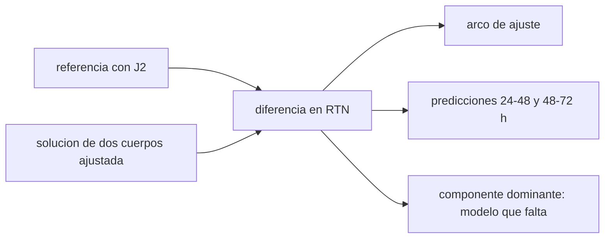

# B74-C20 — Validación frente a efemérides de referencia

<!-- nav:top -->
[🏠 Programa](../../../../README.md) · [📚 Bloque B74](../../../tronco-comun/B74-estimacion-de-orbitas-y-navegacion-espacial.md) · [← Anterior: B74-C19 — Métricas de precisión de navegación](../B74-C19-metricas-de-precision-de-navegacion/CLASE.md) · [Siguiente: B74-C21 — Kernels SPICE y su uso en navegación →](../B74-C21-kernels-spice-y-su-uso-en-navegacion/CLASE.md)
<!-- /nav -->

## 1. Ubicación, nivel y alcance

Clase 20 del bloque B74. Nivel N3. Una solución de navegación no se da por buena hasta compararla con algo independiente: una efeméride de referencia. Aquí generas una referencia sintética (órbita integrada numéricamente con el término J2), ajustas a ella una órbita de dos cuerpos con 24 h de datos y mides las diferencias en el marco RTN (radial, transversal, normal) dentro del arco de ajuste y fuera de él, en tramos de predicción de 24 h. El resultado enseña qué es un buen acuerdo y qué diferencias delatan un modelo incompleto.

## 2. Por qué esta clase existe

Una solución que ajusta bien sus datos puede predecir pésimamente. La decisión central: **¿dentro de qué tolerancia coincide mi solución con la referencia, en qué componente falla y qué modelo falta?**

## 3. Lo que podrás hacer al terminar

1. Calcular diferencias de posición en el marco RTN de la referencia.
2. Comparar el acuerdo dentro del arco de ajuste y en predicción.
3. Verificar el integrador numérico con un caso de solución conocida.
4. Interpretar la componente dominante de la diferencia como pista del modelo que falta.
5. Reportar rms por componente y máximo 3D por tramo.
6. Rotular lo sintético y lo ilustrativo.

La evidencia es la **informe de comparación con una efeméride** del ejercicio 12 (sección 20).

## 4. Con qué llegas y cómo comprobarlo

1. ¿Qué es el marco RTN?
2. ¿Qué es J2?
3. ¿Qué es un arco de ajuste?
4. ¿Qué es una predicción?
5. ¿Qué es una verificación por segunda vía?

<details>
<summary>Ver respuestas</summary>

1. El marco local de la órbita: radial, transversal y normal al plano. 2. El coeficiente del achatamiento terrestre en el campo de gravedad. 3. El intervalo de datos con que se ajusta la solución. 4. La extrapolación de la solución más allá de los datos. 5. Calcular lo mismo con otro método y comparar.
</details>

Con cuatro o cinco aciertos, sigue; si no, repasa los prerrequisitos.

## 5. Un caso de contexto y casos de referencia

La referencia sintética incluye J2 y la solución es de dos cuerpos. Con 24 h de ajuste la diferencia rms es `78918 m` en la componente normal; en la predicción de 24–48 h sube a `284114 m` y en la de 48–72 h a `553140 m`, con máximos 3D de `190035`, `571843` y `968761 m`. Es el **ejemplo conductor**; la referencia es sintética, no una efeméride real.

## 6. Vocabulario

Una **efeméride de referencia** es una trayectoria independiente (de otra herramienta o de otra solución). La **diferencia RTN** descompone `Δr` en los ejes radial, transversal y normal de la referencia. El **arco de ajuste** es donde hay datos; la **predicción** es fuera de él. El **J2** causa la precesión de la línea de nodos. La **solución a validar** es el producto cuya calidad se mide.

## 7. Modelo mental: comparar dos mapas del mismo territorio



*Descripción textual:* la referencia y la solución se comparan en el marco RTN dentro y fuera del arco de ajuste; la componente dominante apunta al modelo que falta.

Analogía: dos mapas del mismo territorio: donde coinciden hay acuerdo; las diferencias sistemáticas dicen qué elemento falta en uno de ellos (por ejemplo, un río). Límite: la referencia no es la verdad; es otra solución con sus propios errores (aquí una integración numérica sintética).

## 8. La explicación, paso a paso

### 8.1 Verificar la herramienta

Antes de validar nada, se comprueba el integrador: sin J2, RK4 de 10 s difiere del propagador kepleriano en `3,09e-01 m` tras un día (error de truncamiento). Esa cifra es el mínimo que puede resolver la comparación.

### 8.2 En el arco de ajuste

Un ajuste de dos cuerpos a 24 h de posiciones con J2 deja diferencias rms (R, T, N) de `1209`, `286` y `78918 m`, con un máximo 3D de `190035 m`: el modelo no puede acomodar la precesión del plano orbital.

### 8.3 En predicción

De 24 a 48 h: rms `8173`, `4223`, `284114 m` (máx. `571843 m`). De 48 a 72 h: `27481`, `15284`, `553140 m` (máx. `968761 m`). El error crece con el tiempo fuera del arco.

### 8.4 Qué dice la componente dominante

Domina la componente normal: el plano orbital de la referencia gira (precesión nodal) y el de dos cuerpos no. La lectura es: falta J2 en el modelo dinámico. Un acuerdo «bueno» dentro del arco no basta; hay que mirar la predicción y la componente.

## 9. Magnitudes, símbolos y unidades

| Símbolo | Qué es | Unidad | Valor / nota |
|---|---|---|---|
| `Δr_R, Δr_T, Δr_N` | diferencias radial, transversal y normal | m |  |
| `rms` | raíz de la media de los cuadrados | m |  |
| `máx. 3D` | máxima norma de la diferencia | m |  |
| `J2` | coeficiente de achatamiento | — | 1,08263 × 10⁻³ (ilustrativo, no consultado) |
| `Δt` | paso de integración | s | 10 |
| `arco` | tiempo de datos de ajuste | h | 24 |

## 10. Convenciones y referencias

Marco inercial; referencia por RK4 con paso de 10 s y gravedad central más J2 (J2 y radio ecuatorial ilustrativos, no consultados); μ = 3,986004 × 10¹⁴ m³/s² (ilustrativo); datos de ajuste cada 600 s sin ruido; diferencias en el marco RTN de la referencia; todo sintético.

## 11. De dónde sale lo que afirmamos

| ID | Fuente | Localizador | Respalda | Estado |
|---|---|---|---|---|
| S1 | NIST, CODATA — Speed of light in vacuum — https://physics.nist.gov/cgi-bin/cuu/Value?c (consultada 2026-11-10) | entrada «c» | c = 299 792 458 m/s (exacta) | Consultada |
| S2 | NASA/JPL SSD, Horizons API — https://ssd-api.jpl.nasa.gov/doc/horizons.html (consultada 2026-11-10) | parámetros EPHEM_TYPE, COMMAND, CENTER, TLIST | Horizons entrega tablas de observador, vectores de estado, elementos y SPK; parámetros de la API | Consultada |
| — | Montenbruck y Gill, *Satellite Orbits* (Springer, 2000); Vallado, *Fundamentals of Astrodynamics and Applications* (4.ª ed., Microcosm, 2013) | — | fundamento teórico general de la clase | No consultada |

Límites: no se contrastó con ninguna efeméride real: Horizons solo se consultó como proveedor de vectores de estado (parámetros EPHEM_TYPE, CENTER, TLIST) y no se descargó ningún dato. La referencia es sintética.

## 12. Cómo ver la comparación con la referencia

| Magnitud | Valor |
|---|---|
| control sin J2 | 3,09e-01 m |
| rms N, ajuste 0–24 h | 78918 m |
| rms N, 24–48 h | 284114 m |
| rms N, 48–72 h | 553140 m |
| máx. 3D, 48–72 h | 968761 m |

Descripción larga: la diferencia crece con el tiempo fuera del arco de ajuste y se concentra en la componente normal, señal de que falta la precesión nodal por J2.

## 13. Ejemplo trabajado: una diferencia en RTN

**Paso 1 · Diferencia.** `Δr = r_sol − r_ref` en el instante `t`.

**Paso 2 · Marco.** `R̂ = r_ref/|r_ref|`, `N̂ = (r × v)/|r × v|`, `T̂ = N̂ × R̂`.

**Paso 3 · Componentes.** `Δr_R = Δr·R̂`, `Δr_T = Δr·T̂`, `Δr_N = Δr·N̂`.

**Paso 4 · Lectura.** En el tramo de 24–48 h, `Δr_N` rms es `284114 m`: el plano orbital de la solución se desvía del de la referencia.

## 14. Distintas formas de describir un acuerdo entre dos trayectorias

**Por componente:** R, T, N. **Por tramo:** ajuste y predicción. **Por estadístico:** rms y máximo. **Por causa:** modelo que falta. **Por verificación:** integrador de control.

## 15. Práctica guiada

**Ejercicio 1 · guiado.** Si `Δr_N` rms es 80 km y `Δr_R` es 1 km, ¿qué sugiere? *Pista:* plano orbital.

<details><summary>Solución comentada</summary>

Un desajuste del plano orbital (nodo o inclinación).
</details>

**Ejercicio 2 · guiado.** ¿Qué prueba haces antes de comparar con una referencia numérica? *Pista:* control del integrador.

<details><summary>Solución comentada</summary>

Comparar con una solución analítica conocida en un caso sin la perturbación.
</details>

**Ejercicio 3 · guiado.** ¿Por qué se compara también fuera del arco de ajuste? *Pista:* ajuste no es predicción.

<details><summary>Solución comentada</summary>

Porque ajustar bien los datos no garantiza predecir bien.
</details>

## 16. Práctica autónoma, transferencia e integrador

**Ejercicio 4 · autónomo.** ¿Qué cambia si el arco de ajuste se reduce a 6 h?

<details><summary>Solución comentada</summary>

El error en predicción crece más rápido porque el ajuste absorbe menos del modelo que falta.
</details>

**Ejercicio 5 · autónomo.** ¿Qué componente crece primero si falta el arrastre atmosférico?

<details><summary>Solución comentada</summary>

La transversal (a lo largo de la trayectoria).
</details>

**Ejercicio 6 · autónomo.** ¿Qué error mínimo puede resolver esta comparación?

<details><summary>Solución comentada</summary>

Unos 0,3 m, el del integrador de control.
</details>

**Ejercicio 7 · autónomo.** ¿Qué ocurre si la referencia tiene un sesgo de 5 m?

<details><summary>Solución comentada</summary>

Se confunde con el error de la solución; hay que declararlo.
</details>

**Ejercicio 8 · autónomo.** ¿Cómo mejorarías la solución?

<details><summary>Solución comentada</summary>

Incluir J2 en el modelo dinámico y reajustar.
</details>

**Ejercicio 9 · transferencia.** **Transferencia.** Un proveedor dice que su solución coincide «con la referencia» a 1 km. ¿Qué preguntas haces?

<details><summary>Solución comentada</summary>

En qué componente, en qué tramo (ajuste o predicción) y con qué referencia y qué sesgos.
</details>

**Ejercicio 10 · transferencia.** **Transferencia.** ¿Qué cambia si la referencia es de otra agencia con otro modelo de gravedad?

<details><summary>Solución comentada</summary>

Una parte de la diferencia es del modelo de la referencia, no de la solución; hay que cuantificarla.
</details>

**Ejercicio 11 · transferencia.** **Transferencia.** ¿Cómo usas esta idea con efemérides de naves reales?

<details><summary>Solución comentada</summary>

Se comparan las soluciones publicadas con una reconstrucción independiente y se reportan diferencias RTN por tramo (ver C21 y C22).
</details>

**Ejercicio 12 · integrador.** **Integrador.** Elabora tu *informe de comparación con una efeméride*: control del integrador, rms R/T/N y máximo por tramo, componente dominante y causa probable, rotulando lo sintético.

<details><summary>Solución comentada</summary>

Secciones 8.1–8.4 y la salida del laboratorio.
</details>

## 17. Laboratorio: comparación con una referencia sintética

El script [laboratorio.py](laboratorio.py) integra una referencia con J2, ajusta una órbita de dos cuerpos a 24 h y compara en RTN dentro y fuera del arco (**comprueba** integrador de control con diferencia < 1 m y diferencia creciente fuera del arco).

**Datos:** referencia y solución **sintéticas/ilustrativas**; J2 y μ ilustrativos. **Predice antes de ejecutar:** ¿qué componente domina la diferencia? (la normal). **Ejecución del 2026-11-10 (Python 3.12.9, NumPy 2.4.4):**

```text
Python 3.12.9, NumPy 2.4.4 (referencia y solucion SINTETICAS)
Control sin J2: |RK4 - Kepler| tras 1 dia = 3.09e-01 m
Ajuste de dos cuerpos a 24 h de posiciones J2: 7 iteraciones ; correccion final 8.88e-05 m
tramo                 rms R [m]    rms T [m]    rms N [m]   max 3D [m]
ajuste 0-24 h            1208.5        285.8      78917.8     190034.7
prediccion 24-48 h       8172.6       4222.9     284114.0     571842.5
prediccion 48-72 h      27481.4      15283.7     553140.4     968761.1
(el modelo de dos cuerpos no reproduce la precesion nodal por J2: domina la componente normal y el error crece fuera del arco de ajuste)
Pruebas superadas.
```

```bash
python programa/clases/B74/B74-C20-validacion-frente-a-efemerides-de-referencia/laboratorio.py
```

**Límites:** sin ruido en las observaciones, sin otras perturbaciones (arrastre, tercer cuerpo, presión de radiación); el integrador RK4 de paso fijo tiene un error de truncamiento de unos 0,3 m por día.

## 18. Errores frecuentes y cómo corregirlos

**Validar solo en el arco de ajuste.** Compara también en predicción; ver 8.3.

**Mirar solo la norma 3D.** Descompón en RTN; ver 8.4.

**No verificar el integrador.** Hazlo con un caso conocido; ver 8.1.

**Presentar la referencia sintética como una efeméride real.** Rotula como sintético, como en la sección 10.

## 19. Cómo sabrás que vas bien

Tras la sección 8: ¿qué componente esperabas dominante y cuál fue? Si dudas, repasa el ejemplo 13. Tras el laboratorio: ¿qué comprueba? (ver la sección 17).

## 20. Qué entregas y cómo se evalúa

El producto es tu **informe de comparación con una efeméride** (ejercicio 12).

| Criterio | Inicial | En desarrollo | Logrado | Destacado |
|---|---|---|---|---|
| Conceptos | Los confunde | Parciales | Descompone la diferencia en RTN y la interpreta | Explica los límites |
| Cálculo | Sin unidades | Con errores | Tablas completas con unidades | Calcula casos nuevos |
| Numérico | Sin comprobar | Un caso | Contraste con una segunda vía | Interpreta las diferencias |
| Fuentes | Sin fuente | Sin fecha | Fuentes con fecha y estado | Declara lo sintético y lo no consultado |
| Límites | No los nombra | Uno | Tres | Discute qué falta del modelo |

**Condiciones críticas (no se compensan con promedio):** validar fuera del arco de ajuste y rotular la referencia como sintética; rotular los datos como sintéticos y no presentar nada simulado como observado; citar solo lo consultado.

## 21. Ética, seguridad y límites

Clase educativa en estado E0: los modelos son simplificados y sus datos son sintéticos o ilustrativos; ningún resultado describe la órbita real de una nave ni sustituye a un producto de navegación de misión. Accesibilidad: tablas equivalentes a las gráficas, fórmulas en texto, ejercicios sin conexión. Tolerancias del laboratorio: integrador de control < 1 m en 1 día; máximo 3D creciente entre tramos.

## 22. Para cerrar y seguir

Con 24 h de datos, la solución de dos cuerpos difiere de la referencia con J2 en `190035 m` (máximo) dentro del arco y `968761 m` a 48–72 h, sobre todo en la componente normal. Queda una pregunta: ¿cómo se usan las efemérides reales en un entorno de trabajo estándar como SPICE?

**Glosario español–inglés.** efeméride de referencia · *reference ephemeris*; marco RTN · *RTN frame*; arco de ajuste · *fit arc*; predicción · *prediction*; precesión nodal · *nodal precession*.

**Continuidad.** [B74-C21](../B74-C21-kernels-spice-y-su-uso-en-navegacion/CLASE.md) estudia los kernels SPICE y su uso en navegación.

**Referencias:** ver sección 11.

<!-- nav:bottom -->
---

[← Anterior: B74-C19 — Métricas de precisión de navegación](../B74-C19-metricas-de-precision-de-navegacion/CLASE.md) · [📚 Bloque B74](../../../tronco-comun/B74-estimacion-de-orbitas-y-navegacion-espacial.md) · [Siguiente: B74-C21 — Kernels SPICE y su uso en navegación →](../B74-C21-kernels-spice-y-su-uso-en-navegacion/CLASE.md)
<!-- /nav -->
