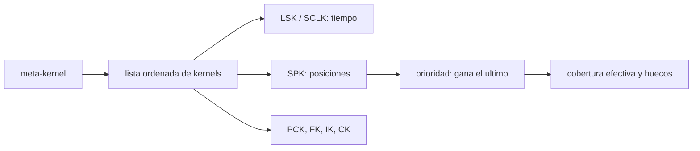

# B74-C21 — Kernels SPICE y su uso en navegación

<!-- nav:top -->
[🏠 Programa](../../../../README.md) · [📚 Bloque B74](../../../tronco-comun/B74-estimacion-de-orbitas-y-navegacion-espacial.md) · [← Anterior: B74-C20 — Validación frente a efemérides de referencia](../B74-C20-validacion-frente-a-efemerides-de-referencia/CLASE.md) · [Siguiente: B74-C22 — Informe de navegación verificable →](../B74-C22-informe-de-navegacion-verificable/CLASE.md)
<!-- /nav -->

## 1. Ubicación, nivel y alcance

Clase 21 del bloque B74. Nivel N3. SPICE, el sistema de información de geometría de observación de NASA/NAIF, organiza los datos de navegación en **kernels** de varios tipos y los combina con un **meta-kernel**: un archivo de texto que lista cuáles cargar y en qué orden. Aquí aprendes la estructura de un meta-kernel, la regla de prioridad entre kernels que se solapan y cómo se representa una trayectoria con polinomios de Chebyshev, usando un análisis didáctico (sin SPICE) sobre archivos y trayectorias sintéticas.

## 2. Por qué esta clase existe

Un resultado de navegación depende de qué kernels se cargaron y en qué orden: dos corridas con el mismo código pueden dar trayectorias distintas. La decisión central: **¿cómo declaro, valido y audito el conjunto de kernels de una solución para que sea reproducible?**

## 3. Lo que podrás hacer al terminar

1. Nombrar los tipos de kernel de SPICE y su función.
2. Leer la estructura de un meta-kernel (`KERNELS_TO_LOAD`, `PATH_VALUES`, `PATH_SYMBOLS`).
3. Aplicar la regla de prioridad: gana el kernel cargado después.
4. Calcular la cobertura efectiva y localizar huecos.
5. Evaluar la precisión de un segmento de posiciones tipo Chebyshev.
6. Rotular lo sintético y lo no consultado.

La evidencia es la **meta-kernel validado y auditado** del ejercicio 12 (sección 20).

## 4. Con qué llegas y cómo comprobarlo

1. ¿Qué es un archivo de texto con una lista de rutas?
2. ¿Qué es una efeméride?
3. ¿Qué es un polinomio de Chebyshev?
4. ¿Qué es una cobertura temporal?
5. ¿Qué es una verificación por segunda vía?

<details>
<summary>Ver respuestas</summary>

1. Un archivo de configuración que enumera recursos. 2. Una tabla o función de posiciones de un cuerpo en el tiempo. 3. Un polinomio ortogonal que aproxima bien funciones suaves en un intervalo. 4. El intervalo de tiempo para el que un archivo tiene datos. 5. Calcular lo mismo con otro método y comparar.
</details>

Con cuatro o cinco aciertos, sigue; si no, repasa los prerrequisitos.

## 5. Un caso de contexto y casos de referencia

Un meta-kernel sintético carga 6 archivos (LSK, SCLK, PCK y tres SPK) en orden; para el cuerpo «NAVE» dos SPK se solapan entre 400 y 600 s y gana el cargado después; la cobertura efectiva deja un hueco desde el segundo `901`. Un segmento de Chebyshev de grado 12 con 4 registros de 1 h representa 4 h de trayectoria con `0,069 m` de error. Es el **ejemplo conductor**; los archivos y nombres son inventados.

## 6. Vocabulario

Un **kernel** es un archivo de datos de SPICE. Los tipos descritos por NAIF son **SPK** (posición y velocidad), **CK** (orientación de nave), **PCK** (tamaño, forma y orientación de cuerpos), **IK** (campo de visión de instrumentos), **FK** (marcos), **LSK** (segundos intercalares), **SCLK** (reloj de nave) y **DSK** (formas). Un **meta-kernel** (`KPL/MK`) lista kernels en `KERNELS_TO_LOAD`. Con kernels que compiten, el cargado **después** tiene prioridad.

## 7. Modelo mental: una pila de transparencias



*Descripción textual:* el meta-kernel define una lista ordenada; los kernels de tiempo se cargan antes que los de posición; entre los que se solapan gana el cargado después, y de ello resulta la cobertura efectiva y sus huecos.

Analogía: apilar transparencias con mapas: lo que se ve en cada punto es la transparencia de más arriba que tiene dibujo allí. Límite: el análisis es didáctico, con un lector mínimo de meta-kernels; no sustituye a SPICE ni valida kernels binarios reales.

## 8. La explicación, paso a paso

### 8.1 Los tipos de kernel

NAIF describe SPK (posición y velocidad de objetos), CK (orientación de naves y estructuras), PCK (tamaño, forma y orientación de cuerpos del sistema solar), IK (campos de visión de instrumentos), FK (marcos de referencia), LSK (segundos intercalares), SCLK (reloj de la nave) y DSK (modelos de forma, en desarrollo según la página consultada).

### 8.2 El meta-kernel

Un meta-kernel empieza con `KPL/MK` y define `KERNELS_TO_LOAD`; con `PATH_VALUES` y `PATH_SYMBOLS` se evitan rutas largas (`$KERNELS/...`). En el laboratorio se resuelven 6 archivos; todos existen y LSK y SCLK están antes que los SPK (las dos comprobaciones valen 1 = sí: `1` y `1`).

### 8.3 Prioridad y cobertura

NAIF documenta que el kernel cargado después tiene prioridad sobre uno anterior cuando comparten cuerpo y tiempo. Con dos SPK de «NAVE» solapados, en `t = 500 s` los datos vienen de `spk_nave_v2_sint,bsp`. La cobertura efectiva tiene `1` hueco a partir de `901 s`: un cálculo ahí fallaría.

### 8.4 Segmentos tipo Chebyshev

Una trayectoria suave puede guardarse como polinomios por tramos. Para 4 h de una órbita de dos cuerpos, 1 registro de grado 12 tiene `73041 m` de error, 2 registros `148,8 m` y 4 registros `0,069 m`; con 4 registros de grado 6 el error es `2370 m`. La precisión depende del número de registros y del grado, no del formato.

## 9. Magnitudes, símbolos y unidades

| Símbolo | Qué es | Unidad | Valor / nota |
|---|---|---|---|
| `SPK, CK, PCK, IK, FK, LSK, SCLK, DSK` | tipos de kernel | — | según NAIF |
| `KERNELS_TO_LOAD` | lista de kernels del meta-kernel | — | orden = prioridad |
| `PATH_VALUES, PATH_SYMBOLS` | rutas y sus símbolos | — | `$SIMBOLO/archivo` |
| `cobertura` | intervalo de datos de un kernel | s | por cuerpo |
| `registros` | tramos de un segmento | — | 1, 2, 4 |
| `grado` | grado del polinomio de Chebyshev | — | 6 o 12 |

## 10. Convenciones y referencias

Meta-kernel sintético con nombres inventados en un directorio temporal; coberturas ficticias en segundos desde una época arbitraria; trayectoria de dos cuerpos con μ = 3,986004 × 10¹⁴ m³/s² (ilustrativo); no se usa SPICE. Lo descrito de NAIF viene de las páginas consultadas.

## 11. De dónde sale lo que afirmamos

| ID | Fuente | Localizador | Respalda | Estado |
|---|---|---|---|---|
| S1 | NASA/JPL NAIF, SPICE Tutorials (índice) — https://naif.jpl.nasa.gov/naif/tutorials.html (consultada 2026-11-10) | lista de tipos de kernel | SPK, CK, PCK, IK, FK, LSK, SCLK y DSK y su función | Consultada |
| S2 | NASA/JPL NAIF, Kernel Required Reading — https://naif.jpl.nasa.gov/pub/naif/toolkit_docs/C/req/kernel.html (consultada 2026-11-10) | secciones de meta-kernel y prioridad | furnsh, meta-kernel `KPL/MK`, `KERNELS_TO_LOAD`, `PATH_VALUES`/`PATH_SYMBOLS`; el kernel cargado después tiene prioridad | Consultada |
| S3 | NASA/JPL SSD, Horizons API — https://ssd-api.jpl.nasa.gov/doc/horizons.html (consultada 2026-11-10) | parámetros EPHEM_TYPE, COMMAND, CENTER, TLIST | Horizons entrega tablas de observador, vectores de estado, elementos y SPK; parámetros de la API | Consultada |
| — | Montenbruck y Gill, *Satellite Orbits* (Springer, 2000) | — | fundamento teórico general de la clase | No consultada |

Límites: no se leyeron los formatos binarios de SPK/CK ni el manual completo de SPICE, solo las páginas indicadas; el lector de meta-kernels es didáctico y no equivale al analizador de NAIF; Horizons se consultó únicamente por los parámetros de salida de vectores y SPK.

## 12. Cómo ver la carga de kernels

| Magnitud | Valor |
|---|---|
| archivos en el meta-kernel | 6 |
| LSK y SCLK antes de los SPK (1 = sí) | 1 |
| fuente en t = 500 s | spk_nave_v2_sint,bsp |
| huecos de cobertura | 1 |
| error de Chebyshev (4 reg., grado 12) | 0,069 m |

Descripción larga: el orden del meta-kernel decide qué dato se usa; un hueco de cobertura es un error latente; la precisión de un segmento depende del número de registros y del grado.

## 13. Ejemplo trabajado: quién gana en un solapamiento

**Paso 1 · Orden.** `spk_nave_v1` se carga antes que `spk_nave_v2`.

**Paso 2 · Solapamiento.** Entre 400 y 600 s ambos tienen «NAVE».

**Paso 3 · Regla.** Gana el cargado después: `v2`.

**Paso 4 · Lectura.** Si se invierte el orden en el meta-kernel, cambia la trayectoria de esos 200 s; por eso el orden debe registrarse en el informe (C22).

## 14. Distintas formas de describir un conjunto de kernels

**Por tipo:** SPK, CK, PCK, IK, FK, LSK, SCLK. **Por orden:** prioridad. **Por cobertura:** intervalos y huecos. **Por ruta:** símbolos. **Por huella:** hash (ver C22).

## 15. Práctica guiada

**Ejercicio 1 · guiado.** ¿Qué kernel necesitas para convertir UTC a un tiempo continuo? *Pista:* segundos intercalares.

<details><summary>Solución comentada</summary>

El LSK.
</details>

**Ejercicio 2 · guiado.** Si dos SPK cubren el mismo cuerpo y tiempo, ¿cuál se usa? *Pista:* regla de NAIF.

<details><summary>Solución comentada</summary>

El cargado después.
</details>

**Ejercicio 3 · guiado.** ¿Qué ventaja tiene `PATH_SYMBOLS`? *Pista:* rutas repetidas.

<details><summary>Solución comentada</summary>

Evita repetir rutas largas y facilita cambiar de directorio.
</details>

## 16. Práctica autónoma, transferencia e integrador

**Ejercicio 4 · autónomo.** ¿Qué riesgo hay con rutas relativas en un meta-kernel?

<details><summary>Solución comentada</summary>

Que dejen de ser válidas si cambia el directorio de trabajo, según la documentación consultada.
</details>

**Ejercicio 5 · autónomo.** ¿Cómo detectarías un hueco de cobertura antes de ejecutar?

<details><summary>Solución comentada</summary>

Calculando la cobertura efectiva de cada cuerpo en el intervalo de trabajo.
</details>

**Ejercicio 6 · autónomo.** ¿Qué pasa si cargas el mismo SPK dos veces?

<details><summary>Solución comentada</summary>

Se añade un duplicado a la lista de kernels cargados; hay que descargarlo antes de recargar para subir la prioridad.
</details>

**Ejercicio 7 · autónomo.** ¿Qué implica el grado 6 con 4 registros?

<details><summary>Solución comentada</summary>

Un error de miles de metros: el modelo está subdimensionado.
</details>

**Ejercicio 8 · autónomo.** ¿Qué kernel contiene la orientación de la cámara de navegación?

<details><summary>Solución comentada</summary>

Un CK (actitud de la nave) junto con IK y FK.
</details>

**Ejercicio 9 · transferencia.** **Transferencia.** Dos grupos obtienen trayectorias distintas con el mismo código. ¿Qué compruebas primero?

<details><summary>Solución comentada</summary>

El meta-kernel: qué archivos, qué versión y en qué orden.
</details>

**Ejercicio 10 · transferencia.** **Transferencia.** ¿Qué información del meta-kernel debe ir en un informe de navegación?

<details><summary>Solución comentada</summary>

Lista ordenada, versiones y huella de cada archivo.
</details>

**Ejercicio 11 · transferencia.** **Transferencia.** ¿Cómo usarías esto con efemérides de Horizons?

<details><summary>Solución comentada</summary>

Descargando un SPK (cuerpos pequeños) o vectores, y registrando su versión y fecha de obtención.
</details>

**Ejercicio 12 · integrador.** **Integrador.** Elabora tu *meta-kernel validado y auditado*: orden resuelto, comprobaciones de existencia y de tiempo, cobertura efectiva con huecos y la precisión de un segmento de Chebyshev, rotulando lo sintético.

<details><summary>Solución comentada</summary>

Secciones 8.1–8.4 y la salida del laboratorio.
</details>

## 17. Laboratorio: meta-kernel, prioridad y Chebyshev

El script [laboratorio.py](laboratorio.py) escribe y analiza un meta-kernel sintético, resuelve la prioridad entre dos SPK solapados, calcula la cobertura efectiva y mide el error de segmentos de Chebyshev (**comprueba** existencia y orden de los archivos, ganador del solapamiento, un hueco, y error de Chebyshev < 0,1 m con 4 registros y grado 12).

**Datos:** archivos, coberturas y trayectoria **sintéticos**; la estructura del meta-kernel y la regla de prioridad vienen de NAIF (consultado). **Predice antes de ejecutar:** ¿qué SPK gana en el solapamiento? (el cargado después, `v2`). **Ejecución del 2026-11-10 (Python 3.12.9, NumPy 2.4.4):**

```text
Python 3.12.9, NumPy 2.4.4 (meta-kernel y arco SINTETICOS; NO se usa SPICE)
Orden de carga resuelto desde el meta-kernel:
  1. lsk_sintetico.tls
  2. sclk_sintetico.tsc
  3. pck_sintetico.tpc
  4. spk_planetas_sint.bsp
  5. spk_nave_v1_sint.bsp
  6. spk_nave_v2_sint.bsp
Archivos existentes: True ; LSK y SCLK antes que los SPK: True
Cobertura efectiva de NAVE (0-1000 s), gana el cargado despues:
      0-  399 s : spk_nave_v1_sint.bsp
    400-  900 s : spk_nave_v2_sint.bsp
    901- 1000 s : SIN COBERTURA (hueco)
En t = 500 s (solapamiento) los datos vienen de spk_nave_v2_sint.bsp
Segmento tipo Chebyshev de una trayectoria de 4 h (sintetica): error maximo de la posicion en 1000 instantes
registros   grado    error max [m]
    1         12      7.304e+04
    2         12      1.488e+02
    4         12      6.937e-02
    4          6      2.370e+03
Pruebas superadas.
```

```bash
python programa/clases/B74/B74-C21-kernels-spice-y-su-uso-en-navegacion/laboratorio.py
```

**Límites:** no se usa SPICE ni kernels binarios; el lector solo entiende el formato mínimo del ejemplo; el error de Chebyshev es de una órbita de dos cuerpos.

## 18. Errores frecuentes y cómo corregirlos

**Creer que el orden del meta-kernel es indiferente.** Decide la prioridad; ver 8.3.

**No comprobar la cobertura.** Un hueco falla en ejecución; ver 8.3.

**Confundir la regla de prioridad con la de versión más reciente.** Gana el cargado después, no el más nuevo.

**Presentar los kernels sintéticos como reales.** Rotula como sintético, como en la sección 10.

## 19. Cómo sabrás que vas bien

Tras la sección 8: ¿qué SPK esperabas que ganara y cuál fue? Si dudas, repasa el ejemplo 13. Tras el laboratorio: ¿qué comprueba? (ver la sección 17).

## 20. Qué entregas y cómo se evalúa

El producto es tu **meta-kernel validado y auditado** (ejercicio 12).

| Criterio | Inicial | En desarrollo | Logrado | Destacado |
|---|---|---|---|---|
| Conceptos | Los confunde | Parciales | Nombra los tipos de kernel y aplica la prioridad | Explica los límites |
| Cálculo | Sin unidades | Con errores | Tablas completas con unidades | Calcula casos nuevos |
| Numérico | Sin comprobar | Un caso | Contraste con una segunda vía | Interpreta las diferencias |
| Fuentes | Sin fuente | Sin fecha | Fuentes con fecha y estado | Declara lo sintético y lo no consultado |
| Límites | No los nombra | Uno | Tres | Discute qué falta del modelo |

**Condiciones críticas (no se compensan con promedio):** registrar el orden de carga y rotular los kernels como sintéticos; rotular los datos como sintéticos y no presentar nada simulado como observado; citar solo lo consultado.

## 21. Ética, seguridad y límites

Clase educativa en estado E0: los modelos son simplificados y sus datos son sintéticos o ilustrativos; ningún resultado describe la órbita real de una nave ni sustituye a un producto de navegación de misión. Accesibilidad: tablas equivalentes a las gráficas, fórmulas en texto, ejercicios sin conexión. Tolerancias del laboratorio: error de Chebyshev < 0,1 m (4 registros, grado 12); un hueco esperado; ganador `v2`.

## 22. Para cerrar y seguir

Un meta-kernel de 6 archivos define una trayectoria única solo si se registra su orden; entre dos SPK solapados gana el cargado después (`spk_nave_v2_sint,bsp`) y la cobertura efectiva deja `1` hueco. Queda una pregunta: ¿cómo se documenta todo esto en un informe verificable?

**Glosario español–inglés.** kernel · *kernel*; meta-kernel · *meta-kernel*; prioridad de carga · *load priority*; cobertura · *coverage*; segundos intercalares · *leapseconds*.

**Continuidad.** [B74-C22](../B74-C22-informe-de-navegacion-verificable/CLASE.md) estudia el informe de navegación verificable.

**Referencias:** ver sección 11.

<!-- nav:bottom -->
---

[← Anterior: B74-C20 — Validación frente a efemérides de referencia](../B74-C20-validacion-frente-a-efemerides-de-referencia/CLASE.md) · [📚 Bloque B74](../../../tronco-comun/B74-estimacion-de-orbitas-y-navegacion-espacial.md) · [Siguiente: B74-C22 — Informe de navegación verificable →](../B74-C22-informe-de-navegacion-verificable/CLASE.md)
<!-- /nav -->
