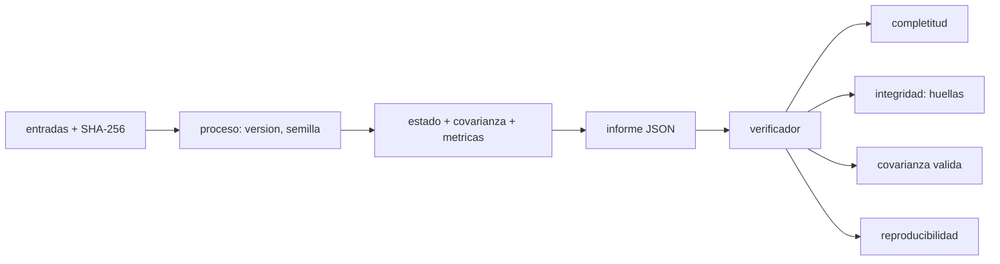

# B74-C22 — Informe de navegación verificable

<!-- nav:top -->
[🏠 Programa](../../../../README.md) · [📚 Bloque B74](../../../tronco-comun/B74-estimacion-de-orbitas-y-navegacion-espacial.md) · [← Anterior: B74-C21 — Kernels SPICE y su uso en navegación](../B74-C21-kernels-spice-y-su-uso-en-navegacion/CLASE.md) · [Siguiente: B74-C23 — Consistencia de filtros: innovaciones y pruebas NEES/NIS →](../B74-C23-consistencia-de-filtros-innovaciones-y-pruebas-nees-nis/CLASE.md)
<!-- /nav -->

## 1. Ubicación, nivel y alcance

Clase 22 del bloque B74. Nivel N3. Un resultado de navegación sin su procedencia es una cifra sin garantía. Un informe verificable declara qué datos entraron (con su huella), con qué software y versiones, en qué sistema de referencia, escala de tiempo y unidades, con qué semilla, y entrega el estado con su covarianza y sus límites, de modo que un tercero pueda comprobar que el informe es íntegro, completo y reproducible. Aquí construyes uno sobre un problema sintético y escribes el verificador que lo audita.

## 2. Por qué esta clase existe

Cuando dos equipos discrepan en una trayectoria, la primera pregunta es qué entradas y qué versiones usó cada uno. La decisión central: **¿qué debe llevar un informe para que cualquiera pueda reproducirlo y detectar que se alteró un dato?**

## 3. Lo que podrás hacer al terminar

1. Listar los campos mínimos de un informe de navegación verificable.
2. Calcular y comprobar huellas SHA-256 de los archivos de entrada.
3. Escribir un verificador de completitud, integridad, validez de la covarianza y reproducibilidad.
4. Detectar la alteración de un solo byte de una entrada.
5. Rechazar un informe al que le falta el sistema de referencia.
6. Rotular lo sintético y lo no consultado.

La evidencia es la **informe de navegación con manifiesto** del ejercicio 12 (sección 20).

## 4. Con qué llegas y cómo comprobarlo

1. ¿Qué es una función hash?
2. ¿Qué es un manifiesto?
3. ¿Qué es la reproducibilidad?
4. ¿Qué es una covarianza válida?
5. ¿Qué es una verificación por segunda vía?

<details>
<summary>Ver respuestas</summary>

1. Una función que resume un archivo en una cadena de longitud fija; un cambio mínimo cambia el resultado. 2. Una lista de archivos con sus huellas. 3. Obtener el mismo resultado con las mismas entradas y el mismo software. 4. Simétrica y definida positiva. 5. Calcular lo mismo con otro método y comparar.
</details>

Con cuatro o cinco aciertos, sigue; si no, repasa los prerrequisitos.

## 5. Un caso de contexto y casos de referencia

Un informe sintético de 11 campos (`1080` bytes) declara el estado `1,051 m` de la verdad sintética, `σ` 3D formal de `3,009 m` y las huellas SHA-256 `66fd4eb087da…` y `4f94cacc442c…` de sus dos entradas. El verificador lo aprueba; tras alterar un byte de una entrada lo rechaza por la huella, y un informe sin sistema de referencia es rechazado por incompleto. Es el **ejemplo conductor**; los datos son sintéticos.

## 6. Vocabulario

La **procedencia** (*provenance*) es el origen de cada dato y proceso. La **huella** SHA-256 identifica el contenido de un archivo. La **completitud** exige los campos obligatorios. La **integridad** exige que las huellas coincidan. La **reproducibilidad** exige que recalcular desde las entradas dé el mismo estado. Los **límites** dicen qué no cubre el informe.

## 7. Modelo mental: una cadena de custodia



*Descripción textual:* las entradas con su huella y el proceso con su versión producen el estado y el informe; un verificador independiente revisa completitud, integridad, covarianza válida y reproducibilidad.

Analogía: una cadena de custodia en un laboratorio: cada muestra tiene su sello y su registro; si el sello está roto, el resultado no se acepta. Límite: una huella demuestra que el archivo es el mismo, no que sea correcto; un informe verificable no es un informe verdadero.

## 8. La explicación, paso a paso

### 8.1 Los campos

El informe declara: identificador, sistema de referencia, escala de tiempo, unidades, versiones de software, semilla, entradas con huellas, estado, covarianza, métricas y límites. Son 11 campos; sin cualquiera de ellos el verificador rechaza.

### 8.2 El resultado

El ajuste de posición con cuatro alcances sintéticos da un estado a `1,051 m` de la verdad sintética, con una `σ` 3D formal de `3,009 m`. Las huellas de las entradas empiezan por `66fd4eb087da` y `4f94cacc442c`.

### 8.3 Tres pruebas del verificador

Informe íntegro: aprobado (`1` = 1). Un byte alterado en `alcances.csv`: rechazado por huella distinta (`1` = 1 indica rechazo). Informe sin sistema de referencia: rechazado por incompleto (`1` = 1 indica rechazo).

### 8.4 Qué no garantiza

Un informe aprobado garantiza trazabilidad, no exactitud: si el modelo es incompleto (sin troposfera, sin sesgos), el informe lo declara en `limites`, pero el verificador no puede detectarlo. Por eso se completa con validación frente a una referencia (C20) y pruebas de consistencia (C23).

## 9. Magnitudes, símbolos y unidades

| Símbolo | Qué es | Unidad | Valor / nota |
|---|---|---|---|
| `SHA-256` | huella de 256 bits | — | 64 caracteres hexadecimales |
| `campos` | entradas del informe | — | 11 |
| `x̂` | estado estimado | m | 3 componentes |
| `P` | covarianza | m² | 3 × 3 |
| `semilla` | semilla del generador | — | 71 |
| `σ 3D` | raíz de la traza de P | m | 3,0 |

## 10. Convenciones y referencias

Marco terrestre fijo simplificado (sintético), alcances simultáneos de cuatro estaciones sintéticas con ruido de 1 m; informe en JSON con claves ordenadas; huellas SHA-256 de `hashlib`; todo sintético; no se consultó ninguna norma de gestión de la calidad.

## 11. De dónde sale lo que afirmamos

| ID | Fuente | Localizador | Respalda | Estado |
|---|---|---|---|---|
| S1 | NASA/JPL NAIF, Kernel Required Reading — https://naif.jpl.nasa.gov/pub/naif/toolkit_docs/C/req/kernel.html (consultada 2026-11-10) | secciones de meta-kernel y prioridad | furnsh, meta-kernel `KPL/MK`, `KERNELS_TO_LOAD`, `PATH_VALUES`/`PATH_SYMBOLS`; el kernel cargado después tiene prioridad | Consultada |
| S2 | CCSDS 502.0-B-3, Orbit Data Messages, Blue Book, abril de 2023 — https://ccsds.org/Pubs/502x0b3e1.pdf (consultada 2026-11-10, texto extraído con PyMuPDF) | alcance (sección 1) y lista de usos | existen los mensajes OPM, OMM, OEM y OCM; usos: planificación de seguimiento, predicciones, comparación de órbitas, propagación y reconstrucción de órbitas | Consultada (solo alcance) |
| — | Montenbruck y Gill, *Satellite Orbits* (Springer, 2000) | — | fundamento teórico general de la clase | No consultada |

Límites: la lista de campos obligatorios se propone en esta clase; no corresponde a una norma consultada. De CCSDS 502.0-B-3 solo se leyó que los mensajes de órbita se usan para comparación y reconstrucción de órbitas; NAIF se usa solo por la práctica de registrar el orden del meta-kernel.

## 12. Cómo ver un informe verificable

| Magnitud | Valor |
|---|---|
| campos del informe | 11 |
| tamaño | 1080 bytes |
| error frente a la verdad sintética | 1,051 m |
| σ 3D formal | 3,009 m |
| pruebas del verificador superadas | tres de tres |

Descripción larga: el verificador aprueba el informe íntegro y rechaza el manipulado y el incompleto; la aprobación garantiza trazabilidad, no exactitud.

## 13. Ejemplo trabajado: detectar un byte alterado

**Paso 1 · Huella original.** `SHA-256(alcances.csv)` empieza por `4f94cacc442c`.

**Paso 2 · Alteración.** Se cambia el primer carácter del archivo.

**Paso 3 · Nueva huella.** Ya no coincide con la del informe.

**Paso 4 · Resultado.** El verificador rechaza: «huella distinta en alcances.csv».

## 14. Distintas formas de describir un informe

**Por campos:** completitud. **Por huellas:** integridad. **Por recálculo:** reproducibilidad. **Por covarianza:** validez. **Por límites:** alcance declarado.

## 15. Práctica guiada

**Ejercicio 1 · guiado.** ¿Cuántos caracteres hexadecimales tiene una huella SHA-256? *Pista:* 256 bits, 4 bits por carácter.

<details><summary>Solución comentada</summary>

64.
</details>

**Ejercicio 2 · guiado.** Si cambias un bit de un archivo, ¿cambia la huella? *Pista:* propiedad de una función hash.

<details><summary>Solución comentada</summary>

Sí, de forma impredecible.
</details>

**Ejercicio 3 · guiado.** ¿Qué campo permite a un tercero repetir el cálculo estocástico? *Pista:* generador.

<details><summary>Solución comentada</summary>

La semilla (junto con las versiones).
</details>

## 16. Práctica autónoma, transferencia e integrador

**Ejercicio 4 · autónomo.** ¿Por qué conviene ordenar las claves del JSON?

<details><summary>Solución comentada</summary>

Para que la serialización sea determinista y su huella estable.
</details>

**Ejercicio 5 · autónomo.** ¿Qué falta si el informe no declara la escala de tiempo?

<details><summary>Solución comentada</summary>

No se sabe a qué instante corresponden las medidas; el informe es incompleto.
</details>

**Ejercicio 6 · autónomo.** ¿Una huella demuestra que los datos son correctos?

<details><summary>Solución comentada</summary>

No: solo que son los mismos.
</details>

**Ejercicio 7 · autónomo.** ¿Cómo validarías la covarianza del informe?

<details><summary>Solución comentada</summary>

Comprobando simetría y que sus autovalores sean positivos.
</details>

**Ejercicio 8 · autónomo.** ¿Qué otras versiones registrarías?

<details><summary>Solución comentada</summary>

Del sistema operativo, de las bibliotecas y de los kernels utilizados.
</details>

**Ejercicio 9 · transferencia.** **Transferencia.** Un equipo envía una trayectoria sin informe. ¿Qué pides?

<details><summary>Solución comentada</summary>

Las entradas con huellas, las versiones, el marco, la escala de tiempo y la covarianza.
</details>

**Ejercicio 10 · transferencia.** **Transferencia.** ¿Cómo combinarías este informe con el meta-kernel de C21?

<details><summary>Solución comentada</summary>

Registrando la lista ordenada de kernels y la huella de cada uno en el campo de entradas.
</details>

**Ejercicio 11 · transferencia.** **Transferencia.** ¿Qué ocurre si el recálculo da una diferencia de 1e-3 m?

<details><summary>Solución comentada</summary>

Hay una fuente de no determinismo (hilos, versiones o semilla); se investiga antes de aceptar.
</details>

**Ejercicio 12 · integrador.** **Integrador.** Elabora tu *informe de navegación con manifiesto*: JSON con los campos obligatorios, huellas de las entradas, el estado con su covarianza y un verificador con tres pruebas (íntegro, manipulado, incompleto), rotulando lo sintético.

<details><summary>Solución comentada</summary>

Secciones 8.1–8.4 y la salida del laboratorio.
</details>

## 17. Laboratorio: informe verificable y verificador

El script [laboratorio.py](laboratorio.py) genera entradas sintéticas, resuelve una posición, escribe un informe JSON con huellas SHA-256 y lo audita con un verificador, incluyendo una manipulación y un informe incompleto (**comprueba** aprobación del informe íntegro y rechazo del manipulado y del incompleto).

**Datos:** entradas **sintéticas**; las huellas se calculan con `hashlib`. **Predice antes de ejecutar:** ¿qué ocurre al alterar un solo byte de una entrada? (se rechaza por huella). **Ejecución del 2026-11-10 (Python 3.12.9, NumPy 2.4.4):**

```text
Python 3.12.9, NumPy 2.4.4 (datos SINTETICOS, semilla 71)
Informe: 1080 bytes ; campos = 11 ; huella de estaciones.csv = 66fd4eb087dacf1b...; huella de alcances.csv = 4f94cacc442c4dd3...
Estado = (12000000.316, 7999999.272, 6000000.689) m ; error frente a la verdad sintetica = 1.051 m ; sigma 3D formal = 3.009 m
Verificacion del informe integro: APROBADA
Verificacion tras alterar un byte de alcances.csv: RECHAZADA: huella distinta en alcances.csv
Verificacion de un informe sin sistema de referencia: RECHAZADA: falta el campo sistema_de_referencia
Pruebas superadas.
```

```bash
python programa/clases/B74/B74-C22-informe-de-navegacion-verificable/laboratorio.py
```

**Límites:** la lista de campos es una propuesta de la clase; no detecta modelos incorrectos, solo falta de trazabilidad; el recálculo usa el mismo código.

## 18. Errores frecuentes y cómo corregirlos

**Confundir trazabilidad con exactitud.** Ver 8.4.

**Omitir la escala de tiempo o el marco.** El informe queda incompleto; ver 8.1.

**No fijar la semilla.** Se pierde la reproducibilidad.

**Presentar el informe sintético como el de una misión.** Rotula como sintético, como en la sección 10.

## 19. Cómo sabrás que vas bien

Tras la sección 8: ¿qué esperabas del verificador ante un byte alterado y qué hizo? Si dudas, repasa el ejemplo 13. Tras el laboratorio: ¿qué comprueba? (ver la sección 17).

## 20. Qué entregas y cómo se evalúa

El producto es tu **informe de navegación con manifiesto** (ejercicio 12).

| Criterio | Inicial | En desarrollo | Logrado | Destacado |
|---|---|---|---|---|
| Conceptos | Los confunde | Parciales | Distingue completitud, integridad y reproducibilidad | Explica los límites |
| Cálculo | Sin unidades | Con errores | Tablas completas con unidades | Calcula casos nuevos |
| Numérico | Sin comprobar | Un caso | Contraste con una segunda vía | Interpreta las diferencias |
| Fuentes | Sin fuente | Sin fecha | Fuentes con fecha y estado | Declara lo sintético y lo no consultado |
| Límites | No los nombra | Uno | Tres | Discute qué falta del modelo |

**Condiciones críticas (no se compensan con promedio):** declarar sistema de referencia, escala de tiempo y unidades y rotular los datos como sintéticos; rotular los datos como sintéticos y no presentar nada simulado como observado; citar solo lo consultado.

## 21. Ética, seguridad y límites

Clase educativa en estado E0: los modelos son simplificados y sus datos son sintéticos o ilustrativos; ningún resultado describe la órbita real de una nave ni sustituye a un producto de navegación de misión. Accesibilidad: tablas equivalentes a las gráficas, fórmulas en texto, ejercicios sin conexión. Tolerancias del laboratorio: reproducibilidad del estado dentro de 1e-6 m; las tres pruebas del verificador superadas.

## 22. Para cerrar y seguir

Un informe de 11 campos con huellas SHA-256 se aprueba íntegro y se rechaza si se altera un byte (`4f94cacc442c…`) o si falta el marco de referencia. Queda una pregunta: ¿cómo se comprueba que el filtro que produjo el estado es consistente?

**Glosario español–inglés.** informe verificable · *verifiable report*; procedencia · *provenance*; huella · *hash / digest*; manifiesto · *manifest*; reproducibilidad · *reproducibility*.

**Continuidad.** [B74-C23](../B74-C23-consistencia-de-filtros-innovaciones-y-pruebas-nees-nis/CLASE.md) estudia la consistencia de filtros con innovaciones y pruebas NEES/NIS.

**Referencias:** ver sección 11.

<!-- nav:bottom -->
---

[← Anterior: B74-C21 — Kernels SPICE y su uso en navegación](../B74-C21-kernels-spice-y-su-uso-en-navegacion/CLASE.md) · [📚 Bloque B74](../../../tronco-comun/B74-estimacion-de-orbitas-y-navegacion-espacial.md) · [Siguiente: B74-C23 — Consistencia de filtros: innovaciones y pruebas NEES/NIS →](../B74-C23-consistencia-de-filtros-innovaciones-y-pruebas-nees-nis/CLASE.md)
<!-- /nav -->
