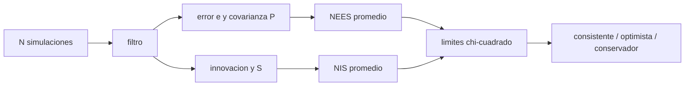

# B74-C23 — Consistencia de filtros: innovaciones y pruebas NEES/NIS

<!-- nav:top -->
[🏠 Programa](../../../../README.md) · [📚 Bloque B74](../../../tronco-comun/B74-estimacion-de-orbitas-y-navegacion-espacial.md) · [← Anterior: B74-C22 — Informe de navegación verificable](../B74-C22-informe-de-navegacion-verificable/CLASE.md) · [Siguiente: B74-C24 — Medidas retardadas y fuera de secuencia en filtros de estimación →](../B74-C24-medidas-retardadas-y-fuera-de-secuencia-en-filtros-de-estimacion/CLASE.md)
<!-- /nav -->

## 1. Ubicación, nivel y alcance

Clase 23 del bloque B74. Nivel N3. Un filtro consistente es aquel cuyo error real coincide, en promedio, con la covarianza que declara. Dos estadísticos lo comprueban: el **NEES** (error de estado normalizado, cuando se conoce la verdad, como en una simulación) y el **NIS** (innovación normalizada, que se puede calcular también con datos reales). Aquí los promedias sobre 100 simulaciones, calculas los límites de aceptación de una `χ²` y pruebas tres filtros: uno acertado, uno optimista y uno conservador.

## 2. Por qué esta clase existe

Un filtro optimista presenta covarianzas pequeñas y errores grandes, y no avisa. La decisión central: **¿cómo sé, con una prueba estadística, si mi filtro es consistente y qué estadístico me avisa de qué fallo?**

## 3. Lo que podrás hacer al terminar

1. Definir NEES y NIS con sus grados de libertad.
2. Calcular los límites de aceptación de dos colas con el cuantil de una `χ²`.
3. Promediar sobre realizaciones independientes para ganar potencia.
4. Distinguir filtros optimistas, conservadores y consistentes.
5. Explicar por qué el NIS es menos sensible que el NEES.
6. Rotular lo sintético y lo ilustrativo.

La evidencia es la **informe de consistencia de un filtro** del ejercicio 12 (sección 20).

## 4. Con qué llegas y cómo comprobarlo

1. ¿Qué es una `χ²` con ν grados de libertad?
2. ¿Qué es una innovación?
3. ¿Qué valor medio tiene una `χ²_ν`?
4. ¿Qué es un intervalo de aceptación?
5. ¿Qué es una verificación por segunda vía?

<details>
<summary>Ver respuestas</summary>

1. La suma de ν normales estándar al cuadrado. 2. La diferencia entre la medida y la predicha. 3. ν. 4. El rango dentro del cual el estadístico es compatible con la hipótesis. 5. Calcular lo mismo con otro método y comparar.
</details>

Con cuatro o cinco aciertos, sigue; si no, repasa los prerrequisitos.

## 5. Un caso de contexto y casos de referencia

Con 100 realizaciones sintéticas, el filtro acertado (`q = 0,05`) tiene NEES medio `1,997` (esperado 2; límites `[1,627, 2,411]`), el optimista (`q = 0,005`), `10,14`, y el conservador (`q = 0,5`), `1,132`. Es el **ejemplo conductor**; los datos son sintéticos.

## 6. Vocabulario

El **NEES** es `eᵀP⁻¹e` con `e = x̂ − x` (ν = dimensión del estado). El **NIS** es `νᵀS⁻¹ν` con `ν` la innovación y `S` su covarianza (ν = dimensión de la medida). Un filtro es **consistente** si su promedio está dentro de los límites de la `χ²`. **Optimista** significa covarianza menor que el error real; **conservador**, mayor.

## 7. Modelo mental: un termómetro que declara su propio error



*Descripción textual:* el filtro produce errores con covarianza e innovaciones con su covarianza; los promedios de NEES y NIS sobre las simulaciones se comparan con los límites de la χ² para decidir si el filtro es consistente.

Analogía: un termómetro que declara «±0,1 °C»; si en promedio se equivoca más, es optimista; si se equivoca mucho menos, es conservador. Límite: la prueba supone errores gaussianos e independientes entre realizaciones; con datos reales hay que usar el NIS y promediar en el tiempo.

## 8. La explicación, paso a paso

### 8.1 Límites de aceptación

Para el promedio de N realizaciones, `N·NEES` sigue una `χ²` con `N·n` grados de libertad. Con `N = 100`, `n = 2` los límites del 95 % son `[1,627, 2,411]` (esperado 2), y para el NIS con 1 grado de libertad, `[0,742, 1,296]` (esperado 1). El cuantil se aproxima con Wilson–Hilferty (aproximación estándar, no consultada).

### 8.2 El filtro acertado

Con el `q` verdadero, el NEES medio es `1,997` y el NIS `0,989`; el `0,94` y el `0,94` de los pasos caen dentro de los límites, como se espera para una prueba al 95 % con pasos correlacionados.

### 8.3 Optimista y conservador

El filtro optimista (`q` diez veces menor) tiene NEES medio `10,14`, fuera de los límites en el `0,00` de los pasos; su NIS medio es `1,297` y solo el `0,54` de los pasos queda dentro: el NIS lo detecta peor. El conservador (`q` diez veces mayor) tiene NEES `1,132`, por debajo del límite inferior, y NIS `0,865`.

### 8.4 Qué usar cuando no hay verdad

El NEES exige conocer el estado verdadero (simulación o referencia independiente). Con datos reales solo se puede calcular el NIS (y otras pruebas de blancura de las innovaciones); una prueba NIS que pasa no garantiza una covarianza correcta, pero una que falla señala un problema.

## 9. Magnitudes, símbolos y unidades

| Símbolo | Qué es | Unidad | Valor / nota |
|---|---|---|---|
| `NEES` | error de estado normalizado | — | ≈ n si consistente |
| `NIS` | innovación normalizada | — | ≈ m si consistente |
| `N` | realizaciones independientes | — | 100 |
| `χ²_{p,ν}` | cuantil de la χ² | — | Wilson–Hilferty |
| `q` | densidad de ruido de proceso | (m/s²)² | 0,05 verdadero |
| `[lo, hi]` | límites de aceptación | — | [1,627; 2,411] (NEES) |

## 10. Convenciones y referencias

Una dimensión; 60 pasos de 1 s; medida de posición con σ = 5 m; aceleración aleatoria verdadera q = 0,05 (m/s²)²; 100 realizaciones; límites de dos colas al 95 %; semilla 73. Todo sintético.

## 11. De dónde sale lo que afirmamos

| ID | Fuente | Localizador | Respalda | Estado |
|---|---|---|---|---|
| S1 | NIST, CODATA — Speed of light in vacuum — https://physics.nist.gov/cgi-bin/cuu/Value?c (consultada 2026-11-10) | entrada «c» | c = 299 792 458 m/s (exacta) | Consultada |
| S2 | CCSDS 502.0-B-3, Orbit Data Messages, Blue Book, abril de 2023 — https://ccsds.org/Pubs/502x0b3e1.pdf (consultada 2026-11-10, texto extraído con PyMuPDF) | alcance (sección 1) y lista de usos | existen los mensajes OPM, OMM, OEM y OCM; usos: planificación de seguimiento, predicciones, comparación de órbitas, propagación y reconstrucción de órbitas | Consultada (solo alcance) |
| — | Bar-Shalom, Li y Kirubarajan, *Estimation with Applications to Tracking and Navigation* (Wiley, 2001); Tapley, Schutz y Born, *Statistical Orbit Determination* (Elsevier, 2004) | — | fundamento teórico general de la clase | No consultada |

Límites: las definiciones de NEES y NIS y la aproximación de Wilson–Hilferty son relaciones estándar no consultadas en una fuente concreta (la referencia natural es Bar-Shalom et al., no consultada); el laboratorio las verifica con un caso de comportamiento conocido.

## 12. Cómo ver la consistencia de un filtro

| Magnitud | Valor |
|---|---|
| límites NEES (95 %) | [1,627, 2,411] |
| NEES acertado | 1,997 |
| NEES optimista | 10,14 |
| NEES conservador | 1,132 |
| NIS optimista dentro de límites | 0,54 |

Descripción larga: el NEES separa claramente al filtro acertado del optimista y del conservador; el NIS lo hace con menos potencia.

## 13. Ejemplo trabajado: un límite de aceptación

**Paso 1 · Estadístico.** Promedio de NEES sobre `N = 100` realizaciones con `n = 2`.

**Paso 2 · Distribución.** `N·NEES ~ χ²_{200}` si el filtro es consistente.

**Paso 3 · Límites.** `χ²_{0,025;200}/100 = 1,627` y `χ²_{0,975;200}/100 = 2,411`.

**Paso 4 · Decisión.** Un NEES de `10,14` está muy por encima de `2,411`: el filtro es optimista.

## 14. Distintas formas de describir la consistencia

**Por NEES:** error frente a covarianza. **Por NIS:** innovación frente a su covarianza. **Por límites:** χ². **Por signo:** optimista o conservador. **Por tiempo:** fracción dentro de límites.

## 15. Práctica guiada

**Ejercicio 1 · guiado.** ¿Qué valor esperas del NIS para una medida de 2 componentes? *Pista:* grados de libertad.

<details><summary>Solución comentada</summary>

2.
</details>

**Ejercicio 2 · guiado.** Si el NEES medio es 10 con límites [1,6; 2,4], ¿qué haces? *Pista:* fuera del límite superior.

<details><summary>Solución comentada</summary>

Concluyes que el filtro es optimista y subes `Q` o revisas el modelo.
</details>

**Ejercicio 3 · guiado.** ¿Qué pasa con los límites al aumentar N? *Pista:* promedio de más realizaciones.

<details><summary>Solución comentada</summary>

Se estrechan alrededor del valor esperado.
</details>

## 16. Práctica autónoma, transferencia e integrador

**Ejercicio 4 · autónomo.** ¿Por qué el NIS es menos sensible que el NEES?

<details><summary>Solución comentada</summary>

Compara solo la innovación, que incluye el ruido de medida; el error de estado no observado puede esconderse.
</details>

**Ejercicio 5 · autónomo.** ¿Qué falla si las realizaciones no son independientes?

<details><summary>Solución comentada</summary>

Los límites son demasiado estrechos y se rechaza un filtro consistente.
</details>

**Ejercicio 6 · autónomo.** ¿Cómo detectarías un sesgo con las innovaciones?

<details><summary>Solución comentada</summary>

Con una media de innovaciones distinta de cero (prueba de blancura/centrado).
</details>

**Ejercicio 7 · autónomo.** ¿Qué estadístico usarías con datos de una misión real?

<details><summary>Solución comentada</summary>

El NIS y la blancura de las innovaciones; el NEES no es calculable.
</details>

**Ejercicio 8 · autónomo.** ¿Qué pasa con el NEES si R se subestima?

<details><summary>Solución comentada</summary>

El filtro es optimista: el NEES sube.
</details>

**Ejercicio 9 · transferencia.** **Transferencia.** Un equipo reporta «χ²/gl = 1» de un ajuste. ¿Es lo mismo que un NIS consistente?

<details><summary>Solución comentada</summary>

Es una prueba del ajuste por lotes; el NIS evalúa un filtro paso a paso con su covarianza.
</details>

**Ejercicio 10 · transferencia.** **Transferencia.** ¿Qué cambia si el filtro es no lineal?

<details><summary>Solución comentada</summary>

Los estadísticos siguen valiendo, pero la linealización puede hacer el NEES alto (ver C09).
</details>

**Ejercicio 11 · transferencia.** **Transferencia.** ¿Cómo usarías esta prueba en una campaña con 10 pasadas reales?

<details><summary>Solución comentada</summary>

Promediando el NIS por pasada y comprobando blancura; el NEES queda para simulaciones con la misma configuración.
</details>

**Ejercicio 12 · integrador.** **Integrador.** Elabora tu *informe de consistencia de un filtro*: límites, NEES y NIS de tres filtros, fracciones dentro de límites y diagnóstico, rotulando lo sintético.

<details><summary>Solución comentada</summary>

Secciones 8.1–8.4 y la salida del laboratorio.
</details>

## 17. Laboratorio: NEES, NIS y límites χ²

El script [laboratorio.py](laboratorio.py) simula 100 trayectorias, filtra con tres valores de `q` y evalúa NEES y NIS con límites de aceptación (**comprueba** el filtro acertado dentro de límites ≥ 0,85 y los otros dos fuera).

**Datos:** trayectorias y medidas **sintéticas/ilustrativas**. **Predice antes de ejecutar:** ¿qué filtro tiene el NEES más alto? (el optimista). **Ejecución del 2026-11-10 (Python 3.12.9, NumPy 2.4.4):**

```text
Python 3.12.9, NumPy 2.4.4 (datos SINTETICOS, semilla 73)
N = 100 realizaciones, 60 pasos ; q verdadero = 0.05 (m/s2)^2
Limites NEES (95 %, 2 gl, promedio de 100): [1.627, 2.411] ; esperado 2
Limites NIS (95 %, 1 gl, promedio de 100): [0.742, 1.296] ; esperado 1
filtro          q       NEES medio  dentro   NIS medio  dentro
acertado       0.050       1.997    0.94       0.989    0.94
optimista      0.005      10.142    0.00       1.297    0.54
conservador    0.500       1.132    0.00       0.865    0.84
Pruebas superadas.
```

```bash
python programa/clases/B74/B74-C23-consistencia-de-filtros-innovaciones-y-pruebas-nees-nis/laboratorio.py
```

**Límites:** una dimensión, gaussiano, 100 realizaciones; cuantiles aproximados; pasos correlacionados dentro de cada realización.

## 18. Errores frecuentes y cómo corregirlos

**Dar por bueno un filtro por el rms.** Aplica NEES/NIS; ver 8.2.

**Calcular NEES sin verdad.** Solo es posible en simulación o con una referencia independiente.

**Olvidar los grados de libertad.** El esperado depende de la dimensión; ver 8.1.

**Presentar los filtros sintéticos como de misión.** Rotula como sintético, como en la sección 10.

## 19. Cómo sabrás que vas bien

Tras la sección 8: ¿qué NEES esperabas del filtro optimista y cuál fue? Si dudas, repasa el ejemplo 13. Tras el laboratorio: ¿qué comprueba? (ver la sección 17).

## 20. Qué entregas y cómo se evalúa

El producto es tu **informe de consistencia de un filtro** (ejercicio 12).

| Criterio | Inicial | En desarrollo | Logrado | Destacado |
|---|---|---|---|---|
| Conceptos | Los confunde | Parciales | Define NEES y NIS con sus límites | Explica los límites |
| Cálculo | Sin unidades | Con errores | Tablas completas con unidades | Calcula casos nuevos |
| Numérico | Sin comprobar | Un caso | Contraste con una segunda vía | Interpreta las diferencias |
| Fuentes | Sin fuente | Sin fecha | Fuentes con fecha y estado | Declara lo sintético y lo no consultado |
| Límites | No los nombra | Uno | Tres | Discute qué falta del modelo |

**Condiciones críticas (no se compensan con promedio):** indicar los grados de libertad y el nivel de confianza y rotular los datos como sintéticos; rotular los datos como sintéticos y no presentar nada simulado como observado; citar solo lo consultado.

## 21. Ética, seguridad y límites

Clase educativa en estado E0: los modelos son simplificados y sus datos son sintéticos o ilustrativos; ningún resultado describe la órbita real de una nave ni sustituye a un producto de navegación de misión. Accesibilidad: tablas equivalentes a las gráficas, fórmulas en texto, ejercicios sin conexión. Tolerancias del laboratorio: filtro acertado con ≥ 85 % de los pasos dentro de límites; optimista y conservador fuera.

## 22. Para cerrar y seguir

El NEES separa al filtro acertado (`1,997`) del optimista (`10,14`) y del conservador (`1,132`); el NIS lo hace con menos potencia. Queda una pregunta: ¿qué hacer cuando una medida llega tarde o desordenada?

**Glosario español–inglés.** consistencia · *consistency*; error de estimación normalizado al cuadrado · *NEES*; innovación normalizada al cuadrado · *NIS*; optimista · *optimistic*; conservador · *conservative*.

**Continuidad.** [B74-C24](../B74-C24-medidas-retardadas-y-fuera-de-secuencia-en-filtros-de-estimacion/CLASE.md) estudia las medidas retardadas y fuera de secuencia en filtros de estimación.

**Referencias:** ver sección 11.

<!-- nav:bottom -->
---

[← Anterior: B74-C22 — Informe de navegación verificable](../B74-C22-informe-de-navegacion-verificable/CLASE.md) · [📚 Bloque B74](../../../tronco-comun/B74-estimacion-de-orbitas-y-navegacion-espacial.md) · [Siguiente: B74-C24 — Medidas retardadas y fuera de secuencia en filtros de estimación →](../B74-C24-medidas-retardadas-y-fuera-de-secuencia-en-filtros-de-estimacion/CLASE.md)
<!-- /nav -->
