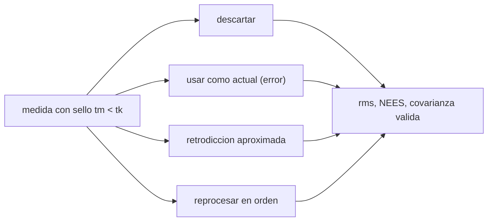

# B74-C24 — Medidas retardadas y fuera de secuencia en filtros de estimación

<!-- nav:top -->
[🏠 Programa](../../../../README.md) · [📚 Bloque B74](../../../tronco-comun/B74-estimacion-de-orbitas-y-navegacion-espacial.md) · [← Anterior: B74-C23 — Consistencia de filtros: innovaciones y pruebas NEES/NIS](../B74-C23-consistencia-de-filtros-innovaciones-y-pruebas-nees-nis/CLASE.md) · [Siguiente: B74-C25 — Detección de limbo y bordes planetarios en imágenes de navegación →](../B74-C25-deteccion-de-limbo-y-bordes-planetarios-en-imagenes-de-navegacion/CLASE.md)
<!-- /nav -->

## 1. Ubicación, nivel y alcance

Clase 24 del bloque B74. Nivel N3. En una red real las medidas llegan con retraso y a veces desordenadas: una medida con sello de tiempo anterior al estado actual del filtro (OOSM, *out-of-sequence measurement*). Hay cuatro respuestas posibles: descartarla, usarla como si fuera actual, retropropagar el estado y corregir aproximadamente, o reprocesar en orden. Aquí las comparas en un filtro lineal sintético con cinco medidas que llegan 5 a 9 pasos tarde y ves cuál es consistente.

## 2. Por qué esta clase existe

Una medida tardía contiene información valiosa pero tratarla mal puede dañar más que descartarla. La decisión central: **¿qué tratamiento de una medida tardía mejora el estimado sin romper la consistencia, y a qué coste?**

## 3. Lo que podrás hacer al terminar

1. Definir una medida fuera de secuencia y su retardo.
2. Comparar descartar, usar como actual, retrodicción aproximada y reprocesar.
3. Calcular la retrodicción `x_m = F⁻ˡ x_k` y su covarianza.
4. Reconocer una covarianza que deja de ser definida positiva.
5. Medir rms y NEES de cada tratamiento.
6. Rotular lo sintético y lo ilustrativo.

La evidencia es la **comparación de tratamientos de una medida tardía** del ejercicio 12 (sección 20).

## 4. Con qué llegas y cómo comprobarlo

1. ¿Qué es el sello de tiempo de una medida?
2. ¿Qué es una matriz de transición `F`?
3. ¿Qué es una inversa de `F`?
4. ¿Qué es una covarianza cruzada?
5. ¿Qué es una verificación por segunda vía?

<details>
<summary>Ver respuestas</summary>

1. El instante al que corresponde la medida, no el de su llegada. 2. La que propaga el estado un paso. 3. La que retropropaga el estado un paso. 4. La que relaciona los errores de dos estados distintos. 5. Calcular lo mismo con otro método y comparar.
</details>

Con cuatro o cinco aciertos, sigue; si no, repasa los prerrequisitos.

## 5. Un caso de contexto y casos de referencia

Cinco medidas de posición (pasos 21–25) llegan tras el paso 30. Al evaluar el error en el paso 30 en 2000 realizaciones: descartar da `2,609 m` rms (NEES `2,004`), usarlas como actuales `41,2 m` (NEES `582`), la retrodicción aproximada `2,745 m` con covarianza no definida positiva en `100 %` de los casos, y reprocesar en orden `2,512 m` (NEES `2,010`). Es el **ejemplo conductor**; todo es sintético.

## 6. Vocabulario

Una **OOSM** llega después de que el filtro avanzó más allá de su sello de tiempo. El **retardo** `l` es el número de pasos. La **retrodicción** propaga el estado hacia atrás: `x_m = F⁻ˡ x_k`. El **reprocesado** repite el filtro desde un estado guardado con las medidas en orden. La **covarianza cruzada** entre el estado actual y el ruido de proceso del intervalo es lo que las aproximaciones deben tratar.

## 7. Modelo mental: una carta que llega tarde



*Descripción textual:* una medida con sello anterior al estado actual puede descartarse, usarse como actual, tratarse con retrodicción aproximada o reprocesarse; cada tratamiento se evalúa con rms, NEES y validez de la covarianza.

Analogía: una carta que llega tarde con un dato de ayer: ignorarla pierde información, leerla como si fuera de hoy engaña, y reordenar toda la correspondencia es lo más justo pero cuesta tiempo. Límite: en el modelo lineal sintético reprocesar es exacto; con modelos no lineales y filtros a bordo hay que equilibrar coste y precisión.

## 8. La explicación, paso a paso

### 8.1 Descartar

Descartar las cinco medidas tardías deja un filtro consistente (NEES `2,004`) pero pierde información: rms `2,609 m`.

### 8.2 Usarlas como actuales

Tratar una medida del paso 21 como si fuera del paso 30 introduce un sesgo de decenas de metros (v·l ≈ 50–90 m): rms `41,2 m` y NEES `582`; es el peor tratamiento.

### 8.3 Retrodicción aproximada sin correlación cruzada

Retropropagar el estado, calcular la innovación y trasladar la corrección da un rms de `2,745 m`, peor que descartar, y la covarianza deja de ser definida positiva en el `100 %` de los casos (NEES medio `-2,21`, que carece de sentido). El fallo viene de ignorar que el error actual y el ruido de proceso del intervalo están correlacionados; los algoritmos publicados (de Bar-Shalom y colaboradores, no consultados) incorporan esa correlación.

### 8.4 Reprocesar en orden

Guardar el estado del paso 20 y repetir el filtro con las medidas en orden da el mejor resultado: rms `2,512 m` y NEES `2,010`. Es exacto en el modelo lineal; su coste es almacenar un historial y repetir `l` pasos.

## 9. Magnitudes, símbolos y unidades

| Símbolo | Qué es | Unidad | Valor / nota |
|---|---|---|---|
| `l` | retardo de la medida | pasos | 5–9 |
| `F` | matriz de transición | — | [[1,Δt],[0,1]] |
| `x_m = F⁻ˡ x_k` | estado retropropagado | m, m/s |  |
| `Q_l` | ruido de proceso acumulado en l pasos | m², (m/s)² |  |
| `NEES` | error normalizado | — | ≈ 2 si consistente |
| `q` | ruido de proceso | (m/s²)² | 0,05 (ilustrativo) |

## 10. Convenciones y referencias

Una dimensión, Δt = 1 s, medida de posición con σ = 5 m, aceleración aleatoria q = 0,05 (m/s²)²; 30 pasos; medidas de los pasos 21–25 llegan tras el 30; 2000 realizaciones; semilla 79. Todo sintético.

## 11. De dónde sale lo que afirmamos

| ID | Fuente | Localizador | Respalda | Estado |
|---|---|---|---|---|
| S1 | NIST, CODATA — Speed of light in vacuum — https://physics.nist.gov/cgi-bin/cuu/Value?c (consultada 2026-11-10) | entrada «c» | c = 299 792 458 m/s (exacta) | Consultada |
| S2 | CCSDS 502.0-B-3, Orbit Data Messages, Blue Book, abril de 2023 — https://ccsds.org/Pubs/502x0b3e1.pdf (consultada 2026-11-10, texto extraído con PyMuPDF) | alcance (sección 1) y lista de usos | existen los mensajes OPM, OMM, OEM y OCM; usos: planificación de seguimiento, predicciones, comparación de órbitas, propagación y reconstrucción de órbitas | Consultada (solo alcance) |
| — | Bar-Shalom, Li y Kirubarajan, *Estimation with Applications to Tracking and Navigation* (Wiley, 2001); Tapley, Schutz y Born, *Statistical Orbit Determination* (Elsevier, 2004) | — | fundamento teórico general de la clase | No consultada |

Límites: los algoritmos de OOSM de la literatura no se consultaron; la retrodicción del laboratorio es una versión simple, sin correlación cruzada, que se muestra para exhibir su fallo. De CCSDS 502.0-B-3 solo se leyó el alcance.

## 12. Cómo ver los tratamientos de una medida tardía

| Magnitud | Valor |
|---|---|
| descartar | 2,609 m |
| como actual | 41,2 m |
| retrodicción aproximada | 2,745 m |
| reprocesar | 2,512 m |
| P no definida positiva (retrodicción) | 100 % |

Descripción larga: reprocesar en orden es el mejor; usar la medida como actual es el peor; una retrodicción sin correlación cruzada es peor que descartar y deja una covarianza inválida.

## 13. Ejemplo trabajado: retropropagar un estado

**Paso 1 · Estado actual.** `x_k` en el paso 30.

**Paso 2 · Retardo.** Una medida del paso 25 tiene `l = 5`.

**Paso 3 · Retrodicción.** `x_m = F⁻⁵ x_k`; con la matriz de movimiento uniforme, la posición retrocede `5 v`.

**Paso 4 · Lectura.** La retrodicción ignora la aceleración aleatoria del intervalo; su covarianza `F⁻ˡ(P + Q_l)F⁻ˡᵀ` no refleja la correlación con `x_k`.

## 14. Distintas formas de describir una medida tardía

**Por retardo:** `l`. **Por tratamiento:** descartar, actual, retrodicción, reproceso. **Por error:** rms. **Por consistencia:** NEES. **Por coste:** historial y pasos repetidos.

## 15. Práctica guiada

**Ejercicio 1 · guiado.** Si el móvil va a 10 m/s, ¿cuánto se equivoca la posición de una medida de 7 s antes tratada como actual? *Pasos:* velocidad por retardo.

<details><summary>Solución comentada</summary>

`70 m`.
</details>

**Ejercicio 2 · guiado.** ¿Qué guardas para poder reprocesar? *Pista:* un estado anterior.

<details><summary>Solución comentada</summary>

El estado y la covarianza en el instante previo al retraso, y las medidas en orden.
</details>

**Ejercicio 3 · guiado.** ¿Qué tratamiento es consistente pero pierde información? *Pista:* el más simple.

<details><summary>Solución comentada</summary>

Descartar.
</details>

## 16. Práctica autónoma, transferencia e integrador

**Ejercicio 4 · autónomo.** ¿Cómo cambia el beneficio de reprocesar si el retardo crece de 5 a 50 pasos?

<details><summary>Solución comentada</summary>

Aumenta el coste y el valor de la medida disminuye porque la información es antigua.
</details>

**Ejercicio 5 · autónomo.** ¿Qué ocurre si no se guarda el historial?

<details><summary>Solución comentada</summary>

No es posible reprocesar; hay que usar una aproximación o descartar.
</details>

**Ejercicio 6 · autónomo.** ¿Por qué una covarianza no definida positiva es una alarma?

<details><summary>Solución comentada</summary>

Porque ya no representa una incertidumbre y el filtro puede divergir.
</details>

**Ejercicio 7 · autónomo.** ¿Cómo se acota el historial a bordo?

<details><summary>Solución comentada</summary>

Con una ventana deslizante de pasos y medidas.
</details>

**Ejercicio 8 · autónomo.** ¿Qué pasa si hay varias medidas tardías desordenadas entre sí?

<details><summary>Solución comentada</summary>

Se ordenan por sello de tiempo antes de reprocesar.
</details>

**Ejercicio 9 · transferencia.** **Transferencia.** Un centro de operaciones recibe pasadas con 20 min de retraso. ¿Qué haría con un filtro de seguimiento?

<details><summary>Solución comentada</summary>

Reprocesar desde un estado guardado o ejecutar el ajuste por lotes de la pasada.
</details>

**Ejercicio 10 · transferencia.** **Transferencia.** ¿Por qué las redes de estaciones reportan sellos de tiempo y no tiempos de llegada?

<details><summary>Solución comentada</summary>

Para poder situar la medida en el instante correcto.
</details>

**Ejercicio 11 · transferencia.** **Transferencia.** ¿Qué cambia con un modelo no lineal?

<details><summary>Solución comentada</summary>

Reprocesar requiere repetir la propagación no lineal; las retrodicciones son más aproximadas.
</details>

**Ejercicio 12 · integrador.** **Integrador.** Elabora tu *comparación de tratamientos de una medida tardía*: tabla de rms, NEES y validez de la covarianza para los cuatro tratamientos, con un diagnóstico del fallo de la retrodicción simple, rotulando lo sintético.

<details><summary>Solución comentada</summary>

Secciones 8.1–8.4 y la salida del laboratorio.
</details>

## 17. Laboratorio: cuatro tratamientos de una medida tardía

El script [laboratorio.py](laboratorio.py) simula 2000 trayectorias con cinco medidas retrasadas y compara descartar, usar como actual, retrodicción simple y reprocesar en orden (**comprueba** reprocesar con el menor rms, ingenuo peor que descartar y NEES del reproceso entre 1,8 y 2,2).

**Datos:** trayectorias y medidas **sintéticas/ilustrativas**. **Predice antes de ejecutar:** ¿cuál es el peor tratamiento? (usar la medida como actual). **Ejecución del 2026-11-10 (Python 3.12.9, NumPy 2.4.4):**

```text
Python 3.12.9, NumPy 2.4.4 (datos SINTETICOS, semilla 79)
2000 realizaciones; medidas de los pasos 21-25 llegan tras el paso 30 (retardo de 5 a 9 pasos)
tratamiento                           rms error de posicion [m]   NEES medio (esperado 2)   covarianza no definida positiva
(a) descartar                                       2.609                2.004                  0.0 %
(b) ingenuo (como actual)                          41.224              582.388                  0.0 %
(c) retrodiccion aproximada                         2.745               -2.213                100.0 %
(d) reprocesar en orden                             2.512                2.010                  0.0 %
Pruebas superadas.
```

```bash
python programa/clases/B74/B74-C24-medidas-retardadas-y-fuera-de-secuencia-en-filtros-de-estimacion/laboratorio.py
```

**Límites:** modelo lineal, una dimensión, retardos fijos; la retrodicción es una versión simple; no se implementaron los algoritmos publicados.

## 18. Errores frecuentes y cómo corregirlos

**Usar la medida tardía como actual.** Introduce un sesgo grande; ver 8.2.

**Creer que una aproximación siempre supera a descartar.** Puede ser peor; ver 8.3.

**Olvidar guardar el historial.** Sin él no se puede reprocesar.

**Presentar los datos sintéticos como reales.** Rotula como sintético, como en la sección 10.

## 19. Cómo sabrás que vas bien

Tras la sección 8: ¿qué tratamiento esperabas el mejor y cuál fue? Si dudas, repasa el ejemplo 13. Tras el laboratorio: ¿qué comprueba? (ver la sección 17).

## 20. Qué entregas y cómo se evalúa

El producto es tu **comparación de tratamientos de una medida tardía** (ejercicio 12).

| Criterio | Inicial | En desarrollo | Logrado | Destacado |
|---|---|---|---|---|
| Conceptos | Los confunde | Parciales | Distingue los cuatro tratamientos y su consistencia | Explica los límites |
| Cálculo | Sin unidades | Con errores | Tablas completas con unidades | Calcula casos nuevos |
| Numérico | Sin comprobar | Un caso | Contraste con una segunda vía | Interpreta las diferencias |
| Fuentes | Sin fuente | Sin fecha | Fuentes con fecha y estado | Declara lo sintético y lo no consultado |
| Límites | No los nombra | Uno | Tres | Discute qué falta del modelo |

**Condiciones críticas (no se compensan con promedio):** comprobar la validez de la covarianza y rotular los datos como sintéticos; rotular los datos como sintéticos y no presentar nada simulado como observado; citar solo lo consultado.

## 21. Ética, seguridad y límites

Clase educativa en estado E0: los modelos son simplificados y sus datos son sintéticos o ilustrativos; ningún resultado describe la órbita real de una nave ni sustituye a un producto de navegación de misión. Accesibilidad: tablas equivalentes a las gráficas, fórmulas en texto, ejercicios sin conexión. Tolerancias del laboratorio: reproceso con el menor rms y NEES entre 1,8 y 2,2; ingenuo peor que descartar.

## 22. Para cerrar y seguir

Reprocesar en orden da `2,512 m` y NEES `2,010`; descartar `2,609 m`; usarla como actual `41,2 m`; la retrodicción simple deja la covarianza inválida. Queda una pregunta: ¿cómo se extraen bordes planetarios de una imagen para navegar?

**Glosario español–inglés.** medida fuera de secuencia · *out-of-sequence measurement*; retardo · *lag*; retrodicción · *retrodiction*; reprocesado · *reprocessing*; covarianza cruzada · *cross-covariance*.

**Continuidad.** [B74-C25](../B74-C25-deteccion-de-limbo-y-bordes-planetarios-en-imagenes-de-navegacion/CLASE.md) estudia la detección de limbo y bordes planetarios en imágenes de navegación.

**Referencias:** ver sección 11.

<!-- nav:bottom -->
---

[← Anterior: B74-C23 — Consistencia de filtros: innovaciones y pruebas NEES/NIS](../B74-C23-consistencia-de-filtros-innovaciones-y-pruebas-nees-nis/CLASE.md) · [📚 Bloque B74](../../../tronco-comun/B74-estimacion-de-orbitas-y-navegacion-espacial.md) · [Siguiente: B74-C25 — Detección de limbo y bordes planetarios en imágenes de navegación →](../B74-C25-deteccion-de-limbo-y-bordes-planetarios-en-imagenes-de-navegacion/CLASE.md)
<!-- /nav -->
