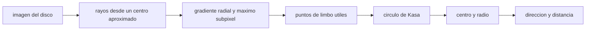

# B74-C25 — Detección de limbo y bordes planetarios en imágenes de navegación

<!-- nav:top -->
[🏠 Programa](../../../../README.md) · [📚 Bloque B74](../../../tronco-comun/B74-estimacion-de-orbitas-y-navegacion-espacial.md) · [← Anterior: B74-C24 — Medidas retardadas y fuera de secuencia en filtros de estimación](../B74-C24-medidas-retardadas-y-fuera-de-secuencia-en-filtros-de-estimacion/CLASE.md) · [Siguiente: B74-C26 — Navegación por hitos y correlación de terreno →](../B74-C26-navegacion-por-hitos-y-correlacion-de-terreno/CLASE.md)
<!-- /nav -->

## 1. Ubicación, nivel y alcance

Clase 25 del bloque B74. Nivel N3. Cuando la nave se acerca a un planeta o luna, su disco llena la imagen y el modo clásico de navegar es medir su **limbo** (el borde del disco): del círculo ajustado salen el centro (dirección) y el radio (distancia). Aquí detectas el limbo con borde subpíxel en imágenes sintéticas de un disco completo y de un disco en cuarto (fase de 90°), ajustas un círculo por mínimos cuadrados algebraicos y mides el sesgo y la dispersión de centro y radio.

## 2. Por qué esta clase existe

En un disco iluminado a medias, el borde oscuro no existe y un ajuste ingenuo se sesga. La decisión central: **¿qué parte del limbo es utilizable, con qué incertidumbre, y qué sesgo introduce la fase?**

## 3. Lo que podrás hacer al terminar

1. Detectar un borde por el máximo del gradiente radial con interpolación parabólica.
2. Ajustar un círculo por el método algebraico de Kåsa.
3. Medir sesgo y dispersión de centro y radio por Monte Carlo.
4. Explicar por qué la fase del disco reduce el limbo útil y aumenta la dispersión.
5. Convertir el radio en distancia con el tamaño angular.
6. Rotular lo sintético y lo ilustrativo.

La evidencia es la **ficha de extracción de limbo** del ejercicio 12 (sección 20).

## 4. Con qué llegas y cómo comprobarlo

1. ¿Qué es el gradiente de una imagen?
2. ¿Qué es la interpolación parabólica?
3. ¿Qué es el ajuste algebraico de un círculo?
4. ¿Qué es la fase de un cuerpo?
5. ¿Qué es una verificación por segunda vía?

<details>
<summary>Ver respuestas</summary>

1. La derivada de la intensidad respecto de la posición. 2. Ajustar una parábola a tres puntos para hallar el máximo con precisión subpíxel. 3. Resolver `x² + y² + Dx + Ey + F = 0` por mínimos cuadrados lineales. 4. El ángulo Sol–cuerpo–observador, que determina la parte iluminada. 5. Calcular lo mismo con otro método y comparar.
</details>

Con cuatro o cinco aciertos, sigue; si no, repasa los prerrequisitos.

## 5. Un caso de contexto y casos de referencia

En una imagen sintética de 200 × 200 px con un disco de radio 80,3 px, el disco completo se ajusta con sesgo de centro `(-0,003, +0,005) px`, sesgo de radio `+0,001 px` y dispersión de `0,024 px`; en cuarto (fase 90°) quedan `78` puntos de limbo, el sesgo de radio es `+0,070 px` y la dispersión del centro, `0,173 px`. Es el **ejemplo conductor**; la imagen es sintética.

## 6. Vocabulario

El **limbo** es el borde visible del disco. El **borde subpíxel** se localiza con el máximo del gradiente más una interpolación. El **ajuste de Kåsa** es un ajuste circular de mínimos cuadrados lineal. La **fase** es el ángulo Sol–objeto–observador. La **PSF** difumina el borde. El **tamaño angular** es `2R/d` y da la distancia.

## 7. Modelo mental: trazar el contorno de la luna con un lápiz



*Descripción textual:* se lanzan rayos desde un centro aproximado, en cada uno se localiza el borde con precisión subpíxel, se conservan los puntos fuertes, se ajusta un círculo y de él salen dirección y distancia.

Analogía: dibujar el contorno de la luna con un lápiz y luego medir el círculo que mejor lo envuelve; si solo ves la mitad iluminada, el círculo sale más incierto. Límite: el disco sintético es perfectamente circular y sin relieve ni atmósfera; el limbo real de un cuerpo con atmósfera o relieve tiene sesgos que requieren un modelo.

## 8. La explicación, paso a paso

### 8.1 Un borde con precisión subpíxel

En cada uno de 180 rayos, se muestrea la imagen con interpolación bilineal, se deriva el perfil radial y se toma el máximo de `|gradiente|`; una parábola por tres puntos da la posición con una fracción de píxel.

### 8.2 Ajuste de Kåsa

Con los puntos `(xᵢ, yᵢ)`, se resuelve por mínimos cuadrados lineales `x² + y² + Dx + Ey + F = 0`; el centro es `(−D/2, −E/2)` y el radio `√(cx² + cy² − F)`.

### 8.3 Disco completo

Con 300 realizaciones de ruido, el sesgo del centro es `(-0,003, +0,005) px`, el del radio `+0,001 px` y las dispersiones `0,024 px` (centro) y `0,013 px` (radio). Con 180 puntos de limbo el ajuste es muy preciso.

### 8.4 Disco en cuarto

Solo `78` puntos superan el umbral del 25 % del gradiente máximo. El sesgo del radio es `+0,070 px` y las dispersiones suben a `0,173 px` (centro) y `0,139 px` (radio): unas siete veces más. Para convertir el radio en distancia: `d = R_cuerpo/tan(θ)` con `θ` el radio angular; un error de radio de `0,14 px` sobre 80 px es un error relativo de `0,14/80` en la distancia.

## 9. Magnitudes, símbolos y unidades

| Símbolo | Qué es | Unidad | Valor / nota |
|---|---|---|---|
| `R` | radio del disco | px | 80,3 (sintético) |
| `(cx, cy)` | centro | px | (100,4; 99,6) |
| `σ_PSF` | ancho de la PSF | px | 1,5 |
| `σ_ruido` | ruido por píxel | — | 2 (amplitud 100) |
| `fase` | ángulo Sol–cuerpo–observador | ° | 0 o 90 |
| `d` | distancia | m | R_cuerpo/tan θ |

## 10. Convenciones y referencias

Imagen de 200 × 200 px; origen en la esquina; perfil de borde con erfc; sombreado de Lambert para la fase; ruido gaussiano; 300 realizaciones por caso; semilla 83. Todo sintético; no se modela atmósfera, relieve ni distorsión óptica.

## 11. De dónde sale lo que afirmamos

| ID | Fuente | Localizador | Respalda | Estado |
|---|---|---|---|---|
| S1 | NIST, CODATA — Speed of light in vacuum — https://physics.nist.gov/cgi-bin/cuu/Value?c (consultada 2026-11-10) | entrada «c» | c = 299 792 458 m/s (exacta) | Consultada |
| S2 | NASA/JPL NAIF, SPICE Tutorials (índice) — https://naif.jpl.nasa.gov/naif/tutorials.html (consultada 2026-11-10) | lista de tipos de kernel | SPK, CK, PCK, IK, FK, LSK, SCLK y DSK y su función | Consultada |
| — | Montenbruck y Gill, *Satellite Orbits* (Springer, 2000); Tapley, Schutz y Born, *Statistical Orbit Determination* (Elsevier, 2004) | — | fundamento teórico general de la clase | No consultada |

Límites: el método de Kåsa y la detección por gradiente son técnicas estándar no consultadas en una fuente concreta; NAIF solo respalda los tipos de kernel (IK para el campo de visión y PCK para el tamaño del cuerpo, ver C21). La imagen es sintética.

## 12. Cómo ver la extracción del limbo

| Magnitud | Valor |
|---|---|
| sesgo del radio (disco completo) | +0,001 px |
| dispersión del centro (completo) | 0,024 px |
| puntos de limbo (cuarto) | 78 |
| sesgo del radio (cuarto) | +0,070 px |
| dispersión del centro (cuarto) | 0,173 px |

Descripción larga: con el disco completo el ajuste es casi perfecto; con la fase de 90° hay menos limbo y la dispersión es unas siete veces mayor.

## 13. Ejemplo trabajado: del radio al error de distancia

**Paso 1 · Radio angular.** Radio de 80 px con 0,001 rad/px: `θ = 0,08 rad`.

**Paso 2 · Distancia.** `d = R_cuerpo/tan θ`.

**Paso 3 · Error.** `δd/d = δR/R = 0,14/80`.

**Paso 4 · Lectura.** El error relativo de distancia es de `0,14/80`, es decir ≈ 0,17 %; con disco completo, `0,013/80`.

## 14. Distintas formas de describir una medida de limbo

**Por puntos:** limbo útil. **Por círculo:** centro y radio. **Por error:** sesgo y dispersión. **Por fase:** fracción iluminada. **Por distancia:** `R/tan θ`.

## 15. Práctica guiada

**Ejercicio 1 · guiado.** Convierte un radio de 100 px con 0,0005 rad/px en distancia a un cuerpo de 3400 km de radio. *Pasos:* `θ = 0,05 rad`, `d = R/tan θ`.

<details><summary>Solución comentada</summary>

`d ≈ 3400/0,05004 = 67 940 km`.
</details>

**Ejercicio 2 · guiado.** ¿Cuántos parámetros ajusta Kåsa? *Pista:* centro y radio.

<details><summary>Solución comentada</summary>

Tres (D, E, F), equivalentes a centro y radio.
</details>

**Ejercicio 3 · guiado.** ¿Qué pasa con el número de puntos de limbo cuando la fase es de 90°? *Pista:* la mitad oscura.

<details><summary>Solución comentada</summary>

Disminuye a aproximadamente la mitad o menos.
</details>

## 16. Práctica autónoma, transferencia e integrador

**Ejercicio 4 · autónomo.** ¿Por qué la dispersión crece con menos puntos?

<details><summary>Solución comentada</summary>

Porque el ajuste del círculo se apoya en un arco corto y se vuelve poco condicionado.
</details>

**Ejercicio 5 · autónomo.** ¿Qué hace el umbral del 25 % del gradiente máximo?

<details><summary>Solución comentada</summary>

Descarta rayos sin borde claro (la zona oscura).
</details>

**Ejercicio 6 · autónomo.** ¿Qué ocurre si la PSF es más ancha?

<details><summary>Solución comentada</summary>

El borde se difumina, el máximo del gradiente es menos preciso y aumenta la dispersión.
</details>

**Ejercicio 7 · autónomo.** ¿Cómo se corregiría un limbo con atmósfera?

<details><summary>Solución comentada</summary>

Con un modelo del perfil de brillo del limbo y no solo el máximo del gradiente.
</details>

**Ejercicio 8 · autónomo.** ¿Por qué Kåsa puede sesgar con arcos cortos?

<details><summary>Solución comentada</summary>

El método algebraico no es el óptimo geométrico y tiene un sesgo hacia radios menores en arcos cortos.
</details>

**Ejercicio 9 · transferencia.** **Transferencia.** Un grupo ajusta el limbo de Marte con la imagen completa y obtiene 0,02 px. ¿Es creíble?

<details><summary>Solución comentada</summary>

Con disco completo y buen contraste sí, pero hay que incluir el sesgo del modelo del limbo (atmósfera, relieve).
</details>

**Ejercicio 10 · transferencia.** **Transferencia.** ¿Cómo combinas este centro con la actitud de una cámara estelar?

<details><summary>Solución comentada</summary>

El centro da una dirección en el marco de la cámara; la actitud la convierte al marco inercial (C14).
</details>

**Ejercicio 11 · transferencia.** **Transferencia.** ¿Qué pasa si el objeto es una luna pequeña (radio 3 px)?

<details><summary>Solución comentada</summary>

Limbo casi inexistente; se usa el centroide o la correlación (C26).
</details>

**Ejercicio 12 · integrador.** **Integrador.** Elabora tu *ficha de extracción de limbo*: método, tabla de sesgo y dispersión del disco completo y del cuarto, cálculo de la distancia y límites, rotulando lo sintético.

<details><summary>Solución comentada</summary>

Secciones 8.1–8.4 y la salida del laboratorio.
</details>

## 17. Laboratorio: limbo y círculo de Kåsa

El script [laboratorio.py](laboratorio.py) genera discos sintéticos completo y en cuarto, detecta el limbo en 180 rayos con borde subpíxel y ajusta un círculo; 300 realizaciones de ruido por caso (**comprueba** disco completo con error de centro y radio < 0,05 px).

**Datos:** imágenes **sintéticas/ilustrativas**. **Predice antes de ejecutar:** ¿cuántas veces mayor es la dispersión del centro con el disco en cuarto? (alrededor de 7). **Ejecución del 2026-11-10 (Python 3.12.9, NumPy 2.4.4):**

```text
Python 3.12.9, NumPy 2.4.4 (imagen SINTETICA, semilla 83)
Disco: centro (100.4, 99.6) px, radio 80.3 px, PSF sigma 1.5 px, ruido 2.0 (amplitud 100.0); centro inicial desplazado 4 px
caso                 puntos de limbo   sesgo centro [px] (x, y)     sesgo radio [px]   sigma centro [px]   sigma radio [px]
disco completo              180.0   (-0.003, +0.005)            +0.001            0.024              0.013
gibboso (fase 90)            77.7   (-0.012, +0.001)            +0.070            0.173              0.139
Pruebas superadas.
```

```bash
python programa/clases/B74/B74-C25-deteccion-de-limbo-y-bordes-planetarios-en-imagenes-de-navegacion/laboratorio.py
```

**Límites:** disco circular perfecto, PSF gaussiana conocida y sin atmósfera, relieve ni distorsión; Kåsa no es el óptimo geométrico.

## 18. Errores frecuentes y cómo corregirlos

**Usar todos los rayos en un disco en cuarto.** Se contamina con falsos bordes; ver 8.4.

**Ignorar el sesgo del ajuste algebraico.** Ver las preguntas de 16.

**Confundir píxeles con distancia.** Convierte con el tamaño angular; ejemplo 13.

**Presentar la imagen sintética como real.** Rotula como sintético, como en la sección 10.

## 19. Cómo sabrás que vas bien

Tras la sección 8: ¿cuántas veces mayor esperabas la dispersión en cuarto y cuántas fue? Si dudas, repasa el ejemplo 13. Tras el laboratorio: ¿qué comprueba? (ver la sección 17).

## 20. Qué entregas y cómo se evalúa

El producto es tu **ficha de extracción de limbo** (ejercicio 12).

| Criterio | Inicial | En desarrollo | Logrado | Destacado |
|---|---|---|---|---|
| Conceptos | Los confunde | Parciales | Detecta el borde y ajusta el círculo | Explica los límites |
| Cálculo | Sin unidades | Con errores | Tablas completas con unidades | Calcula casos nuevos |
| Numérico | Sin comprobar | Un caso | Contraste con una segunda vía | Interpreta las diferencias |
| Fuentes | Sin fuente | Sin fecha | Fuentes con fecha y estado | Declara lo sintético y lo no consultado |
| Límites | No los nombra | Uno | Tres | Discute qué falta del modelo |

**Condiciones críticas (no se compensan con promedio):** reportar sesgo y dispersión por separado y rotular la imagen como sintética; rotular los datos como sintéticos y no presentar nada simulado como observado; citar solo lo consultado.

## 21. Ética, seguridad y límites

Clase educativa en estado E0: los modelos son simplificados y sus datos son sintéticos o ilustrativos; ningún resultado describe la órbita real de una nave ni sustituye a un producto de navegación de misión. Accesibilidad: tablas equivalentes a las gráficas, fórmulas en texto, ejercicios sin conexión. Tolerancias del laboratorio: disco completo: error de centro y radio < 0,05 px (media de 300 realizaciones).

## 22. Para cerrar y seguir

Con el disco completo el limbo da un centro con `0,024 px` de dispersión; con la fase de 90° sube a `0,173 px`. Queda una pregunta: ¿cómo se navega cuando no hay disco, solo relieve?

**Glosario español–inglés.** limbo · *limb*; borde subpíxel · *sub-pixel edge*; ajuste de círculo · *circle fit*; fase · *phase angle*; función de dispersión del punto · *point spread function*.

**Continuidad.** [B74-C26](../B74-C26-navegacion-por-hitos-y-correlacion-de-terreno/CLASE.md) estudia la navegación por hitos y la correlación de terreno.

**Referencias:** ver sección 11.

<!-- nav:bottom -->
---

[← Anterior: B74-C24 — Medidas retardadas y fuera de secuencia en filtros de estimación](../B74-C24-medidas-retardadas-y-fuera-de-secuencia-en-filtros-de-estimacion/CLASE.md) · [📚 Bloque B74](../../../tronco-comun/B74-estimacion-de-orbitas-y-navegacion-espacial.md) · [Siguiente: B74-C26 — Navegación por hitos y correlación de terreno →](../B74-C26-navegacion-por-hitos-y-correlacion-de-terreno/CLASE.md)
<!-- /nav -->
