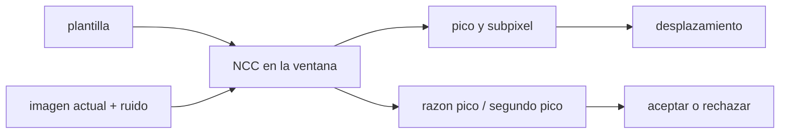

# B74-C26 — Navegación por hitos y correlación de terreno

<!-- nav:top -->
[🏠 Programa](../../../../README.md) · [📚 Bloque B74](../../../tronco-comun/B74-estimacion-de-orbitas-y-navegacion-espacial.md) · [← Anterior: B74-C25 — Detección de limbo y bordes planetarios en imágenes de navegación](../B74-C25-deteccion-de-limbo-y-bordes-planetarios-en-imagenes-de-navegacion/CLASE.md) · [Siguiente: B74-C27 — Navegación por púlsares de rayos X como técnica de investigación →](../B74-C27-navegacion-por-pulsares-de-rayos-x-como-tecnica-de-investigacion/CLASE.md)
<!-- /nav -->

## 1. Ubicación, nivel y alcance

Clase 26 del bloque B74. Nivel N3. Navegar por **hitos** (*landmarks*) o por correlación de terreno consiste en reconocer en una imagen actual un trozo de terreno que se conoce de un mapa o de una imagen previa, y de su desplazamiento deducir posición o movimiento. La herramienta básica es la correlación cruzada normalizada (NCC) con refinamiento subpíxel. Aquí la aplicas a un terreno sintético con ruido creciente y a un terreno periódico donde falla por ambigüedad.

## 2. Por qué esta clase existe

Un buen pico de correlación no garantiza un buen emparejamiento: en un terreno repetitivo hay dos picos casi iguales. La decisión central: **¿cuánta precisión da la correlación en un terreno rico, y cuándo el emparejamiento es ambiguo y no debe usarse?**

## 3. Lo que podrás hacer al terminar

1. Calcular la correlación cruzada normalizada de una plantilla con una ventana de búsqueda.
2. Refinar el desplazamiento con interpolación parabólica.
3. Medir cómo crece el error con el ruido.
4. Usar la razón pico/segundo pico como prueba de ambigüedad.
5. Reconocer un terreno periódico como caso de fallo.
6. Rotular lo sintético y lo ilustrativo.

La evidencia es la **ficha de correlación de un hito** del ejercicio 12 (sección 20).

## 4. Con qué llegas y cómo comprobarlo

1. ¿Qué es la correlación cruzada normalizada?
2. ¿Qué es una plantilla?
3. ¿Qué es un desplazamiento subpíxel?
4. ¿Qué es una ambigüedad de correlación?
5. ¿Qué es una verificación por segunda vía?

<details>
<summary>Ver respuestas</summary>

1. El producto de dos señales sin media dividido por sus normas; vale 1 si son iguales salvo escala y desplazamiento de brillo. 2. Un recorte de imagen que se busca en otra. 3. Uno menor que un píxel, estimado por interpolación. 4. Varios picos de valor casi igual. 5. Calcular lo mismo con otro método y comparar.
</details>

Con cuatro o cinco aciertos, sigue; si no, repasa los prerrequisitos.

## 5. Un caso de contexto y casos de referencia

Un terreno sintético desplazado `(5,37; −3,82) px` con ruido de `0,05` se recupera con un error rms de `0,0084 px`; con ruido `1,0`, `0,0843 px`. En un terreno periódico, la razón pico/segundo pico es `1,00` y el desplazamiento hallado (`(5,37, 12,00)`) falla en `y` por un periodo. Es el **ejemplo conductor**; el terreno es sintético.

## 6. Vocabulario

La **NCC** mide la similitud de dos ventanas sin sensibilidad a brillo y contraste. La **plantilla** es el trozo de referencia. La **ventana de búsqueda** acota los desplazamientos. El **refinamiento subpíxel** ajusta una parábola alrededor del pico. La **razón pico/segundo pico** mide la unicidad. Un **terreno periódico** produce picos repetidos.

## 7. Modelo mental: reconocer un rostro en una foto de grupo



*Descripción textual:* la plantilla se desliza sobre la imagen para calcular la NCC; el pico con su refinamiento da el desplazamiento y la razón pico/segundo pico decide si el emparejamiento es único y aceptable.

Analogía: encontrar tu rostro en una foto de grupo: si eres único, el resultado es claro; si hay gemelos, hay ambigüedad aunque la coincidencia sea perfecta. Límite: el terreno sintético tiene la misma apariencia en las dos imágenes; en la práctica cambian la iluminación, la escala y la perspectiva.

## 8. La explicación, paso a paso

### 8.1 NCC y subpíxel

Para cada desplazamiento de `±12 px` se calcula la NCC de la plantilla de 32 × 32 px con la ventana de la imagen; el máximo se refina con una parábola en cada eje.

### 8.2 Error frente al ruido

Con ruido de `0,05`, `0,2`, `0,5` y `1,0`, el error rms del desplazamiento es `0,0084`, `0,0189`, `0,0411` y `0,0843 px`; la altura del pico baja de `0,973` a `0,686`. El error crece de forma casi proporcional al ruido.

### 8.3 La razón pico/segundo pico

En terreno rico es `4,64` (ruido 0,05) y `4,30` (ruido 1,0): un emparejamiento único. Una regla práctica es rechazar si la razón es menor que un umbral (por ejemplo 1,2–1,5; valor ilustrativo).

### 8.4 Ambigüedad

En un terreno periódico de 16 px, el pico (`0,970`) y el segundo (`0,968`) casi coinciden (razón `1,00`): el desplazamiento hallado en `y` es `12,00` frente a `−3,82` verdadero: se confunde un periodo. Un error de emparejamiento no se ve en el valor del pico.

## 9. Magnitudes, símbolos y unidades

| Símbolo | Qué es | Unidad | Valor / nota |
|---|---|---|---|
| `(dx, dy)` | desplazamiento verdadero | px | (5,37; −3,82) |
| `T` | tamaño de la plantilla | px | 32 |
| `NCC` | correlación cruzada normalizada | — | ≤ 1 |
| `σ` | ruido de la imagen | — | 0,05–1,0 |
| `pico/segundo` | razón de unicidad | — | 4,6 (rico); 1,0 (periódico) |
| `rms` | error del desplazamiento | px | 0,008–0,084 |

## 10. Convenciones y referencias

Terreno sintético de 256 × 256 px generado con ruido filtrado en Fourier (k₀ = 0,12 ciclos/px); desplazamiento por Fourier; ventana de búsqueda de ±12 px; 100 realizaciones por nivel de ruido; semilla 89. Todo sintético.

## 11. De dónde sale lo que afirmamos

| ID | Fuente | Localizador | Respalda | Estado |
|---|---|---|---|---|
| S1 | NIST, CODATA — Speed of light in vacuum — https://physics.nist.gov/cgi-bin/cuu/Value?c (consultada 2026-11-10) | entrada «c» | c = 299 792 458 m/s (exacta) | Consultada |
| S2 | NASA/JPL NAIF, SPICE Tutorials (índice) — https://naif.jpl.nasa.gov/naif/tutorials.html (consultada 2026-11-10) | lista de tipos de kernel | SPK, CK, PCK, IK, FK, LSK, SCLK y DSK y su función | Consultada |
| — | Montenbruck y Gill, *Satellite Orbits* (Springer, 2000); Tapley, Schutz y Born, *Statistical Orbit Determination* (Elsevier, 2004) | — | fundamento teórico general de la clase | No consultada |

Límites: la NCC y su refinamiento subpíxel son técnicas estándar no consultadas en una fuente concreta; no se consultó ninguna misión de navegación por terreno; NAIF solo respalda la lista de tipos de kernel (IK y FK describen el instrumento y los marcos).

## 12. Cómo ver la correlación de un hito

| Magnitud | Valor |
|---|---|
| error rms (ruido 0,05) | 0,0084 px |
| error rms (ruido 1,0) | 0,0843 px |
| pico NCC (ruido 1,0) | 0,686 |
| razón pico/segundo (rico) | 4,64 |
| razón pico/segundo (periódico) | 1,00 |

Descripción larga: el error sube con el ruido pero sigue siendo submilipíxel a decimal; en un terreno repetitivo la razón pico/segundo delata la ambigüedad.

## 13. Ejemplo trabajado: de píxeles a posición

**Paso 1 · Desplazamiento.** `0,0084` px de error con ruido 0,05.

**Paso 2 · Escala.** Con 10 m/px, el error es `0,0084 × 10 = 0,084 m` (aprox.).

**Paso 3 · Ruido grande.** Con ruido 1,0: `0,0843 × 10 = 0,84 m` (aprox.).

**Paso 4 · Ambigüedad.** Un salto de un periodo de 16 px son 160 m: un error gravísimo que el valor del pico no revela.

## 14. Distintas formas de describir un emparejamiento

**Por pico:** NCC. **Por subpíxel:** parábola. **Por unicidad:** pico/segundo pico. **Por ruido:** error rms. **Por terreno:** rico o periódico.

## 15. Práctica guiada

**Ejercicio 1 · guiado.** Convierte un error de 0,05 px a metros con 20 m/px. *Pasos:* multiplica.

<details><summary>Solución comentada</summary>

`1 m`.
</details>

**Ejercicio 2 · guiado.** ¿Qué NCC tienen dos ventanas idénticas? *Pista:* máxima similitud.

<details><summary>Solución comentada</summary>

1.
</details>

**Ejercicio 3 · guiado.** ¿Qué razón pico/segundo pico indica ambigüedad? *Pista:* picos casi iguales.

<details><summary>Solución comentada</summary>

Cercana a 1.
</details>

## 16. Práctica autónoma, transferencia e integrador

**Ejercicio 4 · autónomo.** ¿Por qué la NCC no depende del brillo medio ni del contraste?

<details><summary>Solución comentada</summary>

Porque resta la media y normaliza por la norma de cada ventana.
</details>

**Ejercicio 5 · autónomo.** ¿Qué ocurre con el error si la plantilla se amplía a 64 × 64 px?

<details><summary>Solución comentada</summary>

Disminuye, porque hay más información; pero la perspectiva cambia más.
</details>

**Ejercicio 6 · autónomo.** ¿Cómo detectarías una ambigüedad sin conocer la verdad?

<details><summary>Solución comentada</summary>

Con la razón pico/segundo pico y comprobando consistencia con la dinámica.
</details>

**Ejercicio 7 · autónomo.** ¿Qué pasa si la ventana de búsqueda es menor que el desplazamiento?

<details><summary>Solución comentada</summary>

No se encuentra el pico verdadero.
</details>

**Ejercicio 8 · autónomo.** ¿Qué hace el subpíxel con ruido alto?

<details><summary>Solución comentada</summary>

Su error crece; la parábola sobre tres puntos es sensible al ruido.
</details>

**Ejercicio 9 · transferencia.** **Transferencia.** Una agencia usa correlación de terreno para el descenso. ¿Qué verificaría de la imagen?

<details><summary>Solución comentada</summary>

Que haya relieve suficiente, iluminación comparable y escala y perspectiva compatibles.
</details>

**Ejercicio 10 · transferencia.** **Transferencia.** ¿Cómo combinarías esta medida con un filtro?

<details><summary>Solución comentada</summary>

Como medida de desplazamiento con su covarianza en un EKF; con la prueba de unicidad como puerta (C30).
</details>

**Ejercicio 11 · transferencia.** **Transferencia.** ¿Qué cambia con un cráter en lugar de una ventana arbitraria?

<details><summary>Solución comentada</summary>

Un hito discreto: se ajusta una forma (elipse) en lugar de correlacionar la textura.
</details>

**Ejercicio 12 · integrador.** **Integrador.** Elabora tu *ficha de correlación de un hito*: NCC, error frente al ruido, razón pico/segundo pico y un caso ambiguo, rotulando lo sintético.

<details><summary>Solución comentada</summary>

Secciones 8.1–8.4 y la salida del laboratorio.
</details>

## 17. Laboratorio: NCC con subpíxel y ambigüedad

El script [laboratorio.py](laboratorio.py) correlaciona una plantilla con un terreno sintético desplazado y ruidoso, mide el error con cuatro niveles de ruido y prueba un terreno periódico (**comprueba** error rms < 0,05 px con ruido 0,05, error creciente con el ruido y razón pico/segundo < 1,1 en el periódico).

**Datos:** terreno e imagen **sintéticos/ilustrativos**. **Predice antes de ejecutar:** ¿qué razón pico/segundo pico tendrá el terreno periódico? (cercana a 1). **Ejecución del 2026-11-10 (Python 3.12.9, NumPy 2.4.4):**

```text
Python 3.12.9, NumPy 2.4.4 (terreno SINTETICO, semilla 89)
desplazamiento verdadero = (5.37, -3.82) px ; plantilla 32 x 32 px ; busqueda +/-12 px
ruido    error rms [px]   NCC pico medio   razon pico/segundo pico (media)
 0.05          0.0084            0.973                       4.64
 0.20          0.0189            0.955                       4.64
 0.50          0.0411            0.871                       4.57
 1.00          0.0843            0.686                       4.30
Terreno periodico (16 px), ruido 0.20: pico NCC = 0.970, segundo pico = 0.968, razon = 1.00; desplazamiento hallado = (5.37, 12.00) px frente a (5.37, -3.82) verdadero
Pruebas superadas.
```

```bash
python programa/clases/B74/B74-C26-navegacion-por-hitos-y-correlacion-de-terreno/laboratorio.py
```

**Límites:** el terreno no cambia salvo por el desplazamiento y el ruido; sin cambios de iluminación, escala ni perspectiva; solo traslación.

## 18. Errores frecuentes y cómo corregirlos

**Fiarse del valor del pico.** En terreno periódico es alto y engañoso; ver 8.4.

**Ignorar el ruido.** Aumenta el error; ver 8.2.

**Usar una ventana de búsqueda pequeña.** Puede perder el pico.

**Presentar el terreno sintético como real.** Rotula como sintético, como en la sección 10.

## 19. Cómo sabrás que vas bien

Tras la sección 8: ¿qué esperabas del error con ruido 1,0 y cuál fue? Si dudas, repasa el ejemplo 13. Tras el laboratorio: ¿qué comprueba? (ver la sección 17).

## 20. Qué entregas y cómo se evalúa

El producto es tu **ficha de correlación de un hito** (ejercicio 12).

| Criterio | Inicial | En desarrollo | Logrado | Destacado |
|---|---|---|---|---|
| Conceptos | Los confunde | Parciales | Calcula NCC y usa la razón pico/segundo pico | Explica los límites |
| Cálculo | Sin unidades | Con errores | Tablas completas con unidades | Calcula casos nuevos |
| Numérico | Sin comprobar | Un caso | Contraste con una segunda vía | Interpreta las diferencias |
| Fuentes | Sin fuente | Sin fecha | Fuentes con fecha y estado | Declara lo sintético y lo no consultado |
| Límites | No los nombra | Uno | Tres | Discute qué falta del modelo |

**Condiciones críticas (no se compensan con promedio):** aplicar una prueba de unicidad y rotular el terreno como sintético; rotular los datos como sintéticos y no presentar nada simulado como observado; citar solo lo consultado.

## 21. Ética, seguridad y límites

Clase educativa en estado E0: los modelos son simplificados y sus datos son sintéticos o ilustrativos; ningún resultado describe la órbita real de una nave ni sustituye a un producto de navegación de misión. Accesibilidad: tablas equivalentes a las gráficas, fórmulas en texto, ejercicios sin conexión. Tolerancias del laboratorio: error rms < 0,05 px con ruido 0,05 (100 realizaciones); razón pico/segundo < 1,1 en terreno periódico.

## 22. Para cerrar y seguir

La correlación de terreno recupera el desplazamiento con `0,0084` a `0,0843 px` según el ruido, pero en un terreno periódico la razón pico/segundo pico es `1,00` y el resultado es ambiguo. Queda una pregunta: ¿pueden los púlsares de rayos X ser un «GPS» del espacio profundo?

**Glosario español–inglés.** correlación cruzada normalizada · *normalized cross-correlation*; plantilla · *template*; hito · *landmark*; ambigüedad · *ambiguity*; subpíxel · *sub-pixel*.

**Continuidad.** [B74-C27](../B74-C27-navegacion-por-pulsares-de-rayos-x-como-tecnica-de-investigacion/CLASE.md) estudia la navegación por púlsares de rayos X como técnica de investigación.

**Referencias:** ver sección 11.

<!-- nav:bottom -->
---

[← Anterior: B74-C25 — Detección de limbo y bordes planetarios en imágenes de navegación](../B74-C25-deteccion-de-limbo-y-bordes-planetarios-en-imagenes-de-navegacion/CLASE.md) · [📚 Bloque B74](../../../tronco-comun/B74-estimacion-de-orbitas-y-navegacion-espacial.md) · [Siguiente: B74-C27 — Navegación por púlsares de rayos X como técnica de investigación →](../B74-C27-navegacion-por-pulsares-de-rayos-x-como-tecnica-de-investigacion/CLASE.md)
<!-- /nav -->
