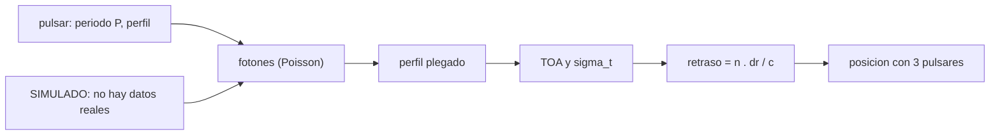

# B74-C27 — Navegación por púlsares de rayos X como técnica de investigación

<!-- nav:top -->
[🏠 Programa](../../../../README.md) · [📚 Bloque B74](../../../tronco-comun/B74-estimacion-de-orbitas-y-navegacion-espacial.md) · [← Anterior: B74-C26 — Navegación por hitos y correlación de terreno](../B74-C26-navegacion-por-hitos-y-correlacion-de-terreno/CLASE.md) · [Siguiente: B74-C28 — Medidas de rango y Doppler para determinar la órbita →](../B74-C28-medidas-de-rango-y-doppler-para-determinar-la-orbita/CLASE.md)
<!-- /nav -->

## 1. Ubicación, nivel y alcance

Clase 27 del bloque B74. Nivel N3. Los púlsares emiten pulsos periódicos de rayos X tan regulares que sus tiempos de llegada pueden funcionar como un reloj y un faro: si una nave mide cuándo llega un pulso y lo compara con el momento en que llegaría a un punto de referencia, el retraso `n·Δr/c` informa de su posición a lo largo de la dirección `n` del púlsar. Es una **técnica de investigación** en desarrollo; esta clase es una **simulación** con un púlsar y un detector ilustrativos, no con datos reales, y no describe un sistema operativo.

## 2. Por qué esta clase existe

La idea atrae porque sería autónoma, sin estaciones; la pregunta honesta es cuánta precisión da con una cantidad realista de fotones. La decisión central: **¿cuánto tiempo de observación y cuántos púlsares hacen falta para una cierta precisión, y qué parte de la técnica sigue sin demostrarse en esta clase?**

## 3. Lo que podrás hacer al terminar

1. Escribir el retraso de llegada `n·Δr/c` de un pulso.
2. Estimar el tiempo de llegada con un perfil plegado y máxima verosimilitud de Poisson.
3. Comparar la dispersión con la cota de Cramér–Rao.
4. Convertir la precisión de tiempo en precisión de posición con tres púlsares.
5. Ver que la precisión mejora como `1/√T`.
6. Declarar qué es simulado, qué es ilustrativo y qué no se consultó.

La evidencia es la **presupuesto de un fijado por púlsares (simulado)** del ejercicio 12 (sección 20).

## 4. Con qué llegas y cómo comprobarlo

1. ¿Qué es un púlsar?
2. ¿Qué es el perfil plegado?
3. ¿Qué es el ruido de Poisson?
4. ¿Qué es una cota de Cramér–Rao?
5. ¿Qué es una verificación por segunda vía?

<details>
<summary>Ver respuestas</summary>

1. Una estrella de neutrones que gira y emite pulsos periódicos. 2. El histograma de las llegadas de fotones según su fase de rotación. 3. Fluctuación √N de un recuento de N eventos. 4. Un límite inferior a la varianza de un estimador insesgado. 5. Calcular lo mismo con otro método y comparar.
</details>

Con cuatro o cinco aciertos, sigue; si no, repasa los prerrequisitos.

## 5. Un caso de contexto y casos de referencia

En una **simulación** con un púlsar ilustrativo (periodo 33 ms, 8 fotones/s pulsados y 20 de fondo), un tiempo de llegada medido durante `10³`, `10⁴` y `10⁵ s` tiene dispersión `13,92`, `4,57` y `1,51 µs` (cotas `14,85`, `4,70` y `1,49 µs`). Con tres púlsares sintéticos el fijado de posición simulado es de `8,58`, `2,81` y `0,93 km`. Es el **ejemplo conductor**; nada de esto proviene de observaciones.

## 6. Vocabulario

El **tiempo de llegada** (TOA) de un pulso se estima ajustando un perfil. El **retraso geométrico** es `Δt = n·Δr/c` para un desplazamiento `Δr` respecto de la referencia. El **perfil plegado** acumula fotones según la fase. La **cota de Cramér–Rao** limita el error del TOA: `σ_t = P/√(T Σ λ′²/λ Δφ)`. La **dilución** de la geometría multiplica `cσ_t`.

## 7. Modelo mental: un faro que parpadea con precisión de reloj



*Descripción textual:* un púlsar simulado emite fotones con ruido de Poisson, se pliega el perfil, se estima el tiempo de llegada, se convierte el retraso en posición con tres púlsares y todo el proceso está rotulado como simulado.

Analogía: determinar tu posición escuchando tres faros que parpadean con una cadencia perfecta: cuanto más tiempo cuentas parpadeos, mejor sabes cuándo llegaron. Límite: la técnica real exige modelos de tiempo del púlsar, correcciones relativistas, detectores de rayos X sensibles y un fondo bien caracterizado; esta clase simula solo la estadística de fotones.

## 8. La explicación, paso a paso

### 8.1 La idea

Si una nave está desplazada `Δr` respecto de la referencia, el pulso del púlsar en la dirección `n` llega `Δt = n·Δr/c` antes o después. Medir `Δt` da la componente `n·Δr`; con tres direcciones no coplanares se obtiene `Δr`.

### 8.2 Precisión del tiempo de llegada

En la simulación (perfil gaussiano de 0,03 ciclos sobre un fondo, 64 casillas, Poisson), la dispersión del TOA es `13,92 µs` a `10³ s`, `4,57 µs` a `10⁴ s` y `1,51 µs` a `10⁵ s`; la cota de Cramér–Rao es `14,85`, `4,70` y `1,49 µs`: el estimador (cociente `0,94`, `0,97`, `1,02`) casi la alcanza.

### 8.3 De tiempo a posición

`cσ_t` vale `4175 m` a `10³ s` y `454 m` a `10⁵ s`. Con una geometría de tres púlsares sintéticos de dilución `2,06`, el fijado simulado es `8,58 km`, `2,81 km` y `0,93 km`. La mejora es como `1/√T` (cociente `9,20` entre `10³` y `10⁵ s`; esperado 10).

### 8.4 Qué no está demostrado aquí

Este resultado es de una estadística de fotones con parámetros ilustrativos. No incluye la incertidumbre de la efeméride del púlsar, la estabilidad a largo plazo, la sincronización con la nave, el movimiento de la nave durante las `10⁵ s` ni el fondo real. Por eso se trata como técnica de investigación y no como método operativo.

## 9. Magnitudes, símbolos y unidades

| Símbolo | Qué es | Unidad | Valor / nota |
|---|---|---|---|
| `P` | periodo del púlsar | s | 0,033 (ilustrativo) |
| `w` | anchura del pulso | ciclos | 0,03 |
| `λ` | tasa de fotones | fotones/s | 8 pulsados + 20 de fondo |
| `T` | duración de la observación | s | 10³, 10⁴, 10⁵ |
| `σ_t` | incertidumbre del TOA | µs | 13,9 → 1,5 |
| `Δt = n·Δr/c` | retraso geométrico | s | 1 µs ↔ 300 m |

## 10. Convenciones y referencias

Perfil gaussiano plegado en 64 casillas; recuentos de Poisson; estimación por máxima verosimilitud sobre una malla; tres púlsares sintéticos con direcciones no coplanares; `c = 299 792 458 m/s` (NIST). Todo simulado e ilustrativo; no se usaron datos ni parámetros de púlsares ni detectores reales.

## 11. De dónde sale lo que afirmamos

| ID | Fuente | Localizador | Respalda | Estado |
|---|---|---|---|---|
| S1 | NIST, CODATA — Speed of light in vacuum — https://physics.nist.gov/cgi-bin/cuu/Value?c (consultada 2026-11-10) | entrada «c» | c = 299 792 458 m/s (exacta) | Consultada |
| — | Thornton y Border, *Radiometric Tracking Techniques for Deep-Space Navigation* (JPL/Wiley, 2003); Montenbruck y Gill, *Satellite Orbits* (Springer, 2000) | — | fundamento teórico general de la clase | No consultada |

Límites: no se consultó ninguna fuente sobre navegación por púlsares ni sobre demostraciones en vuelo (los intentos de consultar una página de la NASA fallaron con error 404); todos los parámetros del púlsar y del detector son ilustrativos. La cota de Cramér–Rao se contrasta con la simulación.

## 12. Cómo ver un fijado por púlsares (simulado)

| Magnitud | Valor |
|---|---|
| σ_t a 10³ s (emp./cota) | 13,92 / 14,85 µs |
| σ_t a 10⁵ s (emp./cota) | 1,51 / 1,49 µs |
| c σ_t a 10⁵ s | 454 m |
| σ posición 3D a 10³ s | 8,58 km |
| σ posición 3D a 10⁵ s | 0,93 km |

Descripción larga: la precisión del tiempo mejora con la raíz de la duración, alcanza la cota de Cramér–Rao y se convierte en posición con la geometría de los púlsares.

## 13. Ejemplo trabajado: de microsegundos a kilómetros

**Paso 1 · TOA.** `σ_t = 1,51 µs` a `10⁵ s`.

**Paso 2 · Alcance.** `c σ_t = 454 m`.

**Paso 3 · Geometría.** Con dilución `2,06`, `σ_pos = 0,93 km`.

**Paso 4 · Lectura.** Menos de un kilómetro en simulación tras 28 h de observación (`10⁵ s`); a `10³ s` son `8,58 km`: la técnica compite solo con muchas horas de datos.

## 14. Distintas formas de describir un fijado por púlsares

**Por tiempo:** TOA. **Por distancia:** `cσ_t`. **Por geometría:** dilución. **Por duración:** `1/√T`. **Por estado:** simulado frente a demostrado.

## 15. Práctica guiada

**Ejercicio 1 · guiado.** Convierte 2 µs en metros. *Pasos:* `c × 2 × 10⁻⁶`.

<details><summary>Solución comentada</summary>

`600 m`.
</details>

**Ejercicio 2 · guiado.** ¿Cuánto mejora σ_t si la observación pasa de 10⁴ a 10⁶ s? *Pista:* `1/√T`.

<details><summary>Solución comentada</summary>

Diez veces.
</details>

**Ejercicio 3 · guiado.** ¿Qué retraso produce un desplazamiento de 3 km en la dirección del púlsar? *Pista:* `Δr/c`.

<details><summary>Solución comentada</summary>

`10 µs`.
</details>

## 16. Práctica autónoma, transferencia e integrador

**Ejercicio 4 · autónomo.** ¿Qué ocurre con σ_t si el fondo se duplica?

<details><summary>Solución comentada</summary>

Aumenta, porque la señal pulsada pierde contraste.
</details>

**Ejercicio 5 · autónomo.** ¿Qué pulso daría mejor precisión: uno más estrecho o uno más ancho?

<details><summary>Solución comentada</summary>

El más estrecho: mayor pendiente.
</details>

**Ejercicio 6 · autónomo.** ¿Por qué se necesitan al menos tres púlsares no coplanares?

<details><summary>Solución comentada</summary>

Para observar las tres componentes de la posición.
</details>

**Ejercicio 7 · autónomo.** ¿Qué papel tiene la efeméride del púlsar?

<details><summary>Solución comentada</summary>

Su error se suma como sesgo al TOA.
</details>

**Ejercicio 8 · autónomo.** ¿Qué ocurre si la nave se mueve durante la observación?

<details><summary>Solución comentada</summary>

Se debe modelar el movimiento en el ajuste; si no, se sesga el TOA.
</details>

**Ejercicio 9 · transferencia.** **Transferencia.** Un artículo afirma «precisión de 100 m con púlsares». ¿Qué preguntas haces?

<details><summary>Solución comentada</summary>

Cuántas horas, qué detector y área, qué púlsares, si fue simulado o real y qué modelo de tiempo usó.
</details>

**Ejercicio 10 · transferencia.** **Transferencia.** ¿Por qué es una técnica de investigación y no operativa en esta clase?

<details><summary>Solución comentada</summary>

Porque aquí solo se simula la estadística de fotones y no se cubren los sistemáticos.
</details>

**Ejercicio 11 · transferencia.** **Transferencia.** ¿Cómo combinarías púlsares con Doppler de una estación?

<details><summary>Solución comentada</summary>

Como observables complementarios en un filtro, con sus covarianzas y sesgos.
</details>

**Ejercicio 12 · integrador.** **Integrador.** Elabora tu *presupuesto de un fijado por púlsares (simulado)*: σ_t frente a la cota para tres duraciones, conversión a metros, geometría de tres púlsares y la lista de lo que no se modela, rotulando claramente lo simulado.

<details><summary>Solución comentada</summary>

Secciones 8.1–8.4 y la salida del laboratorio.
</details>

## 17. Laboratorio: púlsares: TOA y posición (simulación)

El script [laboratorio.py](laboratorio.py) simula el perfil plegado de un púlsar con ruido de Poisson, estima el tiempo de llegada por máxima verosimilitud, lo compara con la cota de Cramér–Rao y lo convierte en posición con tres púlsares sintéticos (**comprueba** dispersión dentro del 25 % de la cota y escala `1/√T` del error de posición).

**Datos:** púlsar, detector y geometría **simulados/ilustrativos**; `c` de NIST (consultado). **Predice antes de ejecutar:** ¿cuánto mejora la posición al pasar de 10³ a 10⁵ s? (unas 10 veces). **Ejecución del 2026-11-10 (Python 3.12.9, NumPy 2.4.4):**

```text
Python 3.12.9, NumPy 2.4.4 (SIMULACION con pulsar y detector ILUSTRATIVOS, semilla 97)
P = 33 ms ; anchura = 0.03 ciclos ; tasa pulsada = 8.0 fot/s ; fondo = 20.0 fot/s
T [s]        sigma_t emp [us]   cota CR [us]   cociente   sigma alcance equivalente c sigma_t [m]
    1e+03            13.925         14.853      0.938           4174.6
    1e+04             4.567          4.697      0.972           1369.1
    1e+05             1.513          1.485      1.019            453.6
Geometria de tres pulsares sinteticos: factor de dilucion = 2.06
T =   1e+03 s: sigma de posicion 3D = 8.58 km
T =   1e+04 s: sigma de posicion 3D = 2.81 km
T =   1e+05 s: sigma de posicion 3D = 0.93 km
Cociente sigma(1e3 s)/sigma(1e5 s) = 9.20 (esperado 10)
Pruebas superadas.
```

```bash
python programa/clases/B74/B74-C27-navegacion-por-pulsares-de-rayos-x-como-tecnica-de-investigacion/laboratorio.py
```

**Límites:** solo estadística de fotones; sin efeméride del púlsar, sin movimiento de la nave, sin fondo variable ni efectos relativistas; no es una demostración de capacidad operativa.

## 18. Errores frecuentes y cómo corregirlos

**Presentar la simulación como una capacidad demostrada.** Es una técnica de investigación; ver 8.4.

**Olvidar el movimiento de la nave durante la observación.** Sesga el TOA.

**Creer que la precisión mejora más rápido que `1/√T`.** Es ley de la raíz; ver 8.3.

**Usar los números del laboratorio como datos reales.** Todo es ilustrativo; ver la sección 10.

## 19. Cómo sabrás que vas bien

Tras la sección 8: ¿cuánto esperabas de mejora con 100 veces más tiempo y cuánto hubo? Si dudas, repasa el ejemplo 13. Tras el laboratorio: ¿qué comprueba? (ver la sección 17).

## 20. Qué entregas y cómo se evalúa

El producto es tu **presupuesto de un fijado por púlsares (simulado)** (ejercicio 12).

| Criterio | Inicial | En desarrollo | Logrado | Destacado |
|---|---|---|---|---|
| Conceptos | Los confunde | Parciales | Relaciona TOA, retraso geométrico y posición | Explica los límites |
| Cálculo | Sin unidades | Con errores | Tablas completas con unidades | Calcula casos nuevos |
| Numérico | Sin comprobar | Un caso | Contraste con una segunda vía | Interpreta las diferencias |
| Fuentes | Sin fuente | Sin fecha | Fuentes con fecha y estado | Declara lo sintético y lo no consultado |
| Límites | No los nombra | Uno | Tres | Discute qué falta del modelo |

**Condiciones críticas (no se compensan con promedio):** declarar la técnica como de investigación y lo simulado como simulado; rotular los datos como sintéticos y no presentar nada simulado como observado; citar solo lo consultado.

## 21. Ética, seguridad y límites

Clase educativa en estado E0: los modelos son simplificados y sus datos son sintéticos o ilustrativos; ningún resultado describe la órbita real de una nave ni sustituye a un producto de navegación de misión. Accesibilidad: tablas equivalentes a las gráficas, fórmulas en texto, ejercicios sin conexión. Tolerancias del laboratorio: σ_t empírica dentro del 25 % de la cota; cociente de posición 10³/10⁵ s entre 7 y 14.

## 22. Para cerrar y seguir

En simulación, `10⁵ s` de datos de un púlsar ilustrativo dan `1,51 µs` de TOA y `0,93 km` de posición con tres púlsares; es la estadística de fotones, no una capacidad probada. Queda una pregunta: ¿cómo se intercambian los elementos orbitales entre equipos?

**Glosario español–inglés.** navegación por púlsares de rayos X · *X-ray pulsar navigation*; tiempo de llegada · *time of arrival*; perfil plegado · *folded profile*; cota de Cramér–Rao · *Cramér–Rao bound*; técnica de investigación · *research technique*.

**Continuidad.** [B74-C28](../B74-C28-medidas-de-rango-y-doppler-para-determinar-la-orbita/CLASE.md) estudia las medidas de rango y Doppler para determinar la órbita.

**Referencias:** ver sección 11.

<!-- nav:bottom -->
---

[← Anterior: B74-C26 — Navegación por hitos y correlación de terreno](../B74-C26-navegacion-por-hitos-y-correlacion-de-terreno/CLASE.md) · [📚 Bloque B74](../../../tronco-comun/B74-estimacion-de-orbitas-y-navegacion-espacial.md) · [Siguiente: B74-C28 — Medidas de rango y Doppler para determinar la órbita →](../B74-C28-medidas-de-rango-y-doppler-para-determinar-la-orbita/CLASE.md)
<!-- /nav -->
