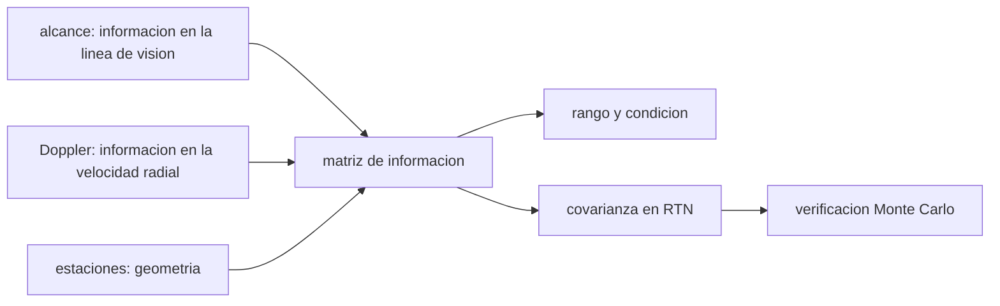

# B74-C28 — Medidas de rango y Doppler para determinar la órbita

<!-- nav:top -->
[🏠 Programa](../../../../README.md) · [📚 Bloque B74](../../../tronco-comun/B74-estimacion-de-orbitas-y-navegacion-espacial.md) · [← Anterior: B74-C27 — Navegación por púlsares de rayos X como técnica de investigación](../B74-C27-navegacion-por-pulsares-de-rayos-x-como-tecnica-de-investigacion/CLASE.md) · [Siguiente: B74-C29 — Formatos TLE y OMM de elementos orbitales →](../B74-C29-formatos-tle-y-omm-de-elementos-orbitales/CLASE.md)
<!-- /nav -->

## 1. Ubicación, nivel y alcance

Clase 28 del bloque B74. Nivel N3. El alcance y la velocidad de alcance (Doppler) no aportan la misma información sobre una órbita. Aquí comparas, con la matriz de información de un ajuste, qué parte del estado de una órbita sintética observa cada observable desde una o dos estaciones fijas en 20 minutos: cuántas componentes son observables, con qué precisión en el marco RTN y con qué número de condición. Es la versión «cuantitativa» de las clases C03, C04 y C15.

## 2. Por qué esta clase existe

Un único pase desde una única estación puede no determinar la órbita completa, aunque la medida sea muy precisa. La decisión central: **¿qué combinación de observables y de estaciones hace observable el estado y con qué precisión en cada dirección?**

## 3. Lo que podrás hacer al terminar

1. Construir la matriz de información de alcance, de Doppler y de ambos.
2. Determinar el rango numérico y el número de condición de la información.
3. Reconocer que una sola estación en un solo pase no hace observable el estado completo.
4. Comparar la precisión en R, T y N para alcance, Doppler y ambos.
5. Contrastar la covarianza formal con Monte Carlo.
6. Rotular lo sintético y lo ilustrativo.

La evidencia es la **comparación de la información por observable** del ejercicio 12 (sección 20).

## 4. Con qué llegas y cómo comprobarlo

1. ¿Qué es el rango de una matriz?
2. ¿Qué es el número de condición?
3. ¿Qué es el marco RTN?
4. ¿Qué es la observabilidad?
5. ¿Qué es una verificación por segunda vía?

<details>
<summary>Ver respuestas</summary>

1. El número de direcciones independientes que contiene. 2. El cociente entre el mayor y el menor valor singular. 3. El marco local radial, transversal y normal. 4. La posibilidad de determinar el estado a partir de las medidas. 5. Calcular lo mismo con otro método y comparar.
</details>

Con cuatro o cinco aciertos, sigue; si no, repasa los prerrequisitos.

## 5. Un caso de contexto y casos de referencia

Con una estación fija en 20 minutos, alcance y Doppler juntos solo hacen observable un subespacio de rango `4` de 6. Con dos estaciones el alcance solo da `σ = (8,0, 13,9, 102,6) m` (R, T, N), el Doppler solo `(2,4, 1,4, 80,5) m` y ambos `(1,8, 1,1, 21,4) m`. Es el **ejemplo conductor**; la órbita y las estaciones son sintéticas.

## 6. Vocabulario

La **matriz de información** `HᵀWH` suma las contribuciones de los observables. Su **rango numérico** es el número de direcciones del estado que se pueden determinar. El **número de condición** mide cuán desigual es la información. El **marco RTN** descompone el error en radial, transversal y normal. La **normalización** por escalas permite comparar posición y velocidad.

## 7. Modelo mental: dos tipos de reglas para medir una órbita



*Descripción textual:* el alcance, el Doppler y las estaciones aportan información que se suma en una matriz; su rango y su número de condición dicen qué es observable y su inversa da la covarianza en RTN, que se verifica con Monte Carlo.

Analogía: medir un edificio con una cinta (alcance) o con un medidor de cambios (Doppler); cada uno ve cosas distintas y juntos desde varios puntos lo ven completo. Límite: la clase simula estaciones fijas en el espacio inercial y un solo pase; con la rotación terrestre y varios pases la observabilidad mejora.

## 8. La explicación, paso a paso

### 8.1 Una estación, un pase

Con alcance y Doppler de una sola estación en 20 minutos, la información tiene rango `4` de 6: hay dos direcciones del estado que ninguna medida distingue (número de condición `5,0e+16`). No hay covarianza finita.

### 8.2 Dos estaciones

Con dos estaciones el estado se hace observable. Solo con alcance: `σ` posición `(8,0, 13,9, 102,6) m` y velocidad `(0,0464, 0,0267, 0,1864) m/s`. Solo con Doppler: `(2,4, 1,4, 80,5) m` y `(0,0064, 0,0042, 0,0226) m/s`.

### 8.3 Ambos observables

Alcance y Doppler juntos: posición `(1,8, 1,1, 21,4) m` y velocidad `(0,0047, 0,0033, 0,0181) m/s`; el número de condición baja a `1,25e+03`. El Doppler domina la precisión de velocidad (unas 6 a 7 veces mejor que el alcance solo) y el alcance aporta la posición absoluta: se complementan. La componente normal es la peor en los tres casos.

### 8.4 Verificación

Con 200 realizaciones de ruido y ajuste por Gauss–Newton, la dispersión empírica coincide con la formal con cocientes entre `1,00` y `1,06`: la matriz de información describe bien la precisión.

## 9. Magnitudes, símbolos y unidades

| Símbolo | Qué es | Unidad | Valor / nota |
|---|---|---|---|
| `HᵀWH` | matriz de información | — | 6 × 6 |
| `rango` | direcciones observables | — | 4 (1 est.); 6 (2 est.) |
| `κ` | número de condición normalizado | — | 1,25 × 10³ (ambos, 2 est.) |
| `σ_R, σ_T, σ_N` | incertidumbres de posición en RTN | m | 1,8; 1,1; 21,4 |
| `σ_ρ, σ_ρ̇` | ruidos de medida | m, m/s | 10; 0,01 (ilustrativos) |
| `Δt` | paso de medida | s | 60 |

## 10. Convenciones y referencias

Órbita kepleriana sintética (μ = 3,986004 × 10¹⁴ m³/s², ilustrativo); estaciones fijas en el marco inercial; 21 instantes en 20 min; matriz de información por diferencias centrales del propagador; rango con umbral de 10⁻⁹ relativo; semilla 101. Todo sintético.

## 11. De dónde sale lo que afirmamos

| ID | Fuente | Localizador | Respalda | Estado |
|---|---|---|---|---|
| S1 | NIST, CODATA — Speed of light in vacuum — https://physics.nist.gov/cgi-bin/cuu/Value?c (consultada 2026-11-10) | entrada «c» | c = 299 792 458 m/s (exacta) | Consultada |
| S2 | NASA/JPL, DSN Telecommunications Link Design Handbook 810-005 (índice) — https://deepspace.jpl.nasa.gov/dsndocs/810-005/ (consultada 2026-11-10) | página de presentación | el manual trata de los parámetros de desempeño de los enlaces de telecomunicaciones entre nave y DSN; los módulos de radiometría no se leyeron | Consultada (solo índice) |
| — | Tapley, Schutz y Born, *Statistical Orbit Determination* (Elsevier, 2004); Thornton y Border, *Radiometric Tracking Techniques for Deep-Space Navigation* (JPL/Wiley, 2003); Montenbruck y Gill, *Satellite Orbits* (Springer, 2000) | — | fundamento teórico general de la clase | No consultada |

Límites: del manual del DSN solo se leyó la página de presentación; no se consultó ningún dato sobre cómo se combinan alcance y Doppler en las operaciones reales. Los resultados son de un modelo sintético con estaciones fijas y un solo pase.

## 12. Cómo ver la información por observable

| Magnitud | Valor |
|---|---|
| rango, 1 estación (ambos) | 4 de 6 |
| σ_T alcance solo, 2 est. | 13,9 m |
| σ_T Doppler solo, 2 est. | 1,4 m |
| σ_T ambos, 2 est. | 1,1 m |
| σ_vT ambos, 2 est. | 0,0033 m/s |

Descripción larga: una estación en un pase no basta; con dos, el Doppler domina la velocidad y el alcance la posición; juntos mejoran la precisión y el condicionamiento.

## 13. Ejemplo trabajado: complementariedad de observables

**Paso 1 · Velocidad.** `σ_vT` con alcance solo: `0,0267 m/s`; con Doppler solo: `0,0042 m/s`.

**Paso 2 · Posición.** `σ_pR` con alcance solo: `8,0 m`; con Doppler solo: `2,4 m`.

**Paso 3 · Ambos.** `σ_pR = 1,8 m`, `σ_vT = 0,0033 m/s`.

**Paso 4 · Lectura.** Cada observable cubre lo que el otro mide peor.

## 14. Distintas formas de describir la observabilidad

**Por rango:** direcciones observables. **Por condición:** equilibrio de la información. **Por RTN:** precisión direccional. **Por observable:** alcance, Doppler o ambos. **Por simulación:** Monte Carlo.

## 15. Práctica guiada

**Ejercicio 1 · guiado.** ¿Cuántas incógnitas tiene el estado orbital? *Pista:* posición y velocidad.

<details><summary>Solución comentada</summary>

6.
</details>

**Ejercicio 2 · guiado.** Si el rango de la información es 4, ¿cuántas direcciones no se observan? *Pista:* 6 − 4.

<details><summary>Solución comentada</summary>

2.
</details>

**Ejercicio 3 · guiado.** ¿Qué ocurre con la covarianza formal en el caso de rango 4? *Pista:* inversa de una matriz singular.

<details><summary>Solución comentada</summary>

No existe (o es infinita en las direcciones no observadas).
</details>

## 16. Práctica autónoma, transferencia e integrador

**Ejercicio 4 · autónomo.** ¿Por qué el Doppler da mejor velocidad?

<details><summary>Solución comentada</summary>

Porque mide directamente la velocidad radial con 0,01 m/s.
</details>

**Ejercicio 5 · autónomo.** ¿Por qué el alcance da mejor posición absoluta?

<details><summary>Solución comentada</summary>

Mide la distancia con 10 m, con sensibilidad directa.
</details>

**Ejercicio 6 · autónomo.** ¿Qué mejora la observabilidad de una sola estación?

<details><summary>Solución comentada</summary>

Más pases (la rotación terrestre cambia la geometría) o un arco más largo.
</details>

**Ejercicio 7 · autónomo.** ¿Por qué la componente normal es la peor?

<details><summary>Solución comentada</summary>

Porque las líneas de visión desde estaciones cercanas aportan poca información fuera del plano orbital.
</details>

**Ejercicio 8 · autónomo.** ¿Qué te dice un número de condición de 10¹⁶?

<details><summary>Solución comentada</summary>

Que el problema es numéricamente singular: faltan direcciones.
</details>

**Ejercicio 9 · transferencia.** **Transferencia.** Un equipo propone un solo pase con una sola estación y un filtro. ¿Qué adviertes?

<details><summary>Solución comentada</summary>

Que el estado no es observable por completo y que la solución dependerá de la previa.
</details>

**Ejercicio 10 · transferencia.** **Transferencia.** ¿Cómo mejorarías la determinación con medidas ópticas?

<details><summary>Solución comentada</summary>

Aportando líneas de visión transversales (C13) que complementan el alcance y el Doppler.
</details>

**Ejercicio 11 · transferencia.** **Transferencia.** ¿Qué cambia si las estaciones giran con la Tierra?

<details><summary>Solución comentada</summary>

La geometría cambia durante el pase y aumenta el rango de información.
</details>

**Ejercicio 12 · integrador.** **Integrador.** Elabora tu *comparación de la información por observable*: tabla de rango, condición y σ en RTN para cuatro configuraciones, con una conclusión sobre la complementariedad, rotulando lo sintético.

<details><summary>Solución comentada</summary>

Secciones 8.1–8.4 y la salida del laboratorio.
</details>

## 17. Laboratorio: información de alcance y Doppler

El script [laboratorio.py](laboratorio.py) calcula la matriz de información de cuatro configuraciones de observables y estaciones, su rango y condición y la covarianza en RTN, y la verifica con Monte Carlo (**comprueba** rango 6 con ambos observables y dos estaciones, rango menor con una, y cociente empírico/formal entre 0,8 y 1,2).

**Datos:** órbita, estaciones y ruido **sintéticos/ilustrativos**; μ ilustrativo. **Predice antes de ejecutar:** ¿qué componente de posición es la peor? (la normal). **Ejecución del 2026-11-10 (Python 3.12.9, NumPy 2.4.4):**

```text
Python 3.12.9, NumPy 2.4.4 (orbita y estaciones SINTETICAS)
configuracion                sigma pos R,T,N [m]            sigma vel R,T,N [m/s]              cond(info)
alcance+Doppler, 1 est.    no observable: rango 4 de 6 (numero de condicion 5.0e+16)
alcance, 2 estaciones            8.0      13.9     102.6      0.0464   0.0267   0.1864       7.06e+03
Doppler, 2 estaciones            2.4       1.4      80.5      0.0064   0.0042   0.0226       1.59e+04
alcance+Doppler, 2 est.          1.8       1.1      21.4      0.0047   0.0033   0.0181       1.25e+03
Cociente sigma empirica / formal (alcance+Doppler, 2 est., 200 realizaciones): 1.02 1.05 1.05 1.00 1.05 1.06
Pruebas superadas.
```

```bash
python programa/clases/B74/B74-C28-medidas-de-rango-y-doppler-para-determinar-la-orbita/laboratorio.py
```

**Límites:** estaciones fijas en el espacio inercial, un solo pase y sin perturbaciones; el rango numérico depende del umbral elegido.

## 18. Errores frecuentes y cómo corregirlos

**Dar una covarianza para un estado no observable.** Comprueba el rango; ver 8.1.

**Creer que el alcance basta.** Ver 8.2–8.3.

**Ignorar la normal.** Es la peor componente.

**Presentar las estaciones sintéticas como reales.** Rotula como sintético, como en la sección 10.

## 19. Cómo sabrás que vas bien

Tras la sección 8: ¿qué observable esperabas mejor para la velocidad y cuál fue? Si dudas, repasa el ejemplo 13. Tras el laboratorio: ¿qué comprueba? (ver la sección 17).

## 20. Qué entregas y cómo se evalúa

El producto es tu **comparación de la información por observable** (ejercicio 12).

| Criterio | Inicial | En desarrollo | Logrado | Destacado |
|---|---|---|---|---|
| Conceptos | Los confunde | Parciales | Relaciona rango, condición y observabilidad | Explica los límites |
| Cálculo | Sin unidades | Con errores | Tablas completas con unidades | Calcula casos nuevos |
| Numérico | Sin comprobar | Un caso | Contraste con una segunda vía | Interpreta las diferencias |
| Fuentes | Sin fuente | Sin fecha | Fuentes con fecha y estado | Declara lo sintético y lo no consultado |
| Límites | No los nombra | Uno | Tres | Discute qué falta del modelo |

**Condiciones críticas (no se compensan con promedio):** comprobar la observabilidad antes de dar covarianzas y rotular los datos como sintéticos; rotular los datos como sintéticos y no presentar nada simulado como observado; citar solo lo consultado.

## 21. Ética, seguridad y límites

Clase educativa en estado E0: los modelos son simplificados y sus datos son sintéticos o ilustrativos; ningún resultado describe la órbita real de una nave ni sustituye a un producto de navegación de misión. Accesibilidad: tablas equivalentes a las gráficas, fórmulas en texto, ejercicios sin conexión. Tolerancias del laboratorio: rango 6 con ambos observables y dos estaciones; cociente empírico/formal entre 0,8 y 1,2.

## 22. Para cerrar y seguir

Con una estación el estado es observable solo en `4` de 6 direcciones; con dos estaciones, alcance y Doppler juntos dan `(1,8, 1,1, 21,4) m` en R, T, N. Queda una pregunta: ¿cómo se intercambian los elementos orbitales entre equipos y bases de datos?

**Glosario español–inglés.** observabilidad · *observability*; matriz de información · *information matrix*; rango · *rank*; número de condición · *condition number*; complementariedad · *complementarity*.

**Continuidad.** [B74-C29](../B74-C29-formatos-tle-y-omm-de-elementos-orbitales/CLASE.md) estudia los formatos TLE y OMM de elementos orbitales.

**Referencias:** ver sección 11.

<!-- nav:bottom -->
---

[← Anterior: B74-C27 — Navegación por púlsares de rayos X como técnica de investigación](../B74-C27-navegacion-por-pulsares-de-rayos-x-como-tecnica-de-investigacion/CLASE.md) · [📚 Bloque B74](../../../tronco-comun/B74-estimacion-de-orbitas-y-navegacion-espacial.md) · [Siguiente: B74-C29 — Formatos TLE y OMM de elementos orbitales →](../B74-C29-formatos-tle-y-omm-de-elementos-orbitales/CLASE.md)
<!-- /nav -->
