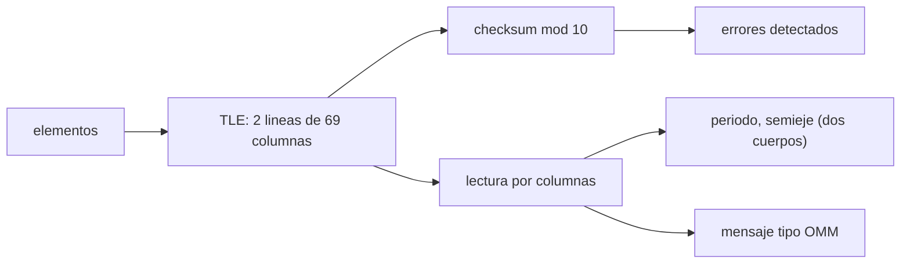

# B74-C29 — Formatos TLE y OMM de elementos orbitales

<!-- nav:top -->
[🏠 Programa](../../../../README.md) · [📚 Bloque B74](../../../tronco-comun/B74-estimacion-de-orbitas-y-navegacion-espacial.md) · [← Anterior: B74-C28 — Medidas de rango y Doppler para determinar la órbita](../B74-C28-medidas-de-rango-y-doppler-para-determinar-la-orbita/CLASE.md) · [Siguiente: B74-C30 — Asociación de observaciones y correlación de pistas →](../B74-C30-asociacion-de-observaciones-y-correlacion-de-pistas/CLASE.md)
<!-- /nav -->

## 1. Ubicación, nivel y alcance

Clase 29 del bloque B74. Nivel N3. Los elementos orbitales se intercambian en formatos de texto estandarizados. El **TLE** (*two-line element set*) es el clásico de 69 columnas por línea que usa un catálogo mundial de objetos; el **OMM** (*Orbit Mean-Elements Message*) es el mensaje de elementos medios del estándar CCSDS 502.0-B-3, que cubre el mismo contenido en formatos modernos. Aquí construyes un TLE **sintético** (objeto inventado), calculas su suma de verificación, lo lees, mides cuántos errores detecta esa suma y lo conviertes a un mensaje tipo OMM, sin ejecutar SGP4.

## 2. Por qué esta clase existe

Un TLE mal copiado o mal leído da una órbita equivocada sin avisar. La decisión central: **¿qué errores detecta la suma de verificación, qué resolución tiene cada campo y qué significan realmente esos «elementos medios»?**

## 3. Lo que podrás hacer al terminar

1. Nombrar los campos de las líneas 1 y 2 de un TLE y sus columnas.
2. Calcular la suma de verificación módulo 10 de cada línea.
3. Medir qué errores de un dígito y de transposición detecta.
4. Leer un TLE y estimar la magnitud física (periodo, semieje) de dos cuerpos.
5. Estimar la resolución de los campos en metros.
6. Pasar los campos a un mensaje tipo OMM y declarar lo no verificado.

La evidencia es la **TLE sintético validado y convertido** del ejercicio 12 (sección 20).

## 4. Con qué llegas y cómo comprobarlo

1. ¿Qué es una suma de verificación?
2. ¿Qué es el movimiento medio?
3. ¿Qué es una excentricidad sin punto decimal?
4. ¿Qué es un elemento medio?
5. ¿Qué es una verificación por segunda vía?

<details>
<summary>Ver respuestas</summary>

1. Un número derivado del contenido que sirve para detectar errores de copia. 2. Las vueltas por día de la órbita. 3. Un campo que omite el «0.» inicial. 4. Un elemento promediado, definido para una teoría de propagación concreta. 5. Calcular lo mismo con otro método y comparar.
</details>

Con cuatro o cinco aciertos, sigue; si no, repasa los prerrequisitos.

## 5. Un caso de contexto y casos de referencia

Un TLE sintético (objeto inventado `SINTETICO-99999`) tiene dos líneas de `69` caracteres con sumas de verificación `5` y `1`. La suma detecta `918` de `918` sustituciones de un dígito, pero `0` de `27` transposiciones. Su movimiento medio da un periodo de `95,68 min`. Es el **ejemplo conductor**; el TLE no describe un satélite real.

## 6. Vocabulario

El **TLE** son dos líneas de 69 columnas con elementos medios para el modelo SGP4. El **checksum** (columna 69) es la suma de los dígitos (el signo menos vale 1) módulo 10. El **movimiento medio** son revoluciones por día. El **OMM** es el mensaje de elementos medios de CCSDS 502.0-B-3. La **teoría de elementos medios** debe declararse: los elementos de un TLE solo son válidos con la teoría para la que se generaron.

## 7. Modelo mental: un formulario con casillas de ancho fijo



*Descripción textual:* los elementos se escriben en un TLE de columnas fijas, se calcula el checksum, se lee por columnas, se obtienen magnitudes de dos cuerpos y un mensaje tipo OMM; el checksum determina qué errores se detectan.

Analogía: un formulario con casillas de ancho fijo y un dígito de control al final; detecta cambiar una cifra, pero no intercambiar dos cifras. Límite: el TLE es un formato de elementos medios para una teoría de propagación; leer sus números como elementos osculadores de dos cuerpos es solo una aproximación de magnitud.

## 8. La explicación, paso a paso

### 8.1 La estructura

Según la página consultada de CelesTrak, la línea 1 contiene número de satélite (columnas 3–7), clasificación (8), designador (10–17), época (19–32), derivadas del movimiento medio, el término BSTAR, tipo de efeméride y número de elemento (65–68) y el checksum (69); la línea 2 contiene inclinación (9–16), RAAN (18–25), excentricidad sin punto (27–33), argumento del perigeo (35–42), anomalía media (44–51), movimiento medio (53–63), número de revolución (64–68) y checksum (69).

### 8.2 La suma de verificación

Los dígitos suman su valor y el signo menos suma 1; letras, espacios, puntos y el signo más suman 0; se toma módulo 10. El TLE sintético da `5` (línea 1) y `1` (línea 2).

### 8.3 Qué detecta

Cambiar un dígito por otro siempre cambia la suma: `918` de `918` (100 %). Intercambiar dos dígitos adyacentes no la cambia: `0` de `27` detectadas. Una suma módulo 10 no protege contra transposiciones.

### 8.4 Magnitudes y resolución

Con `n = 15,05 rev/día`, un cálculo de dos cuerpos da un periodo de `95,68 min` y un semieje de `6929,6 km` (solo orden de magnitud, pues los elementos son medios para SGP4). La resolución de la anomalia media (0,0001°) equivale a unos `6,0 m` a lo largo de la órbita. El mensaje tipo OMM resultante tiene `14` campos y `458` bytes; sus claves son ilustrativas y no se contrastaron con el estándar.

## 9. Magnitudes, símbolos y unidades

| Símbolo | Qué es | Unidad | Valor / nota |
|---|---|---|---|
| `n` | movimiento medio | rev/día | 15,05 (ilustrativo) |
| `e` | excentricidad (sin punto en el TLE) | — | 0,0012345 |
| `i, Ω, ω, M` | inclinación, RAAN, argumento del perigeo, anomalía media | ° | 53; 120,5; 85; 275 |
| `checksum` | suma módulo 10 (columna 69) | — | 5 y 1 en el caso |
| `a` | semieje (dos cuerpos, ilustrativo) | km | 6929,6 |
| `μ` | parámetro gravitacional | m³/s² | 3,986004 × 10¹⁴ (ilustrativo) |

## 10. Convenciones y referencias

TLE sintético de objeto inventado (número de catálogo 99999, designador 24999ZZZ); época 2026, día 310,5; las columnas y la regla de suma vienen de la página de CelesTrak consultada; no se usa SGP4; las claves del mensaje tipo OMM son ilustrativas. Todo sintético.

## 11. De dónde sale lo que afirmamos

| ID | Fuente | Localizador | Respalda | Estado |
|---|---|---|---|---|
| S1 | CelesTrak, Two-Line Element Set Format — https://celestrak.org/NORAD/documentation/tle-fmt.php (consultada 2026-11-10) | descripción de las líneas 1 y 2 | columnas de los campos del TLE y regla del checksum módulo 10 (letras, blancos, punto y «+» = 0; «−» = 1); la página no trata SGP4 | Consultada |
| S2 | CCSDS 502.0-B-3, Orbit Data Messages, Blue Book, abril de 2023 — https://ccsds.org/Pubs/502x0b3e1.pdf (consultada 2026-11-10, texto extraído con PyMuPDF) | alcance (sección 1) y lista de usos | existen los mensajes OPM, OMM, OEM y OCM; usos: planificación de seguimiento, predicciones, comparación de órbitas, propagación y reconstrucción de órbitas | Consultada (solo alcance) |
| S3 | NIST, CODATA — Speed of light in vacuum — https://physics.nist.gov/cgi-bin/cuu/Value?c (consultada 2026-11-10) | entrada «c» | c = 299 792 458 m/s (exacta) | Consultada |
| — | Vallado, *Fundamentals of Astrodynamics and Applications* (4.ª ed., Microcosm, 2013); Montenbruck y Gill, *Satellite Orbits* (Springer, 2000) | — | fundamento teórico general de la clase | No consultada |

Límites: de CCSDS 502.0-B-3 solo se leyó el alcance (existencia de OPM, OMM, OEM y OCM y sus usos): no se contrastaron las claves del mensaje tipo OMM; la página de CelesTrak consultada no trata SGP4 ni la naturaleza de los elementos medios; no se descargó ningún TLE real.

## 12. Cómo ver un TLE sintético

| Magnitud | Valor |
|---|---|
| longitudes de línea | 69 y 69 |
| checksums | 5 y 1 |
| sustituciones detectadas | 918 de 918 |
| transposiciones detectadas | 0 de 27 |
| periodo de dos cuerpos | 95,68 min |

Descripción larga: la suma de verificación detecta todas las sustituciones de un dígito pero ninguna transposición; la resolución de los campos limita la posición a metros.

## 13. Ejemplo trabajado: calcular un checksum

**Paso 1 · Dígitos.** Se suman todos los dígitos de las columnas 1–68.

**Paso 2 · Signos menos.** Cada «−» suma 1; letras, espacios, puntos y «+» suman 0.

**Paso 3 · Módulo.** Se toma el resto de dividir entre 10.

**Paso 4 · Resultado.** Línea 1: `5`; línea 2: `1`; coincide con la columna 69.

## 14. Distintas formas de describir un conjunto de elementos

**Por TLE:** dos líneas. **Por OMM:** campos con claves. **Por checksum:** integridad parcial. **Por resolución:** metros por campo. **Por teoría:** elementos medios de SGP4.

## 15. Práctica guiada

**Ejercicio 1 · guiado.** Calcula el checksum de `1 2 3` (solo cuenta los dígitos). *Pasos:* suma y módulo 10.

<details><summary>Solución comentada</summary>

`(1+2+3) mod 10 = 6`.
</details>

**Ejercicio 2 · guiado.** ¿Cuánto vale la suma de un «−» y de un «.»? *Pista:* regla del checksum.

<details><summary>Solución comentada</summary>

1 y 0.
</details>

**Ejercicio 3 · guiado.** ¿Qué excentricidad es `0012345` en un TLE? *Pista:* punto decimal supuesto.

<details><summary>Solución comentada</summary>

`0,0012345`.
</details>

## 16. Práctica autónoma, transferencia e integrador

**Ejercicio 4 · autónomo.** ¿Por qué una transposición no cambia la suma?

<details><summary>Solución comentada</summary>

Porque la suma no depende del orden de los dígitos.
</details>

**Ejercicio 5 · autónomo.** ¿Qué otra comprobación añadirías al leer un TLE?

<details><summary>Solución comentada</summary>

Que las longitudes sean 69, que los números de satélite de las dos líneas coincidan y que la época sea plausible.
</details>

**Ejercicio 6 · autónomo.** ¿Por qué el semieje obtenido con n no es exacto?

<details><summary>Solución comentada</summary>

Porque el movimiento medio del TLE es un elemento medio y no el osculador de dos cuerpos.
</details>

**Ejercicio 7 · autónomo.** ¿Qué ocurre si usas un TLE con una teoría distinta de SGP4?

<details><summary>Solución comentada</summary>

Obtienes posiciones con errores de kilómetros.
</details>

**Ejercicio 8 · autónomo.** ¿Qué ventaja da un formato como el OMM sobre el TLE?

<details><summary>Solución comentada</summary>

Claves con nombre, más precisión, metadatos de teoría y marco y la posibilidad de ampliarse.
</details>

**Ejercicio 9 · transferencia.** **Transferencia.** Un colega pega un TLE desde un correo y no pasa el checksum. ¿Qué haces?

<details><summary>Solución comentada</summary>

Lo rechazas y pides la fuente; un checksum erróneo indica un error de copia.
</details>

**Ejercicio 10 · transferencia.** **Transferencia.** ¿Cómo documentarías en un informe el TLE usado?

<details><summary>Solución comentada</summary>

Con las dos líneas, la fuente, la fecha de obtención, la huella y la teoría de propagación (ver C22).
</details>

**Ejercicio 11 · transferencia.** **Transferencia.** ¿Qué pasa si dos TLE del mismo objeto discrepan?

<details><summary>Solución comentada</summary>

Se comparan con una referencia (C20) y se verifica cuál es más reciente y consistente.
</details>

**Ejercicio 12 · integrador.** **Integrador.** Elabora tu *TLE sintético validado y convertido*: líneas con checksum, tasa de detección de errores, magnitudes de dos cuerpos, resolución de campos y mensaje tipo OMM con lo que no se verificó, rotulando lo sintético.

<details><summary>Solución comentada</summary>

Secciones 8.1–8.4 y la salida del laboratorio.
</details>

## 17. Laboratorio: TLE sintético: checksum, lectura y OMM

El script [laboratorio.py](laboratorio.py) construye un TLE sintético, calcula y verifica su checksum, mide los errores que detecta, lee los campos, estima magnitudes y resoluciones y genera un mensaje tipo OMM (**comprueba** longitudes de 69, checksum coincidente, 100 % de sustituciones detectadas e ida y vuelta dentro de la resolución).

**Datos:** objeto, elementos y época **sintéticos**; columnas y regla del checksum de CelesTrak (consultado); μ ilustrativo. **Predice antes de ejecutar:** ¿se detectan las transposiciones de dígitos? (no). **Ejecución del 2026-11-10 (Python 3.12.9, NumPy 2.4.4):**

```text
Python 3.12.9 (objeto SINTETICO; numero de catalogo 99999 inventado)
1 99999U 24999ZZZ 26310.50000000  .00000000  00000-0  00000-0 0  9995
2 99999  53.0000 120.5000 0012345  85.0000 275.0000 15.05000000123451
Longitudes: 69 y 69 ; sumas de verificacion: 5 y 1 (recalculadas: 5 y 1)
Sustituciones de un digito: 918 de 918 detectadas (100.0 %)
Transposiciones adyacentes de digitos distintos: 0 de 27 detectadas (0.0 %)
Leido: i = 53.0 deg ; RAAN = 120.5 deg ; e = 0.0012345 ; w = 85.0 deg ; M = 275.0 deg ; n = 15.05 rev/dia ; epoca = 2026 dia 310.5
Magnitud de dos cuerpos: periodo = 95.6811 min ; semieje a = 6929.642 km (solo ilustrativo; los elementos del TLE son medios para SGP4)
Resolucion de la anomalia media (0.0001 deg): medio paso = 5e-05 deg -> 6.05 m a lo largo de la orbita
Resolucion del movimiento medio (1e-8 rev/dia): medio paso = 5.0e-09 rev/dia -> 1.535 mm en el semieje
Mensaje tipo OMM (JSON, claves ILUSTRATIVAS): 14 campos, 458 bytes
Pruebas superadas.
```

```bash
python programa/clases/B74/B74-C29-formatos-tle-y-omm-de-elementos-orbitales/laboratorio.py
```

**Límites:** no se ejecuta SGP4; las magnitudes de dos cuerpos son solo ilustrativas; las claves del mensaje tipo OMM no se contrastaron con el estándar.

## 18. Errores frecuentes y cómo corregirlos

**Creer que el checksum protege contra todo error.** No detecta transposiciones; ver 8.3.

**Leer un TLE como elementos osculadores.** Son medios para SGP4; ver 8.4.

**Olvidar el punto decimal supuesto de la excentricidad.** Ver el ejemplo guiado 3.

**Presentar el TLE sintético como un objeto real.** Rotula como sintético, como en la sección 10.

## 19. Cómo sabrás que vas bien

Tras la sección 8: ¿qué esperabas del checksum ante una transposición y qué pasó? Si dudas, repasa el ejemplo 13. Tras el laboratorio: ¿qué comprueba? (ver la sección 17).

## 20. Qué entregas y cómo se evalúa

El producto es tu **TLE sintético validado y convertido** (ejercicio 12).

| Criterio | Inicial | En desarrollo | Logrado | Destacado |
|---|---|---|---|---|
| Conceptos | Los confunde | Parciales | Lee el TLE por columnas y explica el checksum | Explica los límites |
| Cálculo | Sin unidades | Con errores | Tablas completas con unidades | Calcula casos nuevos |
| Numérico | Sin comprobar | Un caso | Contraste con una segunda vía | Interpreta las diferencias |
| Fuentes | Sin fuente | Sin fecha | Fuentes con fecha y estado | Declara lo sintético y lo no consultado |
| Límites | No los nombra | Uno | Tres | Discute qué falta del modelo |

**Condiciones críticas (no se compensan con promedio):** declarar la teoría de elementos medios y rotular el TLE sintético como no real; rotular los datos como sintéticos y no presentar nada simulado como observado; citar solo lo consultado.

## 21. Ética, seguridad y límites

Clase educativa en estado E0: los modelos son simplificados y sus datos son sintéticos o ilustrativos; ningún resultado describe la órbita real de una nave ni sustituye a un producto de navegación de misión. Accesibilidad: tablas equivalentes a las gráficas, fórmulas en texto, ejercicios sin conexión. Tolerancias del laboratorio: 100 % de sustituciones detectadas; ida y vuelta dentro de la resolución de cada campo.

## 22. Para cerrar y seguir

Un TLE sintético se valida con `5` y `1`; la suma detecta todas las sustituciones pero ninguna transposición, y la resolución de la anomalía media son unos `6,0 m`. Queda una pregunta: ¿cómo se decide qué observación pertenece a qué objeto?

**Glosario español–inglés.** elementos de dos líneas · *two-line elements*; suma de verificación · *checksum*; movimiento medio · *mean motion*; mensaje de elementos medios · *Orbit Mean-Elements Message*; elementos medios · *mean elements*.

**Continuidad.** [B74-C30](../B74-C30-asociacion-de-observaciones-y-correlacion-de-pistas/CLASE.md) estudia la asociación de observaciones y la correlación de pistas.

**Referencias:** ver sección 11.

<!-- nav:bottom -->
---

[← Anterior: B74-C28 — Medidas de rango y Doppler para determinar la órbita](../B74-C28-medidas-de-rango-y-doppler-para-determinar-la-orbita/CLASE.md) · [📚 Bloque B74](../../../tronco-comun/B74-estimacion-de-orbitas-y-navegacion-espacial.md) · [Siguiente: B74-C30 — Asociación de observaciones y correlación de pistas →](../B74-C30-asociacion-de-observaciones-y-correlacion-de-pistas/CLASE.md)
<!-- /nav -->
