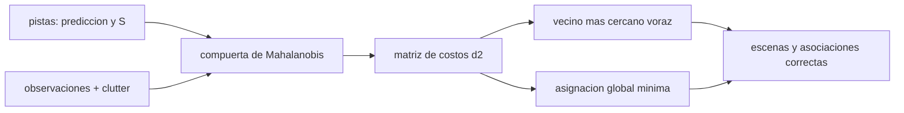

# B74-C30 — Asociación de observaciones y correlación de pistas

<!-- nav:top -->
[🏠 Programa](../../../../README.md) · [📚 Bloque B74](../../../tronco-comun/B74-estimacion-de-orbitas-y-navegacion-espacial.md) · [← Anterior: B74-C29 — Formatos TLE y OMM de elementos orbitales](../B74-C29-formatos-tle-y-omm-de-elementos-orbitales/CLASE.md) · [Siguiente: B75-C01 — Geometría de transferencias heliocéntricas →](../../../tronco-comun/B75-trayectorias-y-misiones-interplanetarias.md#b75-c01)
<!-- /nav -->

## 1. Ubicación, nivel y alcance

Clase 30 del bloque B74. Nivel N3. Antes de actualizar un filtro hay que decidir **qué observación pertenece a qué pista**. Con varios objetos cercanos y falsas detecciones (*clutter*), asociar mal contamina la solución. Aquí aplicas una compuerta de Mahalanobis (`d² < g`) y comparas dos reglas de asignación: el vecino más cercano voraz y la asignación global de costo mínimo, en escenas sintéticas de cuatro objetos con distinta separación y dos falsas detecciones por escena.

## 2. Por qué esta clase existe

Una asociación incorrecta no se ve en el filtro: el estado sigue convergiendo, pero hacia el objeto equivocado. La decisión central: **¿qué compuerta y qué regla de asignación equilibran el riesgo de perder una observación verdadera y el de aceptar una falsa o la de otro objeto?**

## 3. Lo que podrás hacer al terminar

1. Calcular la distancia de Mahalanobis de una observación a una pista.
2. Fijar la compuerta con el cuantil de la `χ²` (99 % con 2 grados de libertad).
3. Comparar el vecino más cercano voraz y la asignación global.
4. Medir la fracción de escenas y de asociaciones correctas frente a la separación.
5. Comprobar que la compuerta pierde el 1 % de las observaciones verdaderas.
6. Rotular lo sintético y lo ilustrativo.

La evidencia es la **matriz de asociación de pistas sintéticas** del ejercicio 12 (sección 20).

## 4. Con qué llegas y cómo comprobarlo

1. ¿Qué es la distancia de Mahalanobis?
2. ¿Qué es el clutter?
3. ¿Qué es una asignación?
4. ¿Qué es un cuantil de la `χ²`?
5. ¿Qué es una verificación por segunda vía?

<details>
<summary>Ver respuestas</summary>

1. La distancia normalizada por la covarianza: `√(νᵀS⁻¹ν)`. 2. Detecciones que no corresponden a ningún objeto de interés. 3. Una correspondencia uno a uno entre pistas y observaciones. 4. El valor bajo el que queda una fracción dada de la distribución. 5. Calcular lo mismo con otro método y comparar.
</details>

Con cuatro o cinco aciertos, sigue; si no, repasa los prerrequisitos.

## 5. Un caso de contexto y casos de referencia

Con cuatro objetos separados `1,5 σ` y dos falsas detecciones por escena, el vecino más cercano acierta en `23,3 %` de las escenas y la asignación global en `45,1 %`; a `3σ`: `71,7 %` y `81,1 %`; a `6σ`: `85,4 %` ambos. La compuerta de `g = 9,210` pierde `0,88 %` de las observaciones verdaderas. Es el **ejemplo conductor**; las escenas son sintéticas.

## 6. Vocabulario

La **compuerta** (*gate*) acepta una observación si `d² = νᵀS⁻¹ν < g`. La **asociación de vecino más cercano** toma para cada pista la observación más próxima disponible. La **asignación global** minimiza la suma de costos `d²` de todas las pistas a la vez. El **clutter** son falsas detecciones. Una **pista** es un objeto seguido con estado y covarianza.

## 7. Modelo mental: repartir invitados en mesas



*Descripción textual:* las pistas y las observaciones pasan por la compuerta y generan una matriz de costos; se asigna con vecino más cercano o con asignación global y se evalúa la fracción de aciertos.

Analogía: repartir invitados en mesas con tarjetas ambiguas: si cada uno elige la mesa más cercana por orden, dos pueden quedarse con la misma; repartir mirando toda la sala a la vez evita conflictos. Límite: las covarianzas se suponen correctas y las detecciones gaussianas; con covarianzas optimistas la compuerta rechaza observaciones verdaderas.

## 8. La explicación, paso a paso

### 8.1 La compuerta

Para 2 grados de libertad, `d² < g` con `g = −2 ln(1 − P)`: para `P = 0,99`, `g = 9,210`. En las simulaciones se pierden `0,88 %`, `0,86 %` y `1,00 %` de las observaciones verdaderas, consistente con el 1 % esperado.

### 8.2 Vecino más cercano

Con separación de `1,5σ`, solo `23,3 %` de las escenas tienen las cuatro asociaciones correctas (`49,1 %` de las asociaciones individuales); a `3σ`, `71,7 %` y `86,4 %`; a `6σ`, `85,4 %` y `96,1 %`. El orden de las pistas importa: la primera toma lo mejor aunque otra lo necesite más.

### 8.3 Asignación global

Minimizar la suma de `d²` de todas las pistas mejora: `45,1 %` de escenas a `1,5σ` (frente a `23,3 %`) y `81,1 %` a `3σ`. A `6σ` coinciden (`85,4 %`), porque no hay competencia.

### 8.4 Lo que queda

Incluso con asignación global, a `1,5σ` casi la mitad de las escenas falla: no hay algoritmo que arregle observaciones ambiguas. Hacen falta más datos (otra medida, mejor geometría, otro observable) o llevar varias hipótesis. El límite a `6σ` (`85,4 %`) viene de observaciones verdaderas fuera de compuerta y de clutter cerca de una pista.

## 9. Magnitudes, símbolos y unidades

| Símbolo | Qué es | Unidad | Valor / nota |
|---|---|---|---|
| `ν` | innovación (observación − predicción) | km |  |
| `S` | covarianza de la innovación | km² | σ²I, σ = 1 km (ilustrativo) |
| `d²` | distancia de Mahalanobis al cuadrado | — | νᵀS⁻¹ν |
| `g` | umbral de la compuerta | — | 9,210 (99 %, 2 gl) |
| `sep` | separación entre objetos | σ | 1,5; 3; 6 |
| `clutter` | falsas detecciones por escena | — | 2 (media de Poisson) |

## 10. Convenciones y referencias

Plano en km; cuatro objetos en un cuadrado de lado `sep·σ` centrado en (10, 10); observaciones con ruido gaussiano σ = 1 km; clutter uniforme en un cuadrado de 20 × 20 km con media 2; 3000 escenas por separación; semilla 103. Todo sintético.

## 11. De dónde sale lo que afirmamos

| ID | Fuente | Localizador | Respalda | Estado |
|---|---|---|---|---|
| S1 | NIST, CODATA — Speed of light in vacuum — https://physics.nist.gov/cgi-bin/cuu/Value?c (consultada 2026-11-10) | entrada «c» | c = 299 792 458 m/s (exacta) | Consultada |
| S2 | CCSDS 502.0-B-3, Orbit Data Messages, Blue Book, abril de 2023 — https://ccsds.org/Pubs/502x0b3e1.pdf (consultada 2026-11-10, texto extraído con PyMuPDF) | alcance (sección 1) y lista de usos | existen los mensajes OPM, OMM, OEM y OCM; usos: planificación de seguimiento, predicciones, comparación de órbitas, propagación y reconstrucción de órbitas | Consultada (solo alcance) |
| — | Bar-Shalom, Li y Kirubarajan, *Estimation with Applications to Tracking and Navigation* (Wiley, 2001); Tapley, Schutz y Born, *Statistical Orbit Determination* (Elsevier, 2004) | — | fundamento teórico general de la clase | No consultada |

Límites: la distancia de Mahalanobis, el vecino más cercano y la asignación global son técnicas estándar no consultadas en una fuente concreta (la referencia natural es Bar-Shalom et al., no consultada); de CCSDS 502.0-B-3 solo se leyó el alcance.

## 12. Cómo ver la asociación de pistas

| Magnitud | Valor |
|---|---|
| compuerta `g` (99 %, 2 gl) | 9,210 |
| vecino más cercano, 1,5σ (escenas OK) | 23,3 % |
| global, 1,5σ (escenas OK) | 45,1 % |
| global, 3σ (escenas OK) | 81,1 % |
| verdaderas fuera de compuerta | 0,88 % |

Descripción larga: la asignación global supera al vecino más cercano cuando los objetos están cerca; con separación grande coinciden; la compuerta pierde el 1 % que se le pide.

## 13. Ejemplo trabajado: una compuerta de Mahalanobis

**Paso 1 · Innovación.** `ν = (1,2; −0,8) km`.

**Paso 2 · Distancia.** `d² = (1,2² + 0,8²)/1² = 2,08`.

**Paso 3 · Comparación.** `2,08 < 9,210`: la observación entra en la compuerta.

**Paso 4 · Lectura.** Entrar en la compuerta no prueba que sea la observación correcta: otra pista cercana puede reclamar la misma.

## 14. Distintas formas de describir una asociación

**Por compuerta:** `d² < g`. **Por regla:** voraz o global. **Por costo:** suma de `d²`. **Por escena:** todas correctas. **Por asociación:** fracción individual.

## 15. Práctica guiada

**Ejercicio 1 · guiado.** Calcula `d²` para `ν = (2; 1,5) km` y `σ = 1 km`. *Pasos:* suma de cuadrados.

<details><summary>Solución comentada</summary>

`2² + 1,5² = 6,25`.
</details>

**Ejercicio 2 · guiado.** ¿Entra en la compuerta de 9,21? *Pista:* compara.

<details><summary>Solución comentada</summary>

Sí, `6,25 < 9,21`.
</details>

**Ejercicio 3 · guiado.** ¿Qué `g` corresponde al 95 % con 2 gl? *Pista:* `−2 ln 0,05`.

<details><summary>Solución comentada</summary>

`5,99`.
</details>

## 16. Práctica autónoma, transferencia e integrador

**Ejercicio 4 · autónomo.** ¿Por qué el vecino más cercano depende del orden de las pistas?

<details><summary>Solución comentada</summary>

Porque la primera pista toma la mejor observación aunque otra pista la necesite más.
</details>

**Ejercicio 5 · autónomo.** ¿Qué pasa con la fracción de escenas correctas si el clutter se duplica?

<details><summary>Solución comentada</summary>

Disminuye: más candidatas falsas dentro de la compuerta.
</details>

**Ejercicio 6 · autónomo.** ¿Por qué la compuerta pierde exactamente un 1 % de las verdaderas?

<details><summary>Solución comentada</summary>

Porque con el cuantil del 99 % la probabilidad de caer fuera es 1 %.
</details>

**Ejercicio 7 · autónomo.** ¿Qué ocurre si la covarianza `S` es optimista?

<details><summary>Solución comentada</summary>

La compuerta es demasiado estrecha y rechaza observaciones verdaderas (ver C23).
</details>

**Ejercicio 8 · autónomo.** ¿Qué algoritmo escala mejor que la búsqueda exhaustiva?

<details><summary>Solución comentada</summary>

El húngaro o la subasta, de coste polinomial.
</details>

**Ejercicio 9 · transferencia.** **Transferencia.** Un centro de vigilancia une observaciones de varias estaciones con una sola compuerta. ¿Qué riesgo ves?

<details><summary>Solución comentada</summary>

Covarianzas distintas por estación; hay que calcular `S` por observación.
</details>

**Ejercicio 10 · transferencia.** **Transferencia.** ¿Cómo se relaciona esto con la ventana de búsqueda de la correlación de terreno?

<details><summary>Solución comentada</summary>

Es el mismo concepto de compuerta: acotar candidatos antes de decidir (C26).
</details>

**Ejercicio 11 · transferencia.** **Transferencia.** ¿Qué hacer cuando dos objetos se cruzan?

<details><summary>Solución comentada</summary>

Mantener hipótesis múltiples hasta tener más datos, o añadir otro observable.
</details>

**Ejercicio 12 · integrador.** **Integrador.** Elabora tu *matriz de asociación de pistas sintéticas*: compuerta, costos `d²`, asignación voraz y global, tasas de acierto para tres separaciones y una discusión de cuándo no hay solución algorítmica, rotulando lo sintético.

<details><summary>Solución comentada</summary>

Secciones 8.1–8.4 y la salida del laboratorio.
</details>

## 17. Laboratorio: compuerta y asignación de pistas

El script [laboratorio.py](laboratorio.py) simula escenas de cuatro objetos con clutter, aplica la compuerta de Mahalanobis y compara el vecino más cercano con la asignación global en 3000 escenas por separación (**comprueba** fracción de verdaderas fuera de compuerta entre 0,5 % y 1,5 % y asignación global no peor que el vecino más cercano).

**Datos:** pistas, observaciones y clutter **sintéticos/ilustrativos**. **Predice antes de ejecutar:** ¿qué separación hace iguales a los dos métodos? (6σ). **Ejecución del 2026-11-10 (Python 3.12.9, NumPy 2.4.4):**

```text
Python 3.12.9, NumPy 2.4.4 (escenas SINTETICAS, semilla 103)
compuerta chi2 (2 gl, 99 %) = 9.210 ; sigma = 1.0 km ; clutter medio = 2 falsas detecciones por escena
separacion      vecino mas cercano: escenas OK / asoc. OK      global: escenas OK / asoc. OK      verdaderas fuera de compuerta
   1.5 sigma             23.3 % /  49.1 %                    45.1 % /  66.6 %                0.88 %
   3.0 sigma             71.7 % /  86.4 %                    81.1 % /  92.5 %                0.86 %
   6.0 sigma             85.4 % /  96.1 %                    85.4 % /  96.1 %                1.00 %
Pruebas superadas.
```

```bash
python programa/clases/B74/B74-C30-asociacion-de-observaciones-y-correlacion-de-pistas/laboratorio.py
```

**Límites:** covarianza conocida e isótropa, ruido gaussiano, una observación por objeto y clutter uniforme; la búsqueda exhaustiva no escala.

## 18. Errores frecuentes y cómo corregirlos

**Creer que estar en la compuerta es una asociación correcta.** Ver el ejemplo 13 y 8.4.

**Asignar voraz en un orden arbitrario.** Es peor que la asignación global; ver 8.2–8.3.

**Usar una compuerta fija con covarianzas distintas.** Usa `S` de cada observación.

**Presentar las escenas sintéticas como datos reales.** Rotula como sintético, como en la sección 10.

## 19. Cómo sabrás que vas bien

Tras la sección 8: ¿qué método esperabas mejor a 1,5σ y cuál fue? Si dudas, repasa el ejemplo 13. Tras el laboratorio: ¿qué comprueba? (ver la sección 17).

## 20. Qué entregas y cómo se evalúa

El producto es tu **matriz de asociación de pistas sintéticas** (ejercicio 12).

| Criterio | Inicial | En desarrollo | Logrado | Destacado |
|---|---|---|---|---|
| Conceptos | Los confunde | Parciales | Aplica la compuerta y compara reglas de asignación | Explica los límites |
| Cálculo | Sin unidades | Con errores | Tablas completas con unidades | Calcula casos nuevos |
| Numérico | Sin comprobar | Un caso | Contraste con una segunda vía | Interpreta las diferencias |
| Fuentes | Sin fuente | Sin fecha | Fuentes con fecha y estado | Declara lo sintético y lo no consultado |
| Límites | No los nombra | Uno | Tres | Discute qué falta del modelo |

**Condiciones críticas (no se compensan con promedio):** declarar covarianza, compuerta y tasa de clutter y rotular las escenas como sintéticas; rotular los datos como sintéticos y no presentar nada simulado como observado; citar solo lo consultado.

## 21. Ética, seguridad y límites

Clase educativa en estado E0: los modelos son simplificados y sus datos son sintéticos o ilustrativos; ningún resultado describe la órbita real de una nave ni sustituye a un producto de navegación de misión. Accesibilidad: tablas equivalentes a las gráficas, fórmulas en texto, ejercicios sin conexión. Tolerancias del laboratorio: verdaderas fuera de compuerta entre 0,5 % y 1,5 %; asignación global no peor que el vecino más cercano.

## 22. Para cerrar y seguir

La compuerta de `9,210` pierde el 1 % de las observaciones verdaderas; a `1,5σ`, la asignación global acierta en `45,1 %` de las escenas y el vecino más cercano en `23,3 %`. Con esto se cierra el bloque: de las medidas al estado, del estado a su incertidumbre y de la incertidumbre a su verificación.

**Glosario español–inglés.** asociación de datos · *data association*; compuerta · *gate*; distancia de Mahalanobis · *Mahalanobis distance*; vecino más cercano · *nearest neighbor*; asignación global · *global nearest neighbor*.

**Continuidad.** Con C30 termina el bloque B74; la guía del bloque resume el recorrido completo.

**Referencias:** ver sección 11.

<!-- nav:bottom -->
---

[← Anterior: B74-C29 — Formatos TLE y OMM de elementos orbitales](../B74-C29-formatos-tle-y-omm-de-elementos-orbitales/CLASE.md) · [📚 Bloque B74](../../../tronco-comun/B74-estimacion-de-orbitas-y-navegacion-espacial.md) · [Siguiente: B75-C01 — Geometría de transferencias heliocéntricas →](../../../tronco-comun/B75-trayectorias-y-misiones-interplanetarias.md#b75-c01)
<!-- /nav -->
