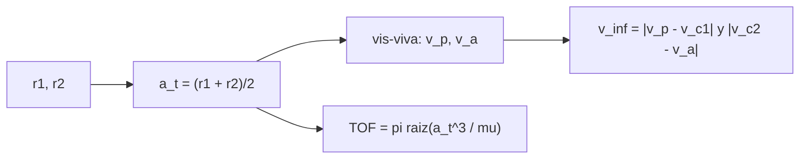

# B75-C01 — Geometría de transferencias heliocéntricas

<!-- nav:top -->
[🏠 Programa](../../../../README.md) · [📚 Bloque B75](../../../tronco-comun/B75-trayectorias-y-misiones-interplanetarias.md) · [← Anterior: B74-C30 — Asociación de observaciones y correlación de pistas](../../B74/B74-C30-asociacion-de-observaciones-y-correlacion-de-pistas/CLASE.md) · [Siguiente: B75-C02 — Ángulos de fase planetaria →](../B75-C02-angulos-de-fase-planetaria/CLASE.md)
<!-- /nav -->

## 1. Ubicación, nivel y alcance

Clase 1 del bloque B75. Nivel N3. Aquí empieza el diseño de trayectorias interplanetarias: ¿qué órbita alrededor del Sol lleva una nave de la Tierra a otro planeta gastando la menor velocidad? Usas la elipse de Hohmann, la mecánica de dos cuerpos del [bloque B71](../../../tronco-comun/B71-mecanica-orbital-fundamental.md) y los semiejes de los planetas como datos. El modelo es de órbitas planetarias circulares y coplanares: una primera estimación, no una efeméride.

## 2. Por qué esta clase existe

Para ir a Marte no se apunta a donde está Marte: se elige una elipse alrededor del Sol que toque la órbita de la Tierra al salir y la de Marte al llegar. La decisión central: **¿cuál es la elipse de menor energía que une dos órbitas circulares, cuánto dura el viaje y qué velocidad exige a la salida y a la llegada?**

## 3. Lo que podrás hacer al terminar

1. Calcular el semieje mayor, la excentricidad y el periodo de la elipse de transferencia entre dos radios heliocéntricos.
2. Calcular las velocidades en el perihelio y el afelio de la elipse con la ecuación vis-viva.
3. Obtener los excesos hiperbólicos de salida y de llegada (`v∞`) como diferencia con la velocidad circular del planeta.
4. Calcular el tiempo de vuelo como medio periodo de la elipse.
5. Comparar las transferencias a Venus, Marte y Júpiter.
6. Separar lo consultado (semiejes, velocidades) de lo estándar y de lo que el modelo simplifica.

La evidencia es tu **ficha de una transferencia de Hohmann** del ejercicio 12 (sección 20).

## 4. Con qué llegas y cómo comprobarlo

1. ¿Qué dice la ecuación vis-viva y qué mide cada término?
2. ¿Qué es la velocidad circular a un radio `r`?
3. ¿Qué dice la tercera ley de Kepler?
4. ¿Qué significa «coplanar»?
5. ¿Qué es un dato sintético o un modelo simplificado y por qué se rotula?

<details>
<summary>Ver respuestas</summary>

1. `v² = μ(2/r − 1/a)`: la velocidad `v` a distancia `r` en una órbita de semieje `a` alrededor de un cuerpo de parámetro `μ = GM`. 2. `v_c = √(μ/r)`, la velocidad de una órbita circular de ese radio. 3. `T² ∝ a³`; con `μ`, `T = 2π√(a³/μ)`. 4. Que las órbitas están en el mismo plano; aquí, el plano de la órbita de la Tierra. 5. Un dato generado o una simplificación (órbitas circulares) que no describe lo medido; se rotula para no confundirlo con una observación.
</details>

Con cuatro o cinco aciertos, sigue; si no, repasa los prerrequisitos.

## 5. Un caso de contexto y casos de referencia

Una nave que sale de la Tierra hacia Marte con una elipse de perihelio `r₁ = 149,598×10⁶ km` y afelio `r₂ = 227,956×10⁶ km` tiene `a = 188,777×10⁶ km`, tarda `258,88 d` y pide `v∞ = 2,9452 km/s` al salir y `2,6493 km/s` al llegar. Es el **ejemplo conductor**. La NASA describe la transferencia de Hohmann como la ruta de menor propulsante entre dos órbitas y señala que las oportunidades de mínima energía hacia Marte se repiten cada unos 25 meses [S5]. Los números de esta clase son del modelo circular y coplanar, no de una misión.

## 6. Vocabulario

La **elipse de transferencia de Hohmann** es la mitad de una elipse tangente a las dos órbitas circulares. Su **perihelio** es el radio menor y su **afelio** el mayor. El **exceso hiperbólico de velocidad** `v∞` es la velocidad de la nave respecto al planeta, lejos de él: aquí, la diferencia entre la velocidad heliocéntrica de la nave y la del planeta. El **tiempo de vuelo** (`TOF`) es medio periodo de la elipse. La **ecuación vis-viva** relaciona velocidad, radio y semieje.

## 7. Modelo mental: una escalera entre dos pisos



*Descripción textual:* Los dos radios dan el semieje de la transferencia; del semieje salen las velocidades en los extremos (vis-viva) y el tiempo de vuelo; la diferencia con las velocidades circulares da los excesos hiperbólicos.

Analogía: subir de un piso a otro por una escalera tangente a ambos: sale con un empujón y llega con otro. Límite: la escalera supone que los pisos son circulares y están en el mismo plano; los planetas reales tienen excentricidad (Marte, 0,0935) e inclinación [S2].

## 8. La explicación, paso a paso

### 8.1 La elipse

Con `r₁ = 149,598×10⁶ km` (Tierra) y `r₂ = 227,956×10⁶ km` (Marte), `a_t = (r₁ + r₂)/2 = 188,777×10⁶ km` y la excentricidad es `e = (r₂ − r₁)/(r₂ + r₁) = 0,2075`. Con `μ☉ = 1,32712440×10¹¹ km³/s²`, el tiempo de vuelo es `TOF = π√(a_t³/μ☉) = 258,88 d`.

### 8.2 Velocidades y excesos

La velocidad en el perihelio es `v_p = √(μ(2/r₁ − 1/a_t)) = 32,730 km/s`; la circular de la Tierra es `29,785 km/s`, y su diferencia da `v∞,sal = 2,9452 km/s`. En el afelio, `v_a = 21,479 km/s` frente a la circular de Marte `24,128 km/s`: `v∞,lleg = 2,6493 km/s`. La suma, `5,5944 km/s`, es el delta-v heliocéntrico total, no el de la misión (la salida desde una órbita baja y la captura se calculan en C23 y C14).

### 8.3 Tres destinos

| Destino | `a_t` (10⁶ km) | `v∞,sal` (km/s) | `v∞,lleg` (km/s) | suma (km/s) | `TOF` (d) |
|---|---|---|---|---|---|
| Venus | 128,904 | 2,4953 | 2,7065 | 5,2018 | 146,08 |
| Marte | 188,777 | 2,9452 | 2,6493 | 5,5944 | 258,88 |
| Júpiter | 464,038 | 8,7933 | 5,6433 | 14,4365 | 997,73 |

### 8.4 Qué verifica el modelo

La velocidad circular del modelo (`29,785` y `24,128 km/s`) se parece a la velocidad orbital media de las fichas (`29,78` y `24,08 km/s`) [S1, S2], con diferencia mayor en Marte porque su órbita real es excéntrica. La energía específica coincide en el perihelio y el afelio y vale `−μ/(2a_t)`.

## 9. Magnitudes, símbolos y unidades

| Símbolo | Qué es | Unidad | Valor / nota |
|---|---|---|---|
| `r₁`, `r₂` | radios de las órbitas inicial y final | km | 149,598×10⁶; 227,956×10⁶ |
| `a_t` | semieje de la transferencia | km | 188,777×10⁶ |
| `μ☉` | parámetro gravitacional del Sol | km³/s² | 1,32712440×10¹¹ (estándar) |
| `v_p`, `v_a` | velocidad en perihelio y afelio | km/s | 32,730; 21,479 |
| `v∞` | exceso hiperbólico de velocidad | km/s | 2,9452 (salida); 2,6493 (llegada) |
| `TOF` | tiempo de vuelo | d | 258,88 |

## 10. Convenciones y referencias

Marco heliocéntrico plano (eclíptica aproximada), distancias en km, tiempos en s (resultados en días), velocidades en km/s. Semiejes y velocidades de las fichas NASA/NSSDC; `μ☉` es un valor estándar. Impulsos instantáneos y esfera de influencia de tamaño nulo (cónicas empalmadas). Las órbitas planetarias son circulares y coplanares.

## 11. De dónde sale lo que afirmamos

| ID | Fuente | Localizador | Respalda | Estado |
|---|---|---|---|---|
| S1 | NASA/NSSDC, Earth Fact Sheet — https://nssdc.gsfc.nasa.gov/planetary/factsheet/earthfact.html (consultada 2026-11-10) | página leída | semieje 149,598×10⁶ km, periodo sideral 365,256 d, excentricidad 0,0167, velocidad orbital media 29,78 km/s, masa 5,9722×10²⁴ kg, radio medio 6371,000 km, velocidad de escape 11,186 km/s | Consultada |
| S2 | NASA/NSSDC, Mars Fact Sheet — https://nssdc.gsfc.nasa.gov/planetary/factsheet/marsfact.html (consultada 2026-11-10) | página leída | semieje 227,956×10⁶ km, periodo sideral 686,980 d, excentricidad 0,0935, inclinación 1,848°, velocidad media 24,08 km/s, masa 0,64169×10²⁴ kg, radio ecuatorial 3396,2 km, g 3,73 m/s² | Consultada |
| S3 | NASA/NSSDC, Venus Fact Sheet — https://nssdc.gsfc.nasa.gov/planetary/factsheet/venusfact.html (consultada 2026-11-10) | página leída | semieje 108,210×10⁶ km, periodo sideral 224,701 d, excentricidad 0,0068, inclinación 3,395°, velocidad media 35,02 km/s, masa 4,8673×10²⁴ kg, radio medio 6051,8 km | Consultada |
| S4 | NASA/NSSDC, Jupiter Fact Sheet — https://nssdc.gsfc.nasa.gov/planetary/factsheet/jupiterfact.html (consultada 2026-11-10) | página leída | semieje 778,479×10⁶ km, periodo sideral 4332,589 d, excentricidad 0,0487, inclinación 1,304°, velocidad media 13,06 km/s, masa 1898,13×10²⁴ kg, radio medio 69 911 km | Consultada |
| S5 | NASA, Basics of Space Flight, cap. 4 «Interplanetary Trajectories» — https://science.nasa.gov/learn/basics-of-space-flight/chapter4-1/ (consultada 2026-11-10) | página leída | transferencia de Hohmann como ruta de menor propulsante; oportunidades mínimas de energía a Marte cada ~25 meses y a Venus cada ~19 meses; la asistencia gravitacional cambia la velocidad heliocéntrica y deja la relativa en módulo; el vuelo de Galileo por Ío redujo el propulsante de inserción en 90 kg | Consultada |
| S6 | NASA, Europa Clipper (página de la misión) — https://science.nasa.gov/mission/europa-clipper/ (consultada 2026-11-10) | página leída | lanzamiento el 14 de octubre de 2024 en Falcon Heavy; sobrevuelo de Marte en 2025 y de la Tierra el 3 de diciembre de 2026; llegada a Júpiter en abril de 2030; 49 sobrevuelos cercanos de Europa; unos 2,9 mil millones de km hasta Júpiter | Consultada |
| S7 | IAU 2015 Resolución B3 (Mamajek et al.), arXiv:1510.07674 — https://arxiv.org/abs/1510.07674 (consultada 2026-11-10) | resumen | solo el resumen: la resolución adopta un «parámetro nominal de masa solar» como constante exacta del SI; el resumen no imprime su valor numérico | Consultada |
| — | Valores estándar (no consultados en una fuente concreta de esta clase) | — | GM☉ = 1,32712440×10¹¹ km³/s² (valor estándar, ver la resolución IAU 2015 B3 de la fila anterior donde se cita); 1 au = 149 597 870,7 km; c = 299 792,458 km/s; g₀ = 9,80665 m/s²; ecuaciones de dos cuerpos | No consultada en una fuente concreta |

Límites: los semiejes son de las fichas; el modelo no usa las excentricidades ni las inclinaciones; del resumen de la IAU (2015, B3) solo se leyó que el parámetro solar nominal es una constante exacta, no su valor, por lo que `μ☉` se rotula estándar. No se consulta ninguna misión real en esta clase.

## 12. Cómo ver la transferencia

| Magnitud | Valor |
|---|---|
| `a_t` | 188,777×10⁶ km |
| `e` | 0,2075 |
| `TOF` | 258,88 d |
| `v∞` salida / llegada | 2,9452 / 2,6493 km/s |
| Energía en perihelio y afelio | −351,505851 km²/s² (iguales) |

Descripción larga: la elipse toca la órbita de la Tierra en su perihelio y la de Marte en su afelio, separados 180°; el viaje cubre medio periodo.

## 13. Ejemplo trabajado: la salida de la Tierra hacia Marte

**Paso 1 · Semieje.** `a_t = (149,598 + 227,956)/2 = 188,777×10⁶ km`.

**Paso 2 · Velocidad en el perihelio.** `v_p = √(μ(2/r₁ − 1/a_t)) = 32,730 km/s`.

**Paso 3 · Exceso.** `v∞ = 32,730 − 29,785 = 2,9452 km/s`.

**Paso 4 · Tiempo.** `TOF = π√(a_t³/μ) = 258,88 d`.

## 14. Distintas formas de abordar el problema

**Por vis-viva:** velocidades a partir de `r` y `a`. **Por energía:** `ε = −μ/(2a)` igual en ambos extremos (comprobación del laboratorio). **Por propagación de Kepler:** se integra el movimiento el `TOF` y la nave llega al radio de Marte a 180°. **Por la tercera ley:** `TOF = ½ T_t`, con `T_t = 365,256 d·(a_t/1 au)^1,5`.

## 15. Práctica guiada

**Ejercicio 1 · con los pasos indicados.** Calcula `a_t` y `e` para Tierra–Marte. *Pasos:* promedia los radios; resta y divide por la suma.

<details><summary>Solución comentada</summary>

`a_t = 188,777×10⁶ km`; `e = 78,358/377,554 = 0,2075`.
</details>

**Ejercicio 2 · con una pista.** Estima el `TOF` con la tercera ley. *Pista:* `a_t/1 au ≈ 1,2619` y el periodo terrestre es `365,256 d`.

<details><summary>Solución comentada</summary>

`1,2619^1,5 = 1,4176`, periodo `517,8 d`, mitad `258,9 d`; coincide con `258,88 d`.
</details>

**Ejercicio 3 · casi autónomo.** ¿Por qué el delta-v heliocéntrico (`5,59 km/s`) no es el de la misión? Revisa 8.2.

<details><summary>Solución comentada</summary>

Porque solo mide el cambio respecto al Sol: falta salir del pozo de la Tierra desde una órbita baja y capturarse en Marte (C23 y C14).
</details>

## 16. Práctica autónoma, transferencia e integrador

**Ejercicio 4 · autónomo.** Calcula `v∞` de salida hacia Venus con los datos de 8.3 y explica por qué la nave frena respecto a la Tierra.

<details><summary>Solución comentada</summary>

`2,4953 km/s`. Venus está más cerca del Sol: la nave debe perder velocidad heliocéntrica, por lo que el impulso es retrógrado.
</details>

**Ejercicio 5 · autónomo.** ¿Cuántos años dura el viaje a Júpiter?

<details><summary>Solución comentada</summary>

`997,73 d/365,256 = 2,73 años`.
</details>

**Ejercicio 6 · autónomo.** Calcula `C3 = v∞²` de salida a Marte.

<details><summary>Solución comentada</summary>

`2,9452² = 8,674 km²/s²`.
</details>

**Ejercicio 7 · autónomo.** Si `r₂` se duplicara, ¿cómo cambia el `TOF`? Revisa 8.1.

<details><summary>Solución comentada</summary>

`TOF ∝ a_t^1,5`; `a_t` pasa de `(r₁+r₂)/2` a `(r₁+2r₂)/2`, así que el factor es `((r₁+2r₂)/(r₁+r₂))^1,5`.
</details>

**Ejercicio 8 · autónomo.** Con la ficha de Júpiter, compara su velocidad media (`13,06 km/s`) con la circular del modelo y comenta.

<details><summary>Solución comentada</summary>

`√(μ/778,479×10⁶ km) = 13,06 km/s`: coincide a la precisión de la ficha [S4] porque su excentricidad (0,0487) es pequeña.
</details>

**Ejercicio 9 · transferencia.** Marte tiene `e = 0,0935`: ¿en qué rango varía su radio y qué ocurre con el `TOF` al perihelio y al afelio? Usa el laboratorio como modelo.

<details><summary>Solución comentada</summary>

Radio de `206,64` a `249,27×10⁶ km`. Con el mismo método, el `TOF` va de `237,27 d` a `281,11 d` y `v∞,sal` de `2,296` a `3,514 km/s`: el modelo circular oculta una variación de decenas de días y de más de 1 km/s.
</details>

**Ejercicio 10 · transferencia.** La página de Europa Clipper indica lanzamiento en octubre de 2024 y llegada a Júpiter en abril de 2030 [S6], unos 5,5 años. ¿Contradice el `TOF` de 2,73 años?

<details><summary>Solución comentada</summary>

No: el `TOF` de Hohmann es una cota de mínima energía directa. La misión usa asistencias gravitacionales (C06) para ahorrar energía a costa de tiempo.
</details>

**Ejercicio 11 · transferencia.** Un colega suma `5,59 km/s` y dice que el cohete necesita eso. ¿Qué responde?

<details><summary>Solución comentada</summary>

Que falta el pozo gravitatorio de la Tierra y la captura (C23, C14), y que el valor es de un modelo circular coplanar, no de una misión.
</details>

**Ejercicio 12 · integrador.** Elabora tu *ficha de una transferencia de Hohmann* para el destino que elijas (Venus, Marte o Júpiter): tabla de `a_t`, `e`, `v_p`, `v_a`, `v∞`, `TOF`, comprobación de energía y lista de qué es consultado, estándar y simplificado.

<details><summary>Solución comentada</summary>

Secciones 8.1–8.4 y la salida del laboratorio, con el destino cambiado en el script.
</details>

## 17. Laboratorio: Hohmann de la Tierra a Venus, Marte y Júpiter

El script [hohmann.py](hohmann.py) calcula la elipse, las velocidades, los `v∞` y el tiempo de vuelo para tres destinos y **comprueba** (a) la velocidad circular frente a la ficha, (b) el radio y el ángulo de llegada por propagación de Kepler y (c) la igualdad de la energía en perihelio y afelio.

**Datos:** semiejes y velocidades de las fichas NASA/NSSDC (consultadas); `μ☉` estándar; órbitas circulares y coplanares (**modelo**). **Predice antes de ejecutar:** ¿Cuánto dura el viaje a Marte? (258,88 d.) **Ejecución del 2026-11-10 (Python 3.12.9):**

```text
Python 3.12.9 (biblioteca estandar)
Transferencias de Hohmann desde la Tierra (modelo circular y coplanar):
 destino   a_t [1e6 km]  v_inf_sal [km/s]  v_inf_lleg [km/s]  dv_total_helio [km/s]  TOF [d]
Venus        128.904          2.4953            2.7065               5.2018    146.08
Marte        188.777          2.9452            2.6493               5.5944    258.88
Jupiter      464.038          8.7933            5.6433              14.4365    997.73
v circular calculada frente a la ficha (Tierra / Marte): 29.785 frente a 29.78 y 24.128 frente a 24.08 km/s
Propagacion de Kepler hasta el TOF: radio = 227.956000e6 km (esperado 227.956000e6), angulo = 180.000000 grados
Energia especifica en el perihelio y el afelio: -351.505851 y -351.505851 km2/s2 ; -mu/(2a_t) = -351.505851
Pruebas superadas.
```

```bash
python programa/clases/B75/B75-C01-geometria-de-transferencias-heliocentricas/hohmann.py
```

**Límites:** sin excentricidad ni inclinación, impulsos instantáneos; la propagación de Kepler del laboratorio valida la geometría de la elipse, no la física de una misión real.

## 18. Errores frecuentes y cómo corregirlos

**Sumar `v∞` como si fuera el delta-v de la misión.** Se corrige con 8.2 y el ejercicio 3.

**Usar los semiejes como si los planetas estuvieran siempre a esa distancia.** Se corrige con el ejercicio 9.

**Olvidar que la nave llega al afelio a 180° de la salida.** Se corrige con la sección 12 y la propagación de Kepler del laboratorio.

**Presentar el modelo como una efeméride.** Se corrige con la sección 10.

## 19. Cómo sabrás que vas bien

Tras 8.1: ¿qué `TOF` esperabas y cuál obtuviste? Si dudas, repasa el ejemplo 13. Tras el laboratorio: ¿qué comprueba cada prueba? (ver la sección 17).

## 20. Qué entregas y cómo se evalúa

El producto es tu **ficha de una transferencia de Hohmann** (ejercicio 12).

| Criterio | Inicial | En desarrollo | Logrado | Destacado |
|---|---|---|---|---|
| Conceptos | Confunde elipse y órbita circular | Define `a_t`, `v∞` y `TOF` | Calcula la transferencia completa | Explica por qué es de mínima energía |
| Cálculo | Sin unidades | Con errores | Tabla completa con unidades | Calcula casos nuevos |
| Numérico | Sin comprobar | Una prueba | Energía y Kepler | Interpreta las diferencias con la ficha |
| Fuentes | Sin fuente | Sin fecha | Fuentes con fecha y estado | Declara lo estándar y lo no consultado |
| Límites | No los nombra | Uno | Tres | Discute qué falta del modelo |

**Condiciones críticas (no se compensan con promedio):** rotular el modelo circular y coplanar; no presentar el resultado como efeméride; citar solo lo consultado.

## 21. Ética, seguridad y límites

Clase educativa: los modelos son simplificados (órbitas planetarias circulares y coplanares, dos cuerpos) y sus datos son consultados, sintéticos o ilustrativos y están rotulados; ningún resultado es una efeméride, una medición ni un diseño de misión real. El delta-v heliocéntrico no basta para dimensionar un lanzamiento. Accesibilidad: tablas equivalentes a las gráficas, fórmulas en texto, ejercicios sin conexión.

## 22. Para cerrar y seguir

Una elipse de `a_t = 188,777×10⁶ km` lleva una nave de la Tierra a Marte en `258,88 d` con `v∞ = 2,9452 km/s` a la salida. Queda una pregunta: ¿en qué instante exacto hay que salir para que Marte esté allí cuando la nave llegue?

**Glosario español–inglés.** transferencia de Hohmann · *Hohmann transfer*; exceso hiperbólico de velocidad · *hyperbolic excess speed*; tiempo de vuelo · *time of flight*; perihelio · *perihelion*; vis-viva · *vis-viva*.

**Continuidad.** [B75-C02](../B75-C02-angulos-de-fase-planetaria/CLASE.md) calcula el ángulo de fase de salida.

**Referencias:** ver sección 11.

<!-- nav:bottom -->
---

[← Anterior: B74-C30 — Asociación de observaciones y correlación de pistas](../../B74/B74-C30-asociacion-de-observaciones-y-correlacion-de-pistas/CLASE.md) · [📚 Bloque B75](../../../tronco-comun/B75-trayectorias-y-misiones-interplanetarias.md) · [Siguiente: B75-C02 — Ángulos de fase planetaria →](../B75-C02-angulos-de-fase-planetaria/CLASE.md)
<!-- /nav -->
