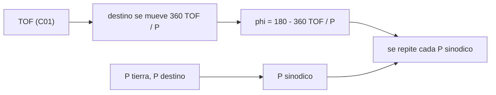

# B75-C02 — Ángulos de fase planetaria

<!-- nav:top -->
[🏠 Programa](../../../../README.md) · [📚 Bloque B75](../../../tronco-comun/B75-trayectorias-y-misiones-interplanetarias.md) · [← Anterior: B75-C01 — Geometría de transferencias heliocéntricas](../B75-C01-geometria-de-transferencias-heliocentricas/CLASE.md) · [Siguiente: B75-C03 — Ventanas de lanzamiento →](../B75-C03-ventanas-de-lanzamiento/CLASE.md)
<!-- /nav -->

## 1. Ubicación, nivel y alcance

Clase 2 del bloque B75. Nivel N3. La elipse de Hohmann (B75-C01) fija cuánto dura el viaje; esta clase fija **dónde debe estar el destino cuando sales**. Calculas el ángulo de fase de salida y el periodo sinódico con los periodos siderales de las fichas de la NASA. Modelo: órbitas circulares y coplanares.

## 2. Por qué esta clase existe

Una nave que llega al afelio de su elipse debe encontrar allí al planeta. Como el planeta se mueve mientras la nave vuela, hay que salir cuando el destino va por delante (o por detrás) un ángulo preciso. La decisión central: **¿qué ángulo de adelanto necesita el destino al salir y cada cuánto se repite esa geometría?**

## 3. Lo que podrás hacer al terminar

1. Definir el ángulo de fase de salida y su signo.
2. Calcular `φ = 180° − 360°·TOF/P_destino` para un destino exterior o interior.
3. Calcular el periodo sinodico `1/|1/P₁ − 1/P₂|`.
4. Verificar que el destino llega al afelio a 180° de la salida.
5. Comparar Venus, Marte y Júpiter.
6. Separar lo consultado (periodos) de lo calculado y de lo simplificado.

La evidencia es tu **tabla de ángulos de fase y periodos sinódicos** del ejercicio 12 (sección 20).

## 4. Con qué llegas y cómo comprobarlo

1. ¿Qué es el tiempo de vuelo de una transferencia de Hohmann?
2. ¿Qué es un periodo sideral?
3. ¿Qué es una velocidad angular media?
4. ¿Qué es la separación angular entre dos cuerpos en órbita?
5. ¿Por qué se rotulan los resultados como de un modelo circular?

<details>
<summary>Ver respuestas</summary>

1. Medio periodo de la elipse de transferencia: `π√(a_t³/μ)` (B75-C01). 2. El tiempo que tarda un cuerpo en volver a la misma dirección respecto a las estrellas. 3. `360°/P` para un periodo `P`. 4. La diferencia de sus longitudes heliocéntricas. 5. Porque la excentricidad real cambia los ángulos y los tiempos.
</details>

Con cuatro o cinco aciertos, sigue; si no, repasa los prerrequisitos.

## 5. Un caso de contexto y casos de referencia

Para Tierra–Marte, el `TOF` de Hohmann es `258,88 d`. En ese tiempo Marte recorre `360°·258,88/686,98 = 135,66°`, así que debe estar `44,337°` por delante de la Tierra al salir. Es el **ejemplo conductor**. Para Venus el ángulo es negativo (`−54,033°`): Venus debe ir por detrás. La NASA señala que las oportunidades de mínima energía se repiten cada unos 25 meses hacia Marte y 19 meses hacia Venus [S5].

## 6. Vocabulario

El **ángulo de fase de salida** `φ` es la diferencia de longitud heliocéntrica destino − Tierra al partir. El **periodo sinódico** es el tiempo entre dos alineaciones iguales de los dos planetas. El **movimiento medio** es `n = 360°/P`. Un destino **exterior** (Marte, Júpiter) tiene `φ` positivo; un destino **interior** (Venus), negativo.

## 7. Modelo mental: dos corredores en una pista



*Descripción textual:* El tiempo de vuelo da el arco que recorre el destino; el ángulo de salida es lo que falta para llegar a 180°; el periodo sinódico dice cada cuánto se repite esa configuración.

Analogía: dos corredores en una pista circular con distinta velocidad: el rápido alcanza al lento cada cierto tiempo. Límite: los planetas tienen órbitas elípticas e inclinadas, por lo que el ángulo y el periodo reales varían.

## 8. La explicación, paso a paso

### 8.1 El ángulo de salida

Para Marte: `φ = 180° − 360°×258,88/686,980 = 44,337°`. Para Venus: `φ = 180° − 360°×146,08/224,701 = −54,033°`. Para Júpiter: `φ = 180° − 360°×997,73/4332,589 = 97,098°` [S2, S3, S4].

### 8.2 El periodo sinódico

`P_sin = 1/|1/P_T − 1/P_d|`, con `P_T = 365,256 d` [S1]:

| Destino | `TOF` (d) | `φ` (°) | `P_sin` (d) | `P_sin` (años) |
|---|---|---|---|---|
| Venus | 146,08 | −54,033 | 583,92 | 1,599 |
| Marte | 258,88 | 44,337 | 779,93 | 2,135 |
| Júpiter | 997,73 | 97,098 | 398,88 | 1,092 |

El `P_sin` de Marte, `2,135 años = 25,6 meses`, concuerda con los «unos 25 meses» de la NASA [S5]; el de Venus, `1,599 años = 19,2 meses`, con los «unos 19 meses».

### 8.3 Qué verifica el laboratorio

El destino, movido durante el `TOF`, queda a 180° de la salida con error menor que `10⁻⁹°`. El periodo sinódico por fórmula (`779,9343 d`) coincide con el obtenido muestreando la separación angular hasta acumular 360° (`779,9400 d`, paso de 0,01 d).

## 9. Magnitudes, símbolos y unidades

| Símbolo | Qué es | Unidad | Valor / nota |
|---|---|---|---|
| `φ` | ángulo de fase de salida | ° | 44,337 (Marte) |
| `P_sin` | periodo sinódico | d | 779,93 (Marte) |
| `n` | movimiento medio | °/d | 0,98561 (Tierra); 0,52403 (Marte) |
| `TOF` | tiempo de vuelo de Hohmann | d | 258,88 |
| `P` | periodo sideral | d | 365,256; 686,980 |

## 10. Convenciones y referencias

Longitudes heliocéntricas medidas en el sentido del movimiento orbital. `φ > 0` si el destino va por delante de la Tierra. Periodos siderales de las fichas NASA/NSSDC consultadas; semiejes de las mismas fichas; `μ☉` estándar. Órbitas circulares y coplanares.

## 11. De dónde sale lo que afirmamos

| ID | Fuente | Localizador | Respalda | Estado |
|---|---|---|---|---|
| S1 | NASA/NSSDC, Earth Fact Sheet — https://nssdc.gsfc.nasa.gov/planetary/factsheet/earthfact.html (consultada 2026-11-10) | página leída | semieje 149,598×10⁶ km, periodo sideral 365,256 d, excentricidad 0,0167, velocidad orbital media 29,78 km/s, masa 5,9722×10²⁴ kg, radio medio 6371,000 km, velocidad de escape 11,186 km/s | Consultada |
| S2 | NASA/NSSDC, Mars Fact Sheet — https://nssdc.gsfc.nasa.gov/planetary/factsheet/marsfact.html (consultada 2026-11-10) | página leída | semieje 227,956×10⁶ km, periodo sideral 686,980 d, excentricidad 0,0935, inclinación 1,848°, velocidad media 24,08 km/s, masa 0,64169×10²⁴ kg, radio ecuatorial 3396,2 km, g 3,73 m/s² | Consultada |
| S3 | NASA/NSSDC, Venus Fact Sheet — https://nssdc.gsfc.nasa.gov/planetary/factsheet/venusfact.html (consultada 2026-11-10) | página leída | semieje 108,210×10⁶ km, periodo sideral 224,701 d, excentricidad 0,0068, inclinación 3,395°, velocidad media 35,02 km/s, masa 4,8673×10²⁴ kg, radio medio 6051,8 km | Consultada |
| S4 | NASA/NSSDC, Jupiter Fact Sheet — https://nssdc.gsfc.nasa.gov/planetary/factsheet/jupiterfact.html (consultada 2026-11-10) | página leída | semieje 778,479×10⁶ km, periodo sideral 4332,589 d, excentricidad 0,0487, inclinación 1,304°, velocidad media 13,06 km/s, masa 1898,13×10²⁴ kg, radio medio 69 911 km | Consultada |
| S5 | NASA, Basics of Space Flight, cap. 4 «Interplanetary Trajectories» — https://science.nasa.gov/learn/basics-of-space-flight/chapter4-1/ (consultada 2026-11-10) | página leída | transferencia de Hohmann como ruta de menor propulsante; oportunidades mínimas de energía a Marte cada ~25 meses y a Venus cada ~19 meses; la asistencia gravitacional cambia la velocidad heliocéntrica y deja la relativa en módulo; el vuelo de Galileo por Ío redujo el propulsante de inserción en 90 kg | Consultada |
| — | Valores estándar (no consultados en una fuente concreta de esta clase) | — | GM☉ = 1,32712440×10¹¹ km³/s² (valor estándar, ver la resolución IAU 2015 B3 de la fila anterior donde se cita); 1 au = 149 597 870,7 km; c = 299 792,458 km/s; g₀ = 9,80665 m/s²; ecuaciones de dos cuerpos | No consultada en una fuente concreta |

Límites: con excentricidad la fase y el periodo reales difieren; las ventanas con fechas se estiman en C03 y se comparan con una efeméride solo en C29; no se consultó ninguna efeméride.

## 12. Cómo ver el ángulo de fase

| Destino | `φ` de salida | Quién va por delante |
|---|---|---|
| Venus | −54,033° | la Tierra |
| Marte | +44,337° | Marte |
| Júpiter | +97,098° | Júpiter |

Descripción larga: para un destino exterior la nave sale cuando el destino va por delante; para uno interior, cuando va por detrás.

## 13. Ejemplo trabajado: el ángulo para Marte

**Paso 1 · Tiempo de vuelo.** `TOF = 258,88 d` (B75-C01).

**Paso 2 · Arco de Marte.** `360°×258,88/686,980 = 135,66°`.

**Paso 3 · Ángulo de salida.** `φ = 180° − 135,66° = 44,34°`.

**Paso 4 · Periodo sinódico.** `1/(1/365,256 − 1/686,980) = 779,93 d`.

## 14. Distintas formas de abordar el problema

**Fórmula directa:** `φ = 180° − n_d·TOF`. **Por muestreo:** se avanza el tiempo hasta que la separación acumula 360°. **Por llegada:** se verifica que el destino quede a 180° de la salida. **Rapidez relativa:** `|n_T − n_d| = 0,46158°/d` para Marte.

## 15. Práctica guiada

**Ejercicio 1 · con los pasos indicados.** Calcula el arco que recorre Marte durante el `TOF`. *Pasos:* `n_M = 360/686,980`; multiplica por `258,88`.

<details><summary>Solución comentada</summary>

`0,52403°/d × 258,88 d = 135,66°`.
</details>

**Ejercicio 2 · con una pista.** Obtén `φ` de Marte. *Pista:* el destino debe quedar a 180° de la salida.

<details><summary>Solución comentada</summary>

`180° − 135,66° = 44,34°`.
</details>

**Ejercicio 3 · casi autónomo.** Calcula `P_sin` de Marte y exprésalo en meses.

<details><summary>Solución comentada</summary>

`779,93 d / 30,4375 = 25,6` meses.
</details>

## 16. Práctica autónoma, transferencia e integrador

**Ejercicio 4 · autónomo.** ¿Cuánto cambia la separación Tierra–Marte por día? ¿Cuántos días equivalen a 1° de fase?

<details><summary>Solución comentada</summary>

`0,46158°/d`; 1° equivale a `2,17 d`.
</details>

**Ejercicio 5 · autónomo.** Calcula `φ` de Venus y explica el signo negativo.

<details><summary>Solución comentada</summary>

`−54,033°`: Venus es interior y más rápido; debe ir por detrás de la Tierra.
</details>

**Ejercicio 6 · autónomo.** Calcula `P_sin` de Júpiter y compárelo con el de Marte.

<details><summary>Solución comentada</summary>

`398,88 d`: Júpiter se alcanza casi cada año porque se mueve muy despacio.
</details>

**Ejercicio 7 · autónomo.** Si el `TOF` a Marte aumentara 10 d, ¿cuánto cambiaría `φ`?

<details><summary>Solución comentada</summary>

El arco aumenta `0,52403×10 = 5,24°` y `φ` baja a `39,10°`.
</details>

**Ejercicio 8 · autónomo.** Con `n_T = 0,98561°/d`, ¿qué tiempo tarda la Tierra en pasar a Marte 360°?

<details><summary>Solución comentada</summary>

`360/0,46158 = 779,9 d`, el periodo sinódico.
</details>

**Ejercicio 9 · transferencia.** La página de la NASA da «unos 25 meses» para Marte [S5]. ¿Contradice el modelo `25,6` meses?

<details><summary>Solución comentada</summary>

No: la NASA da un orden de magnitud; el modelo da `25,6` meses con órbitas circulares.
</details>

**Ejercicio 10 · transferencia.** ¿Por qué el tiempo entre ventanas reales de Marte varía entre unos 25 y 27 meses?

<details><summary>Solución comentada</summary>

La órbita de Marte es excéntrica (`e = 0,0935` [S2]); el modelo circular da un valor constante y oculta esa variación. La cifra real de 27 meses no se consultó.
</details>

**Ejercicio 11 · transferencia.** Una nave sale con el destino a `φ = 30°` en vez de `44,3°`. ¿Dónde llega?

<details><summary>Solución comentada</summary>

Llegará al radio de Marte unos `14,3°` por detrás de Marte (`14,3°/0,524°/d ≈ 27 d` de movimiento de Marte); habría que corregir con otro impulso o con un TOF distinto.
</details>

**Ejercicio 12 · integrador.** Elabora tu *tabla de ángulos de fase y periodos sinódicos* para tres destinos con sus `TOF`, `φ`, `P_sin`, la prueba de llegada a 180° y qué es consultado frente a calculado.

<details><summary>Solución comentada</summary>

Sección 8.2 y la salida del laboratorio.
</details>

## 17. Laboratorio: fases y periodos sinódicos

El script [fase.py](fase.py) calcula `TOF`, `φ` y `P_sin` para Venus, Marte y Júpiter y **comprueba** que el destino llega a 180° de la salida y que el periodo sinódico por fórmula coincide con el obtenido muestreando la separación angular.

**Datos:** periodos siderales y semiejes de las fichas NASA/NSSDC (consultados); `μ☉` estándar; órbitas circulares y coplanares (**modelo**). **Predice antes de ejecutar:** ¿Qué `φ` tendrá Marte? (44,337°.) **Ejecución del 2026-11-10 (Python 3.12.9):**

```text
Python 3.12.9 (biblioteca estandar)
 destino   TOF [d]   fase de salida [grados]   P_sinodico [d]   P_sinodico [anios]
Venus      146.08            -54.033              583.92          1.599
Marte      258.88             44.337              779.93          2.135
Jupiter    997.73             97.098              398.88          1.092
Marte: periodo sinodico por formula = 779.9343 d ; por muestreo de la separacion = 779.9400 d
Pruebas superadas.
```

```bash
python programa/clases/B75/B75-C02-angulos-de-fase-planetaria/fase.py
```

**Límites:** sin excentricidad; el muestreo valida la fórmula, no los periodos reales.

## 18. Errores frecuentes y cómo corregirlos

**Usar el signo contrario de `φ` para un destino interior.** Se corrige con 8.1.

**Confundir periodo sideral y sinódico.** Se corrige con la sección 6.

**Suponer que la fase es la misma cada ventana real.** Se corrige con el ejercicio 10.

**Presentar `φ` como efeméride.** Se corrige con la sección 10.

## 19. Cómo sabrás que vas bien

Tras 8.1: ¿qué signo tiene `φ` de Venus y por qué? Tras el laboratorio: ¿qué dos comprobaciones hace? (ver la sección 17).

## 20. Qué entregas y cómo se evalúa

El producto es tu **tabla de ángulos de fase y periodos sinódicos** (ejercicio 12).

| Criterio | Inicial | En desarrollo | Logrado | Destacado |
|---|---|---|---|---|
| Conceptos | Confunde fase y periodo | Define `φ` y `P_sin` | Calcula ambos | Explica el signo y los límites |
| Cálculo | Sin unidades | Con errores | Tabla completa con unidades | Calcula casos nuevos |
| Numérico | Sin comprobar | Una prueba | Llegada a 180° y muestreo | Interpreta la diferencia de 0,0057 d |
| Fuentes | Sin fuente | Sin fecha | Fuentes con fecha y estado | Declara lo estándar y lo no consultado |
| Límites | No los nombra | Uno | Tres | Discute la excentricidad |

**Condiciones críticas (no se compensan con promedio):** rotular el modelo circular; no presentar `φ` como efeméride; citar solo lo consultado.

## 21. Ética, seguridad y límites

Clase educativa: los modelos son simplificados (órbitas planetarias circulares y coplanares, dos cuerpos) y sus datos son consultados, sintéticos o ilustrativos y están rotulados; ningún resultado es una efeméride, una medición ni un diseño de misión real. El ángulo de fase nominal no sustituye al análisis de la ventana con una efeméride. Accesibilidad: tablas equivalentes a las gráficas, fórmulas en texto, ejercicios sin conexión.

## 22. Para cerrar y seguir

Marte debe ir `44,337°` por delante de la Tierra y esa geometría se repite cada `779,93 d`. Queda una pregunta: ¿qué fechas son esas?

**Glosario español–inglés.** ángulo de fase · *phase angle*; periodo sinódico · *synodic period*; movimiento medio · *mean motion*; planeta interior · *inferior planet*; planeta exterior · *superior planet*.

**Continuidad.** [B75-C03](../B75-C03-ventanas-de-lanzamiento/CLASE.md) traduce el ángulo y el periodo a fechas.

**Referencias:** ver sección 11.

<!-- nav:bottom -->
---

[← Anterior: B75-C01 — Geometría de transferencias heliocéntricas](../B75-C01-geometria-de-transferencias-heliocentricas/CLASE.md) · [📚 Bloque B75](../../../tronco-comun/B75-trayectorias-y-misiones-interplanetarias.md) · [Siguiente: B75-C03 — Ventanas de lanzamiento →](../B75-C03-ventanas-de-lanzamiento/CLASE.md)
<!-- /nav -->
