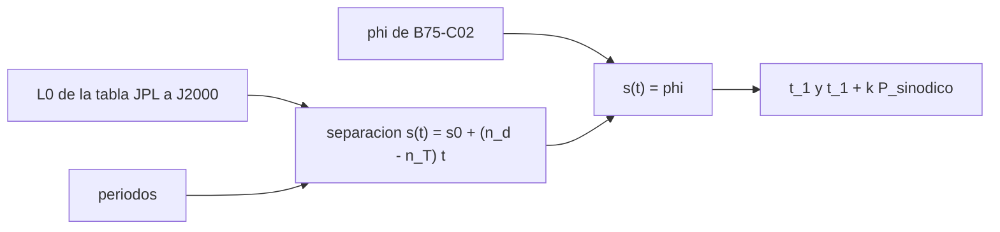

# B75-C03 — Ventanas de lanzamiento

<!-- nav:top -->
[🏠 Programa](../../../../README.md) · [📚 Bloque B75](../../../tronco-comun/B75-trayectorias-y-misiones-interplanetarias.md) · [← Anterior: B75-C02 — Ángulos de fase planetaria](../B75-C02-angulos-de-fase-planetaria/CLASE.md) · [Siguiente: B75-C04 — Ecuación de Lambert →](../B75-C04-ecuacion-de-lambert/CLASE.md)
<!-- /nav -->

## 1. Ubicación, nivel y alcance

Clase 3 del bloque B75. Nivel N3. Con el ángulo de fase de salida (B75-C02) y las longitudes medias a J2000 de la tabla del JPL, esta clase calcula **fechas**: cuándo se cumple la geometría y cada cuánto vuelve. El modelo es circular y coplanar; las fechas son orientativas (decenas de días) y no se comparan con lanzamientos reales.

## 2. Por qué esta clase existe

Una ventana de lanzamiento no es un capricho de calendario: es el instante en que la geometría de los dos planetas coincide con la de la elipse de transferencia. La decisión central: **¿en qué fechas se cumple la fase de salida y cuánto margen de días da una tolerancia angular?**

## 3. Lo que podrás hacer al terminar

1. Escribir la longitud media de cada planeta como `L(t) = L₀ + 360°·t/P`.
2. Resolver la fecha de la primera ventana a partir de `L_destino − L_Tierra = φ`.
3. Generar las ventanas siguientes sumando el periodo sinódico.
4. Convertir días desde J2000 a fecha de calendario.
5. Estimar el ancho en días de una ventana a partir de una tolerancia angular.
6. Separar lo consultado (longitudes a J2000, periodos) de lo modelado y de lo no comparado.

La evidencia es tu **calendario de ventanas del modelo** del ejercicio 12 (sección 20).

## 4. Con qué llegas y cómo comprobarlo

1. ¿Qué es la longitud media de un planeta?
2. ¿Qué es J2000?
3. ¿Qué es `φ`?
4. ¿Qué es el periodo sinódico?
5. ¿Por qué las fechas del modelo son aproximadas?

<details>
<summary>Ver respuestas</summary>

1. El ángulo que tendría si se moviera a velocidad uniforme: `L = L₀ + n·t`. 2. La época de referencia 2000-01-01 12:00; se usa como origen de tiempos. 3. El ángulo de fase de salida de B75-C02. 4. El tiempo entre dos alineaciones iguales (B75-C02). 5. Porque se ignoran la excentricidad y la inclinación.
</details>

Con cuatro o cinco aciertos, sigue; si no, repasa los prerrequisitos.

## 5. Un caso de contexto y casos de referencia

Con `L_Tierra = 100,46457166°` y `L_Marte = −4,55343205°` a J2000 [S1], la separación inicial es `−105,018°`, y cambia `−0,46158°/d`. Alcanzar `φ = 44,337°` ocurre `456,36 d` después de J2000: la primera ventana del modelo cae el `2001-04-01`, y luego cada `779,93 d`. Es el **ejemplo conductor**. Los valores de la tabla del JPL son válidos de 1800 a 2050 y están pensados para posiciones aproximadas [S1].

## 6. Vocabulario

La **longitud media** `L(t)` crece linealmente con el tiempo. Una **ventana** es el instante en que la separación `L_destino − L_Tierra` iguala el ángulo de fase de salida. La **anchura de ventana** es el intervalo de fechas que cumple una tolerancia angular. **J2000** es el origen de tiempos. «Oportunidad» y «ventana» se usan aquí como sinónimos.

## 7. Modelo mental: un reloj con dos agujas



*Descripción textual:* Las longitudes de J2000 y los periodos dan la separación en función del tiempo; igualarla a `φ` da la primera ventana y el periodo sinódico las repite.

Analogía: un reloj de dos agujas que giran a distinta velocidad y se alinean con cierto desfase cada cierto tiempo. Límite: las agujas reales no giran a velocidad uniforme.

## 8. La explicación, paso a paso

### 8.1 Primera ventana

Para Marte, `s₀ = L_M − L_T = −4,55343205° − 100,46457166° = −105,018°`, `ṡ = 360/686,980 − 360/365,256 = −0,46158°/d`, que es negativa porque la Tierra es más rápida. La condición `s(t) ≡ φ (mod 360°)` da `t = 456,36 d`, es decir `2001-04-01` (modelo).

### 8.2 Calendario del modelo

| Ventana | Tierra–Marte (salida) | Tierra–Venus (salida) |
|---|---|---|
| 1 | 2001-04-01 | 2000-12-30 |
| 2 | 2003-05-21 | 2002-08-06 |
| 3 | 2005-07-09 | 2004-03-12 |
| 4 | 2007-08-28 | 2005-10-17 |
| 5 | 2009-10-16 | 2007-05-24 |
| 6 | 2011-12-05 | 2008-12-28 |

Los intervalos son `779,934 d` (Marte) y `583,924 d` (Venus), que coinciden con el periodo sinódico de B75-C02 con error menor que `10⁻⁶ d`.

### 8.3 Ancho de ventana

Una tolerancia de `±5°` en la fase equivale a `5/0,46158 = 10,8 d` a cada lado para Marte. Es una cifra ilustrativa: el ancho real depende de cuánto delta-v extra se acepte (C29).

### 8.4 Lo que el modelo no sabe

La NASA indica oportunidades de mínima energía «cada unos 25 meses» a Marte y «19 meses» a Venus [S5]; el modelo da `25,6` y `19,2` meses. Las fechas reales difieren de las del modelo por la excentricidad de Marte (`0,0935` [S3]) y por la inclinación de Venus (`3,395°` [S4]); no se compararon con fechas de lanzamientos reales (no consultadas).

## 9. Magnitudes, símbolos y unidades

| Símbolo | Qué es | Unidad | Valor / nota |
|---|---|---|---|
| `L₀` | longitud media a J2000 | ° | 100,4646 (Tierra); −4,5534 (Marte) |
| `n` | movimiento medio | °/d | 360/P |
| `s(t)` | separación destino − Tierra | ° | −105,018 + 0,46158·t |
| `φ` | fase de salida | ° | 44,337 (Marte) |
| `P_sin` | periodo sinódico | d | 779,93; 583,92 |

## 10. Convenciones y referencias

Longitudes eclípticas medias de la tabla del JPL (baricentro Tierra–Luna para la Tierra), medidas desde el equinoccio J2000. Tiempo en días desde 2000-01-01 12:00; la conversión a calendario no corrige entre escalas de tiempo (diferencias de segundos, irrelevantes aquí). Órbitas circulares y coplanares; `μ☉` estándar.

## 11. De dónde sale lo que afirmamos

| ID | Fuente | Localizador | Respalda | Estado |
|---|---|---|---|---|
| S1 | NASA JPL SSD, Approximate Positions of the Planets (Table 1) — https://ssd.jpl.nasa.gov/planets/approx_pos.html (consultada 2026-11-10) | página leída | elementos a J2000 válidos de 1800 a 2050: baricentro Tierra–Luna a = 1,00000261 au, L = 100,46457166°; Marte a = 1,52371034 au, e = 0,09339410, L = −4,55343205°; Venus a = 0,72333566 au, L = 181,97909950°; Júpiter a = 5,20288700 au, L = 34,39644051° | Consultada |
| S2 | NASA/NSSDC, Earth Fact Sheet — https://nssdc.gsfc.nasa.gov/planetary/factsheet/earthfact.html (consultada 2026-11-10) | página leída | semieje 149,598×10⁶ km, periodo sideral 365,256 d, excentricidad 0,0167, velocidad orbital media 29,78 km/s, masa 5,9722×10²⁴ kg, radio medio 6371,000 km, velocidad de escape 11,186 km/s | Consultada |
| S3 | NASA/NSSDC, Mars Fact Sheet — https://nssdc.gsfc.nasa.gov/planetary/factsheet/marsfact.html (consultada 2026-11-10) | página leída | semieje 227,956×10⁶ km, periodo sideral 686,980 d, excentricidad 0,0935, inclinación 1,848°, velocidad media 24,08 km/s, masa 0,64169×10²⁴ kg, radio ecuatorial 3396,2 km, g 3,73 m/s² | Consultada |
| S4 | NASA/NSSDC, Venus Fact Sheet — https://nssdc.gsfc.nasa.gov/planetary/factsheet/venusfact.html (consultada 2026-11-10) | página leída | semieje 108,210×10⁶ km, periodo sideral 224,701 d, excentricidad 0,0068, inclinación 3,395°, velocidad media 35,02 km/s, masa 4,8673×10²⁴ kg, radio medio 6051,8 km | Consultada |
| S5 | NASA, Basics of Space Flight, cap. 4 «Interplanetary Trajectories» — https://science.nasa.gov/learn/basics-of-space-flight/chapter4-1/ (consultada 2026-11-10) | página leída | transferencia de Hohmann como ruta de menor propulsante; oportunidades mínimas de energía a Marte cada ~25 meses y a Venus cada ~19 meses; la asistencia gravitacional cambia la velocidad heliocéntrica y deja la relativa en módulo; el vuelo de Galileo por Ío redujo el propulsante de inserción en 90 kg | Consultada |
| — | Valores estándar (no consultados en una fuente concreta de esta clase) | — | GM☉ = 1,32712440×10¹¹ km³/s² (valor estándar, ver la resolución IAU 2015 B3 de la fila anterior donde se cita); 1 au = 149 597 870,7 km; c = 299 792,458 km/s; g₀ = 9,80665 m/s²; ecuaciones de dos cuerpos | No consultada en una fuente concreta |

Límites: se usan solo `L₀` y los periodos; las tasas de variación de los elementos de la tabla y las fechas de misiones no se consultaron.

## 12. Cómo ver las ventanas

| Ventana (modelo) | Fecha |
|---|---|
| Tierra–Marte n.º 1 | 2001-04-01 |
| Tierra–Marte n.º 2 | 2003-05-21 |
| Tierra–Venus n.º 1 | 2000-12-30 |
| Tierra–Venus n.º 2 | 2002-08-06 |

Descripción larga: las ventanas de Marte se separan algo más de dos años; las de Venus, algo más de uno y medio.

## 13. Ejemplo trabajado: la segunda ventana de Marte

**Paso 1 · Primera ventana.** `t₁ = 456,36 d`.

**Paso 2 · Periodo.** `P_sin = 779,934 d`.

**Paso 3 · Segunda.** `t₂ = 456,36 + 779,934 = 1236,29 d`.

**Paso 4 · Fecha.** 1236,29 d después de J2000 es el `2003-05-21`.

## 14. Distintas formas de abordar el problema

**Por la separación angular:** se resuelve `s(t) = φ`. **Por el periodo sinódico:** se suman múltiplos desde la primera ventana. **Por tablas de efemérides:** dan fechas reales, pero no se consultaron aquí. **Por un barrido de Lambert:** C29 construye el mapa fecha de salida–fecha de llegada.

## 15. Práctica guiada

**Ejercicio 1 · con los pasos indicados.** Calcula la separación inicial Marte − Tierra a J2000. *Pasos:* resta las longitudes de la tabla.

<details><summary>Solución comentada</summary>

`−4,55343205 − 100,46457166 = −105,018°`.
</details>

**Ejercicio 2 · con una pista.** Calcula `t₁` hasta `s = φ`. *Pista:* la separación cambia `−0,46158°/d` y `φ ≡ 44,337 − 360 = −315,663°`.

<details><summary>Solución comentada</summary>

`(−315,663 + 105,018)/(−0,46158) = 456,36 d`.
</details>

**Ejercicio 3 · casi autónomo.** ¿Qué fecha corresponde a `t₁`?

<details><summary>Solución comentada</summary>

456,36 d tras 2000-01-01 12:00 es el `2001-04-01` (modelo).
</details>

## 16. Práctica autónoma, transferencia e integrador

**Ejercicio 4 · autónomo.** Estima la siguiente ventana a Marte después de `2011-12-05`.

<details><summary>Solución comentada</summary>

`+779,93 d`: aproximadamente el `2014-01-23` (modelo).
</details>

**Ejercicio 5 · autónomo.** Estima la siguiente ventana a Venus después de `2008-12-28`.

<details><summary>Solución comentada</summary>

`+583,92 d`: aproximadamente el `2010-08-04` (modelo).
</details>

**Ejercicio 6 · autónomo.** ¿Cuántos días de ancho tiene una ventana de `±3°` para Marte?

<details><summary>Solución comentada</summary>

`2×3/0,46158 = 13,0 d`.
</details>

**Ejercicio 7 · autónomo.** Calcula el número de ventanas a Marte en 20 años.

<details><summary>Solución comentada</summary>

`20×365,256/779,93 = 9,4`, es decir 9 o 10.
</details>

**Ejercicio 8 · autónomo.** ¿Por qué la separación Marte − Tierra es negativa y decreciente?

<details><summary>Solución comentada</summary>

Porque la Tierra es más rápida: su longitud crece más que la de Marte.
</details>

**Ejercicio 9 · transferencia.** Una misión debe salir en el `2009-10-16` según el modelo, pero el lanzador se retrasa 30 d. ¿Cuánto cambia la fase?

<details><summary>Solución comentada</summary>

`30×0,46158 = 13,8°`; la fase sale de lo óptimo y exige más delta-v o esperar otra ventana (C29).
</details>

**Ejercicio 10 · transferencia.** Si las ventanas del modelo difieren de las reales en unas semanas, ¿para qué sirve el modelo?

<details><summary>Solución comentada</summary>

Para entender el ritmo (cada 2,1 años) y calcular el orden de magnitud, no para fijar un lanzamiento.
</details>

**Ejercicio 11 · transferencia.** ¿Qué datos añadirías para acercar el modelo a la realidad?

<details><summary>Solución comentada</summary>

La excentricidad y la inclinación (elementos completos de la tabla del JPL) y la ecuación de Kepler.
</details>

**Ejercicio 12 · integrador.** Elabora tu *calendario de ventanas del modelo* para Marte o Venus con seis fechas, el intervalo, el ancho para una tolerancia que elijas y la lista de lo consultado y lo no comparado.

<details><summary>Solución comentada</summary>

Secciones 8.1–8.4 y la salida del laboratorio.
</details>

## 17. Laboratorio: calendario de ventanas Marte y Venus

El script [ventanas.py](ventanas.py) calcula seis ventanas para cada destino desde las longitudes de J2000 y **comprueba** que en cada fecha la separación angular iguala `φ` (error < `10⁻⁶°`) y que los intervalos igualan el periodo sinódico.

**Datos:** longitudes medias a J2000 de la tabla JPL y periodos de las fichas NASA/NSSDC (consultados); órbitas circulares (**modelo**). **Predice antes de ejecutar:** ¿Qué intervalo habrá entre ventanas a Marte? (779,934 d.) **Ejecución del 2026-11-10 (Python 3.12.9):**

```text
Python 3.12.9 (biblioteca estandar)
Marte: fase de salida = 44.337 grados ; periodo sinodico = 779.934 d (2.135 anios)
   salida (modelo) 2001-04-01  t =    456.36 d desde J2000
   salida (modelo) 2003-05-21  t =   1236.29 d desde J2000
   salida (modelo) 2005-07-09  t =   2016.23 d desde J2000
   salida (modelo) 2007-08-28  t =   2796.16 d desde J2000
   salida (modelo) 2009-10-16  t =   3576.10 d desde J2000
   salida (modelo) 2011-12-05  t =   4356.03 d desde J2000
Venus: fase de salida = -54.033 grados ; periodo sinodico = 583.924 d (1.599 anios)
   salida (modelo) 2000-12-30  t =    364.06 d desde J2000
   salida (modelo) 2002-08-06  t =    947.99 d desde J2000
   salida (modelo) 2004-03-12  t =   1531.91 d desde J2000
   salida (modelo) 2005-10-17  t =   2115.83 d desde J2000
   salida (modelo) 2007-05-24  t =   2699.76 d desde J2000
   salida (modelo) 2008-12-28  t =   3283.68 d desde J2000
Intervalos entre ventanas = periodo sinodico del modelo. Pruebas superadas.
```

```bash
python programa/clases/B75/B75-C03-ventanas-de-lanzamiento/ventanas.py
```

**Límites:** sin excentricidad ni inclinación; las fechas no se compararon con las de ningún lanzamiento real.

## 18. Errores frecuentes y cómo corregirlos

**Tomar las fechas del modelo como fechas de lanzamiento.** Se corrige con 8.4.

**Olvidar sumar el periodo sinódico en lugar del sideral.** Se corrige con 8.2.

**Confundir días desde J2000 con fecha juliana.** Se corrige con la sección 10.

**No rotular que el origen del tiempo es J2000.** Se corrige con la sección 10.

## 19. Cómo sabrás que vas bien

Tras 8.1: ¿qué fecha obtuviste para la primera ventana? Tras el laboratorio: ¿qué comprueban las dos pruebas? (ver la sección 17).

## 20. Qué entregas y cómo se evalúa

El producto es tu **calendario de ventanas del modelo** (ejercicio 12).

| Criterio | Inicial | En desarrollo | Logrado | Destacado |
|---|---|---|---|---|
| Conceptos | Confunde fase y fecha | Define ventana | Calcula fechas desde `L₀` | Explica el margen angular |
| Cálculo | Sin unidades | Con errores | Tabla completa con unidades | Calcula casos nuevos |
| Numérico | Sin comprobar | Una prueba | Separación e intervalo | Interpreta los errores |
| Fuentes | Sin fuente | Sin fecha | Fuentes con fecha y estado | Declara lo no comparado |
| Límites | No los nombra | Uno | Tres | Discute excentricidad e inclinación |

**Condiciones críticas (no se compensan con promedio):** rotular las fechas como del modelo; no presentarlas como lanzamientos reales; citar solo lo consultado.

## 21. Ética, seguridad y límites

Clase educativa: los modelos son simplificados (órbitas planetarias circulares y coplanares, dos cuerpos) y sus datos son consultados, sintéticos o ilustrativos y están rotulados; ningún resultado es una efeméride, una medición ni un diseño de misión real. Las fechas de esta clase no sirven para planificar un lanzamiento. Accesibilidad: tablas equivalentes a las gráficas, fórmulas en texto, ejercicios sin conexión.

## 22. Para cerrar y seguir

El modelo da una ventana a Marte cada `779,93 d`; la primera después de J2000 cae el `2001-04-01` (modelo). Queda una pregunta: ¿cómo se calcula la trayectoria cuando la nave sale en cualquier fecha, no solo en la óptima?

**Glosario español–inglés.** ventana de lanzamiento · *launch window*; longitud media · *mean longitude*; época · *epoch*; oportunidad · *launch opportunity*; tolerancia · *tolerance*.

**Continuidad.** [B75-C04](../B75-C04-ecuacion-de-lambert/CLASE.md) resuelve la trayectoria para dos posiciones y un tiempo cualquiera.

**Referencias:** ver sección 11.

<!-- nav:bottom -->
---

[← Anterior: B75-C02 — Ángulos de fase planetaria](../B75-C02-angulos-de-fase-planetaria/CLASE.md) · [📚 Bloque B75](../../../tronco-comun/B75-trayectorias-y-misiones-interplanetarias.md) · [Siguiente: B75-C04 — Ecuación de Lambert →](../B75-C04-ecuacion-de-lambert/CLASE.md)
<!-- /nav -->
