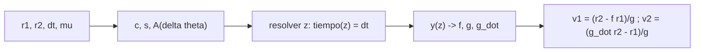

# B75-C04 — Ecuación de Lambert

<!-- nav:top -->
[🏠 Programa](../../../../README.md) · [📚 Bloque B75](../../../tronco-comun/B75-trayectorias-y-misiones-interplanetarias.md) · [← Anterior: B75-C03 — Ventanas de lanzamiento](../B75-C03-ventanas-de-lanzamiento/CLASE.md) · [Siguiente: B75-C05 — Transferencias bi-elípticas →](../B75-C05-transferencias-bi-elipticas/CLASE.md)
<!-- /nav -->

## 1. Ubicación, nivel y alcance

Clase 4 del bloque B75. Nivel N3. La transferencia de Hohmann es un caso particular: una nave puede ir de un punto a otro por muchas elipses. El problema de Lambert pide: dados dos vectores de posición y un tiempo de vuelo, ¿qué velocidad inicial lleva de uno al otro? Aquí lo resuelves con variables universales y lo verificas contra una órbita propagada y contra una integración numérica. Es el bloque de cálculo de las clases C12, C21 y C29. Solo trayectorias directas de menos de una revolución.

## 2. Por qué esta clase existe

Con ventanas fijas solo se calcula el caso ideal. Para cualquier fecha de salida y llegada hace falta resolver la geometría entre dos posiciones. La decisión central: **¿qué velocidad hay que dar a la nave en `r₁` para que llegue a `r₂` en el tiempo `Δt`, y cuánto cuesta?**

## 3. Lo que podrás hacer al terminar

1. Enunciar el problema de Lambert y sus datos (`r₁`, `r₂`, `Δt`, `μ`).
2. Calcular la cuerda `c`, el semiperímetro `s` y el parámetro `A` del arco.
3. Resolver `z` por bisección en la ecuación universal del tiempo y obtener `v₁` y `v₂`.
4. Verificar la solución con una propagación de Kepler y con una integración RK4.
5. Interpretar la curva `v∞(Δt)` de un arco de 135°: mínimo, energía mínima y cota parabólica.
6. Separar lo consultado (radios) de lo sintético (estado de prueba) y de lo estándar (`μ☉`).

La evidencia es tu **ficha de un arco de Lambert verificado** del ejercicio 12 (sección 20).

## 4. Con qué llegas y cómo comprobarlo

1. ¿Qué es una cónica y cuáles son sus tipos?
2. ¿Qué es el tiempo de vuelo entre dos puntos de una elipse?
3. ¿Qué es el exceso hiperbólico `v∞`?
4. ¿Qué es una propagación de Kepler?
5. ¿Qué es una verificación por segunda vía?

<details>
<summary>Ver respuestas</summary>

1. La curva de dos cuerpos: círculo, elipse, parábola o hipérbola según la energía. 2. El tiempo que tarda el cuerpo en recorrer el arco; se obtiene con la ecuación de Kepler. 3. Velocidad respecto al planeta lejos de él (B75-C01). 4. Avanzar un estado `(r, v)` un tiempo `Δt` bajo dos cuerpos. 5. Calcular lo mismo con otro método (aquí, integración numérica) y comparar.
</details>

Con cuatro o cinco aciertos, sigue; si no, repasa los prerrequisitos.

## 5. Un caso de contexto y casos de referencia

Una nave sale de la Tierra (`r₁ = 149,598×10⁶ km`, ángulo 0°) y debe llegar a la posición de Marte a 135° de longitud (`r₂ = 227,956×10⁶ km`) [S1, S2]. Para `Δt = 210 d`, Lambert da `v∞,sal = 5,065 km/s` y `v∞,lleg = 3,004 km/s`; para `Δt = 180 d`, `3,434` y `4,647 km/s`. Es el **ejemplo conductor**. Los radios son los semiejes de las fichas, no una efeméride; la geometría de 135° es una elección ilustrativa.

## 6. Vocabulario

El **problema de Lambert** pide la órbita que une `r₁` y `r₂` en un tiempo dado. La **cuerda** `c` es la distancia entre los dos puntos y el **semiperímetro** `s = (r₁ + r₂ + c)/2`. El **ángulo de transferencia** `Δθ` es el que forman `r₁` y `r₂`. La **variable universal** `z = α χ²` agrupa elipses (`z > 0`), parábolas (`z = 0`) e hipérbolas (`z < 0`). Las **funciones de Stumpff** `C(z)` y `S(z)` evitan separar casos. La **solución de energía mínima** tiene `a = s/2`.

## 7. Modelo mental: unir dos puntos con un hilo cuya longitud es el tiempo



*Descripción textual:* Los datos dan la geometría `c`, `s`, `A`; se busca `z` tal que el tiempo universal iguale `Δt`; con `z` se calculan los coeficientes `f`, `g` y las dos velocidades.

Analogía: unir dos clavos con un hilo: la longitud del hilo es el tiempo disponible. Límite: no es una longitud de hilo, sino una ecuación no lineal que puede tener varias soluciones (varias vueltas), aquí no tratadas.

## 8. La explicación, paso a paso

### 8.1 Geometría del arco

Con `r₁ = 149,598×10⁶ km`, `r₂ = 227,956×10⁶ km` y `Δθ = 135°`: cuerda `c = 350,101×10⁶ km`, `s = 363,827×10⁶ km`, semieje de energía mínima `a_min = s/2 = 181,914×10⁶ km`.

### 8.2 La ecuación del tiempo

Con `A = sinΔθ·√(r₁r₂/(1 − cosΔθ))` (aquí `99,94×10⁶ km`) y `y(z) = r₁ + r₂ + A(zS(z) − 1)/√C(z)`, la ecuación universal es `√μ·Δt = (y/C)^{3/2}·S + A√y`. Se resuelve `z` por bisección y luego `f = 1 − y/r₁`, `g = A√(y/μ)`, `ġ = 1 − y/r₂`, `v₁ = (r₂ − f·r₁)/g`, `v₂ = (ġ·r₂ − r₁)/g`.

### 8.3 La curva del arco de 135°

| `Δt` (d) | `v∞,sal` (km/s) | `v∞,lleg` (km/s) | suma (km/s) |
|---|---|---|---|
| 150 | 6,410 | 9,394 | 15,803 |
| 180 | 3,434 | 4,647 | 8,081 |
| 210 | 5,065 | 3,004 | 8,069 |
| 240 | 7,511 | 4,477 | 11,988 |
| 270 | 9,656 | 6,443 | 16,099 |
| 300 | 11,461 | 8,205 | 19,666 |

La suma es mínima entre 180 y 210 d. El tiempo de energía mínima es `244,12 d` y la cota parabólica (el arco más corto posible por elipse) es `103,17 d`.

### 8.4 Cómo se verifica

(1) Se propaga un estado sintético con Kepler y Lambert recupera la velocidad con error `6,9×10⁻¹⁴ km/s`. (2) La integración RK4 de la solución de 210 d llega a `r₂` con diferencia menor que 0,001 km. (3) Con un arco de 179,99° y el `TOF` de Hohmann, `v∞,sal` coincide con el de Hohmann (`2,9452 km/s`). (4) En el tiempo de energía mínima el semieje de Lambert es `s/2` con error relativo menor que `10⁻⁶`.

## 9. Magnitudes, símbolos y unidades

| Símbolo | Qué es | Unidad | Valor / nota |
|---|---|---|---|
| `c` | cuerda entre `r₁` y `r₂` | km | 350,101×10⁶ |
| `s` | semiperímetro | km | 363,827×10⁶ |
| `A` | parámetro geométrico | km | 99,94×10⁶ |
| `z` | variable universal | — | se resuelve |
| `Δt` | tiempo de vuelo | d | 150–300 |
| `v₁`, `v₂` | velocidades en los extremos | km/s | salida y llegada |

## 10. Convenciones y referencias

Marco heliocéntrico plano, trayectoria directa (sentido antihorario), menos de una revolución. Radios = semiejes de las fichas NASA/NSSDC. El estado de la prueba 1 es sintético. `μ☉` estándar. No se tratan trayectorias de varias vueltas ni la solución de 180° exactos (plano indeterminado).

## 11. De dónde sale lo que afirmamos

| ID | Fuente | Localizador | Respalda | Estado |
|---|---|---|---|---|
| S1 | NASA/NSSDC, Earth Fact Sheet — https://nssdc.gsfc.nasa.gov/planetary/factsheet/earthfact.html (consultada 2026-11-10) | página leída | semieje 149,598×10⁶ km, periodo sideral 365,256 d, excentricidad 0,0167, velocidad orbital media 29,78 km/s, masa 5,9722×10²⁴ kg, radio medio 6371,000 km, velocidad de escape 11,186 km/s | Consultada |
| S2 | NASA/NSSDC, Mars Fact Sheet — https://nssdc.gsfc.nasa.gov/planetary/factsheet/marsfact.html (consultada 2026-11-10) | página leída | semieje 227,956×10⁶ km, periodo sideral 686,980 d, excentricidad 0,0935, inclinación 1,848°, velocidad media 24,08 km/s, masa 0,64169×10²⁴ kg, radio ecuatorial 3396,2 km, g 3,73 m/s² | Consultada |
| S3 | NASA JPL SSD, Approximate Positions of the Planets (Table 1) — https://ssd.jpl.nasa.gov/planets/approx_pos.html (consultada 2026-11-10) | página leída | elementos a J2000 válidos de 1800 a 2050: baricentro Tierra–Luna a = 1,00000261 au, L = 100,46457166°; Marte a = 1,52371034 au, e = 0,09339410, L = −4,55343205°; Venus a = 0,72333566 au, L = 181,97909950°; Júpiter a = 5,20288700 au, L = 34,39644051° | Consultada |
| — | Valores estándar (no consultados en una fuente concreta de esta clase) | — | GM☉ = 1,32712440×10¹¹ km³/s² (valor estándar, ver la resolución IAU 2015 B3 de la fila anterior donde se cita); 1 au = 149 597 870,7 km; c = 299 792,458 km/s; g₀ = 9,80665 m/s²; ecuaciones de dos cuerpos | No consultada en una fuente concreta |

Límites: la geometría de 135° es ilustrativa; la longitud de Marte real a una fecha dada no se calcula aquí (la tabla [S3] sirve para eso en C29); el algoritmo es el de variables universales estándar y se valida contra Kepler, no contra una fuente concreta.

## 12. Cómo ver el arco de Lambert

| Magnitud | Valor |
|---|---|
| `c` | 350,101×10⁶ km |
| `a_min` | 181,914×10⁶ km |
| `Δt` energía mínima | 244,12 d |
| `Δt` parabólico | 103,17 d |
| Suma `v∞` mínima (en la tabla) | 8,069 km/s a 210 d |

Descripción larga: para tiempos cortos la suma de excesos crece muy rápido (el arco se vuelve hiperbólico); para tiempos largos crece más despacio; el óptimo está entre ambos.

## 13. Ejemplo trabajado: el arco de 210 d

**Paso 1 · Datos.** `r₁ = 149,598×10⁶ km`, `r₂ = 227,956×10⁶ km`, `Δθ = 135°`, `Δt = 210 d`.

**Paso 2 · Resolver `z`.** El laboratorio biseca la ecuación del tiempo.

**Paso 3 · Velocidades.** `v₁` da `v∞,sal = 5,065 km/s` respecto a la Tierra.

**Paso 4 · Llegada.** `v₂` da `v∞,lleg = 3,004 km/s` respecto a Marte.

## 14. Distintas formas de abordar el problema

**Por variables universales:** un solo algoritmo para elipses e hipérbolas. **Por energía mínima (Lagrange):** da `a = s/2` y su tiempo. **Por Hohmann:** caso límite de 180°. **Por integración numérica:** RK4 comprueba que la velocidad calculada llega al destino.

## 15. Práctica guiada

**Ejercicio 1 · con los pasos indicados.** Calcula la cuerda `c` de un arco de 135° con `r₁ = 149,598` y `r₂ = 227,956` (10⁶ km). *Pasos:* ley de cosenos `c² = r₁² + r₂² − 2r₁r₂cosΔθ`.

<details><summary>Solución comentada</summary>

`c = 350,101×10⁶ km`.
</details>

**Ejercicio 2 · con una pista.** Calcula `s` y `a_min`. *Pista:* `s = (r₁ + r₂ + c)/2`.

<details><summary>Solución comentada</summary>

`s = 363,827×10⁶ km`; `a_min = 181,914×10⁶ km`.
</details>

**Ejercicio 3 · casi autónomo.** ¿Qué tipo de cónica sale para `Δt = 100 d` y para `Δt = 150 d` en este arco? *Pista:* el tiempo parabólico es `103,17 d`.

<details><summary>Solución comentada</summary>

`100 d` es menor que el tiempo parabólico: la órbita es una hipérbola (energía positiva respecto al Sol). `150 d` es mayor: es una elipse.
</details>

## 16. Práctica autónoma, transferencia e integrador

**Ejercicio 4 · autónomo.** De la tabla 8.3, ¿qué `Δt` da la menor suma de excesos entre los muestreados?

<details><summary>Solución comentada</summary>

`210 d` (suma `8,069 km/s`), ligeramente mejor que `180 d` (`8,081 km/s`).
</details>

**Ejercicio 5 · autónomo.** Compara el `TOF` de energía mínima (`244,12 d`) con el de Hohmann (`258,88 d`).

<details><summary>Solución comentada</summary>

El de Lambert para 135° es más corto porque el arco es menor; ambos son tiempos de elipses distintas.
</details>

**Ejercicio 6 · autónomo.** ¿Qué pasa con `v∞,lleg` cuando `Δt` se acorta de 210 a 150 d?

<details><summary>Solución comentada</summary>

Crece de `3,004` a `9,394 km/s`: la nave llega mucho más rápido respecto a Marte.
</details>

**Ejercicio 7 · autónomo.** Estima por interpolación lineal la suma a `195 d` entre `180 d` y `210 d`.

<details><summary>Solución comentada</summary>

`(8,081 + 8,069)/2 = 8,075 km/s` (estimación lineal, no una solución de Lambert; el mínimo real es algo menor).
</details>

**Ejercicio 8 · autónomo.** ¿Qué comprueba la prueba 3 del laboratorio?

<details><summary>Solución comentada</summary>

Que el caso límite de 180° coincide con Hohmann: `2,9452 km/s` en ambos.
</details>

**Ejercicio 9 · transferencia.** Un colega usa el `Δt` de Hohmann para un arco de 135°. ¿Qué ocurre?

<details><summary>Solución comentada</summary>

Obtiene una solución válida pero de otra energía y con `v∞` mayor que el mínimo de la curva; el `Δt` debe elegirse optimizando (C12).
</details>

**Ejercicio 10 · transferencia.** ¿Por qué Lambert falla para un arco de exactamente 180°?

<details><summary>Solución comentada</summary>

El plano de la órbita queda indeterminado (`sinΔθ = 0`); en el laboratorio se usa 179,99°.
</details>

**Ejercicio 11 · transferencia.** La tabla [S3] da la longitud de Marte a J2000. ¿Cómo la usarías para definir `r₂`?

<details><summary>Solución comentada</summary>

Avanzando `L(t)` con el movimiento medio hasta la fecha de llegada y convirtiéndola en vector (C29).
</details>

**Ejercicio 12 · integrador.** Elabora tu *ficha de un arco de Lambert verificado* para un ángulo de transferencia de tu elección: geometría (`c`, `s`, `a_min`), tabla de `v∞` frente a `Δt`, y las cuatro verificaciones.

<details><summary>Solución comentada</summary>

Secciones 8.1–8.4 y la salida del laboratorio con el ángulo cambiado en el script.
</details>

## 17. Laboratorio: Lambert verificado por Kepler y RK4

El script [lambert.py](lambert.py) resuelve Lambert para un arco Tierra–Marte de 135°, **comprueba** la recuperación de un estado sintético, una integración RK4, el límite de Hohmann y el semieje de energía mínima.

**Datos:** radios de las fichas NASA/NSSDC (consultadas); `μ☉` estándar; estado sintético de la prueba 1 (**sintético**); geometría de 135° ilustrativa. **Predice antes de ejecutar:** ¿Cuál es la suma de excesos más baja del muestreo? (8,069 km/s a 210 d.) **Ejecución del 2026-11-10 (Python 3.12.9):**

```text
Python 3.12.9 (biblioteca estandar)
Prueba 1 (estado sintetico): |v1_Lambert - v1_verdadera| max = 6.89e-14 km/s
Arco Tierra-Marte de 135 grados: TOF [d]  v_inf_sal [km/s]  v_inf_lleg [km/s]  suma [km/s]
                                     150             6.410              9.394         15.803
                                     180             3.434              4.647          8.081
                                     210             5.065              3.004          8.069
                                     240             7.511              4.477         11.988
                                     270             9.656              6.443         16.099
                                     300            11.461              8.205         19.666
Prueba 2 (RK4, 210 d): distancia entre la posicion integrada y r2 = 0.000 km
Prueba 3 (arco ~180 grados, TOF de Hohmann 258.88 d): v_inf_sal = 2.9452 ; Hohmann = 2.9452 km/s
Geometria del arco de 135 grados: cuerda c = 350.101e6 km ; s = 363.827e6 km ; a_min = 181.914e6 km
TOF parabolico (cota inferior elipses) = 103.17 d ; TOF de minima energia = 244.12 d
Prueba 4: semieje de Lambert en el TOF de minima energia = 181.914e6 km (esperado 181.914e6)
Pruebas superadas.
```

```bash
python programa/clases/B75/B75-C04-ecuacion-de-lambert/lambert.py
```

**Límites:** solo trayectorias directas de menos de una vuelta; sin perturbaciones; RK4 y Kepler comparten el mismo modelo de dos cuerpos.

## 18. Errores frecuentes y cómo corregirlos

**Usar un arco de exactamente 180°.** Se corrige con el ejercicio 10.

**Olvidar que la solución depende del sentido (directo o retrógrado).** Se corrige con la sección 10.

**Interpretar la suma de excesos como el delta-v de la misión.** Se corrige con C09 y C23.

**Validar Lambert solo con Lambert.** Se corrige con la sección 8.4: se usa Kepler y RK4.

## 19. Cómo sabrás que vas bien

Tras 8.3: ¿qué `Δt` esperabas como óptimo? Tras el laboratorio: ¿cuántas pruebas independientes pasaron? (ver la sección 17).

## 20. Qué entregas y cómo se evalúa

El producto es tu **ficha de un arco de Lambert verificado** (ejercicio 12).

| Criterio | Inicial | En desarrollo | Logrado | Destacado |
|---|---|---|---|---|
| Conceptos | Confunde Lambert con Hohmann | Enuncia el problema | Resuelve y verifica | Explica los casos límite |
| Cálculo | Sin unidades | Con errores | Tabla completa con unidades | Calcula arcos nuevos |
| Numérico | Sin comprobar | Una prueba | Cuatro pruebas | Interpreta las tolerancias |
| Fuentes | Sin fuente | Sin fecha | Fuentes con fecha y estado | Declara lo sintético y lo estándar |
| Límites | No los nombra | Uno | Tres | Discute las varias vueltas |

**Condiciones críticas (no se compensan con promedio):** rotular el estado de prueba como sintético; no presentar el arco como trayectoria real; citar solo lo consultado.

## 21. Ética, seguridad y límites

Clase educativa: los modelos son simplificados (órbitas planetarias circulares y coplanares, dos cuerpos) y sus datos son consultados, sintéticos o ilustrativos y están rotulados; ningún resultado es una efeméride, una medición ni un diseño de misión real. Un arco de Lambert es una trayectoria de dos cuerpos: no incluye perturbaciones ni diseño de maniobras. Accesibilidad: tablas equivalentes a las gráficas, fórmulas en texto, ejercicios sin conexión.

## 22. Para cerrar y seguir

Lambert une `r₁` y `r₂` en `Δt` y el laboratorio verifica la solución con Kepler y RK4. Queda una pregunta: ¿cuándo conviene ir primero lejos para llegar mejor?

**Glosario español–inglés.** problema de Lambert · *Lambert's problem*; cuerda · *chord*; semiperímetro · *semiperimeter*; variable universal · *universal variable*; funciones de Stumpff · *Stumpff functions*.

**Continuidad.** [B75-C05](../B75-C05-transferencias-bi-elipticas/CLASE.md) compara Hohmann con transferencias de tres impulsos.

**Referencias:** ver sección 11.

<!-- nav:bottom -->
---

[← Anterior: B75-C03 — Ventanas de lanzamiento](../B75-C03-ventanas-de-lanzamiento/CLASE.md) · [📚 Bloque B75](../../../tronco-comun/B75-trayectorias-y-misiones-interplanetarias.md) · [Siguiente: B75-C05 — Transferencias bi-elípticas →](../B75-C05-transferencias-bi-elipticas/CLASE.md)
<!-- /nav -->
