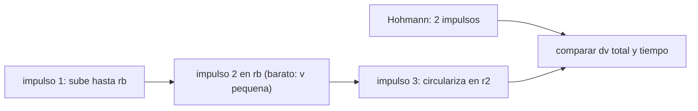

# B75-C05 — Transferencias bi-elípticas

<!-- nav:top -->
[🏠 Programa](../../../../README.md) · [📚 Bloque B75](../../../tronco-comun/B75-trayectorias-y-misiones-interplanetarias.md) · [← Anterior: B75-C04 — Ecuación de Lambert](../B75-C04-ecuacion-de-lambert/CLASE.md) · [Siguiente: B75-C06 — Asistencias gravitacionales →](../B75-C06-asistencias-gravitacionales/CLASE.md)
<!-- /nav -->

## 1. Ubicación, nivel y alcance

Clase 5 del bloque B75. Nivel N3. Hohmann usa dos impulsos y es el mínimo cuando los radios son parecidos; con tres impulsos y un apoapsis muy lejano, la transferencia bi-elíptica puede costar menos delta-v cuando el cociente de radios es grande, a cambio de un tiempo enorme. Aquí calculas los cruces y los verificas con dos métodos independientes. Modelo: órbitas circulares coplanares, impulsos instantáneos.

## 2. Por qué esta clase existe

El delta-v es lo caro. A veces conviene gastar tiempo para ahorrarlo. La decisión central: **¿para qué cociente de radios `R = r₂/r₁` gana la bi-elíptica a Hohmann y cuánto tiempo cuesta esa ganancia?**

## 3. Lo que podrás hacer al terminar

1. Calcular el delta-v total de Hohmann y de una bi-elíptica en unidades de la velocidad circular inicial.
2. Calcular el tiempo de vuelo de una bi-elíptica.
3. Hallar el cociente de cruce `R*` con `rb → ∞` por bisección.
4. Hallar el cociente `R**` a partir del cual cualquier `rb > R` mejora a Hohmann.
5. Aplicar el análisis a Tierra–Júpiter y decidir.
6. Separar lo consultado (semiejes) de lo adimensional y de los resultados clásicos recalculados.

La evidencia es tu **gráfica y tabla de Δv bi-elíptico frente a Hohmann** del ejercicio 12 (sección 20).

## 4. Con qué llegas y cómo comprobarlo

1. ¿Qué es el delta-v de un impulso?
2. ¿Qué dice la ecuación vis-viva?
3. ¿Qué es un apoapsis?
4. ¿Cuántos impulsos tiene Hohmann?
5. ¿Por qué un cociente `R` adimensional es útil?

<details>
<summary>Ver respuestas</summary>

1. El cambio instantáneo de velocidad, en km/s. 2. `v² = μ(2/r − 1/a)`. 3. El punto de la órbita más lejano del cuerpo central. 4. Dos, uno en cada extremo de la elipse. 5. Porque el resultado en unidades de la velocidad circular inicial vale para cualquier cuerpo central.
</details>

Con cuatro o cinco aciertos, sigue; si no, repasa los prerrequisitos.

## 5. Un caso de contexto y casos de referencia

Entre la Tierra y Júpiter, `R = 5,204` y Hohmann gana: `14,437 km/s` frente a `17,598 km/s` de una bi-elíptica con `rb = 20R`, que además tardaría 392 años [S1, S2]. Para `R = 20` la bi-elíptica gasta `0,50935` frente a `0,53473` de Hohmann (en unidades de `v_c1`): ahorro del 4,7 %. Es el **ejemplo conductor**. Los semiejes proceden de las fichas; el resto es adimensional.

## 6. Vocabulario

La **transferencia bi-elíptica** tiene tres impulsos: el primero sube a una elipse con apoapsis `rb > r₂`; el segundo, en `rb`, cambia el periapsis a `r₂`; el tercero circulariza. `R` es el cociente de radios. `R*` es el cociente por encima del cual una bi-elíptica con apoapsis infinito supera a Hohmann. `R**` es el cociente por encima del cual **cualquier** `rb` finita mayor que `R` la supera.

## 7. Modelo mental: tomar impulso lejos para frenar barato



*Descripción textual:* La bi-elíptica sube lejos, donde la velocidad es baja y cambiar el periapsis cuesta poco, y baja a `r₂`; se compara con Hohmann en delta-v y tiempo.

Analogía: lanzar una piedra muy alto y atraparla despacio: el movimiento a gran altura es lento. Límite: la ganancia es pequeña y el tiempo se multiplica.

## 8. La explicación, paso a paso

### 8.1 Delta-v de Hohmann y bi-elíptica

Con `r₁ = 1`, `μ = 1`: `Δv_H = (√(2R/(1+R)) − 1) + (1/√R − √(2/(R(1+R))))`. Para la bi-elíptica, con `a₁ = (1+rb)/2`, `a₂ = (R+rb)/2`: `Δv₁ = √(2 − 1/a₁) − 1`, `Δv₂ = √(2/rb − 1/a₂) − √(2/rb − 1/a₁)` y `Δv₃ = √(2/R − 1/a₂) − √(1/R)`; el total suma los módulos. En el límite `rb → ∞`: `Δv = (√2 − 1)(1 + 1/√R)`.

### 8.2 Tabla

| `R` | Hohmann | bi-elíptica `rb = 20R` | bi-elíptica `rb = 10⁶` | mejor |
|---|---|---|---|---|
| 5,20 | 0,48461 | 0,59089 | 0,59586 | Hohmann |
| 11,00 | 0,53243 | 0,54002 | 0,53910 | Hohmann |
| 12,00 | 0,53418 | 0,53505 | 0,53379 | bi-elíptica (`rb` grande) |
| 15,00 | 0,53622 | 0,52312 | 0,52116 | bi-elíptica |
| 20,00 | 0,53473 | 0,50935 | 0,50684 | bi-elíptica |
| 50,00 | 0,51370 | 0,47561 | 0,47280 | bi-elíptica |

Con `R = 12` y `rb = 20R` Hohmann todavía gana (`0,53418 < 0,53505`); solo una `rb` muy grande (`10⁶`) gana. Eso refleja `R* < R < R**`.

### 8.3 Los dos cruces

`R*` se halla por bisección de `Δv_H − Δv_b(rb = 10¹²)`: `11,9388`. Un barrido independiente de `R` con paso `10⁻³` da `11,939`. `R**` se halla por bisección de `Δv_H − Δv_b(rb = R(1+10⁻⁶))`: `15,582`. Son los valores clásicos 11,94 y 15,58, aquí recalculados y no citados.

### 8.4 Tierra–Júpiter

`R = 5,204 < R*`: Hohmann gana en delta-v (`14,437 km/s` frente a `17,598 km/s` con `rb = 20R`) y en tiempo (`997,7 d` frente a `392,4 años`). La velocidad circular de la Tierra, `29,785 km/s`, fija las unidades.

## 9. Magnitudes, símbolos y unidades

| Símbolo | Qué es | Unidad | Valor / nota |
|---|---|---|---|
| `R` | cociente `r₂/r₁` | — | 5,204 (Tierra–Júpiter) |
| `rb` | apoapsis intermedio | en `r₁` | 20R en la tabla |
| `Δv` | delta-v total | en `v_c1` | 0,48461 (Hohmann, R = 5,2) |
| `R*` | cruce con `rb → ∞` | — | 11,9388 |
| `R**` | cruce para toda `rb > R` | — | 15,582 |

## 10. Convenciones y referencias

Unidades adimensionales (`r₁ = 1`, `μ = 1`, velocidad en unidades de la circular inicial); la aplicación a Tierra–Júpiter usa los semiejes de las fichas y `μ☉` estándar. Órbitas circulares y coplanares; impulsos instantáneos.

## 11. De dónde sale lo que afirmamos

| ID | Fuente | Localizador | Respalda | Estado |
|---|---|---|---|---|
| S1 | NASA/NSSDC, Earth Fact Sheet — https://nssdc.gsfc.nasa.gov/planetary/factsheet/earthfact.html (consultada 2026-11-10) | página leída | semieje 149,598×10⁶ km, periodo sideral 365,256 d, excentricidad 0,0167, velocidad orbital media 29,78 km/s, masa 5,9722×10²⁴ kg, radio medio 6371,000 km, velocidad de escape 11,186 km/s | Consultada |
| S2 | NASA/NSSDC, Jupiter Fact Sheet — https://nssdc.gsfc.nasa.gov/planetary/factsheet/jupiterfact.html (consultada 2026-11-10) | página leída | semieje 778,479×10⁶ km, periodo sideral 4332,589 d, excentricidad 0,0487, inclinación 1,304°, velocidad media 13,06 km/s, masa 1898,13×10²⁴ kg, radio medio 69 911 km | Consultada |
| — | Valores estándar (no consultados en una fuente concreta de esta clase) | — | GM☉ = 1,32712440×10¹¹ km³/s² (valor estándar, ver la resolución IAU 2015 B3 de la fila anterior donde se cita); 1 au = 149 597 870,7 km; c = 299 792,458 km/s; g₀ = 9,80665 m/s²; ecuaciones de dos cuerpos | No consultada en una fuente concreta |

Límites: los cruces 11,94 y 15,58 son resultados clásicos recalculados por el laboratorio, no citados de una fuente; no se consultó ninguna referencia sobre transferencias bi-elípticas (la página de la NASA consultada en otras clases no las menciona).

## 12. Cómo ver la comparación

| Cociente `R` | Mejor opción en delta-v |
|---|---|
| menor que 11,94 | Hohmann |
| entre 11,94 y 15,58 | bi-elíptica solo si `rb` es muy grande |
| mayor que 15,58 | bi-elíptica con cualquier `rb` mayor que `R` |

Descripción larga: la ganancia de la bi-elíptica crece con `R` hasta un 8 % cuando `R = 50`, pero el tiempo de vuelo crece con `rb^1,5`.

## 13. Ejemplo trabajado: R = 20

**Paso 1 · Hohmann.** `Δv_H(20) = 0,53473`.

**Paso 2 · Bi-elíptica (`rb = 400`).** `Δv_b = 0,50935`.

**Paso 3 · Ahorro.** `(0,53473 − 0,50935)/0,53473 = 4,7 %`.

**Paso 4 · Límite.** Con `rb → ∞`, `(√2 − 1)(1 + 1/√20) = 0,50684`, ahorro `5,2 %`.

## 14. Distintas formas de abordar el problema

**Fórmula cerrada para `rb → ∞`:** `(√2 − 1)(1 + 1/√R)`. **Barrido numérico:** busca el menor `Δv` sobre `rb`. **Bisección:** halla los cruces. **Kepler:** la prueba 1 verifica la velocidad en el apoapsis de la primera elipse.

## 15. Práctica guiada

**Ejercicio 1 · con los pasos indicados.** Calcula `Δv` bi-elíptico con `rb → ∞` para `R = 15`. *Pasos:* `(√2−1)(1 + 1/√R)`.

<details><summary>Solución comentada</summary>

`0,41421×1,25820 = 0,52116`.
</details>

**Ejercicio 2 · con una pista.** Compara con Hohmann (`0,53622`). *Pista:* ahorro relativo.

<details><summary>Solución comentada</summary>

`(0,53622 − 0,52116)/0,53622 = 2,8 %`.
</details>

**Ejercicio 3 · casi autónomo.** ¿Por qué una bi-elíptica no sirve entre la Tierra y Júpiter (`R = 5,2`)?

<details><summary>Solución comentada</summary>

Porque `R < R*`: Hohmann gana en delta-v, y la bi-elíptica además tarda siglos.
</details>

## 16. Práctica autónoma, transferencia e integrador

**Ejercicio 4 · autónomo.** Calcula el ahorro relativo con `rb → ∞` para `R = 50`.

<details><summary>Solución comentada</summary>

`(0,51370 − 0,47280)/0,51370 = 8,0 %`.
</details>

**Ejercicio 5 · autónomo.** ¿Qué ocurre con el `Δv` de ambas transferencias cuando `R → ∞`?

<details><summary>Solución comentada</summary>

Tienden al mismo valor, `√2 − 1 = 0,41421`: la diferencia relativa se vuelve pequeña.
</details>

**Ejercicio 6 · autónomo.** En una órbita baja terrestre `v_c1 = 7,8 km/s` (ilustrativo, no consultado). ¿Cuánto ahorra una bi-elíptica con `R = 50`?

<details><summary>Solución comentada</summary>

`(0,51370 − 0,47280)×7,8 = 0,32 km/s`.
</details>

**Ejercicio 7 · autónomo.** ¿Por qué con `R = 12` y `rb = 20R` Hohmann sigue ganando?

<details><summary>Solución comentada</summary>

Porque `R` está entre `R*` y `R**`: solo apoapsis muy grandes superan a Hohmann; `20R` aún no.
</details>

**Ejercicio 8 · autónomo.** Estima por qué el tiempo de vuelo crece como `rb^1,5`.

<details><summary>Solución comentada</summary>

Porque el semieje de la primera elipse es `(1+rb)/2` y el periodo crece como `a^1,5` (tercera ley).
</details>

**Ejercicio 9 · transferencia.** Una misión tiene un cociente `R = 30` y un tope de 2 años. ¿Sirve una bi-elíptica?

<details><summary>Solución comentada</summary>

Hay que calcular el `TOF` de la `rb` que se quiera; con `rb = 20R` (aquí 120 radios iniciales) tarda siglos; con un `rb` modesto la ganancia es casi nula. Probablemente no.
</details>

**Ejercicio 10 · transferencia.** ¿Qué ocurre si hay un cuerpo atractor secundario cerca del apoapsis lejano?

<details><summary>Solución comentada</summary>

El modelo de dos cuerpos deja de valer: la perturbación puede desviar la nave; hay que simular.
</details>

**Ejercicio 11 · transferencia.** Un colega afirma que la bi-elíptica siempre gasta menos combustible. ¿Qué responde?

<details><summary>Solución comentada</summary>

Falso para `R < 11,94`, como muestra la tabla.
</details>

**Ejercicio 12 · integrador.** Elabora tu *gráfica y tabla de Δv bi-elíptico frente a Hohmann* para al menos seis valores de `R`, con los dos cruces y una conclusión para Tierra–Júpiter.

<details><summary>Solución comentada</summary>

Secciones 8.1–8.4 y la salida del laboratorio.
</details>

## 17. Laboratorio: cruces de Hohmann y bi-elíptica

El script [bielipticas.py](bielipticas.py) calcula `Δv` para siete cocientes, halla `R*` y `R**` por bisección y **comprueba** un barrido independiente y la velocidad en el apoapsis por Kepler.

**Datos:** semiejes de las fichas NASA/NSSDC (consultados) para la aplicación; resto adimensional (**modelo**). **Predice antes de ejecutar:** ¿Quién gana en Tierra–Júpiter? (Hohmann.) **Ejecución del 2026-11-10 (Python 3.12.9):**

```text
Python 3.12.9 (biblioteca estandar)
Delta-v total (unidades de la velocidad circular inicial):
   R    Hohmann   bi-eliptica rb=20R   bi-eliptica rb=1e6   mejor
  5.20   0.48461        0.59089              0.59586   Hohmann
 11.00   0.53243        0.54002              0.53910   Hohmann
 12.00   0.53418        0.53505              0.53379   bi-eliptica
 15.00   0.53622        0.52312              0.52116   bi-eliptica
 15.60   0.53626        0.52114              0.51909   bi-eliptica
 20.00   0.53473        0.50935              0.50684   bi-eliptica
 50.00   0.51370        0.47561              0.47280   bi-eliptica
Cruce con rb -> infinito (Hohmann = bi-eliptica): R* = 11.9388
Desde R** toda rb finita mayor que R mejora a Hohmann (rb = R(1+1e-6)): R** = 15.582
Prueba 1: apoapsis de la 1.a elipse por Kepler r = 100.000000 (esperado 100.0), v = 0.014071951
Tierra->Jupiter (R = 5.204): Hohmann = 14.437 km/s ; bi-eliptica rb = 20R = 17.598 km/s
Tiempo de vuelo: Hohmann = 997.7 d ; bi-eliptica rb = 20R = 392.4 anios
Barrido independiente de R*: 11.939
Pruebas superadas.
```

```bash
python programa/clases/B75/B75-C05-transferencias-bi-elipticas/bielipticas.py
```

**Límites:** impulsos instantáneos, órbitas circulares; los cruces 11,94 y 15,58 se recalculan, no se citan de una fuente.

## 18. Errores frecuentes y cómo corregirlos

**Creer que la bi-elíptica siempre ahorra delta-v.** Se corrige con 8.2.

**Ignorar el tiempo de vuelo.** Se corrige con 8.4.

**Comparar en unidades distintas.** Se corrige con la sección 10.

**Citar 11,94 y 15,58 sin verificarlos.** Se corrige con 8.3.

## 19. Cómo sabrás que vas bien

Tras 8.2: ¿en qué `R` cambia el mejor? Tras el laboratorio: ¿qué dos métodos dieron `R*`? (ver la sección 17).

## 20. Qué entregas y cómo se evalúa

El producto es tu **gráfica y tabla de Δv bi-elíptico frente a Hohmann** (ejercicio 12).

| Criterio | Inicial | En desarrollo | Logrado | Destacado |
|---|---|---|---|---|
| Conceptos | Confunde Hohmann y bi-elíptica | Define ambas | Calcula y compara | Explica los cruces |
| Cálculo | Sin unidades | Con errores | Tabla completa | Calcula casos nuevos |
| Numérico | Sin comprobar | Una prueba | Bisección y barrido | Interpreta las tolerancias |
| Fuentes | Sin fuente | Sin fecha | Fuentes con fecha y estado | Declara lo recalculado |
| Límites | No los nombra | Uno | Tres | Discute el tiempo de vuelo |

**Condiciones críticas (no se compensan con promedio):** no afirmar que la bi-elíptica siempre ahorra; declarar los cruces como recalculados; citar solo lo consultado.

## 21. Ética, seguridad y límites

Clase educativa: los modelos son simplificados (órbitas planetarias circulares y coplanares, dos cuerpos) y sus datos son consultados, sintéticos o ilustrativos y están rotulados; ningún resultado es una efeméride, una medición ni un diseño de misión real. Un ahorro de delta-v en el papel no incluye el costo de tiempo, riesgo ni perturbaciones. Accesibilidad: tablas equivalentes a las gráficas, fórmulas en texto, ejercicios sin conexión.

## 22. Para cerrar y seguir

Para `R > 11,94` la bi-elíptica puede ahorrar delta-v, pero entre planetas del Sistema Solar Hohmann suele ganar. Queda una pregunta: ¿cómo ganar velocidad sin gastar combustible?

**Glosario español–inglés.** transferencia bi-elíptica · *bi-elliptic transfer*; apoapsis · *apoapsis*; cociente de radios · *radius ratio*; impulso · *impulse*; delta-v · *delta-v*.

**Continuidad.** [B75-C06](../B75-C06-asistencias-gravitacionales/CLASE.md) estudia el uso de un planeta para cambiar la velocidad.

**Referencias:** ver sección 11.

<!-- nav:bottom -->
---

[← Anterior: B75-C04 — Ecuación de Lambert](../B75-C04-ecuacion-de-lambert/CLASE.md) · [📚 Bloque B75](../../../tronco-comun/B75-trayectorias-y-misiones-interplanetarias.md) · [Siguiente: B75-C06 — Asistencias gravitacionales →](../B75-C06-asistencias-gravitacionales/CLASE.md)
<!-- /nav -->
