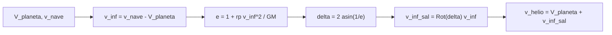

# B75-C06 — Asistencias gravitacionales

<!-- nav:top -->
[🏠 Programa](../../../../README.md) · [📚 Bloque B75](../../../tronco-comun/B75-trayectorias-y-misiones-interplanetarias.md) · [← Anterior: B75-C05 — Transferencias bi-elípticas](../B75-C05-transferencias-bi-elipticas/CLASE.md) · [Siguiente: B75-C07 — Sobrevuelos planetarios →](../B75-C07-sobrevuelos-planetarios/CLASE.md)
<!-- /nav -->

## 1. Ubicación, nivel y alcance

Clase 6 del bloque B75. Nivel N3. Hasta ahora la velocidad de la nave solo cambiaba con motores. Un sobrevuelo planetario cambia la velocidad **heliocéntrica** sin gastar propulsante: el planeta gira el vector de velocidad relativa y, como el planeta se mueve, el giro se traduce en un cambio de velocidad respecto al Sol. Aquí lo calculas con cónicas empalmadas y lo verificas con Kepler y RK4.

## 2. Por qué esta clase existe

Un cohete que sale de la Tierra no puede llevar combustible para ir a Júpiter con una trayectoria directa de baja energía y además frenar. La decisión central: **¿cuánta velocidad heliocéntrica puede ganar o perder una nave pasando cerca de un planeta, y de qué depende?**

## 3. Lo que podrás hacer al terminar

1. Calcular el exceso hiperbólico `v∞` de llegada a un planeta como diferencia de velocidades.
2. Calcular la excentricidad y el ángulo de giro `δ = 2 arcsin(1/e)` de un sobrevuelo.
3. Rotar el vector `v∞` y obtener la velocidad heliocéntrica de salida.
4. Calcular el cambio de energía con `Δ(v²) = 2 V v∞ (1 − cos δ)` para un planeta en órbita circular.
5. Distinguir el sobrevuelo que acelera del que frena según el sentido relativo.
6. Separar lo consultado de lo ilustrativo y lo estándar.

La evidencia es tu **triángulo de velocidades de un sobrevuelo** del ejercicio 12 (sección 20).

## 4. Con qué llegas y cómo comprobarlo

1. ¿Qué es un exceso hiperbólico `v∞`?
2. ¿Qué es la excentricidad de una hipérbola?
3. ¿Qué es un cambio de marco de referencia?
4. ¿Qué es la energía específica de una órbita?
5. ¿Qué es una cónica empalmada?

<details>
<summary>Ver respuestas</summary>

1. La velocidad respecto al planeta lejos de él; se conserva en un sobrevuelo (B75-C01). 2. Un número `e > 1` que describe su apertura; a mayor `e`, menor giro. 3. Restar o sumar la velocidad del planeta para pasar del marco heliocéntrico al del planeta. 4. `ε = v²/2 − μ/r`, constante en dos cuerpos. 5. Una trayectoria formada por arcos de dos cuerpos (heliocéntrico, planetocéntrico) unidos en la esfera de influencia.
</details>

Con cuatro o cinco aciertos, sigue; si no, repasa los prerrequisitos.

## 5. Un caso de contexto y casos de referencia

Una nave llega a Júpiter por una elipse de Hohmann desde la Tierra: lleva `7,4134 km/s` y el planeta `13,0567 km/s`, de modo que `v∞ = 5,6433 km/s`. Pasando a `5 R_J` del centro, `e = 1,090`, `δ = 133,14°` y la nave sale con `17,4095 km/s` heliocéntricos: gana `9,996 km/s` sin gastar propulsante. Es el **ejemplo conductor**. Es un caso ilustrativo y no corresponde a ninguna misión. La NASA explica que la nave en la asistencia no siente aceleración, sino una caída continua, y que el vuelo de Galileo por Ío ahorró 90 kg de propulsante de inserción en Júpiter [S5].

## 6. Vocabulario

Un **sobrevuelo** (o asistencia gravitacional) es el paso de una nave cerca de un planeta. El **ángulo de giro** `δ` es lo que se desvía `v∞`. El **periapsis** es el punto de máxima aproximación. El planeta cede o recibe una energía despreciable; la nave recibe o cede una grande. Un sobrevuelo es **acelerador** si `v∞` queda más alineado con la velocidad del planeta y **frenador** si queda menos.

## 7. Modelo mental: rebotar contra un tren en movimiento



*Descripción textual:* La velocidad relativa se calcula restando la del planeta, se rota por el ángulo que fija el periapsis y se suma de nuevo la velocidad del planeta.

Analogía: una pelota que rebota contra un tren en movimiento: sale más rápida respecto al andén porque el tren se mueve. Límite: la nave no choca, se curva por gravedad, y el planeta no es rígido ni uniforme.

## 8. La explicación, paso a paso

### 8.1 El giro

`e = 1 + r_p v∞²/GM` y `δ = 2 arcsin(1/e)`. Con `GM_J = G M_J = 1,26687×10⁸ km³/s²` (masa y radio de las fichas [S1, S4]) y `r_p = 5 R_J = 357 460 km`: `e = 1,090`, `δ = 133,14°`.

### 8.2 Velocidad heliocéntrica de salida

Se rota `v∞` por `δ` y se suma `V_J = 13,0567 km/s`. El módulo de `v∞` no cambia; el heliocéntrico sí. La energía satisface `v²_sal − v²_ent = 2 V v∞ (1 − cos δ)` cuando `v∞` entra antiparalelo a `V`.

### 8.3 Dos casos

| Planeta | `v∞` (km/s) | `r_p` | `e` | `δ` (°) | `|v|` entra → sale (km/s) | `Δ|v|` | afelio / perihelio nuevos (au) |
|---|---|---|---|---|---|---|---|
| Júpiter | 5,6433 | 2 R_J | 1,036 | 149,726 | 7,4134 → 18,1546 | +10,741 | 151,071 / 5,072 |
| Júpiter | 5,6433 | 5 R_J | 1,090 | 133,141 | 7,4134 → 17,4095 | +9,996 | 41,986 / 4,874 |
| Júpiter | 5,6433 | 10 R_J | 1,180 | 115,917 | 7,4134 → 16,3319 | +8,919 | 19,364 / 4,540 |
| Venus | 2,7065 | 1,05 R_V | 1,143 | 122,013 | 37,7270 → 33,6641 | −4,063 | 0,741 / 0,604 |
| Venus | 2,7065 | 1,5 R_V | 1,205 | 112,216 | 37,7270 → 34,0894 | −3,638 | 0,749 / 0,625 |
| Venus | 2,7065 | 3 R_V | 1,409 | 90,394 | 37,7270 → 35,1063 | −2,621 | 0,783 / 0,671 |

Júpiter acelera porque la nave llega más lenta que el planeta; Venus frena porque la nave, que viene de la Tierra, llega más rápida que Venus [S2, S3]. Pasar «por delante» o «por detrás» cambia la dirección de salida (hacia afuera o hacia adentro del Sistema Solar), no el módulo ganado en el plano.

### 8.4 Qué verifica el laboratorio

(1) `|v∞|` antes y después difiere en menos de `10⁻¹² km/s`. (2) El giro por la fórmula (`133,141291°`) coincide con el obtenido propagando con Kepler hasta ±2×10⁴ y ±4×10⁴ d y extrapolando (`133,141293°`). (3) RK4 y Kepler coinciden tras 20 d de sobrevuelo (menos de 10 km). La velocidad de escape heliocéntrica a 5,2 au, `√2·13,0567 = 18,4649 km/s`, no se alcanza ni rozando la superficie de Júpiter (`18,422 km/s`).

## 9. Magnitudes, símbolos y unidades

| Símbolo | Qué es | Unidad | Valor / nota |
|---|---|---|---|
| `v∞` | exceso hiperbólico | km/s | 5,6433 (Júpiter) |
| `e` | excentricidad de la hipérbola | — | 1,090 |
| `δ` | ángulo de giro | ° | 133,14 |
| `GM` | parámetro gravitacional del planeta | km³/s² | 1,26687×10⁸ (G·M) |
| `V` | velocidad orbital del planeta | km/s | 13,0567 |
| `Δ|v|` | cambio de velocidad heliocéntrica | km/s | +9,996 |

## 10. Convenciones y referencias

Marco heliocéntrico plano; órbita planetaria circular; `v∞` en el marco del planeta; sentido antihorario positivo. `GM = G·M` con `G = 6,67430×10⁻¹¹ m³ kg⁻¹ s⁻²` (registro de cambios de la página del JPL) y masas de las fichas NSSDC: la tabla de parámetros del JPL no lista GM. Distancias de periapsis elegidas por el ejercicio.

## 11. De dónde sale lo que afirmamos

| ID | Fuente | Localizador | Respalda | Estado |
|---|---|---|---|---|
| S1 | NASA/NSSDC, Jupiter Fact Sheet — https://nssdc.gsfc.nasa.gov/planetary/factsheet/jupiterfact.html (consultada 2026-11-10) | página leída | semieje 778,479×10⁶ km, periodo sideral 4332,589 d, excentricidad 0,0487, inclinación 1,304°, velocidad media 13,06 km/s, masa 1898,13×10²⁴ kg, radio medio 69 911 km | Consultada |
| S2 | NASA/NSSDC, Venus Fact Sheet — https://nssdc.gsfc.nasa.gov/planetary/factsheet/venusfact.html (consultada 2026-11-10) | página leída | semieje 108,210×10⁶ km, periodo sideral 224,701 d, excentricidad 0,0068, inclinación 3,395°, velocidad media 35,02 km/s, masa 4,8673×10²⁴ kg, radio medio 6051,8 km | Consultada |
| S3 | NASA/NSSDC, Earth Fact Sheet — https://nssdc.gsfc.nasa.gov/planetary/factsheet/earthfact.html (consultada 2026-11-10) | página leída | semieje 149,598×10⁶ km, periodo sideral 365,256 d, excentricidad 0,0167, velocidad orbital media 29,78 km/s, masa 5,9722×10²⁴ kg, radio medio 6371,000 km, velocidad de escape 11,186 km/s | Consultada |
| S4 | NASA JPL SSD, Planetary Physical Parameters — https://ssd.jpl.nasa.gov/planets/phys_par.html (consultada 2026-11-10) | página leída | radios ecuatoriales (Venus 6051,8 km; Tierra 6378,1366 km; Marte 3396,19 km; Júpiter 71 492 km) y la constante G = 6,67430×10⁻¹¹ m³ kg⁻¹ s⁻² citada en su registro de cambios. La página no lista GM: aquí GM = G·M con las masas de las fichas NSSDC | Consultada |
| S5 | NASA, Basics of Space Flight, cap. 4 «Interplanetary Trajectories» — https://science.nasa.gov/learn/basics-of-space-flight/chapter4-1/ (consultada 2026-11-10) | página leída | transferencia de Hohmann como ruta de menor propulsante; oportunidades mínimas de energía a Marte cada ~25 meses y a Venus cada ~19 meses; la asistencia gravitacional cambia la velocidad heliocéntrica y deja la relativa en módulo; el vuelo de Galileo por Ío redujo el propulsante de inserción en 90 kg | Consultada |
| S6 | NASA, Europa Clipper (página de la misión) — https://science.nasa.gov/mission/europa-clipper/ (consultada 2026-11-10) | página leída | lanzamiento el 14 de octubre de 2024 en Falcon Heavy; sobrevuelo de Marte en 2025 y de la Tierra el 3 de diciembre de 2026; llegada a Júpiter en abril de 2030; 49 sobrevuelos cercanos de Europa; unos 2,9 mil millones de km hasta Júpiter | Consultada |
| — | Valores estándar (no consultados en una fuente concreta de esta clase) | — | GM☉ = 1,32712440×10¹¹ km³/s² (valor estándar, ver la resolución IAU 2015 B3 de la fila anterior donde se cita); 1 au = 149 597 870,7 km; c = 299 792,458 km/s; g₀ = 9,80665 m/s²; ecuaciones de dos cuerpos | No consultada en una fuente concreta |

Límites: los GM se calculan, no se leyeron; las fichas dan las masas; el radio de Júpiter (71 492 km) y de Venus (6051,8 km) vienen de la página de parámetros físicos [S4]; no se consultaron las trayectorias de Galileo, Voyager ni Cassini más allá de lo que dice la página de NASA citada; los casos son ilustrativos.

## 12. Cómo ver el triángulo de velocidades

| Vector | Antes | Después |
|---|---|---|
| `v∞` (módulo) | 5,6433 km/s | 5,6433 km/s |
| `v` heliocéntrica | 7,4134 km/s | 17,4095 km/s |
| Dirección de `v∞` | opuesta a `V` | girada 133,14° |

Descripción larga: el vector `v∞` mantiene su longitud y gira; al sumarle `V` (que no cambia) el vector heliocéntrico resultante es más largo.

## 13. Ejemplo trabajado: Júpiter a 5 R_J

**Paso 1 · v∞.** `13,0567 − 7,4134 = 5,6433 km/s`.

**Paso 2 · Excentricidad.** `e = 1 + 357 460×31,846/1,26687×10⁸ = 1,090`.

**Paso 3 · Giro.** `δ = 2 arcsin(1/1,090) = 133,14°`.

**Paso 4 · Energía.** `Δ(v²) = 2·13,0567·5,6433·(1 − cos 133,14°) = 248`, de modo que `v_sal = √(54,96 + 248) = 17,41 km/s`.

## 14. Distintas formas de abordar el problema

**Por vectores:** rotar `v∞` y sumar `V`. **Por energía:** `Δ(v²) = 2 V v∞ (1 − cos δ)`. **Por Kepler hiperbólico:** el ángulo entre asíntotas confirma `δ`. **Por RK4:** integra el sobrevuelo directamente.

## 15. Práctica guiada

**Ejercicio 1 · con los pasos indicados.** Calcula `v∞` de llegada a Júpiter. *Pasos:* resta la velocidad de la nave de la del planeta (el ejemplo da `7,4134` y `13,0567`).

<details><summary>Solución comentada</summary>

`5,6433 km/s`.
</details>

**Ejercicio 2 · con una pista.** Calcula `e` y `δ` para `r_p = 5 R_J`. *Pista:* `GM_J = 1,26687×10⁸`.

<details><summary>Solución comentada</summary>

`e = 1,090`; `δ = 133,14°`.
</details>

**Ejercicio 3 · casi autónomo.** Calcula el aumento de velocidad heliocéntrica con la identidad de energía.

<details><summary>Solución comentada</summary>

`Δ(v²) = 248,0`; `v_sal = 17,41 km/s`; `Δ|v| = +9,996 km/s`.
</details>

## 16. Práctica autónoma, transferencia e integrador

**Ejercicio 4 · autónomo.** Calcula `δ` para Venus con `r_p = 1,5 R_V` (`v∞ = 2,7065 km/s`, `GM_V = 3,2486×10⁵`).

<details><summary>Solución comentada</summary>

`e = 1,205`; `δ = 112,2°`.
</details>

**Ejercicio 5 · autónomo.** Con `δ = 112,2°` y `cos δ = −0,377`, calcula `v²_sal − v²_ent` en Venus (`V = 35,02`).

<details><summary>Solución comentada</summary>

`2·35,02·2,7065·(−0,377 − 1) = −261`: la nave frena.
</details>

**Ejercicio 6 · autónomo.** ¿Por qué la nave que llega más rápida que el planeta frena?

<details><summary>Solución comentada</summary>

Porque `v∞` está alineado con `V`; al girar, su componente en la dirección de `V` disminuye.
</details>

**Ejercicio 7 · autónomo.** ¿Alcanza la nave la velocidad de escape del Sistema Solar si pasa rozando Júpiter (`R_J`)?

<details><summary>Solución comentada</summary>

No: sale con `18,42 km/s` frente a `18,46 km/s` de escape a 5,2 au.
</details>

**Ejercicio 8 · autónomo.** ¿Cuánto cambia la velocidad de Júpiter al ceder energía a una nave de 1000 kg?

<details><summary>Solución comentada</summary>

Por conservación del momento, `m·Δv/M ≈ 1000×9,996/1,898×10²⁷ = 5×10⁻²⁴ km/s`: nada medible.
</details>

**Ejercicio 9 · transferencia.** La página de Europa Clipper indica un sobrevuelo de Marte en 2025 y de la Tierra el 3 de diciembre de 2026 [S6]. ¿Qué papel cumplen?

<details><summary>Solución comentada</summary>

Aportan energía heliocéntrica a la nave sin consumir propulsante; cómo se reparte entre ambos no se consultó.
</details>

**Ejercicio 10 · transferencia.** ¿Por qué la asistencia no viola la conservación de la energía?

<details><summary>Solución comentada</summary>

La energía se toma o se cede al movimiento orbital del planeta, cuyo cambio es despreciable por su masa enorme (ejercicio 8).
</details>

**Ejercicio 11 · transferencia.** Un diseñador quiere «más giro» con una nave más lenta respecto al planeta. ¿Cómo influye `v∞`?

<details><summary>Solución comentada</summary>

Para igual `r_p`, `e` crece con `v∞²`, y `δ` baja: a mayor `v∞` hay menos giro, pero la ganancia depende también de `V`.
</details>

**Ejercicio 12 · integrador.** Elabora tu *triángulo de velocidades de un sobrevuelo* para el planeta y el `r_p` que elijas: `v∞`, `e`, `δ`, velocidades heliocéntricas, `Δ|v|` y la verificación por energía.

<details><summary>Solución comentada</summary>

Secciones 8.1–8.4 y la salida del laboratorio.
</details>

## 17. Laboratorio: sobrevuelos de Júpiter y Venus

El script [asistencia.py](asistencia.py) calcula `v∞`, `e`, `δ`, la velocidad heliocéntrica y los nuevos afelio y perihelio para tres periapsis en Júpiter y Venus, y **comprueba** `|v∞|` conservado, el giro de la fórmula contra Kepler a gran distancia y RK4 contra Kepler.

**Datos:** semiejes, masas y radios de fichas NASA/NSSDC y JPL (consultados); `G` del registro del JPL; `GM = G·M` calculado; periapsis y llegada por Hohmann **ilustrativos**. **Predice antes de ejecutar:** ¿Frena o acelera el sobrevuelo de Venus? (frena.) **Ejecución del 2026-11-10 (Python 3.12.9):**

```text
Python 3.12.9 (biblioteca estandar)
Planeta  rp [R_p]   e      giro [grados]  |v| antes -> despues [km/s]   dv helio [km/s]   afelio [au]  perihelio [au]
Jupiter: V_planeta = 13.0567 km/s ; v_nave = 7.4134 km/s ; v_inf = 5.6433 km/s ; GM = 126686890.6 km3/s2
Jupiter    2.00    1.036     149.726     7.4134 ->  18.1546            10.7412      151.071        5.072
Jupiter    5.00    1.090     133.141     7.4134 ->  17.4095             9.9961       41.986        4.874
Jupiter   10.00    1.180     115.917     7.4134 ->  16.3319             8.9185       19.364        4.540
Venus: V_planeta = 35.0205 km/s ; v_nave = 37.7270 km/s ; v_inf = 2.7065 km/s ; GM = 324858.2 km3/s2
Venus      1.05    1.143     122.013    37.7270 ->  33.6641            -4.0629        0.741        0.604
Venus      1.50    1.205     112.216    37.7270 ->  34.0894            -3.6376        0.749        0.625
Venus      3.00    1.409      90.394    37.7270 ->  35.1063            -2.6206        0.783        0.671
Prueba 2: giro entre asintotas (Kepler, +/-2e4 y 4e4 d, extrapolado) = 133.141293 grados ; formula = 133.141291 grados
Prueba 3: |RK4 - Kepler| tras 20 d = 0.0000 km
Pruebas superadas.
```

```bash
python programa/clases/B75/B75-C06-asistencias-gravitacionales/asistencia.py
```

**Límites:** plano único, planeta en órbita circular, sin radiación ni perturbaciones; el análisis de dos cuerpos no es una trayectoria de misión.

## 18. Errores frecuentes y cómo corregirlos

**Creer que el módulo de `v∞` cambia.** Se corrige con 8.4.

**Olvidar sumar `V` al volver al marco heliocéntrico.** Se corrige con 8.2.

**Pensar que la energía sale de la nada.** Se corrige con el ejercicio 8.

**Tomar los casos como trayectorias de misiones reales.** Se corrige con la sección 10.

## 19. Cómo sabrás que vas bien

Tras 8.1: ¿qué `δ` obtuviste para `5 R_J`? Tras el laboratorio: ¿qué tres cosas verifica? (ver la sección 17).

## 20. Qué entregas y cómo se evalúa

El producto es tu **triángulo de velocidades de un sobrevuelo** (ejercicio 12).

| Criterio | Inicial | En desarrollo | Logrado | Destacado |
|---|---|---|---|---|
| Conceptos | Cree que gasta combustible | Define `δ` y `v∞` | Calcula la ganancia | Explica el acelerador y el frenador |
| Cálculo | Sin unidades | Con errores | Tabla completa | Calcula casos nuevos |
| Numérico | Sin comprobar | Una prueba | Tres pruebas | Interpreta las tolerancias |
| Fuentes | Sin fuente | Sin fecha | Fuentes con fecha y estado | Declara lo calculado (GM) |
| Límites | No los nombra | Uno | Tres | Discute el modelo plano |

**Condiciones críticas (no se compensan con promedio):** rotular los casos como ilustrativos; no presentar el resultado como una misión real; citar solo lo consultado.

## 21. Ética, seguridad y límites

Clase educativa: los modelos son simplificados (órbitas planetarias circulares y coplanares, dos cuerpos) y sus datos son consultados, sintéticos o ilustrativos y están rotulados; ningún resultado es una efeméride, una medición ni un diseño de misión real. Un sobrevuelo real exige un análisis de riesgo (radiación, anillos, incertidumbre de apuntado) que esta clase no hace. Accesibilidad: tablas equivalentes a las gráficas, fórmulas en texto, ejercicios sin conexión.

## 22. Para cerrar y seguir

Un sobrevuelo de Júpiter a `5 R_J` sube la velocidad heliocéntrica en `9,996 km/s` en el modelo. Queda una pregunta: ¿cómo es la geometría de la hipérbola que se recorre?

**Glosario español–inglés.** asistencia gravitacional · *gravity assist*; sobrevuelo · *flyby*; ángulo de giro · *turn angle*; periapsis · *periapsis*; esfera de influencia · *sphere of influence*.

**Continuidad.** [B75-C07](../B75-C07-sobrevuelos-planetarios/CLASE.md) detalla la geometría de la hipérbola.

**Referencias:** ver sección 11.

<!-- nav:bottom -->
---

[← Anterior: B75-C05 — Transferencias bi-elípticas](../B75-C05-transferencias-bi-elipticas/CLASE.md) · [📚 Bloque B75](../../../tronco-comun/B75-trayectorias-y-misiones-interplanetarias.md) · [Siguiente: B75-C07 — Sobrevuelos planetarios →](../B75-C07-sobrevuelos-planetarios/CLASE.md)
<!-- /nav -->
