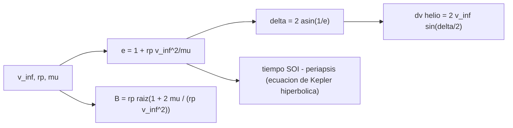

# B75-C07 — Sobrevuelos planetarios

<!-- nav:top -->
[🏠 Programa](../../../../README.md) · [📚 Bloque B75](../../../tronco-comun/B75-trayectorias-y-misiones-interplanetarias.md) · [← Anterior: B75-C06 — Asistencias gravitacionales](../B75-C06-asistencias-gravitacionales/CLASE.md) · [Siguiente: B75-C08 — Secuencias múltiples de sobrevuelos →](../B75-C08-secuencias-multiples-de-sobrevuelos/CLASE.md)
<!-- /nav -->

## 1. Ubicación, nivel y alcance

Clase 7 del bloque B75. Nivel N3. La clase C06 trató el sobrevuelo como una caja negra que gira `v∞`. Aquí abres la caja: la nave recorre una hipérbola alrededor del planeta. Calculas su semieje, excentricidad, velocidad en el periapsis, parámetro de impacto y el tiempo que pasa dentro de la esfera de influencia, con un sobrevuelo sintético de la Tierra y comprobaciones con Kepler.

## 2. Por qué esta clase existe

Para apuntar una nave a un sobrevuelo hay que saber a qué distancia pasará, a qué velocidad y cuánto tiempo estará bajo la influencia del planeta. La decisión central: **¿qué hipérbola corresponde a un `v∞` y una altitud de periapsis dados, y cuánto cambia la velocidad heliocéntrica?**

## 3. Lo que podrás hacer al terminar

1. Calcular el semieje `a = −μ/v∞²` y la excentricidad `e = 1 + r_p v∞²/μ` de la hipérbola.
2. Calcular la velocidad en el periapsis y el parámetro de impacto `B`.
3. Calcular el giro `δ` y el cambio heliocéntrico `|Δv| = 2 v∞ sin(δ/2)`.
4. Calcular el radio de la esfera de influencia y el tiempo dentro de ella.
5. Verificar la hipérbola con Kepler.
6. Separar lo consultado (masa, radio, semieje) de lo sintético (`v∞`, altitud).

La evidencia es tu **ficha geométrica de un sobrevuelo** del ejercicio 12 (sección 20).

## 4. Con qué llegas y cómo comprobarlo

1. ¿Qué es la excentricidad de una hipérbola?
2. ¿Qué es el semieje de una hipérbola?
3. ¿Qué es el parámetro de impacto?
4. ¿Qué es la esfera de influencia?
5. ¿Qué es `v∞`?

<details>
<summary>Ver respuestas</summary>

1. `e > 1`; mide la apertura; `e = 1/sin(δ/2)`. 2. Se toma negativo: `a = −μ/v∞²`; su módulo da la escala. 3. La distancia entre el planeta y la asíntota de entrada. 4. La región donde el planeta domina el movimiento de la nave frente al Sol. 5. La velocidad relativa al planeta lejos de él (B75-C06).
</details>

Con cuatro o cinco aciertos, sigue; si no, repasa los prerrequisitos.

## 5. Un caso de contexto y casos de referencia

Un sobrevuelo sintético de la Tierra con `v∞ = 3,0 km/s` a `500 km` de altitud tiene `r_p = 6871 km`, `e = 1,1551`, `δ = 119,925°`, `v_p = 11,1814 km/s` y `B = 25 609 km`; cambia la velocidad heliocéntrica en `5,194 km/s` y la nave pasa `6,224 d` dentro de la esfera de influencia. Es el **ejemplo conductor**. Todo es sintético: la ficha de la Tierra solo aporta la masa y el radio medio [S1].

## 6. Vocabulario

La **hipérbola de aproximación** es la trayectoria de la nave en el marco del planeta. El **semieje** `a = −μ/v∞²` es negativo. El **parámetro de impacto** `B = r_p√(1 + 2μ/(r_p v∞²))` es la distancia perpendicular entre el centro y la asíntota. La **esfera de influencia** tiene radio `r_SOI = a_p (m/M)^{2/5}`. Un **sobrevuelo** termina cuando la nave sale de ella.

## 7. Modelo mental: una curva que se abre



*Descripción textual:* Con `v∞`, `r_p` y `μ` se obtienen la excentricidad, el giro, el parámetro de impacto, el tiempo hasta el periapsis y el cambio de velocidad heliocéntrica.

Analogía: una curva en una autopista: cuanto más cerca pasa del centro, más cierra. Límite: la hipérbola es de dos cuerpos; el Sol y la Luna perturban en el borde de la esfera.

## 8. La explicación, paso a paso

### 8.1 Elementos de la hipérbola

Con `μ = G M = 398 602,54 km³/s²` (masa de la ficha y `G` del JPL [S1, S2]) y `v∞ = 3,0 km/s`: `a = −μ/v∞² = −44 289 km`. A `500 km` de altitud (`R = 6371 km`), `r_p = 6871 km`, `e = 1 + 6871×9/398 602,54 = 1,1551`, `δ = 2 arcsin(1/e) = 119,925°`, `v_p = √(v∞² + 2μ/r_p) = 11,1814 km/s` y `B = |a|√(e² − 1) = 25 609 km`.

### 8.2 Cuatro altitudes

| Altitud (km) | `r_p` (km) | `e` | `δ` (°) | `v_p` (km/s) | `B` (km) | `|Δv_helio|` (km/s) |
|---|---|---|---|---|---|---|
| 200 | 6571 | 1,1484 | 121,104 | 11,4159 | 25 005 | 5,2248 |
| 500 | 6871 | 1,1551 | 119,925 | 11,1814 | 25 609 | 5,1942 |
| 2000 | 8371 | 1,1890 | 114,500 | 10,2095 | 28 488 | 5,0462 |
| 10 000 | 16 371 | 1,3696 | 93,793 | 7,5958 | 41 450 | 4,3807 |

### 8.3 Dentro de la esfera de influencia

`r_SOI = a_T (m_T/M_☉)^{2/5} = 924 650 km` (145,1 `R_T`), con `M_☉ = GM_☉/G = 1,9884×10³⁰ kg`. El tiempo del borde al periapsis sale de la ecuación hiperbólica de Kepler, `t = √(|a|³/μ)(e sinh H − H)` con `cosh H = (1 + r/|a|)/e`: `3,112 d`. En total, `6,224 d` dentro de la esfera. La velocidad en el borde es `3,1404 km/s`.

### 8.4 Verificaciones

`B` por dos fórmulas coincide con error relativo menor que `10⁻⁹`. La propagación de Kepler desde el periapsis durante `3,112 d` llega a `924 649,546 km`, igual al radio de la esfera dentro de 1 m. Además, `|Δv| = 2 v∞ sin(δ/2)` coincide con la diferencia de vectores dentro de `10⁻¹²`.

## 9. Magnitudes, símbolos y unidades

| Símbolo | Qué es | Unidad | Valor / nota |
|---|---|---|---|
| `a` | semieje de la hipérbola | km | −44 289 |
| `e` | excentricidad | — | 1,1551 |
| `B` | parámetro de impacto | km | 25 609 |
| `v_p` | velocidad en el periapsis | km/s | 11,1814 |
| `r_SOI` | radio de la esfera de influencia | km | 924 650 |
| `t_SOI` | tiempo en la esfera | d | 6,224 |

## 10. Convenciones y referencias

Marco geocéntrico; `v∞` y altitudes sintéticos; masa y radio medio de la ficha NSSDC; `G` del registro de cambios del JPL. `GM_Tierra` calculado es `398 602,54 km³/s²`, ligeramente distinto del valor definido por las misiones (`398 600,44`, no consultado) por redondear la masa; la diferencia relativa `5×10⁻⁶` no afecta a esta clase. Sin atmósfera, Sol ni Luna.

## 11. De dónde sale lo que afirmamos

| ID | Fuente | Localizador | Respalda | Estado |
|---|---|---|---|---|
| S1 | NASA/NSSDC, Earth Fact Sheet — https://nssdc.gsfc.nasa.gov/planetary/factsheet/earthfact.html (consultada 2026-11-10) | página leída | semieje 149,598×10⁶ km, periodo sideral 365,256 d, excentricidad 0,0167, velocidad orbital media 29,78 km/s, masa 5,9722×10²⁴ kg, radio medio 6371,000 km, velocidad de escape 11,186 km/s | Consultada |
| S2 | NASA JPL SSD, Planetary Physical Parameters — https://ssd.jpl.nasa.gov/planets/phys_par.html (consultada 2026-11-10) | página leída | radios ecuatoriales (Venus 6051,8 km; Tierra 6378,1366 km; Marte 3396,19 km; Júpiter 71 492 km) y la constante G = 6,67430×10⁻¹¹ m³ kg⁻¹ s⁻² citada en su registro de cambios. La página no lista GM: aquí GM = G·M con las masas de las fichas NSSDC | Consultada |
| S3 | NASA, Europa Clipper (página de la misión) — https://science.nasa.gov/mission/europa-clipper/ (consultada 2026-11-10) | página leída | lanzamiento el 14 de octubre de 2024 en Falcon Heavy; sobrevuelo de Marte en 2025 y de la Tierra el 3 de diciembre de 2026; llegada a Júpiter en abril de 2030; 49 sobrevuelos cercanos de Europa; unos 2,9 mil millones de km hasta Júpiter | Consultada |
| — | Valores estándar (no consultados en una fuente concreta de esta clase) | — | GM☉ = 1,32712440×10¹¹ km³/s² (valor estándar, ver la resolución IAU 2015 B3 de la fila anterior donde se cita); 1 au = 149 597 870,7 km; c = 299 792,458 km/s; g₀ = 9,80665 m/s²; ecuaciones de dos cuerpos | No consultada en una fuente concreta |

Límites: no se consultó la altitud de ningún sobrevuelo real; la esfera de influencia es la aproximación de Laplace; la atmósfera terrestre a 200 km no se modeló.

## 12. Cómo ver la hipérbola

| Magnitud | Valor |
|---|---|
| `a` | −44 289 km |
| `e` | 1,1551 |
| `δ` | 119,925° |
| `B` | 25 609 km |
| `t` en la esfera | 6,224 d |

Descripción larga: la hipérbola se abre desde la asíntota de entrada a 25 609 km del centro, pasa a 6871 km y sale por la otra asíntota, girada 120°.

## 13. Ejemplo trabajado: la altitud de 500 km

**Paso 1 · Semieje.** `a = −398 602,54/9 = −44 289 km`.

**Paso 2 · Excentricidad.** `e = 1 + 6871×9/398 602,54 = 1,1551`.

**Paso 3 · Giro.** `δ = 2 arcsin(1/1,1551) = 119,93°`.

**Paso 4 · Cambio helio.** `|Δv| = 2×3,0×sin(59,96°) = 5,194 km/s`.

## 14. Distintas formas de abordar el problema

**Por la geometría de la cónica:** `a`, `e`, `B`. **Por energía:** `v_p² = v∞² + 2μ/r_p`. **Por Kepler:** propagación desde el periapsis. **Por vectores:** la diferencia `v_sal − v_ent` coincide con `2 v∞ sin(δ/2)`.

## 15. Práctica guiada

**Ejercicio 1 · con los pasos indicados.** Calcula `a` para `v∞ = 3 km/s` con `μ = 398 602,54`. *Pasos:* `−μ/v∞²`.

<details><summary>Solución comentada</summary>

`−44 289 km`.
</details>

**Ejercicio 2 · con una pista.** Calcula `e` para `r_p = 6871 km`. *Pista:* `1 + r_p v∞²/μ`.

<details><summary>Solución comentada</summary>

`1,1551`.
</details>

**Ejercicio 3 · casi autónomo.** Calcula `δ` y `|Δv|`.

<details><summary>Solución comentada</summary>

`δ = 119,93°`; `|Δv| = 2 v∞/e = 5,194 km/s`.
</details>

## 16. Práctica autónoma, transferencia e integrador

**Ejercicio 4 · autónomo.** Calcula `v_p` a `500 km` de altitud.

<details><summary>Solución comentada</summary>

`√(9 + 2×398 602,54/6871) = 11,181 km/s`.
</details>

**Ejercicio 5 · autónomo.** Calcula `B` a `2000 km` de altitud con `|a|√(e² − 1)`.

<details><summary>Solución comentada</summary>

`44 289×√(1,1890² − 1) = 28 488 km`.
</details>

**Ejercicio 6 · autónomo.** ¿Por qué `|Δv|` baja al subir la altitud?

<details><summary>Solución comentada</summary>

Porque `e` crece, `δ` baja y `|Δv| = 2 v∞/e` disminuye.
</details>

**Ejercicio 7 · autónomo.** Calcula el máximo `|Δv|` que da la Tierra con `v∞ = 3 km/s` rozando la superficie (`r_p = 6371 km`).

<details><summary>Solución comentada</summary>

`e = 1 + 6371×9/398 602,54 = 1,1439`; `|Δv| = 6/1,1439 = 5,245 km/s`.
</details>

**Ejercicio 8 · autónomo.** ¿Cuántas veces mayor es `r_SOI` que el radio terrestre?

<details><summary>Solución comentada</summary>

`924 650/6371 = 145,1`.
</details>

**Ejercicio 9 · transferencia.** La página de Europa Clipper indica un sobrevuelo de la Tierra el 3 de diciembre de 2026 [S3]. ¿Qué datos necesitarías para su hipérbola?

<details><summary>Solución comentada</summary>

El `v∞` y la altitud del periapsis; la página consultada no los da.
</details>

**Ejercicio 10 · transferencia.** Si la nave apunta con un error de 100 km en `B`, ¿cómo cambia `r_p`?

<details><summary>Solución comentada</summary>

De `B² = r_p² + 2μ r_p/v∞²`, `dB/dr_p = (r_p + μ/v∞²)/B = (6871 + 44 289)/25 609 = 2,0`, así que `r_p` cambia unos 50 km; el apuntado completo se hace en C24.
</details>

**Ejercicio 11 · transferencia.** ¿Qué efecto no modelado puede alterar un periapsis de 200 km?

<details><summary>Solución comentada</summary>

La atmósfera terrestre (arrastre), que frenaría la nave.
</details>

**Ejercicio 12 · integrador.** Elabora tu *ficha geométrica de un sobrevuelo* para el planeta y la altitud que elijas: `a`, `e`, `δ`, `v_p`, `B`, `r_SOI`, `t_SOI` y las verificaciones.

<details><summary>Solución comentada</summary>

Secciones 8.1–8.4 y la salida del laboratorio.
</details>

## 17. Laboratorio: hipérbola de un sobrevuelo terrestre

El script [sobrevuelo.py](sobrevuelo.py) calcula los elementos de la hipérbola para cuatro altitudes, el tiempo en la esfera de influencia y **comprueba** `B` por dos fórmulas, la propagación de Kepler hasta el borde y el cambio de velocidad por vectores.

**Datos:** masa, radio medio y semieje terrestres de la ficha NASA/NSSDC y `G` del JPL (consultados); `v∞` y altitudes **sintéticos**. **Predice antes de ejecutar:** ¿Cuánto dura el sobrevuelo dentro de la esfera de influencia? (6,224 d.) **Ejecución del 2026-11-10 (Python 3.12.9):**

```text
Python 3.12.9 (biblioteca estandar)
GM_Tierra = 398602.54 km3/s2 ; M_sol (de GM_sol/G) = 1.9884e+30 kg ; r_SOI = 924650 km (145.1 R_T)
v_inf = 3.0 km/s (SINTETICO)
 alt [km]   rp [km]    e       giro [grados]   v_p [km/s]   B [km]     |dv helio| [km/s]
     200      6571   1.1484      121.104      11.4159      25005         5.2248
     500      6871   1.1551      119.925      11.1814      25609         5.1942
    2000      8371   1.1890      114.500      10.2095      28488         5.0462
   10000     16371   1.3696       93.793       7.5958      41450         4.3807
Altitud 500 km: tiempo del borde de la SOI al periapsis = 3.112 d ; por Kepler llega a r = 924649.546 km (SOI = 924649.546 km)
Tiempo total dentro de la SOI = 6.224 d ; velocidad en el borde = 3.1404 km/s
Pruebas superadas.
```

```bash
python programa/clases/B75/B75-C07-sobrevuelos-planetarios/sobrevuelo.py
```

**Límites:** dos cuerpos, sin atmósfera ni perturbaciones; la esfera de influencia es una aproximación.

## 18. Errores frecuentes y cómo corregirlos

**Tomar el semieje positivo.** Se corrige con la sección 6.

**Confundir `B` con `r_p`.** Se corrige con 8.1.

**Olvidar la masa solar al calcular la esfera.** Se corrige con 8.3.

**Presentar el caso sintético como una misión.** Se corrige con la sección 10.

## 19. Cómo sabrás que vas bien

Tras 8.1: ¿qué `e` obtuviste? Tras el laboratorio: ¿qué dos formas de `B` se compararon? (ver la sección 17).

## 20. Qué entregas y cómo se evalúa

El producto es tu **ficha geométrica de un sobrevuelo** (ejercicio 12).

| Criterio | Inicial | En desarrollo | Logrado | Destacado |
|---|---|---|---|---|
| Conceptos | Confunde `a` y `r_p` | Define `a`, `e`, `B` | Calcula la hipérbola | Explica la esfera de influencia |
| Cálculo | Sin unidades | Con errores | Tabla completa | Calcula casos nuevos |
| Numérico | Sin comprobar | Una prueba | Tres pruebas | Interpreta la tolerancia de 1 m |
| Fuentes | Sin fuente | Sin fecha | Fuentes con fecha y estado | Declara lo sintético |
| Límites | No los nombra | Uno | Tres | Discute la atmósfera |

**Condiciones críticas (no se compensan con promedio):** rotular `v∞` y la altitud como sintéticos; no presentar el caso como una misión; citar solo lo consultado.

## 21. Ética, seguridad y límites

Clase educativa: los modelos son simplificados (órbitas planetarias circulares y coplanares, dos cuerpos) y sus datos son consultados, sintéticos o ilustrativos y están rotulados; ningún resultado es una efeméride, una medición ni un diseño de misión real. Un periapsis bajo exige análisis de riesgo (atmósfera, basura espacial); esta clase no lo hace. Accesibilidad: tablas equivalentes a las gráficas, fórmulas en texto, ejercicios sin conexión.

## 22. Para cerrar y seguir

Una hipérbola con `e = 1,1551` gira `119,9°` y mantiene la nave `6,2 d` en la esfera terrestre. Queda una pregunta: ¿cómo se encadenan varios sobrevuelos?

**Glosario español–inglés.** hipérbola · *hyperbola*; parámetro de impacto · *impact parameter*; esfera de influencia · *sphere of influence*; periapsis · *periapsis*; asíntota · *asymptote*.

**Continuidad.** [B75-C08](../B75-C08-secuencias-multiples-de-sobrevuelos/CLASE.md) encadena sobrevuelos con el criterio de Tisserand.

**Referencias:** ver sección 11.

<!-- nav:bottom -->
---

[← Anterior: B75-C06 — Asistencias gravitacionales](../B75-C06-asistencias-gravitacionales/CLASE.md) · [📚 Bloque B75](../../../tronco-comun/B75-trayectorias-y-misiones-interplanetarias.md) · [Siguiente: B75-C08 — Secuencias múltiples de sobrevuelos →](../B75-C08-secuencias-multiples-de-sobrevuelos/CLASE.md)
<!-- /nav -->
