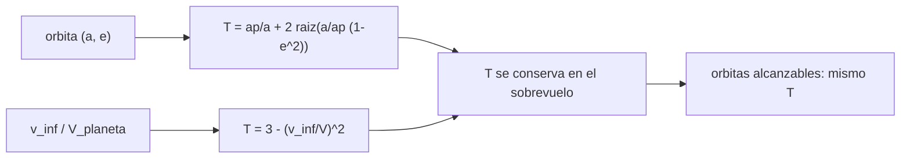

# B75-C08 — Secuencias múltiples de sobrevuelos

<!-- nav:top -->
[🏠 Programa](../../../../README.md) · [📚 Bloque B75](../../../tronco-comun/B75-trayectorias-y-misiones-interplanetarias.md) · [← Anterior: B75-C07 — Sobrevuelos planetarios](../B75-C07-sobrevuelos-planetarios/CLASE.md) · [Siguiente: B75-C09 — Presupuestos de delta-v →](../B75-C09-presupuestos-de-delta-v/CLASE.md)
<!-- /nav -->

## 1. Ubicación, nivel y alcance

Clase 8 del bloque B75. Nivel N3. Un sobrevuelo conserva `v∞`; una cadena de sobrevuelos cambia de planeta en planeta, y cada uno limita qué órbitas se pueden alcanzar. El criterio de Tisserand resume esa limitación en un solo número por planeta: si `T` se conserva en un sobrevuelo, las órbitas alcanzables desde una dada son las que tienen el mismo `T`. Lo calculas, lo verificas con 200 sobrevuelos de giro aleatorio y lees qué órbitas son alcanzables con cada `v∞`.

## 2. Por qué esta clase existe

Una misión que usa sobrevuelos de la Tierra, Venus o Júpiter no puede ir a cualquier órbita: depende del `v∞` con el que llega a cada planeta. La decisión central: **¿qué órbitas puede alcanzar una nave con un sobrevuelo de un planeta y cuánto `v∞` hace falta para llegar a una órbita dada?**

## 3. Lo que podrás hacer al terminar

1. Calcular el parámetro de Tisserand `T = a_p/a + 2√((a/a_p)(1 − e²))`.
2. Relacionarlo con el exceso: `T = 3 − (v∞/V_p)²` en el cruce con el planeta.
3. Verificar que un sobrevuelo conserva `T`.
4. Hallar, para un `T` dado, el perihelio de una órbita con un afelio dado.
5. Decidir qué `v∞` hace falta para alcanzar un afelio objetivo.
6. Separar lo consultado (semiejes, excentricidades) de lo ilustrativo (los `v∞` elegidos).

La evidencia es tu **mapa de Tisserand de una secuencia** del ejercicio 12 (sección 20).

## 4. Con qué llegas y cómo comprobarlo

1. ¿Qué conserva un sobrevuelo en el marco del planeta?
2. ¿Qué es la velocidad circular de un planeta?
3. ¿Qué es el afelio y el perihelio?
4. ¿Qué es el semieje mayor?
5. ¿Por qué se rotulan las simplificaciones?

<details>
<summary>Ver respuestas</summary>

1. El módulo de `v∞` (B75-C06). 2. `V_p = √(μ/a_p)`. 3. El punto más lejano y el más cercano al Sol. 4. La mitad de la suma de perihelio y afelio. 5. Porque el criterio supone órbitas planetarias circulares y coplanares.
</details>

Con cuatro o cinco aciertos, sigue; si no, repasa los prerrequisitos.

## 5. Un caso de contexto y casos de referencia

La elipse de Hohmann Tierra–Marte (`a = 1,2619 au`, `e = 0,2075`) tiene `T = 2,99022` respecto a la Tierra, igual a `3 − (2,9452/29,785)²`. Con `v∞ = 3 km/s` en la Tierra, `T = 2,9899`; las órbitas con ese `T` que cruzan la Tierra alcanzan afelios hasta la órbita de Marte (`1,524 au`) con perihelio `0,9990 au` y periodo `1,417 años`, pero no `2 au` [S1, S2]. Es el **ejemplo conductor**.

## 6. Vocabulario

El **parámetro de Tisserand** de una órbita respecto a un planeta es `T = a_p/a + 2√((a/a_p)(1 − e²))` con ambos semiejes en las mismas unidades. Un sobrevuelo lo **conserva** (en el límite de cónicas empalmadas con planeta en órbita circular). Una **cadena de sobrevuelos** es una secuencia de ellos. El **mapa** de Tisserand reúne las curvas de `T` constante de cada planeta.

## 7. Modelo mental: peldaños de una escalera de caracol



*Descripción textual:* Cada órbita tiene un `T` respecto a un planeta; ese `T` equivale a un `v∞`; el sobrevuelo conserva `T`, de modo que las órbitas con igual `T` son las alcanzables.

Analogía: subir una montaña con escalones de altura fija: cada sobrevuelo es un escalón que cambia de órbita sin cambiar el nivel de `T` del planeta. Límite: con otro planeta de la cadena el nivel es distinto, y los sobrevuelos de planetas con órbita excéntrica solo lo conservan aproximadamente.

## 8. La explicación, paso a paso

### 8.1 De la órbita a `T`

Para Tierra–Marte, con `a = (r_T + r_M)/2 = 1,2619 au` y `e = 0,2075`, `a_p/a = 0,7925` y `T = 0,7925 + 2√(1,2619×(1 − 0,04306)) = 2,99022`. En el cruce, la velocidad de la nave es `v_p = 32,730 km/s` y `V_T = 29,785 km/s`, así que `v∞ = 2,9452` y `3 − (2,9452/29,785)² = 2,99022`: coinciden con error menor que `10⁻⁹`.

### 8.2 Órbitas alcanzables desde la Tierra

Para un `T` fijo y un afelio `r_a` dado (en radios terrestres), el perihelio `q` cumple `T = 2/(r_a + q) + 2√(2 r_a q/(r_a + q))`. Resultado:

| `v∞` (km/s) | `T` | afelio 1,2 au | afelio 1,524 au | afelio 2,0 au | afelio 5,2 au |
|---|---|---|---|---|---|
| 2 | 2,9955 | q = 0,9841 | inalcanzable | inalcanzable | inalcanzable |
| 3 | 2,9899 | q = 0,9503 | q = 0,9990 | inalcanzable | inalcanzable |
| 4 | 2,9820 | q = 0,9064 | q = 0,9768 | inalcanzable | inalcanzable |
| 6 | 2,9594 | q = 0,7993 | q = 0,9169 | q = 0,9701 | inalcanzable |

### 8.3 Lectura

Con `v∞ = 3 km/s` la Tierra alcanza el afelio de Marte (hace falta `≥ 2,9452` para Hohmann) y la órbita resultante tiene `a = 1,2615 au` y periodo `1,417 años`. Con `v∞ = 6 km/s` alcanza afelios de `2 au`, pero no `5,2 au`: para Júpiter por Hohmann hace falta `v∞ = 8,7933 km/s` (`T = 2,9128`).

### 8.4 Verificación

200 sobrevuelos de giro aleatorio (semilla 75, giros de ±1,5 rad) cambian la órbita pero `T` varía como máximo `4,4×10⁻¹⁶`.

## 9. Magnitudes, símbolos y unidades

| Símbolo | Qué es | Unidad | Valor / nota |
|---|---|---|---|
| `T` | parámetro de Tisserand | — | 2,99022 |
| `a_p` | semieje del planeta | au | 1 (Tierra) |
| `v∞/V_p` | exceso relativo a la velocidad del planeta | — | 0,0989 |
| `q` | perihelio | au | 0,9990 |
| `r_a` | afelio | au | 1,524 |

## 10. Convenciones y referencias

Planetas en órbitas circulares y coplanares (semiejes de las fichas NASA/NSSDC); distancias en au (1 au = 149 597 870,7 km, valor estándar); `v∞` elegidos por el ejercicio; `μ☉` estándar. La Tierra se trata en su semieje de ficha (149,598×10⁶ km).

## 11. De dónde sale lo que afirmamos

| ID | Fuente | Localizador | Respalda | Estado |
|---|---|---|---|---|
| S1 | NASA/NSSDC, Earth Fact Sheet — https://nssdc.gsfc.nasa.gov/planetary/factsheet/earthfact.html (consultada 2026-11-10) | página leída | semieje 149,598×10⁶ km, periodo sideral 365,256 d, excentricidad 0,0167, velocidad orbital media 29,78 km/s, masa 5,9722×10²⁴ kg, radio medio 6371,000 km, velocidad de escape 11,186 km/s | Consultada |
| S2 | NASA/NSSDC, Mars Fact Sheet — https://nssdc.gsfc.nasa.gov/planetary/factsheet/marsfact.html (consultada 2026-11-10) | página leída | semieje 227,956×10⁶ km, periodo sideral 686,980 d, excentricidad 0,0935, inclinación 1,848°, velocidad media 24,08 km/s, masa 0,64169×10²⁴ kg, radio ecuatorial 3396,2 km, g 3,73 m/s² | Consultada |
| S3 | ESA, Juice factsheet — https://www.esa.int/Science_Exploration/Space_Science/Juice/Juice_factsheet (consultada 2026-11-10) | página leída | lanzamiento el 14 de abril de 2023 en Ariane 5 desde Kourou; asistencias de la Luna–Tierra, Venus y la Tierra; llegada a Júpiter en julio de 2031; tour que termina en órbita de Ganimedes | Consultada |
| S4 | NASA, Basics of Space Flight, cap. 4 «Interplanetary Trajectories» — https://science.nasa.gov/learn/basics-of-space-flight/chapter4-1/ (consultada 2026-11-10) | página leída | transferencia de Hohmann como ruta de menor propulsante; oportunidades mínimas de energía a Marte cada ~25 meses y a Venus cada ~19 meses; la asistencia gravitacional cambia la velocidad heliocéntrica y deja la relativa en módulo; el vuelo de Galileo por Ío redujo el propulsante de inserción en 90 kg | Consultada |
| — | Valores estándar (no consultados en una fuente concreta de esta clase) | — | GM☉ = 1,32712440×10¹¹ km³/s² (valor estándar, ver la resolución IAU 2015 B3 de la fila anterior donde se cita); 1 au = 149 597 870,7 km; c = 299 792,458 km/s; g₀ = 9,80665 m/s²; ecuaciones de dos cuerpos | No consultada en una fuente concreta |

Límites: el criterio se verifica numéricamente en el laboratorio, no en una fuente; la ficha de ESA sobre Juice [S3] indica asistencias de la Luna–Tierra, Venus y la Tierra, pero no se consultó cómo reparten el `v∞`; no se estudia ninguna cadena real.

## 12. Cómo ver las órbitas alcanzables

| Con `v∞ = 3 km/s` en la Tierra | Valor |
|---|---|
| `T` | 2,9899 |
| Afelio máximo útil | 1,524 au (Marte) |
| `q` en ese afelio | 0,9990 au |
| Periodo | 1,417 años |

Descripción larga: a medida que `v∞` crece, la curva de `T` constante se abre y alcanza afelios mayores con perihelios menores.

## 13. Ejemplo trabajado: el T de Hohmann

**Paso 1 · Semieje y excentricidad.** `a = 1,2619 au`, `e = 0,2075`.

**Paso 2 · T.** `0,7925 + 2√(1,2619×0,95694) = 2,99022`.

**Paso 3 · Vía v∞.** `3 − (2,9452/29,785)² = 2,99022`.

**Paso 4 · Conclusión.** Ambas vías coinciden.

## 14. Distintas formas de abordar el problema

**Por elementos:** `T(a, e)`. **Por velocidad:** `T = 3 − (v∞/V)²`. **Por simulación:** 200 sobrevuelos con vectores. **Por mapa:** las curvas de `T` constante en el plano perihelio–afelio.

## 15. Práctica guiada

**Ejercicio 1 · con los pasos indicados.** Calcula `T` para `v∞ = 3 km/s` en la Tierra (`V = 29,785 km/s`). *Pasos:* `3 − (v∞/V)²`.

<details><summary>Solución comentada</summary>

`3 − 0,010146 = 2,98985`.
</details>

**Ejercicio 2 · con una pista.** Con la tabla 8.2, ¿cuál es el perihelio para afelio `1,524 au` con `v∞ = 3 km/s`?

<details><summary>Solución comentada</summary>

`q = 0,9990 au`.
</details>

**Ejercicio 3 · casi autónomo.** Calcula el semieje y el periodo de esa órbita. *Pista:* tercera ley.

<details><summary>Solución comentada</summary>

`a = (1,524 + 0,9990)/2 = 1,2615 au`; `P = 1,2615^1,5 = 1,417 años`.
</details>

## 16. Práctica autónoma, transferencia e integrador

**Ejercicio 4 · autónomo.** Calcula `T` para `v∞ = 6 km/s`.

<details><summary>Solución comentada</summary>

`3 − (6/29,785)² = 2,9594`.
</details>

**Ejercicio 5 · autónomo.** Calcula `T` para el `v∞` de Hohmann a Júpiter (`8,7933 km/s`).

<details><summary>Solución comentada</summary>

`3 − (8,7933/29,785)² = 2,9128`.
</details>

**Ejercicio 6 · autónomo.** Con `v∞ = 6 km/s`, ¿qué periodo tiene la órbita de afelio `1,2 au` y perihelio `0,7993 au`?

<details><summary>Solución comentada</summary>

`a = 0,9997 au`; `P = 0,999 años`: casi una resonancia 1:1 con la Tierra.
</details>

**Ejercicio 7 · autónomo.** ¿Por qué `T` es casi 3 si `v∞` es pequeño?

<details><summary>Solución comentada</summary>

Porque `T = 3 − (v∞/V)²` y la razón `v∞/V` es pequeña.
</details>

**Ejercicio 8 · autónomo.** ¿Puede una nave con `v∞ = 3 km/s` alcanzar el afelio de Marte con la elipse de Hohmann?

<details><summary>Solución comentada</summary>

Sí: Hohmann pide `2,9452 km/s`, menor que `3 km/s`.
</details>

**Ejercicio 9 · transferencia.** La excentricidad de Marte es `0,0935` [S2]. ¿Cómo afecta al criterio?

<details><summary>Solución comentada</summary>

`T` no se conserva exactamente, porque el planeta no está en órbita circular; la violación es del orden de la excentricidad y se corrige con el cálculo completo.
</details>

**Ejercicio 10 · transferencia.** ¿Por qué la ficha de Juice menciona varias asistencias de la Tierra y Venus [S3]?

<details><summary>Solución comentada</summary>

Cada una cambia la órbita dentro del mismo `T` y permite subir el afelio paso a paso; el reparto concreto no se consultó.
</details>

**Ejercicio 11 · transferencia.** Un diseñador quiere alcanzar Júpiter con solo `v∞ = 3 km/s` en la Tierra. ¿Es posible con un sobrevuelo terrestre?

<details><summary>Solución comentada</summary>

No: la tabla 8.2 muestra afelios inalcanzables mayores que `1,524 au`; haría falta pasar por otro planeta o un impulso.
</details>

**Ejercicio 12 · integrador.** Elabora tu *mapa de Tisserand de una secuencia* para un planeta y cuatro `v∞`: `T`, afelios alcanzables, perihelios, periodos y la prueba de conservación.

<details><summary>Solución comentada</summary>

Secciones 8.1–8.4 y la salida del laboratorio.
</details>

## 17. Laboratorio: Tisserand de la Tierra y 200 sobrevuelos

El script [tisserand.py](tisserand.py) calcula `T` para la elipse de Hohmann Tierra–Marte, tabula las órbitas alcanzables desde la Tierra y **comprueba** `T = 3 − (v∞/V)²` y la conservación de `T` en 200 sobrevuelos aleatorios.

**Datos:** semiejes de las fichas NASA/NSSDC (consultados); `v∞` elegidos (**ilustrativos**); giros aleatorios con semilla 75 (**sintéticos**). **Predice antes de ejecutar:** ¿Qué valor de `T` tiene la elipse de Hohmann? (2,99022.) **Ejecución del 2026-11-10 (Python 3.12.9):**

```text
Python 3.12.9 (biblioteca estandar)
Elipse de Hohmann Tierra-Marte: a = 1.2619 au ; e = 0.2075 ; v_inf (Tierra) = 2.9452 km/s ; T_Tierra = 2.99022 ; 3-(v_inf/V)^2 = 2.99022
Tisserand respecto a la Tierra para v_inf = 2, 3, 4, 6 km/s y orbitas que cruzan la Tierra con afelio dado:
 v_inf [km/s]   T      afelio [au]   perihelio [au]   semieje [au]   periodo [anios]
       2.0   2.9955       1.200          0.9841         1.0920          1.141
       2.0   2.9955       1.524   (inalcanzable con este v_inf)
       2.0   2.9955       2.000   (inalcanzable con este v_inf)
       2.0   2.9955       5.200   (inalcanzable con este v_inf)
       3.0   2.9899       1.200          0.9503         1.0751          1.115
       3.0   2.9899       1.524          0.9990         1.2615          1.417
       3.0   2.9899       2.000   (inalcanzable con este v_inf)
       3.0   2.9899       5.200   (inalcanzable con este v_inf)
       4.0   2.9820       1.200          0.9064         1.0532          1.081
       4.0   2.9820       1.524          0.9768         1.2504          1.398
       4.0   2.9820       2.000   (inalcanzable con este v_inf)
       4.0   2.9820       5.200   (inalcanzable con este v_inf)
       6.0   2.9594       1.200          0.7993         0.9996          0.999
       6.0   2.9594       1.524          0.9169         1.2205          1.348
       6.0   2.9594       2.000          0.9701         1.4851          1.810
       6.0   2.9594       5.200   (inalcanzable con este v_inf)
Prueba 2: 200 sobrevuelos de giro aleatorio (semilla 75): max |T - T0| = 4.44e-16
Pruebas superadas.
```

```bash
python programa/clases/B75/B75-C08-secuencias-multiples-de-sobrevuelos/tisserand.py
```

**Límites:** planeta en órbita circular, coplanar; no se modela la excentricidad ni una cadena real.

## 18. Errores frecuentes y cómo corregirlos

**Creer que `T` se conserva con cualquier maniobra.** Se corrige con la sección 6: solo en sobrevuelos.

**Mezclar `T` de distintos planetas.** Se corrige con 8.1.

**Ignorar que el criterio supone órbitas circulares.** Se corrige con el ejercicio 9.

**Interpretar «inalcanzable» como imposible con cualquier ayuda.** Se corrige con el ejercicio 11.

## 19. Cómo sabrás que vas bien

Tras 8.1: ¿qué `T` esperas para Hohmann? Tras el laboratorio: ¿qué máximo de variación de `T` se obtuvo? (ver la sección 17).

## 20. Qué entregas y cómo se evalúa

El producto es tu **mapa de Tisserand de una secuencia** (ejercicio 12).

| Criterio | Inicial | En desarrollo | Logrado | Destacado |
|---|---|---|---|---|
| Conceptos | No distingue `T` y `v∞` | Define `T` | Relaciona `T` y `v∞` | Explica el mapa |
| Cálculo | Sin unidades | Con errores | Tabla completa | Calcula casos nuevos |
| Numérico | Sin comprobar | Una prueba | Dos pruebas | Interpreta `10⁻¹⁶` |
| Fuentes | Sin fuente | Sin fecha | Fuentes con fecha y estado | Declara lo no consultado |
| Límites | No los nombra | Uno | Tres | Discute la excentricidad |

**Condiciones críticas (no se compensan con promedio):** rotular el supuesto de órbitas circulares; no presentar el mapa como una secuencia real; citar solo lo consultado.

## 21. Ética, seguridad y límites

Clase educativa: los modelos son simplificados (órbitas planetarias circulares y coplanares, dos cuerpos) y sus datos son consultados, sintéticos o ilustrativos y están rotulados; ningún resultado es una efeméride, una medición ni un diseño de misión real. Un mapa de Tisserand es un filtro de factibilidad, no un diseño de misión. Accesibilidad: tablas equivalentes a las gráficas, fórmulas en texto, ejercicios sin conexión.

## 22. Para cerrar y seguir

Con `v∞ = 3 km/s` la Tierra deja alcanzar el afelio de Marte con `T = 2,9899`. Queda una pregunta: ¿cuánto delta-v tiene que sumar una misión entera?

**Glosario español–inglés.** parámetro de Tisserand · *Tisserand parameter*; cadena de sobrevuelos · *flyby sequence*; afelio · *aphelion*; perihelio · *perihelion*; resonancia · *resonance*.

**Continuidad.** [B75-C09](../B75-C09-presupuestos-de-delta-v/CLASE.md) suma el delta-v de todas las fases.

**Referencias:** ver sección 11.

<!-- nav:bottom -->
---

[← Anterior: B75-C07 — Sobrevuelos planetarios](../B75-C07-sobrevuelos-planetarios/CLASE.md) · [📚 Bloque B75](../../../tronco-comun/B75-trayectorias-y-misiones-interplanetarias.md) · [Siguiente: B75-C09 — Presupuestos de delta-v →](../B75-C09-presupuestos-de-delta-v/CLASE.md)
<!-- /nav -->
